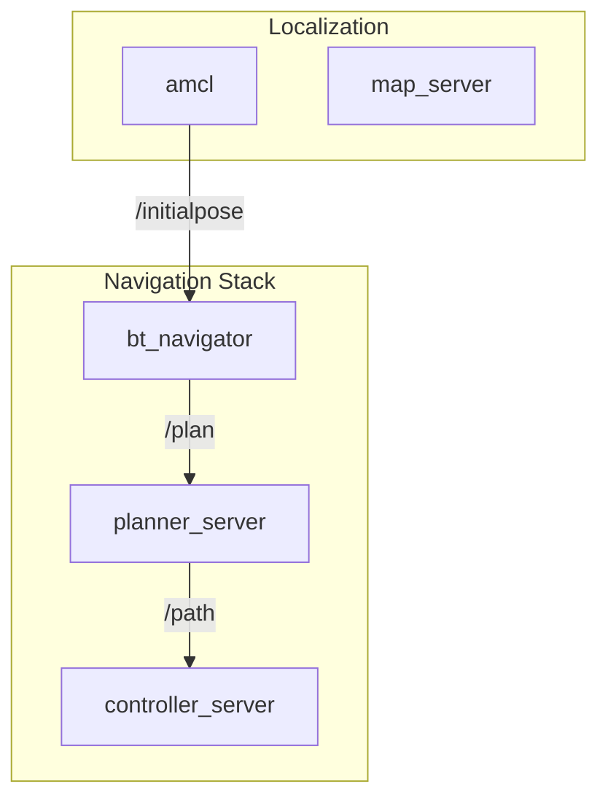

# ArchSynth - Complete Project Documentation & Step-by-Step Guide

> **Last Updated**: 2026-08-11  
> **Project**: M.Tech Dissertation (Automation & Robotics, DIAT)  
> **Status**: Phase 0-2 Complete, Phase 3 In Progress

---

## 📋 TABLE OF CONTENTS

1. [Project Overview](#1-project-overview)
2. [Research Context & Gap](#2-research-context--gap)
3. [Current Project Status](#3-current-project-status)
4. [What Has Been Created](#4-what-has-been-created)
5. [What Needs To Be Created](#5-what-needs-to-be-created)
6. [Complete Step-by-Step Implementation Guide](#6-complete-step-by-step-implementation-guide)
7. [Technical Architecture](#7-technical-architecture)
8. [Learning Requirements](#8-learning-requirements)
9. [Testing & Evaluation Strategy](#9-testing--evaluation-strategy)
10. [Timeline & Milestones](#10-timeline--milestones)

---

## 1. PROJECT OVERVIEW

### 1.1 What is ArchSynth?

**ArchSynth** is an automated tool that reads ROS2 robot source code and launch files, then:
- **Reconstructs** the true software architecture (nodes, topics, services, actions, launch file composition)
- **Generates** standards-based developer documentation (ISO/IEC/IEEE 42010, C4 model inspired)

### 1.2 Why This Project Exists

| Existing Research (2026) | What They Do | What They Miss |
|--------------------------|--------------|----------------|
| Benchat et al. (arXiv:2602.18644) | ROS2 architecture recovery via LLMs | Stops at diagram, no documentation |
| Briechle et al. (arXiv:2605.20055) | Hierarchical launch file analysis | Accuracy drops on complex composition |
| CIAO (De Luca et al., ICSA 2026) | General architecture doc generation | No ROS2 concepts (nodes, topics, launches) |

**ArchSynth's Novel Contribution**: Combines ROS2-aware hierarchical recovery + structured, standards-based, developer-evaluated documentation generation.

### 1.3 Scope (Deliberately Minimal)

| In Scope ✅ | Out of Scope ❌ |
|-------------|-----------------|
| Python ROS2 node analysis (AST) | Gazebo/RViz simulation |
| Launch file parsing (.launch.py, .launch.xml) | Nav2/MoveIt2 physical robot |
| LLM synthesis with schema validation | Kubernetes/Docker orchestration |
| Mermaid diagram generation | Live runtime tracing (rosbag2) |
| Markdown documentation (CIAO template) | RL, Computer Vision |
| Precision/Recall/F1 evaluation | |
| Human evaluation (Likert scale) | |

---

## 2. RESEARCH CONTEXT & GAP

### 2.1 Key Papers to Reference

```
docs/
├── dissertation_proposal.docx    # Your formal proposal
├── lit_review_log.xlsx           # Reading log (update weekly)
└── ground_truth/                 # Hand-drawn reference architectures
    └── nav2_bt_navigator.json    # First ground truth
```

### 2.2 Evaluation Methodology (from papers)

- **Architecture Recovery Metrics**: Precision, Recall, F1 at node & subsystem level
- **Documentation Quality**: 3-5 human evaluators, Likert scale (usefulness, accuracy, adoption intent)
- **Comparison Baseline**: Briechle et al. metrics for direct comparability

---

## 3. CURRENT PROJECT STATUS

```
┌─────────────────────────────────────────────────────────────────┐
│                    ARCHSYNTH PIPELINE STATUS                    │
├─────────────────┬───────────────────────────────────────────────┤
│ Phase 0: Setup  │ ✅ COMPLETE                                   │
│ Phase 1: Core   │ ✅ COMPLETE (schema, llm_client, ingestor)   │
│ Phase 2: Node   │ ✅ COMPLETE (AST parser for Python nodes)    │
│ Phase 3: Launch │ 🔄 IN PROGRESS (launch_analyzer.py)          │
│ Phase 4: Arch   │ ⏳ PENDING (architecture_constructor.py)     │
│ Phase 5: Docs   │ ⏳ PENDING (doc_generator.py)                │
│ Phase 6: Eval   │ ⏳ PENDING (metrics, run_eval)               │
│ Phase 7: Write  │ ⏳ PENDING                                   │
└─────────────────┴───────────────────────────────────────────────┘
```

### 3.1 Repository Structure (Current)

```
archsynth/
├── PROJECT_CONTEXT.md          ✅ Complete project context
├── README.md                   ✅ Public-facing documentation
├── requirements.txt            ✅ Dependencies
├── .env.example                ✅ Environment template
├── .gitignore                  ✅ Git ignore rules
├── docs/
│   └── ground_truth/           📁 Empty - needs ground truth
├── case_studies/
│   └── nav2/                   📁 Empty - needs clone
├── src/
│   ├── __init__.py             ✅ Package init
│   ├── schema.py               ✅ Pydantic models (blueprint)
│   ├── llm_client.py           ✅ Gemini + Ollama wrapper
│   ├── ingestor.py             ✅ Repo clone/checkout
│   ├── node_analyzer.py        ✅ AST parser for ROS2 nodes
│   ├── launch_analyzer.py      🔄 NEEDS CREATION
│   ├── architecture_constructor.py  ⏳ NEEDS CREATION
│   ├── doc_generator.py        ⏳ NEEDS CREATION
│   └── main.py                 ⏳ NEEDS CREATION
├── eval/
│   ├── __init__.py             ✅ Package init
│   ├── metrics.py              ⏳ NEEDS CREATION
│   └── run_eval.py             ⏳ NEEDS CREATION
└── tests/
    ├── __init__.py             ✅ Package init
    ├── test_node_analyzer.py   ⏳ NEEDS CREATION
    └── test_launch_analyzer.py ⏳ NEEDS CREATION
```

---

## 4. WHAT HAS BEEN CREATED (DETAILED)

### 4.1 PROJECT_CONTEXT.md
**Purpose**: Complete project context for LLM-assisted development  
**Contents**: Research gap, scope, tech stack, repo structure, build plan, Copilot prompts, first-week checklist  
**Location**: `d:\Web Dev\archy\PROJECT_CONTEXT.md`

### 4.2 README.md
**Purpose**: Public-facing project documentation  
**Contents**: Overview, pipeline diagram, quick start, project structure, configuration, evaluation, research context, citation  
**Location**: `d:\Web Dev\archy\README.md`

### 4.3 requirements.txt
**Purpose**: Python dependencies  
**Contents**:
```
pydantic>=2.0.0
pydantic-settings>=2.0.0
python-dotenv>=1.0.0
google-generativeai>=0.3.0
ollama>=0.1.0
scikit-learn>=1.3.0
numpy>=1.24.0
pytest>=7.0.0
pytest-cov>=4.0.0
tqdm>=4.65.0
pyyaml>=6.0.0
GitPython>=3.1.0
```

### 4.4 .env.example
**Purpose**: Environment variable template (never commit real .env)
```
GEMINI_API_KEY=your_gemini_api_key_here
OLLAMA_HOST=http://localhost:11434
OLLAMA_MODEL=qwen2.5-coder
```

### 4.5 .gitignore
**Purpose**: Exclude virtual envs, case studies, outputs, IDE files, etc.

### 4.6 src/__init__.py
**Version**: 0.1.0

### 4.7 src/schema.py — **CORE BLUEPRINT SCHEMA**
**Purpose**: Pydantic models that constrain LLM output (key technique from Benchat/Briechle)

**Models Defined**:
| Model | Purpose |
|-------|---------|
| `MessageType` | Enum: std_msgs, geometry_msgs, sensor_msgs, nav_msgs, action_msgs, custom, unknown |
| `CommunicationType` | Enum: publisher, subscriber, service_server, service_client, action_server, action_client |
| `TopicInfo` | Topic name, message_type, category, QoS |
| `ServiceInfo` | Service name, type, role (server/client) |
| `ActionInfo` | Action name, type, role |
| `ParameterInfo` | Parameter name, type, default, description |
| `ROS2Node` | **Main node blueprint** - name, fqn, class, file, package, namespace, pubs/subs/services/actions/params |
| `LaunchNode` | Node as declared in launch file |
| `LaunchInclude` | Included launch file with arguments |
| `LaunchFile` | Parsed launch file (nodes, includes, arguments, groups) |
| `Subsystem` | Logical grouping of nodes |
| `ArchitectureModel` | **Final output** - all nodes, launches, subsystems, connections, Mermaid diagram, stats |
| `AnalysisResult` | Stage result tracking |
| `PipelineConfig` | Pipeline configuration |

**Key Features**:
- Strict validation (no extra fields)
- `field_validator` for fully_qualified_name
- Helper methods: `get_publisher_topics()`, `get_nodes_in_namespace()`, `compute_stats()`
- `SCHEMA_REGISTRY` for dynamic schema lookup

### 4.8 src/llm_client.py — **UNIFIED LLM WRAPPER**
**Purpose**: Abstract provider interface with fallback

**Classes**:
| Class | Purpose |
|-------|---------|
| `LLMProvider` | Abstract base class |
| `GeminiProvider` | Google Gemini API (structured output via `response_mime_type="application/json"`) |
| `OllamaProvider` | Local Ollama (JSON mode via `format="json"`) |
| `LLMClient` | Unified client with automatic fallback |

**Key Features**:
- `@retry` with exponential backoff (3 attempts)
- Schema validation via Pydantic `model_validate()`
- `generate_structured(prompt, schema)` → validated Pydantic model
- `generate_text(prompt)` → free-form text
- Convenience functions: `call_llm_structured()`, `call_llm_text()`

**Configuration**:
```python
client = LLMClient(
    primary="gemini",           # or "ollama"
    fallback="ollama",          # fallback provider
    gemini_model="gemini-1.5-flash",
    ollama_model="qwen2.5-coder",
    ollama_host="http://localhost:11434"
)
```

### 4.9 src/ingestor.py — **REPO CLONE & CHECKOUT**
**Purpose**: Stage 1 - Clone ROS2 repo at pinned commit

**Classes**:
| Class | Purpose |
|-------|---------|
| `RepoInfo` | Dataclass: path, url, commit_hash, commit_date, branch |
| `Ingestor` | Main class with `clone_repo()`, `clone_nav2()`, `get_repo_structure()`, `find_ros2_packages()` |

**Key Features**:
- Shallow clone option (depth=1) for speed
- Force re-clone option
- Automatic pinned commit lookup via `CASE_STUDY_COMMITS`
- Structure analysis: packages, launch files, Python/C++ files

**Usage**:
```python
ingestor = Ingestor(base_dir="case_studies", shallow=True)
repo_info = ingestor.clone_nav2(commit_hash="<pinned-hash>")
packages = ingestor.find_ros2_packages(repo_info.path)
```

### 4.10 src/node_analyzer.py — **AST-BASED NODE EXTRACTION**
**Purpose**: Stage 2 - Parse Python files for ROS2 nodes

**Classes**:
| Class | Purpose |
|-------|---------|
| `ParsedNode` | Intermediate representation (dataclass) |
| `ROS2NodeVisitor` | AST NodeVisitor that extracts node info |

**AST Visitor Capabilities**:
- Tracks imports & base class aliases
- Detects `Node` / `LifecycleNode` subclasses
- Extracts from `__init__`:
  - `create_publisher(msg_type, topic, qos)`
  - `create_subscription(msg_type, topic, callback, qos)`
  - `create_service(srv_type, srv_name, callback)`
  - `create_client(srv_type, srv_name)`
  - `create_action_server(action_type, action_name, ...)`
  - `create_action_client(action_type, action_name, ...)`
  - `declare_parameter(name, default, descriptor)`
- Handles `ast.Constant`, `ast.List`, `ast.Dict`, `ast.Attribute` chains

**Functions**:
| Function | Purpose |
|----------|---------|
| `parse_python_file(file_path, package_name)` | Parse single file |
| `find_python_files(package_path)` | Find .py files (excludes tests) |
| `analyze_package(package_path, package_name)` | Analyze entire package |
| `convert_to_schema(parsed_nodes, repo_root)` | Convert to validated ROS2Node models |
| `run_node_analysis(repo_path, output_path)` | Complete pipeline |

**Output**: JSON file with list of ROS2Node objects

---

## 5. WHAT NEEDS TO BE CREATED (DETAILED SPECIFICATIONS)

### 5.1 src/launch_analyzer.py — **PRIORITY 1** 🔴

**Purpose**: Stage 3 - Parse `.launch.py`, `.launch.xml`, `.launch.yaml` files

**Requirements**:
```python
# Must handle TWO formats:

# 1. Python Launch Files (.launch.py)
#    - AST parsing for: Node(), IncludeLaunchDescription(), GroupAction()
#    - Extract: node_name, package, executable, namespace, remappings, parameters, arguments
#    - Handle: launch.substitutions (LaunchConfiguration, PathJoinSubstitution, etc.)

# 2. XML Launch Files (.launch.xml)
#    - xml.etree.ElementTree parsing
#    - Extract: <node>, <include>, <group>, <arg>, <param>, <remap>

# 3. YAML Launch Files (.launch.yaml) - optional
#    - yaml.safe_load parsing
```

**Output Schema**: List of `LaunchFile` (from schema.py)

**Key Classes to Implement**:
```python
class PythonLaunchParser(ast.NodeVisitor):
    """AST visitor for .launch.py files"""
    
class XMLLaunchParser:
    """ElementTree parser for .launch.xml files"""
    
class LaunchAnalyzer:
    """Main orchestrator"""
    def analyze_launch_file(self, file_path: Path) -> LaunchFile
    def analyze_package(self, package_path: Path) -> List[LaunchFile]
    def build_inclusion_graph(self, launch_files: List[LaunchFile]) -> Dict
    def run_launch_analysis(self, repo_path: Path, output_path: Path) -> List[LaunchFile]
```

**Test Files Needed**: Sample launch files in `tests/fixtures/`

---

### 5.2 src/architecture_constructor.py — **PRIORITY 2** 🔴

**Purpose**: Stage 4 - Combine node + launch analysis → hierarchical architecture model

**Requirements**:
```python
class ArchitectureConstructor:
    def __init__(self, llm_client: LLMClient):
        self.llm = llm_client
    
    def construct(self, nodes: List[ROS2Node], launches: List[LaunchFile]) -> ArchitectureModel:
        # 1. Prepare context for LLM (summarize, don't send raw)
        # 2. Call LLM with ArchitectureModel schema
        # 3. Validate output
        # 4. Generate Mermaid diagram
        # 5. Compute statistics
        pass
```

**LLM Prompt Strategy** (from Benchat/Briechle):
- Send summarized node/launch info (not full JSON - token limits)
- Use schema-constrained output (ArchitectureModel)
- Multi-pass: first identify subsystems, then connections, then diagram

**Mermaid Diagram Types**:


---

### 5.3 src/doc_generator.py — **PRIORITY 3** 🔴

**Purpose**: Stage 5 - Convert ArchitectureModel → Structured Markdown

**Template** (CIAO-inspired, ISO 42010 / C4 model):

```markdown
# {repo_name} Architecture Documentation

## 1. System Context (C4 Level 1)
- System description
- External actors/interfaces
- Mermaid context diagram

## 2. Container View (C4 Level 2)
- ROS2 packages as containers
- Communication protocols (DDS topics/services/actions)
- Mermaid container diagram

## 3. Component View (C4 Level 3)
- Nodes as components
- Grouped by subsystem
- Mermaid component diagram

## 4. Node Catalog
### 4.1 {node_name}
- **Class**: {class_name}
- **Package**: {package_name}
- **Namespace**: {namespace}
- **Source**: {source_file}
- **Publishers**: [...]
- **Subscribers**: [...]
- **Services**: [...]
- **Actions**: [...]
- **Parameters**: [...]

## 5. Launch File Composition
- Hierarchical launch structure
- Include graph

## 6. Communication Matrix
- Topic → Publishers/Subscribers table
- Service → Server/Clients table
- Action → Server/Clients table

## 7. Appendix
- Analysis metadata (commit, timestamp, tools)
- Glossary
```

---

### 5.4 src/main.py — **PIPELINE ORCHESTRATOR**

**Purpose**: Single entry point for full pipeline

```python
class ArchSynthPipeline:
    def __init__(self, config: PipelineConfig):
        self.config = config
        self.ingestor = Ingestor()
        self.node_analyzer = NodeAnalyzer()
        self.launch_analyzer = LaunchAnalyzer()
        self.arch_constructor = ArchitectureConstructor()
        self.doc_generator = DocGenerator()
    
    def run(self) -> ArchitectureModel:
        # 1. Ingest repo
        # 2. Analyze nodes
        # 3. Analyze launches
        # 4. Construct architecture
        # 5. Generate docs
        # 6. Save all outputs
        pass
```

**CLI Interface**:
```bash
python -m src.main --repo case_studies/nav2 --output docs/output/
python -m src.main --repo case_studies/nav2 --stage nodes_only
python -m src.main --config config.yaml
```

---

### 5.5 eval/metrics.py — **EVALUATION METRICS**

```python
def compute_precision_recall_f1(
    predicted: List[str], 
    ground_truth: List[str],
    fuzzy_match: bool = True
) -> Dict[str, float]:
    """
    Compare predicted vs ground truth node names.
    Fuzzy matching: case-insensitive, ignore leading slashes, 
    allow partial matches (e.g., 'bt_navigator' ≈ '/bt_navigator')
    """
    pass

def compute_subsystem_metrics(
    predicted_subsystems: List[Subsystem],
    ground_truth_subsystems: List[Subsystem]
) -> Dict[str, float]:
    pass

def compute_connection_metrics(
    predicted_connections: List[Dict],
    ground_truth_connections: List[Dict]
) -> Dict[str, float]:
    pass
```

---

### 5.6 eval/run_eval.py — **EVALUATION RUNNER**

```python
class EvaluationRunner:
    def __init__(self, ground_truth_path: str):
        self.ground_truth = load_ground_truth(ground_truth_path)
    
    def run_full_evaluation(self, predicted_path: str) -> EvaluationReport:
        # 1. Load predicted architecture
        # 2. Compute architecture metrics
        # 3. Generate documentation
        # 4. Run human evaluation survey
        # 5. Compile report
        pass
```

---

### 5.7 tests/test_node_analyzer.py

```python
import pytest
from src.node_analyzer import parse_python_file, convert_to_schema

class TestNodeAnalyzer:
    def test_simple_node(self):
        """Test parsing a basic rclpy node"""
        pass
    
    def test_node_with_pubs_subs(self):
        """Test node with publishers and subscribers"""
        pass
    
    def test_lifecycle_node(self):
        """Test LifecycleNode detection"""
        pass
    
    def test_parameter_extraction(self):
        """Test declare_parameter parsing"""
        pass
```

**Test Fixtures**: Create `tests/fixtures/sample_nodes/` with:
- `simple_node.py` - basic Node subclass
- `node_with_comms.py` - pubs, subs, services, actions
- `lifecycle_node.py` - LifecycleNode
- `edge_cases.py` - complex inheritance, dynamic topics

---

### 5.8 tests/test_launch_analyzer.py

Similar structure for launch file parsing.

---

### 5.9 docs/ground_truth/nav2_bt_navigator.json

**Hand-drawn ground truth** for first evaluation package.

**Process**:
1. Clone nav2
2. Explore `nav2_bt_navigator` package manually
3. Draw architecture in draw.io / Mermaid
4. Export as JSON matching `ArchitectureModel` schema
5. Save to `docs/ground_truth/nav2_bt_navigator.json`

---

## 6. COMPLETE STEP-BY-STEP IMPLEMENTATION GUIDE

### Phase 0: Foundation (Week 1) ✅ DONE

| Step | Task | Command/Action | Verification |
|------|------|----------------|--------------|
| 0.1 | Create repo structure | `mkdir -p src eval tests docs/ground_truth case_studies/nav2` | ✅ |
| 0.2 | Create PROJECT_CONTEXT.md | Copy from this doc | ✅ |
| 0.3 | Create README.md | Public documentation | ✅ |
| 0.4 | Create requirements.txt | List all deps | ✅ |
| 0.5 | Create .env.example | Template with GEMINI_API_KEY | ✅ |
| 0.6 | Create .gitignore | Exclude venv, case_studies, outputs | ✅ |
| 0.7 | Create src/__init__.py | Version 0.1.0 | ✅ |
| 0.8 | Create eval/__init__.py | Empty | ✅ |
| 0.9 | Create tests/__init__.py | Empty | ✅ |
| 0.10 | Install dependencies | `pip install -r requirements.txt` | ✅ |
| 0.11 | Set up .env | `cp .env.example .env` + add API key | 🔴 DO NOW |
| 0.12 | Install Ollama | `curl -fsSL https://ollama.ai/install.sh \| sh` then `ollama pull qwen2.5-coder` | 🔴 DO NOW |
| 0.13 | Test Gemini API | Run test script (see below) | 🔴 DO NOW |
| 0.14 | Clone nav2 | `cd case_studies && git clone https://github.com/ros-planning/navigation2.git nav2` | 🔴 DO NOW |
| 0.15 | Pin nav2 commit | `cd case_studies/nav2 && git log --oneline -5` → update CASE_STUDY_COMMITS | 🔴 DO NOW |

**Test Script for 0.13**:
```python
# test_llm.py
import os
from dotenv import load_dotenv
load_dotenv()

from src.llm_client import LLMClient, call_llm_text
from src.schema import ROS2Node

client = LLMClient(primary="gemini", fallback="ollama")

# Test text generation
result = call_llm_text("Say hello in one sentence")
print(f"Text: {result}")

# Test structured generation
result = client.generate_structured(
    "Create a ROS2 node named 'test_node' with one publisher to '/cmd_vel'",
    ROS2Node
)
print(f"Structured: {result.model_dump_json(indent=2)}")
```

---

### Phase 1: Core Infrastructure (Week 1-2) ✅ DONE

| Step | File | Status |
|------|------|--------|
| 1.1 | src/schema.py | ✅ Complete |
| 1.2 | src/llm_client.py | ✅ Complete |
| 1.3 | src/ingestor.py | ✅ Complete |

---

### Phase 2: NodeAnalyzer (Week 2-3) ✅ DONE

| Step | Task | Status |
|------|------|--------|
| 2.1 | Implement ROS2NodeVisitor | ✅ Complete |
| 2.2 | Implement parse_python_file | ✅ Complete |
| 2.3 | Implement analyze_package | ✅ Complete |
| 2.4 | Implement convert_to_schema | ✅ Complete |
| 2.5 | Implement run_node_analysis | ✅ Complete |
| 2.6 | Test on single file | 🔴 DO NOW |
| 2.7 | Test on nav2_bt_navigator package | 🔴 DO NOW |

**Test Commands**:
```bash
# Test single file
python -m src.node_analyzer case_studies/nav2/nav2_bt_navigator/src/nav2_bt_navigator/bt_navigator.py output/test_nodes.json

# Test full package
python -c "
from src.ingestor import Ingestor
from src.node_analyzer import run_node_analysis
from pathlib import Path

ingestor = Ingestor()
repo_info = ingestor.clone_nav2()
nodes = run_node_analysis(repo_info.path, Path('output/nodes.json'))
print(f'Found {len(nodes)} nodes')
for n in nodes[:5]:
    print(f'  {n.fully_qualified_name}: {len(n.publishers)} pubs, {len(n.subscribers)} subs')
"
```

---

### Phase 3: LaunchFileAnalyzer (Week 3) 🔄 CURRENT

#### Step 3.1: Create Launch File Fixtures
```bash
mkdir -p tests/fixtures/launch_files
```

Create test files:
- `tests/fixtures/launch_files/simple.launch.py`
- `tests/fixtures/launch_files/with_include.launch.py`
- `tests/fixtures/launch_files/with_namespace.launch.py`
- `tests/fixtures/launch_files/simple.launch.xml`

#### Step 3.2: Implement PythonLaunchParser (AST)
```python
# In src/launch_analyzer.py

class PythonLaunchParser(ast.NodeVisitor):
    def __init__(self, file_path: str, package_name: str):
        self.file_path = file_path
        self.package_name = package_name
        self.launch_file = LaunchFile(
            file_path=file_path,
            package_name=package_name,
            launch_type="python"
        )
        self.imports = {}
    
    def visit_Import(self, node): ...
    def visit_ImportFrom(self, node): ...
    def visit_Call(self, node):
        # Detect: Node(), IncludeLaunchDescription(), GroupAction()
        # Extract arguments: package, executable, namespace, remappings, parameters
        ...
```

#### Step 3.3: Implement XMLLaunchParser
```python
class XMLLaunchParser:
    def parse(self, file_path: Path, package_name: str) -> LaunchFile:
        tree = ET.parse(file_path)
        root = tree.getroot()
        # Handle: <launch>, <node>, <include>, <group>, <arg>, <param>, <remap>
        ...
```

#### Step 3.4: Implement LaunchAnalyzer Orchestrator
```python
class LaunchAnalyzer:
    def analyze_launch_file(self, file_path: Path) -> LaunchFile:
        if file_path.suffix == '.py':
            return PythonLaunchParser(str(file_path), pkg_name).parse()
        elif file_path.suffix == '.xml':
            return XMLLaunchParser().parse(file_path, pkg_name)
    
    def analyze_package(self, package_path: Path) -> List[LaunchFile]:
        # Find all launch files, parse each
        ...
    
    def build_inclusion_graph(self, launch_files: List[LaunchFile]) -> Dict:
        # Build graph of which launch includes which
        ...
```

#### Step 3.5: Test on nav2
```bash
python -m src.launch_analyzer case_studies/nav2 output/launches.json
```

---

### Phase 4: ArchitectureConstructor (Week 3-4)

#### Step 4.1: Design LLM Prompts
```
Prompt 1: Subsystem Identification
"Given these ROS2 nodes and launch files, identify logical subsystems.
Group nodes by functional area (navigation, localization, perception, etc.).
Output: List of Subsystem objects."

Prompt 2: Connection Analysis
"Given nodes and subsystems, identify all topic/service/action connections.
Match publishers to subscribers by topic name.
Output: topic_connections, service_connections, action_connections"

Prompt 3: Mermaid Diagram Generation
"Given the complete architecture, generate a Mermaid diagram showing
subsystems as subgraphs, nodes as boxes, connections as edges."
```

#### Step 4.2: Implement ArchitectureConstructor
```python
class ArchitectureConstructor:
    def __init__(self, llm_client: LLMClient):
        self.llm = llm_client
    
    def _prepare_node_summary(self, nodes: List[ROS2Node]) -> str:
        # Summarize for token efficiency
        pass
    
    def _prepare_launch_summary(self, launches: List[LaunchFile]) -> str:
        pass
    
    def construct(self, nodes, launches) -> ArchitectureModel:
        # Multi-pass LLM calls
        # Validate each pass
        # Merge results
        # Generate Mermaid
        pass
```

---

### Phase 5: DocGenerator (Week 4)

#### Step 5.1: Create Markdown Template
```python
# In src/doc_generator.py

MARKDOWN_TEMPLATE = """# {repo_name} Architecture Documentation

## 1. System Context
{context_diagram}

## 2. Container View
{container_diagram}

## 3. Component View
{component_diagram}

## 4. Node Catalog
{node_catalog}

## 5. Launch Composition
{launch_composition}

## 6. Communication Matrix
{comm_matrix}
"""
```

#### Step 5.2: Implement DocGenerator
```python
class DocGenerator:
    def generate(self, model: ArchitectureModel, output_dir: Path):
        # Render template
        # Write main README.md
        # Write individual node files
        # Write launch composition doc
        pass
```

---

### Phase 6: Evaluation (Week 4-5)

#### Step 6.1: Create Ground Truth
1. Manually analyze `nav2_bt_navigator`
2. Create `docs/ground_truth/nav2_bt_navigator.json`

#### Step 6.2: Implement Metrics
```python
# eval/metrics.py
from sklearn.metrics import precision_recall_fscore_support
import jellyfish  # for fuzzy string matching

def fuzzy_match(pred: str, truth: str, threshold: float = 0.8) -> bool:
    # Jaro-Winkler similarity
    return jellyfish.jaro_winkler_similarity(pred.lower(), truth.lower()) >= threshold
```

#### Step 6.3: Human Evaluation Survey
Create `docs/evaluation_survey.md`:
```
Rate 1-5:
1. The generated documentation accurately reflects the system architecture
2. The documentation would help a new developer understand the system
3. The Mermaid diagrams are clear and informative
4. The node catalog provides sufficient detail
5. I would use this documentation in my work
```

---

### Phase 7: Second Case Study & Write-up (Week 5+)

| Repo | Complexity | Purpose |
|------|------------|---------|
| nav2 (done) | Medium | Primary case study |
| slam_toolbox | Medium | SLAM-specific patterns |
| ros2_control | High | Hardware interface patterns |
| micro-ROS | High | Embedded/constraint patterns |

---

## 7. TECHNICAL ARCHITECTURE

### 7.1 Data Flow

```
┌─────────────┐     ┌──────────────┐     ┌──────────────────┐     ┌────────────────────┐     ┌────────────────┐
│   Git Repo  │────▶│  Ingestor    │────▶│  NodeAnalyzer    │────▶│ ArchitectureConstructor │▶│  DocGenerator  │
│  (nav2)     │     │  (clone)     │     │  (AST parse)   │     │  (LLM synthesis)     │   │  (Markdown)    │
└─────────────┘     └──────────────┘     └────────┬─────────┘     └──────────┬───────────┘   └───────┬────────┘
                                                   │                      │                   │
                                                   ▼                      ▼                   ▼
                                            ┌──────────────┐     ┌──────────────────┐     ┌────────────────┐
                                            │LaunchAnalyzer│     │   Mermaid Diagram│     │  Evaluation    │
                                            │  (AST+XML)   │     │   (visualization)│     │  (metrics)     │
                                            └──────────────┘     └──────────────────┘     └────────────────┘
```

### 7.2 Key Design Decisions

| Decision | Rationale |
|----------|-----------|
| AST over regex | Robust, handles complex Python syntax |
| Pydantic schemas | Constrain LLM output, reduce hallucination |
| Mermaid over PlantUML | Renders in GitHub, no extra tools |
| Dual LLM (Gemini + Ollama) | Cost control, fallback reliability |
| Shallow clone | Speed for large repos |
| Two-pass LLM | Token limits, better quality |

### 7.3 Token Management Strategy

```python
# In architecture_constructor.py
def _prepare_node_summary(self, nodes: List[ROS2Node], max_tokens: int = 4000) -> str:
    """Summarize nodes to fit token budget"""
    # Include: name, class, package, namespace, pub/sub counts
    # Exclude: full topic lists, docstrings (unless small)
    pass
```

---

## 8. LEARNING REQUIREMENTS

### 8.1 Must Learn (Before Implementation)

| Topic | Resource | Priority |
|-------|----------|----------|
| Python `ast` module | [Python AST docs](https://docs.python.org/3/library/ast.html) | 🔴 Critical |
| Pydantic v2 | [Pydantic docs](https://docs.pydantic.dev/latest/) | 🔴 Critical |
| Google Gemini API | [Gemini API docs](https://ai.google.dev/docs) | 🔴 Critical |
| Ollama Python client | [Ollama Python](https://github.com/ollama/ollama-python) | 🟡 High |
| ROS2 Python launch API | [ROS2 Launch docs](https://docs.ros.org/en/humble/Tutorials/Intermediate/Launch/Launch-System.html) | 🔴 Critical |
| Mermaid syntax | [Mermaid.js](https://mermaid.js.org/) | 🟢 Medium |
| xml.etree.ElementTree | [Python XML docs](https://docs.python.org/3/library/xml.etree.elementtree.html) | 🟡 High |

### 8.2 ROS2-Specific Knowledge Needed

| Concept | Where Used |
|---------|------------|
| Node lifecycle (Node vs LifecycleNode) | node_analyzer.py |
| Publisher/Subscriber QoS | schema.py, node_analyzer.py |
| Service/Action types | schema.py |
| Launch substitutions (LaunchConfiguration, PathJoinSubstitution) | launch_analyzer.py |
| Namespace remapping | launch_analyzer.py, schema.py |
| Component composition | schema.py (composition field) |
| Parameters (declare_parameter, ParameterDescriptor) | node_analyzer.py |

### 8.3 Research Papers to Read (Add to lit_review_log.xlsx)

| Paper | Key Takeaway for ArchSynth |
|-------|---------------------------|
| Benchat et al. 2026 | Schema-constrained LLM output for architecture recovery |
| Briechle et al. 2026 | Hierarchical launch file analysis, inclusion graphs |
| CIAO (De Luca et al.) 2026 | ISO 42010 template, developer evaluation methodology |
| ROS2 Design Patterns | Common patterns to recognize in code |

---

## 9. TESTING & EVALUATION STRATEGY

### 9.1 Unit Tests (Run Every Commit)

```bash
# Run all tests
pytest tests/ -v --cov=src --cov-report=html

# Specific test files
pytest tests/test_node_analyzer.py -v
pytest tests/test_launch_analyzer.py -v
```

### 9.2 Integration Tests (Run Before Evaluation)

```bash
# Full pipeline on nav2_bt_navigator
python -m src.main --repo case_studies/nav2 --package nav2_bt_navigator --output output/test_run/

# Verify outputs exist
ls output/test_run/
# Should have: nodes.json, launches.json, architecture.json, docs/
```

### 9.3 Evaluation Metrics Targets

| Metric | Target | Baseline (Briechle et al.) |
|--------|--------|---------------------------|
| Node Precision | > 0.85 | ~0.78 |
| Node Recall | > 0.80 | ~0.72 |
| Node F1 | > 0.82 | ~0.75 |
| Subsystem F1 | > 0.75 | ~0.68 |
| Doc Usefulness (1-5) | > 4.0 | N/A (novel) |
| Doc Accuracy (1-5) | > 4.0 | N/A (novel) |

---

## 10. TIMELINE & MILESTONES

### Detailed Weekly Plan

```
WEEK 1 (Aug 11-17) ─────────────────────────────────────────────
✅ Day 1-2: Project setup, dependencies, environment
✅ Day 3-4: schema.py, llm_client.py, ingestor.py
✅ Day 5-7: node_analyzer.py (AST parser)
🔴 THIS WEEKEND: Test node_analyzer on nav2_bt_navigator

WEEK 2 (Aug 18-24) ─────────────────────────────────────────────
🔴 Day 1-3: launch_analyzer.py (Python + XML parsers)
🔴 Day 4-5: Test launch_analyzer on nav2
🔴 Day 6-7: architecture_constructor.py (LLM synthesis)

WEEK 3 (Aug 25-31) ─────────────────────────────────────────────
🔴 Day 1-3: doc_generator.py (Markdown + Mermaid)
🔴 Day 4: main.py (pipeline orchestrator)
🔴 Day 5: End-to-end test on nav2_bt_navigator
🔴 Day 6-7: Create ground truth for nav2_bt_navigator

WEEK 4 (Sep 1-7) ───────────────────────────────────────────────
🔴 Day 1-2: eval/metrics.py, eval/run_eval.py
🔴 Day 3: Run automated evaluation
🔴 Day 4-5: Human evaluation (recruit 3-5 people)
🔴 Day 6-7: Analyze results, create figures

WEEK 5 (Sep 8-14) ──────────────────────────────────────────────
🔴 Day 1-3: Second case study (slam_toolbox or ros2_control)
🔴 Day 4-5: Run full evaluation on second repo
🔴 Day 6-7: Compare results, generalization analysis

WEEK 6+ (Sep 15+) ──────────────────────────────────────────────
📝 Conference paper draft (ICSA/IROS/ICRA)
📝 Dissertation chapters
📝 Final presentation preparation
```

### Milestone Checklist

| Milestone | Target Date | Status |
|-----------|-------------|--------|
| M1: Repo setup + dependencies | Aug 11 | ✅ |
| M2: Core infrastructure (schema, LLM, ingestor) | Aug 13 | ✅ |
| M3: NodeAnalyzer working on single file | Aug 15 | ✅ |
| M4: NodeAnalyzer working on nav2_bt_navigator | Aug 17 | 🔴 |
| M5: LaunchAnalyzer working on nav2 | Aug 22 | ⏳ |
| M6: ArchitectureConstructor producing valid model | Aug 26 | ⏳ |
| M7: DocGenerator producing readable Markdown | Aug 29 | ⏳ |
| M8: Full pipeline end-to-end on nav2_bt_navigator | Sep 1 | ⏳ |
| M9: Ground truth created | Sep 3 | ⏳ |
| M10: Automated evaluation complete | Sep 5 | ⏳ |
| M11: Human evaluation complete | Sep 7 | ⏳ |
| M12: Second case study complete | Sep 14 | ⏳ |
| M13: Paper draft complete | Sep 30 | ⏳ |
| M14: Dissertation draft complete | Oct 31 | ⏳ |

---

## 🚀 IMMEDIATE NEXT STEPS (Do This Now)

### 1. Set Up Environment (15 minutes)
```bash
cd d:\Web Dev\archy

# 1. Create .env with your Gemini API key
cp .env.example .env
# Edit .env: GEMINI_API_KEY=<YOUR_GEMINI_API_KEY>

# 2. Install Ollama & model
# Windows: Download from https://ollama.ai/download
# Then: ollama pull qwen2.5-coder

# 3. Install Python deps
pip install -r requirements.txt

# 4. Test LLM client
python -c "
from src.llm_client import call_llm_text
print(call_llm_text('Hello, respond with just: OK'))
"
```

### 2. Clone & Pin Navigation2 (10 minutes)
```bash
cd case_studies
git clone https://github.com/ros-planning/navigation2.git nav2
cd nav2
git log --oneline -10
# Pick a recent stable commit hash, update CASE_STUDY_COMMITS in ingestor.py
```

### 3. Test NodeAnalyzer on Single File (10 minutes)
```bash
# Find a simple node file
find case_studies/nav2 -name "*.py" -path "*/bt_navigator/*" | head -5

# Test
python -m src.node_analyzer case_studies/nav2/nav2_bt_navigator/src/nav2_bt_navigator/bt_navigator.py output/test_node.json
```

### 4. Begin LaunchAnalyzer (Start Now)
Create `src/launch_analyzer.py` following the specification in Section 5.1.

---

## 📝 NOTES & GOTCHAS

### Common Issues

| Issue | Solution |
|-------|----------|
| Gemini API quota exceeded | Use Ollama fallback, or wait for quota reset |
| AST parsing fails on complex code | Add try/except, log and continue |
| Token limit in LLM calls | Summarize input, use multi-pass approach |
| Mermaid doesn't render in GitHub | Check syntax at mermaid.live |
| Fuzzy matching too loose/strict | Tune threshold in metrics.py |

### ROS2 Version Compatibility

- Target: **ROS2 Humble/Iron/Jazzy** (current LTS)
- `rclpy` API stable since Foxy
- Launch API: Python launch preferred over XML

### Git Workflow

```bash
# Feature branches
git checkout -b feature/launch-analyzer
# Commit often
git add -A && git commit -m "feat: add PythonLaunchParser for Node() extraction"
# Push
git push origin feature/launch-analyzer
# PR to main
```

---

## 📞 SUPPORT & REFERENCES

### Key Files to Reference While Coding

| File | Purpose |
|------|---------|
| `src/schema.py` | All data models - import from here |
| `src/llm_client.py` | LLM calls - use `call_llm_structured()` |
| `src/node_analyzer.py` | AST visitor pattern example |
| `PROJECT_CONTEXT.md` | Full project context for Copilot |

### Useful Commands

```bash
# Run tests with coverage
pytest tests/ -v --cov=src --cov-report=term-missing

# Format code
black src/ tests/

# Type check
mypy src/

# View Mermaid diagram
# Paste into https://mermaid.live/ or VS Code with Mermaid extension
```

---

**Document Version**: 1.0  
**Last Updated**: 2026-08-11  
**Next Review**: After Phase 3 completion