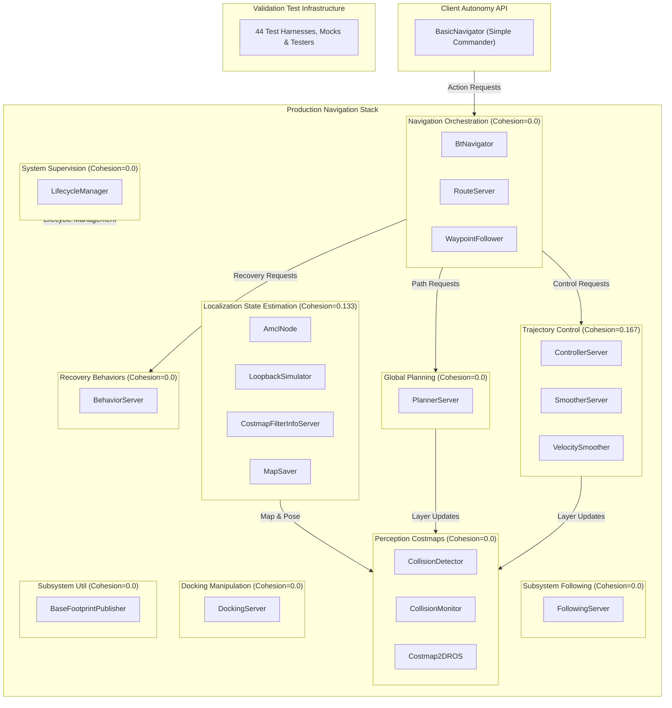
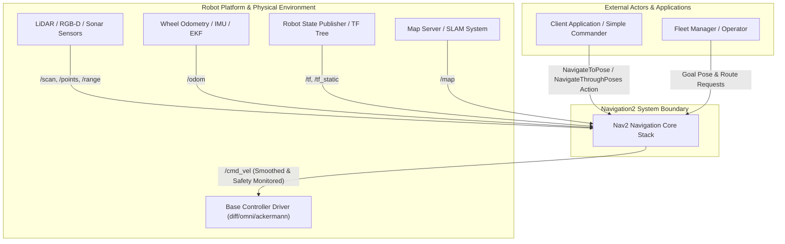
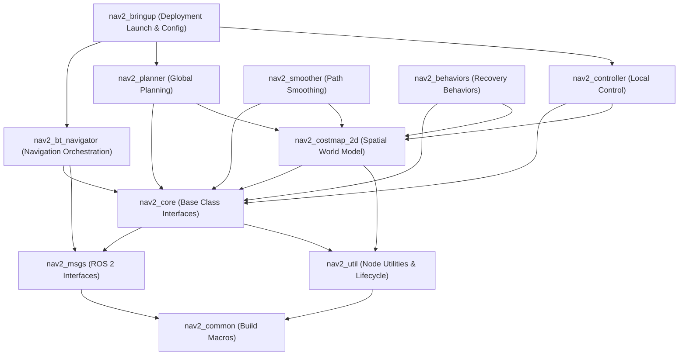
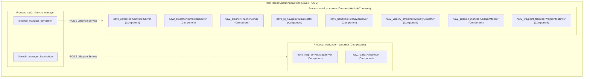
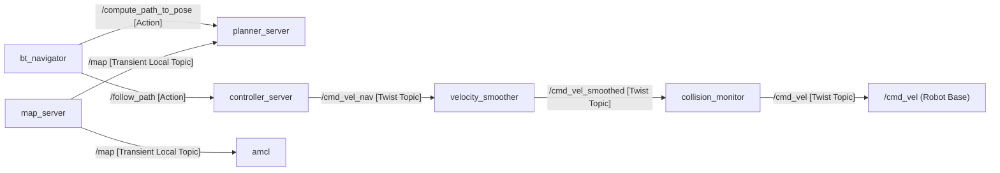
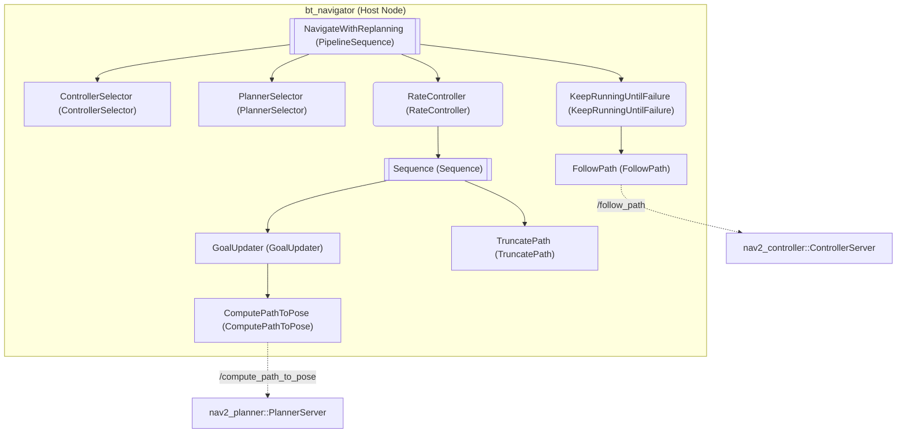

# nav2 Architecture Documentation

> **Generated automatically by ArchSynth**  
> **Tool**: ArchSynth v2.0 — Evidence-Grounded ROS2 Architecture Recovery  
> **Repository**: [nav2](https://github.com/ros-planning/navigation2.git)  
> **Branch**: `main`  
> **Commit Hash**: `6dbf4549ae1914188916b06dcc19dd3a8115d0a5`  
> **Analysis Timestamp**: `2026-11-17T08:00:00+00:00`  
> **LLM Provider & Model**: `gemini / gemini-2.5-pro`  
> **Analysis Duration**: `24.8s`  
> **Documentation Style**: ISO/IEC/IEEE 42010-aligned  

## Executive Summary

This document provides the reconstructed software architecture documentation for **nav2**. ArchSynth parsed **66 ROS2 nodes** and **41 launch files**, organizing them into **12 logical subsystems**. Every recovered architectural entity is grounded with source-code evidence (file:line citations).

### Architecture Overview Statistics

| Metric | Count |
| :--- | :--- |
| **Total Discovered Nodes** | 66 |
| **Parsed Launch Files** | 41 |
| **Logical Subsystems** | 12 |
| **Unique DDS Topics** | 56 |
| **Service Connections** | 31 |
| **Action Connections** | 17 |

---

## 1. System Context (C4 Level 1)

The **nav2** software system provides modular ROS 2 capabilities, core node orchestration, and message passing across its packages (nav2_amcl, nav2_behavior_tree, nav2_behaviors, nav2_bringup, nav2_bt_navigator, nav2_collision_monitor).

---

## 2. Container View (C4 Level 2)

The system is composed of ROS2 package containers communicating over DDS topics, services, and action interfaces.

### Subsystems Summary

#### Subsystem: `subsystem_following`
Production subsystem responsible for subsystem following capabilities.
- **Architectural Role**: `production_subsystem`
- **Intra-Subsystem Cohesion**: `0.0` | **Inter-Subsystem Coupling**: `2.0`
- **Nodes (1)**: `opennav_following::FollowingServer`
- **Boundary Interfaces (1)**: `topic::cmd_vel`
- **Launch Files (1)**: `navigation_launch.py`

#### Subsystem: `trajectory_control`
Production subsystem responsible for trajectory control capabilities.
- **Architectural Role**: `production_subsystem`
- **Intra-Subsystem Cohesion**: `0.167` | **Inter-Subsystem Coupling**: `7.0`
- **Nodes (3)**: `nav2_controller::ControllerServer`, `nav2_smoother::SmootherServer`, `nav2_velocity_smoother::VelocitySmoother`
- **Boundary Interfaces (4)**: `action::follow_path`, `action::smooth_path`, `topic::cmd_vel`, `topic::cmd_vel_smoothed`
- **Launch Files (1)**: `navigation_launch.py`

#### Subsystem: `perception_costmaps`
Production subsystem responsible for perception costmaps capabilities.
- **Architectural Role**: `production_subsystem`
- **Intra-Subsystem Cohesion**: `0.0` | **Inter-Subsystem Coupling**: `4.0`
- **Nodes (3)**: `nav2_collision_monitor::CollisionDetector`, `nav2_collision_monitor::CollisionMonitor`, `nav2_costmap_2d::Costmap2DROS`
- **Boundary Interfaces (3)**: `service::collision_monitor/toggle`, `topic::cmd_vel`, `topic::cmd_vel_smoothed`
- **Launch Files (3)**: `navigation_launch.py`, `collision_detector_node.launch.py`, `collision_monitor_node.launch.py`

#### Subsystem: `localization_state_estimation`
Production subsystem responsible for localization state estimation capabilities.
- **Architectural Role**: `production_subsystem`
- **Intra-Subsystem Cohesion**: `0.133` | **Inter-Subsystem Coupling**: `35.0`
- **Nodes (6)**: `nav2_amcl::AmclNode`, `nav2_loopback_sim::LoopbackSimulator`, `nav2_map_server::CostmapFilterInfoServer`, `nav2_map_server::MapSaver`, `nav2_map_server::MapServer`, `nav2_map_server::VectorObjectServer`
- **Boundary Interfaces (5)**: `service::map_server/load_map`, `topic::amcl_pose`, `topic::cmd_vel`, `topic::initialpose`, `topic::map`
- **Launch Files (12)**: `keepout_zone_launch.py`, `localization_launch.py`, `slam_launch.py`, `speed_zone_launch.py`, `tb3_loopback_simulation_launch.py`

#### Subsystem: `navigation_orchestration`
Production subsystem responsible for navigation orchestration capabilities.
- **Architectural Role**: `production_subsystem`
- **Intra-Subsystem Cohesion**: `0.0` | **Inter-Subsystem Coupling**: `15.0`
- **Nodes (3)**: `nav2_bt_navigator::BtNavigator`, `nav2_route::RouteServer`, `nav2_waypoint_follower::WaypointFollower`
- **Boundary Interfaces (6)**: `action::compute_and_track_route`, `action::compute_route`, `action::follow_gps_waypoints`, `action::follow_waypoints`, `action::navigate_through_poses`, `action::navigate_to_pose`
- **Launch Files (1)**: `navigation_launch.py`

#### Subsystem: `docking_manipulation`
Production subsystem responsible for docking manipulation capabilities.
- **Architectural Role**: `production_subsystem`
- **Intra-Subsystem Cohesion**: `0.0` | **Inter-Subsystem Coupling**: `2.0`
- **Nodes (1)**: `opennav_docking::DockingServer`
- **Boundary Interfaces (1)**: `topic::cmd_vel`
- **Launch Files (1)**: `navigation_launch.py`

#### Subsystem: `subsystem_util`
Production subsystem responsible for subsystem util capabilities.
- **Architectural Role**: `production_subsystem`
- **Intra-Subsystem Cohesion**: `0.0` | **Inter-Subsystem Coupling**: `0.0`
- **Nodes (1)**: `nav2_util::BaseFootprintPublisher`

#### Subsystem: `system_supervision`
Production subsystem responsible for system supervision capabilities.
- **Architectural Role**: `production_subsystem`
- **Intra-Subsystem Cohesion**: `0.0` | **Inter-Subsystem Coupling**: `0.0`
- **Nodes (1)**: `nav2_lifecycle_manager::LifecycleManager`
- **Launch Files (16)**: `keepout_zone_launch.py`, `localization_launch.py`, `navigation_launch.py`, `slam_launch.py`, `speed_zone_launch.py`

#### Subsystem: `global_planning`
Production subsystem responsible for global planning capabilities.
- **Architectural Role**: `production_subsystem`
- **Intra-Subsystem Cohesion**: `0.0` | **Inter-Subsystem Coupling**: `3.0`
- **Nodes (1)**: `nav2_planner::PlannerServer`
- **Boundary Interfaces (3)**: `action::compute_path_through_poses`, `action::compute_path_to_pose`, `topic::plan`
- **Launch Files (1)**: `navigation_launch.py`

#### Subsystem: `recovery_behaviors`
Production subsystem responsible for recovery behaviors capabilities.
- **Architectural Role**: `production_subsystem`
- **Intra-Subsystem Cohesion**: `0.0` | **Inter-Subsystem Coupling**: `0.0`
- **Nodes (1)**: `nav2_behaviors::behavior_server::BehaviorServer`
- **Launch Files (4)**: `navigation_launch.py`, `test_backup_behavior.launch.py`, `test_drive_on_heading_behavior.launch.py`, `test_spin_behavior.launch.py`

#### Subsystem: `client_autonomy_api`
Client-side autonomy application APIs and mission control nodes.
- **Architectural Role**: `client_interface`
- **Intra-Subsystem Cohesion**: `0.0` | **Inter-Subsystem Coupling**: `15.0`
- **Nodes (1)**: `nav2_simple_commander::BasicNavigator`
- **Boundary Interfaces (14)**: `action::compute_and_track_route`, `action::compute_path_through_poses`, `action::compute_path_to_pose`, `action::compute_route`, `action::follow_gps_waypoints`, `action::follow_path`

#### Subsystem: `validation_test_infrastructure`
System integration test harnesses, mock nodes, and verification testers.
- **Architectural Role**: `test_harness`
- **Intra-Subsystem Cohesion**: `0.0` | **Inter-Subsystem Coupling**: `0.0`
- **Nodes (44)**: `nav2_behavior_tree::FibonacciActionServer`, `nav2_behavior_tree::RecoveryDummy`, `nav2_behavior_tree::TestActionServer`, `nav2_behavior_tree::TestService`, `nav2_collision_monitor::FakeCMSource`, `nav2_collision_monitor::MetricsCatcher`, `nav2_collision_monitor::TestNode`, `nav2_controller::TestLifecycleNode`, `nav2_costmap_2d::BinaryStateSubscriber`, `nav2_costmap_2d::CostmapRosLifecycleNode`

### Subsystem Clustering Evaluation (vs. Reference Nav2 Hypothesis)

> **Clustering Algorithm**: `multi_criteria_graph_role_clustering`  
> **Mean Jaccard Similarity**: `0.867` across evaluated functional subsystems.  
> **Evaluation Reference Set**: The ground-truth reference model defines 8 canonical Navigation2 functional domains (`perception_costmaps`, `localization_state_estimation`, `navigation_orchestration`, `global_planning`, `trajectory_control`, `recovery_behaviors`, `system_supervision`, `client_autonomy_api`). Reconstructed subsystems are compared against this ground truth to measure precision, recall, and Jaccard boundary recovery accuracy.

| Subsystem Domain | Reference Nodes | Recovered Nodes | Precision | Recall | Jaccard Similarity |
| :--- | :---: | :---: | :---: | :---: | :---: |
| `perception_costmaps` | 5 | 3 | 1.000 | 0.600 | **0.600** |
| `localization_state_estimation` | 5 | 6 | 0.833 | 1.000 | **0.833** |
| `navigation_orchestration` | 3 | 3 | 1.000 | 1.000 | **1.000** |
| `global_planning` | 1 | 1 | 1.000 | 1.000 | **1.000** |
| `trajectory_control` | 3 | 3 | 1.000 | 1.000 | **1.000** |
| `recovery_behaviors` | 2 | 1 | 1.000 | 0.500 | **0.500** |
| `system_supervision` | 1 | 1 | 1.000 | 1.000 | **1.000** |
| `client_autonomy_api` | 1 | 1 | 1.000 | 1.000 | **1.000** |

---

## 3. Component View & System Diagram (C4 Level 3)

The following Mermaid diagram visualizes the reconstructed subsystem composition and communication graph:

---

## 4. Node Catalog

Overview of the core discovered ROS2 nodes in the system:

| Node Name | Package | Class / Executable | Architectural Classification | Pubs | Subs | Services | Actions | Evidence | Validation |
| :--- | :--- | :--- | :--- | :---: | :---: | :---: | :---: | :---: | :---: |
| [`fake_cm_bag_source`](nodes/nav2_collision_monitor__FakeCMSource.md) | `nav2_collision_monitor` | `FakeCMSource` | `Test Node` | 9 | 0 | 0 | 0 | 1 item(s) | ✅ supported |
| [`basic_navigator`](nodes/nav2_simple_commander__BasicNavigator.md) | `nav2_simple_commander` | `BasicNavigator` | `Client/Library Component` | 3 | 3 | 39 | 34 | 1 item(s) | ✅ supported |
| [`backup_tester`](nodes/nav2_system_tests__BackupTest.md) | `nav2_system_tests` | `BackupTest` | `Test Harness` | 6 | 0 | 3 | 2 | 1 item(s) | ✅ supported |
| [`drive_tester`](nodes/nav2_system_tests__DriveTest.md) | `nav2_system_tests` | `DriveTest` | `Test Harness` | 6 | 0 | 3 | 2 | 1 item(s) | ✅ supported |
| [`spin_tester`](nodes/nav2_system_tests__SpinTest.md) | `nav2_system_tests` | `SpinTest` | `Test Harness` | 6 | 0 | 3 | 2 | 1 item(s) | ✅ supported |
| [`nav2_tester`](nodes/nav2_system_tests__NavTester_src__costmap_filters__tester_node.md) | `nav2_system_tests` | `NavTester` | `Test Harness` | 6 | 24 | 9 | 2 | 1 item(s) | ✅ supported |
| [`nav2_gps_waypoint_tester`](nodes/nav2_system_tests__GpsWaypointFollowerTest.md) | `nav2_system_tests` | `GpsWaypointFollowerTest` | `Test Harness` | 0 | 0 | 6 | 2 | 1 item(s) | ✅ supported |
| [`nav2_tester`](nodes/nav2_system_tests__RouteTester.md) | `nav2_system_tests` | `RouteTester` | `Test Harness` | 3 | 3 | 12 | 4 | 1 item(s) | ✅ supported |
| [`nav2_tester`](nodes/nav2_system_tests__NavTester_src__system__nav_through_poses_tester_error_msg_node.md) | `nav2_system_tests` | `NavTester` | `Test Harness` | 9 | 3 | 12 | 2 | 1 item(s) | ✅ supported |
| [`nav2_tester`](nodes/nav2_system_tests__NavTester_src__system__nav_through_poses_tester_node.md) | `nav2_system_tests` | `NavTester` | `Test Harness` | 3 | 3 | 9 | 2 | 1 item(s) | ✅ supported |
| [`nav2_tester`](nodes/nav2_system_tests__NavTester_src__system__nav_to_pose_tester_node.md) | `nav2_system_tests` | `NavTester` | `Test Harness` | 6 | 3 | 9 | 2 | 1 item(s) | ✅ supported |
| [`nav2_tester`](nodes/nav2_system_tests__NavTester_src__system_failure__tester_node.md) | `nav2_system_tests` | `NavTester` | `Test Harness` | 6 | 3 | 9 | 2 | 1 item(s) | ✅ supported |
| [`nav2_waypoint_tester`](nodes/nav2_system_tests__WaypointFollowerTest.md) | `nav2_system_tests` | `WaypointFollowerTest` | `Test Harness` | 3 | 3 | 9 | 2 | 1 item(s) | ✅ supported |
| [`amcl`](nodes/nav2_amcl__AmclNode.md) | `nav2_amcl` | `nav2_amcl::AmclNode` | `Production ROS 2 Node` | 4 | 6 | 6 | 0 | 5 item(s) | ✅ supported |
| [`behavior_server`](nodes/nav2_behaviors__behavior_server__BehaviorServer.md) | `nav2_behaviors` | `behavior_server::BehaviorServer` | `Production ROS 2 Node` | 0 | 0 | 0 | 0 | 5 item(s) | ✅ supported |
| [`fibonacci_node`](nodes/nav2_behavior_tree__FibonacciActionServer.md) | `nav2_behavior_tree` | `FibonacciActionServer` | `Test Node` | 0 | 0 | 0 | 2 | 1 item(s) | ✅ supported |
| [`RecoveryDummy`](nodes/nav2_behavior_tree__RecoveryDummy.md) | `nav2_behavior_tree` | `RecoveryDummy` | `Test Node` | 0 | 0 | 0 | 0 | 1 item(s) | ✅ supported |
| [`TestActionServer`](nodes/nav2_behavior_tree__TestActionServer.md) | `nav2_behavior_tree` | `TestActionServer` | `Test Node` | 0 | 0 | 0 | 2 | 1 item(s) | ✅ supported |
| [`TestService`](nodes/nav2_behavior_tree__TestService.md) | `nav2_behavior_tree` | `TestService` | `Test Node` | 0 | 0 | 2 | 0 | 1 item(s) | ✅ supported |
| [`bt_navigator`](nodes/nav2_bt_navigator__BtNavigator.md) | `nav2_bt_navigator` | `nav2_bt_navigator::BtNavigator` | `Production ROS 2 Node` | 0 | 0 | 0 | 4 | 5 item(s) | ✅ supported |
| [`cm_metrics_catcher`](nodes/nav2_collision_monitor__MetricsCatcher.md) | `nav2_collision_monitor` | `MetricsCatcher` | `Test Node` | 0 | 8 | 0 | 0 | 1 item(s) | ✅ supported |
| [`test_node`](nodes/nav2_collision_monitor__TestNode.md) | `nav2_collision_monitor` | `TestNode` | `Test Node` | 0 | 2 | 0 | 0 | 1 item(s) | ✅ supported |
| [`collision_detector`](nodes/nav2_collision_monitor__CollisionDetector.md) | `nav2_collision_monitor` | `nav2_collision_monitor::CollisionDetector` | `Production ROS 2 Node` | 6 | 0 | 0 | 0 | 5 item(s) | ✅ supported |
| [`collision_monitor`](nodes/nav2_collision_monitor__CollisionMonitor.md) | `nav2_collision_monitor` | `nav2_collision_monitor::CollisionMonitor` | `Production ROS 2 Node` | 8 | 2 | 2 | 0 | 5 item(s) | ✅ supported |
| [`TestLifecycleNode`](nodes/nav2_controller__TestLifecycleNode.md) | `nav2_controller` | `TestLifecycleNode` | `Test Node` | 0 | 0 | 0 | 0 | 1 item(s) | ✅ supported |
| [`controller_server`](nodes/nav2_controller__ControllerServer.md) | `nav2_controller` | `nav2_controller::ControllerServer` | `Production ROS 2 Node` | 6 | 2 | 0 | 2 | 5 item(s) | ✅ supported |
| [`TestLifecycleNode`](nodes/nav2_costmap_2d__TestLifecycleNode.md) | `nav2_costmap_2d` | `TestLifecycleNode` | `Test Node` | 0 | 0 | 0 | 0 | 2 item(s) | ✅ supported |
| [`CostmapRosLifecycleNode`](nodes/nav2_costmap_2d__CostmapRosLifecycleNode.md) | `nav2_costmap_2d` | `CostmapRosLifecycleNode` | `Test Node` | 0 | 2 | 0 | 0 | 2 item(s) | ✅ supported |
| [`TestCollisionChecker`](nodes/nav2_costmap_2d__TestCollisionChecker.md) | `nav2_costmap_2d` | `TestCollisionChecker` | `Test Node` | 0 | 0 | 0 | 0 | 2 item(s) | ✅ supported |
| [`costmap_filter_info_pub`](nodes/nav2_costmap_2d__InfoPublisher.md) | `nav2_costmap_2d` | `InfoPublisher` | `Test Node` | 4 | 2 | 0 | 0 | 2 item(s) | ✅ supported |
| [`mask_pub`](nodes/nav2_costmap_2d__MaskPublisher.md) | `nav2_costmap_2d` | `MaskPublisher` | `Test Node` | 4 | 2 | 0 | 0 | 2 item(s) | ✅ supported |
| [`binary_state_sub`](nodes/nav2_costmap_2d__BinaryStateSubscriber.md) | `nav2_costmap_2d` | `BinaryStateSubscriber` | `Test Node` | 4 | 2 | 0 | 0 | 2 item(s) | ✅ supported |
| [`path_pub`](nodes/nav2_costmap_2d__PathPublisher.md) | `nav2_costmap_2d` | `PathPublisher` | `Test Node` | 8 | 2 | 0 | 0 | 2 item(s) | ✅ supported |
| [`odom_pub`](nodes/nav2_costmap_2d__OdomPublisher.md) | `nav2_costmap_2d` | `OdomPublisher` | `Test Node` | 8 | 2 | 0 | 0 | 2 item(s) | ✅ supported |
| [`speed_limit_sub`](nodes/nav2_costmap_2d__SpeedLimitSubscriber.md) | `nav2_costmap_2d` | `SpeedLimitSubscriber` | `Test Node` | 8 | 2 | 0 | 0 | 2 item(s) | ✅ supported |
| [`zpf_state_sub`](nodes/nav2_costmap_2d__StateEventSubscriber.md) | `nav2_costmap_2d` | `StateEventSubscriber` | `Test Node` | 4 | 2 | 0 | 0 | 2 item(s) | ✅ supported |
| [`zpf_target_node`](nodes/nav2_costmap_2d__TargetNode.md) | `nav2_costmap_2d` | `TargetNode` | `Test Node` | 4 | 2 | 0 | 0 | 2 item(s) | ✅ supported |
| [`zpf_second_target`](nodes/nav2_costmap_2d__SecondTargetNode.md) | `nav2_costmap_2d` | `SecondTargetNode` | `Test Node` | 4 | 2 | 0 | 0 | 2 item(s) | ✅ supported |
| [`costmap`](nodes/nav2_costmap_2d__Costmap2DROS.md) | `nav2_costmap_2d` | `nav2_costmap_2d::Costmap2DROS` | `Production ROS 2 Node` | 2 | 4 | 2 | 0 | 3 item(s) | ✅ supported |
| [`opennav_docking::TestCollisionChecker`](nodes/opennav_docking__TestCollisionChecker.md) | `opennav_docking` | `opennav_docking::TestCollisionChecker` | `Test Node` | 2 | 0 | 0 | 0 | 2 item(s) | ✅ supported |
| [`dummy_navigator`](nodes/opennav_docking__DummyNavigationServer.md) | `opennav_docking` | `opennav_docking::DummyNavigationServer` | `Test Node` | 0 | 0 | 0 | 0 | 2 item(s) | ✅ supported |
| [`docking_server`](nodes/opennav_docking__DockingServer.md) | `opennav_docking` | `opennav_docking::DockingServer` | `Production ROS 2 Node` | 2 | 0 | 0 | 4 | 5 item(s) | ✅ supported |
| [`following_server`](nodes/opennav_following__FollowingServer.md) | `opennav_following` | `opennav_following::FollowingServer` | `Production ROS 2 Node` | 4 | 2 | 0 | 2 | 5 item(s) | ✅ supported |
| [`TestLifecycleNode`](nodes/nav2_lifecycle_manager__TestLifecycleNode.md) | `nav2_lifecycle_manager` | `TestLifecycleNode` | `Test Node` | 0 | 0 | 0 | 0 | 1 item(s) | ✅ supported |
| [`lifecycle_node_test`](nodes/nav2_lifecycle_manager__LifecycleNodeTest.md) | `nav2_lifecycle_manager` | `LifecycleNodeTest` | `Test Node` | 0 | 0 | 0 | 0 | 1 item(s) | ✅ supported |
| [`lifecycle_manager`](nodes/nav2_lifecycle_manager__LifecycleManager.md) | `nav2_lifecycle_manager` | `nav2_lifecycle_manager::LifecycleManager` | `Production ROS 2 Node` | 2 | 0 | 4 | 0 | 5 item(s) | ✅ supported |
| [`loopback_simulator`](nodes/nav2_loopback_sim__LoopbackSimulator.md) | `nav2_loopback_sim` | `nav2_loopback_sim::LoopbackSimulator` | `Production ROS 2 Node` | 4 | 4 | 2 | 0 | 5 item(s) | ✅ supported |
| [`map_publisher`](nodes/nav2_map_server__TestPublisher.md) | `nav2_map_server` | `TestPublisher` | `Test Node` | 4 | 0 | 0 | 0 | 2 item(s) | ✅ supported |
| [`costmap_filter_info_server`](nodes/nav2_map_server__CostmapFilterInfoServer.md) | `nav2_map_server` | `nav2_map_server::CostmapFilterInfoServer` | `Production ROS 2 Node` | 2 | 0 | 0 | 0 | 5 item(s) | ✅ supported |
| [`map_saver`](nodes/nav2_map_server__MapSaver.md) | `nav2_map_server` | `nav2_map_server::MapSaver` | `Production ROS 2 Node` | 0 | 2 | 2 | 0 | 5 item(s) | ✅ supported |
| [`map_server`](nodes/nav2_map_server__MapServer.md) | `nav2_map_server` | `nav2_map_server::MapServer` | `Production ROS 2 Node` | 2 | 0 | 4 | 0 | 5 item(s) | ✅ supported |
| [`vector_object_server`](nodes/nav2_map_server__VectorObjectServer.md) | `nav2_map_server` | `nav2_map_server::VectorObjectServer` | `Production ROS 2 Node` | 2 | 0 | 6 | 0 | 5 item(s) | ✅ supported |
| [`planner_server`](nodes/nav2_planner__PlannerServer.md) | `nav2_planner` | `nav2_planner::PlannerServer` | `Production ROS 2 Node` | 2 | 0 | 0 | 4 | 5 item(s) | ✅ supported |
| [`fibonacci_server_node`](nodes/nav2_ros_common__FibonacciServerNode.md) | `nav2_ros_common` | `FibonacciServerNode` | `Test Node` | 10 | 10 | 2 | 0 | 1 item(s) | ✅ supported |
| [`ActionTestNode`](nodes/nav2_ros_common__ActionTestNode.md) | `nav2_ros_common` | `ActionTestNode` | `Test Node` | 10 | 10 | 2 | 0 | 1 item(s) | ✅ supported |
| [`test_node`](nodes/nav2_ros_common__LifecycleTransitionTestNode.md) | `nav2_ros_common` | `LifecycleTransitionTestNode` | `Test Node` | 0 | 0 | 0 | 0 | 1 item(s) | ✅ supported |
| [`MyNodeType`](nodes/nav2_ros_common__MyNodeType.md) | `nav2_ros_common` | `MyNodeType` | `Test Node` | 0 | 0 | 0 | 0 | 1 item(s) | ✅ supported |
| [`route_server`](nodes/nav2_route__RouteServer.md) | `nav2_route` | `nav2_route::RouteServer` | `Production ROS 2 Node` | 4 | 0 | 2 | 4 | 5 item(s) | ✅ supported |
| [`smoother_server`](nodes/nav2_smoother__SmootherServer.md) | `nav2_smoother` | `nav2_smoother::SmootherServer` | `Production ROS 2 Node` | 2 | 0 | 0 | 2 | 5 item(s) | ✅ supported |
| [`DummyController`](nodes/nav2_system_tests__DummyController.md) | `nav2_system_tests` | `nav2_system_tests::DummyController` | `Test Node` | 2 | 0 | 0 | 0 | 2 item(s) | ✅ supported |
| [`DummyPlanner`](nodes/nav2_system_tests__DummyPlanner.md) | `nav2_system_tests` | `nav2_system_tests::DummyPlanner` | `Test Node` | 0 | 0 | 0 | 0 | 2 item(s) | ✅ supported |
| [`PlannerTester`](nodes/nav2_system_tests__PlannerTester.md) | `nav2_system_tests` | `nav2_system_tests::PlannerTester` | `Test Harness` | 2 | 0 | 2 | 0 | 2 item(s) | ✅ supported |
| [`nav2_test_cli`](nodes/nav2_util__DummyNode.md) | `nav2_util` | `DummyNode` | `Test Node` | 0 | 0 | 0 | 0 | 1 item(s) | ✅ supported |
| [`nav2_util::BaseFootprintPublisher`](nodes/nav2_util__BaseFootprintPublisher.md) | `nav2_util` | `nav2_util::BaseFootprintPublisher` | `Helper Component` | 0 | 0 | 0 | 0 | 1 item(s) | ✅ supported |
| [`velocity_smoother`](nodes/nav2_velocity_smoother__VelocitySmoother.md) | `nav2_velocity_smoother` | `nav2_velocity_smoother::VelocitySmoother` | `Production ROS 2 Node` | 2 | 2 | 0 | 0 | 5 item(s) | ✅ supported |
| [`waypoint_follower`](nodes/nav2_waypoint_follower__WaypointFollower.md) | `nav2_waypoint_follower` | `nav2_waypoint_follower::WaypointFollower` | `Production ROS 2 Node` | 0 | 0 | 2 | 4 | 5 item(s) | ✅ supported |

---

## 5. Launch File Composition

Parsed **41 launch files** across the repository.

Alternative standalone launch profiles are analyzed independently by default.

| Launch File | Architectural Classification | Direct Node | Direct LifecycleNode | ComposableNode | ComposableNodeContainer | LoadComposableNodes | Included Launch | Unresolved | Resolved Executable | Runtime Node Name | CMake Installed |
| :--- | :--- | :---: | :---: | :---: | :---: | :---: | :---: | :---: | :--- | :--- | :---: |
| `bringup_launch.py` | `Top-Level Entry Point` | 1 | 0 | 0 | 0 | 0 | 5 | 0 | `component_container` | `${container_name}` | Yes |
| `cloned_multi_tb3_simulation_launch.py` | `Top-Level Entry Point` | 0 | 0 | 0 | 0 | 0 | 2 | 0 | `-` | `-` | Yes |
| `keepout_zone_launch.py` | `Subsystem Launch File` | 6 | 0 | 0 | 0 | 0 | 0 | 3 | `costmap_filter_info_server, lifecycle_manager, map_server` | `keepout_costmap_filter_info_server, keepout_filter_mask_server, lifecycle_manager_keepout_zone` | Yes |
| `localization_launch.py` | `Subsystem Launch File` | 8 | 0 | 0 | 0 | 0 | 0 | 4 | `amcl, lifecycle_manager, map_server` | `amcl, lifecycle_manager_localization, map_server` | Yes |
| `navigation_launch.py` | `Subsystem Launch File` | 24 | 0 | 0 | 0 | 0 | 0 | 12 | `behavior_server, bt_navigator, collision_monitor, controller_server, lifecycle_manager, opennav_docking, opennav_following, planner_server, route_server, smoother_server, velocity_smoother, waypoint_follower` | `behavior_server, bt_navigator, collision_monitor, controller_server, docking_server, following_server, lifecycle_manager_navigation, planner_server, route_server, smoother_server, velocity_smoother, waypoint_follower` | Yes |
| `rviz_launch.py` | `Subsystem Launch File` | 1 | 0 | 0 | 0 | 0 | 0 | 0 | `rviz2` | `rviz2` | Yes |
| `slam_launch.py` | `Subsystem Launch File` | 2 | 0 | 0 | 0 | 0 | 2 | 0 | `lifecycle_manager, map_saver_server` | `lifecycle_manager_slam, map_saver_server` | Yes |
| `speed_zone_launch.py` | `Subsystem Launch File` | 6 | 0 | 0 | 0 | 0 | 0 | 3 | `costmap_filter_info_server, lifecycle_manager, map_server` | `lifecycle_manager_speed_zone, speed_costmap_filter_info_server, speed_filter_mask_server` | Yes |
| `tb3_loopback_simulation_launch.py` | `Top-Level Entry Point` | 5 | 0 | 0 | 0 | 0 | 3 | 2 | `lifecycle_manager, map_server, robot_state_publisher` | `lifecycle_manager_map_server, map_server, robot_state_publisher` | Yes |
| `tb3_simulation_launch.py` | `Top-Level Entry Point` | 1 | 0 | 0 | 0 | 0 | 4 | 0 | `robot_state_publisher` | `robot_state_publisher` | Yes |
| `tb4_loopback_simulation_launch.py` | `Top-Level Entry Point` | 6 | 0 | 0 | 0 | 0 | 3 | 2 | `lifecycle_manager, map_server, robot_state_publisher, static_transform_publisher` | `lifecycle_manager_map_server, map_server, robot_state_publisher, static_transform_publisher` | Yes |
| `tb4_simulation_launch.py` | `Top-Level Entry Point` | 1 | 0 | 0 | 0 | 0 | 4 | 0 | `robot_state_publisher` | `robot_state_publisher` | Yes |
| `unique_multi_tb3_simulation_launch.py` | `Top-Level Entry Point` | 0 | 0 | 0 | 0 | 0 | 2 | 0 | `-` | `-` | Yes |
| `collision_detector_node.launch.py` | `Component Launch File` | 4 | 0 | 0 | 0 | 0 | 0 | 2 | `collision_detector, lifecycle_manager` | `collision_detector, lifecycle_manager_collision_detector` | Yes |
| `collision_monitor_node.launch.py` | `Component Launch File` | 4 | 0 | 0 | 0 | 0 | 0 | 2 | `collision_monitor, lifecycle_manager` | `collision_monitor, lifecycle_manager_collision_monitor` | Yes |
| `has_node_params.py` | `Launch Utility / Substitution Module` | 0 | 0 | 0 | 0 | 0 | 0 | 0 | `-` | `-` | Yes |
| `launch_config_as_bool.py` | `Launch Utility / Substitution Module` | 0 | 0 | 0 | 0 | 0 | 0 | 0 | `-` | `-` | Yes |
| `replace_string.py` | `Launch Utility / Substitution Module` | 0 | 0 | 0 | 0 | 0 | 0 | 0 | `-` | `-` | Yes |
| `rewritten_yaml.py` | `Launch Utility / Substitution Module` | 0 | 0 | 0 | 0 | 0 | 0 | 0 | `-` | `-` | Yes |
| `costmap_map_server.launch.py` | `Test Launch File` | 1 | 0 | 0 | 0 | 0 | 0 | 0 | `map_server` | `map_server` | Yes |
| `loopback_simulation.launch.py` | `Component Launch File` | 0 | 0 | 0 | 0 | 0 | 0 | 0 | `-` | `-` | Yes |
| `map_saver_server.launch.py` | `Component Launch File` | 2 | 0 | 0 | 0 | 0 | 0 | 0 | `lifecycle_manager, map_saver_server` | `lifecycle_manager, map_saver_server` | Yes |
| `vector_object_server.launch.py` | `Component Launch File` | 6 | 0 | 0 | 0 | 0 | 0 | 3 | `costmap_filter_info_server, lifecycle_manager, vector_object_server` | `costmap_filter_info_server, lifecycle_manager_vo_server, vector_object_server` | Yes |
| `map_saver_node.launch.py` | `Test Launch File` | 1 | 0 | 0 | 0 | 0 | 0 | 0 | `map_saver_server` | `map_saver_server` | Yes |
| `map_server_node.launch.py` | `Test Launch File` | 1 | 0 | 0 | 0 | 0 | 0 | 0 | `map_server` | `map_server` | Yes |
| `route_tool.launch.py` | `Component Launch File` | 3 | 0 | 0 | 0 | 0 | 0 | 0 | `lifecycle_manager, map_server, rviz2` | `lifecycle_manager, map_server, rviz2` | Yes |
| `assisted_teleop_example_launch.py` | `Example / Demo Launch File` | 2 | 0 | 0 | 0 | 0 | 5 | 0 | `example_assisted_teleop, robot_state_publisher` | `example_assisted_teleop, robot_state_publisher` | Yes |
| `follow_path_example_launch.py` | `Example / Demo Launch File` | 2 | 0 | 0 | 0 | 0 | 5 | 0 | `example_follow_path, robot_state_publisher` | `example_follow_path, robot_state_publisher` | Yes |
| `inspection_demo_launch.py` | `Example / Demo Launch File` | 2 | 0 | 0 | 0 | 0 | 5 | 0 | `demo_inspection, robot_state_publisher` | `demo_inspection, robot_state_publisher` | Yes |
| `nav_through_poses_example_launch.py` | `Example / Demo Launch File` | 2 | 0 | 0 | 0 | 0 | 5 | 0 | `example_nav_through_poses, robot_state_publisher` | `example_nav_through_poses, robot_state_publisher` | Yes |
| `nav_to_pose_example_launch.py` | `Example / Demo Launch File` | 2 | 0 | 0 | 0 | 0 | 5 | 0 | `example_nav_to_pose, robot_state_publisher` | `example_nav_to_pose, robot_state_publisher` | Yes |
| `picking_demo_launch.py` | `Example / Demo Launch File` | 2 | 0 | 0 | 0 | 0 | 5 | 0 | `demo_picking, robot_state_publisher` | `demo_picking, robot_state_publisher` | Yes |
| `recoveries_example_launch.py` | `Example / Demo Launch File` | 2 | 0 | 0 | 0 | 0 | 5 | 0 | `demo_recoveries, robot_state_publisher` | `demo_recoveries, robot_state_publisher` | Yes |
| `route_example_launch.py` | `Example / Demo Launch File` | 2 | 0 | 0 | 0 | 0 | 5 | 0 | `example_route, robot_state_publisher` | `example_route, robot_state_publisher` | Yes |
| `security_demo_launch.py` | `Example / Demo Launch File` | 2 | 0 | 0 | 0 | 0 | 5 | 0 | `demo_security, robot_state_publisher` | `demo_security, robot_state_publisher` | Yes |
| `waypoint_follower_example_launch.py` | `Example / Demo Launch File` | 2 | 0 | 0 | 0 | 0 | 5 | 0 | `example_waypoint_follower, robot_state_publisher` | `example_waypoint_follower, robot_state_publisher` | Yes |
| `test_backup_behavior.launch.py` | `Test Launch File` | 4 | 0 | 0 | 0 | 0 | 1 | 0 | `behavior_server, lifecycle_manager, robot_state_publisher, static_transform_publisher` | `behavior_server, lifecycle_manager_navigation, robot_state_publisher, static_transform_publisher` | Yes |
| `test_drive_on_heading_behavior.launch.py` | `Test Launch File` | 4 | 0 | 0 | 0 | 0 | 1 | 0 | `behavior_server, lifecycle_manager, robot_state_publisher, static_transform_publisher` | `behavior_server, lifecycle_manager_navigation, robot_state_publisher, static_transform_publisher` | Yes |
| `test_spin_behavior.launch.py` | `Test Launch File` | 4 | 0 | 0 | 0 | 0 | 1 | 0 | `behavior_server, lifecycle_manager, robot_state_publisher, static_transform_publisher` | `behavior_server, lifecycle_manager_navigation, robot_state_publisher, static_transform_publisher` | Yes |
| `dual_ekf_navsat.launch.py` | `Test Launch File` | 4 | 0 | 0 | 0 | 0 | 0 | 0 | `ekf_node, lifecycle_manager, navsat_transform_node` | `ekf_filter_node_map, ekf_filter_node_odom, lifecycle_manager_localization, navsat_transform` | Yes |
| `test_case_py.launch.py` | `Test Launch File` | 1 | 0 | 0 | 0 | 0 | 3 | 0 | `robot_state_publisher` | `robot_state_publisher` | Yes |

---

## 6. Communication Matrix

### Topic Connections

| Topic Name | Publisher Nodes | Subscriber Nodes |
| :--- | :--- | :--- |
| `/clock` | `fake_cm_bag_source` | `cm_metrics_catcher` |
| `/cmd_vel` | *External* | `cm_metrics_catcher` |
| `/cmd_vel_smoothed` | `fake_cm_bag_source` | *External* |
| `/collision_state` | *External* | `cm_metrics_catcher` |
| `/fake_costmap/static_layer_raw` | *External* | `` |
| `/local_costmap/costmap` | `fake_cm_bag_source` | `cm_metrics_catcher` |
| `INFO_TOPIC` | `binary_state_sub`, `odom_pub`, `path_pub`, `speed_limit_sub` | *External* |
| `MASK_TOPIC` | `binary_state_sub`, `odom_pub`, `path_pub`, `speed_limit_sub` | *External* |
| `POLYGON_PUB_TOPIC` | *External* | `test_node` |
| `activate_server` | ``, `fibonacci_server_node` | ``, `fibonacci_server_node` |
| `allow_goal` | ``, `fibonacci_server_node` | ``, `fibonacci_server_node` |
| `amcl_pose` | `amcl` | `basic_navigator`, `nav2_tester`, `nav2_waypoint_tester` |
| `binary_state_topic` | *External* | `binary_state_sub` |
| `cmd_vel` | `DummyController`, `collision_monitor`, `controller_server`, `docking_server`, `following_server` | `loopback_simulator`, `velocity_smoother` |
| `cmd_vel_smoothed` | `velocity_smoother` | `collision_monitor` |
| `collision_detector_state` | `collision_detector` | *External* |
| `cost_cloud` | *External* | `nav2_tester` |
| `costmap_filter_info` | `costmap_filter_info_server` | *External* |
| `deactivate_server` | ``, `fibonacci_server_node` | ``, `fibonacci_server_node` |
| `filter_mask` | *External* | `nav2_tester` |
| `filtered_dynamic_pose` | `following_server` | *External* |
| `footprint` | *External* | `costmap` |
| `goal_checker_selector` | `nav2_tester` | *External* |
| `goal_pose` | `nav2_tester` | *External* |
| `initialpose` | `basic_navigator`, `nav2_tester`, `nav2_waypoint_tester` | `amcl`, `loopback_simulator` |
| `kInfoTopic` | `costmap_filter_info_pub`, `mask_pub`, `zpf_second_target`, `zpf_state_sub`, `zpf_target_node` | *External* |
| `kMaskTopic` | `costmap_filter_info_pub`, `mask_pub`, `zpf_second_target`, `zpf_state_sub`, `zpf_target_node` | *External* |
| `local_costmap/clearing_endpoints` | *External* | `nav2_tester` |
| `local_costmap/costmap_raw` | `backup_tester`, `drive_tester`, `spin_tester` | *External* |
| `local_costmap/published_footprint` | `backup_tester`, `drive_tester`, `spin_tester` | *External* |
| `malformed_map` | `map_publisher` | *External* |
| `map` | `PlannerTester`, `map_publisher`, `map_server` | `amcl`, `map_saver` |
| `map_topic_` | `vector_object_server` | *External* |
| `odom` | `loopback_simulator`, `odom_pub`, `path_pub`, `speed_limit_sub` | *External* |
| `omit_preemption` | ``, `fibonacci_server_node` | ``, `fibonacci_server_node` |

### Service Connections

| Service Name | Servers | Clients |
| :--- | :--- | :--- |
| `/controller_server/set_parameters` | *External* | `nav2_tester` |
| `/fromLL` | *External* | `waypoint_follower` |
| `/map_server/map` | *External* | `loopback_simulator` |
| `/waypoint_follower/set_parameters` | *External* | `nav2_gps_waypoint_tester`, `nav2_waypoint_tester` |
| `collision_monitor/toggle` | *External* | `basic_navigator` |
| `get_cost_costmap` | `costmap` | *External* |
| `global_costmap/clear_costmap_around_pose` | *External* | `basic_navigator` |
| `global_costmap/clear_entirely_global_costmap` | *External* | `basic_navigator` |
| `global_costmap/get_costmap` | *External* | `basic_navigator` |
| `is_path_valid` | *External* | `PlannerTester` |
| `local_costmap/clear_costmap_around_pose` | *External* | `basic_navigator` |
| `local_costmap/clear_costmap_around_robot` | *External* | `basic_navigator` |
| `local_costmap/clear_costmap_except_region` | *External* | `basic_navigator` |
| `local_costmap/clear_entirely_local_costmap` | *External* | `basic_navigator` |
| `local_costmap/get_costmap` | *External* | `basic_navigator` |
| `map_saver/save_map` | `map_saver` | *External* |
| `map_server/load_map` | `map_server` | `basic_navigator` |
| `map_server/map` | `map_server` | *External* |
| `node_service` | *External* | `basic_navigator`, `nav2_tester` |
| `reinitialize_global_localization` | `amcl` | *External* |
| `request_nomotion_update` | `amcl` | *External* |
| `route_server/ReroutingService/reroute` | *External* | `nav2_tester` |
| `route_server/set_route_graph` | `route_server` | *External* |
| `service_name` | `` | *External* |
| `set_initial_pose` | `amcl` | *External* |

### Action Connections

| Action Name | Servers | Clients |
| :--- | :--- | :--- |
| `assisted_teleop` | *External* | `basic_navigator` |
| `backup` | *External* | `backup_tester`, `basic_navigator` |
| `compute_and_track_route` | `route_server` | `basic_navigator`, `nav2_tester` |
| `compute_path_through_poses` | `planner_server` | `basic_navigator` |
| `compute_path_to_pose` | `planner_server` | `basic_navigator` |
| `compute_route` | `route_server` | `basic_navigator`, `nav2_tester` |
| `dock_robot` | `docking_server` | `basic_navigator` |
| `drive_on_heading` | *External* | `basic_navigator`, `drive_tester` |
| `follow_gps_waypoints` | `waypoint_follower` | `basic_navigator`, `nav2_gps_waypoint_tester` |
| `follow_object` | `following_server` | `basic_navigator` |
| `follow_path` | `controller_server` | `basic_navigator` |
| `follow_waypoints` | `waypoint_follower` | `basic_navigator`, `nav2_waypoint_tester` |
| `navigate_through_poses` | `bt_navigator` | `basic_navigator`, `nav2_tester` |
| `navigate_to_pose` | `bt_navigator` | `basic_navigator`, `nav2_tester` |
| `smooth_path` | `smoother_server` | `basic_navigator` |
| `spin` | *External* | `basic_navigator`, `spin_tester` |
| `undock_robot` | `docking_server` | `basic_navigator` |

---

## 7. ROS 2 Lifecycle Management Architecture

**nav2** orchestrates **23 lifecycle managers** controlling deterministic startup and state transitions for **43 managed node instances**.

### Lifecycle Managers

| Manager Name | Launch File | Autostart | Managed Nodes |
| :--- | :--- | :---: | :--- |
| `lifecycle_manager_keepout_zone` | `nav2_bringup/launch/keepout_zone_launch.py` | `True` | `keepout_filter_mask_server`, `keepout_costmap_filter_info_server` |
| `lifecycle_manager_localization` | `nav2_bringup/launch/localization_launch.py` | `True` | `map_server`, `amcl` |
| `lifecycle_manager_navigation` | `nav2_bringup/launch/navigation_launch.py` | `True` | `controller_server`, `smoother_server`, `planner_server`, `route_server`, `behavior_server` ... (+6 more) |
| `lifecycle_manager_slam` | `nav2_bringup/launch/slam_launch.py` | `True` | `map_saver` |
| `lifecycle_manager_speed_zone` | `nav2_bringup/launch/speed_zone_launch.py` | `True` | `speed_filter_mask_server`, `speed_costmap_filter_info_server` |
| `lifecycle_manager_map_server` | `nav2_bringup/launch/tb3_loopback_simulation_launch.py` | `True` | `map_server` |
| `lifecycle_manager_map_server` | `nav2_bringup/launch/tb4_loopback_simulation_launch.py` | `True` | `map_server` |
| `lifecycle_manager_collision_detector` | `nav2_collision_monitor/launch/collision_detector_node.launch.py` | `True` | `collision_detector` |
| `lifecycle_manager_collision_monitor` | `nav2_collision_monitor/launch/collision_monitor_node.launch.py` | `True` | `collision_monitor` |
| `lifecycle_manager` | `nav2_costmap_2d/test/integration/costmap_tests_launch.py` | `True` | `map_server` |
| `lifecycle_manager_test` | `nav2_lifecycle_manager/test/launch_bond_test.py` | `False` | `bond_tester` |
| `lifecycle_manager_test` | `nav2_lifecycle_manager/test/launch_lifecycle_test.py` | `False` | `lifecycle_node_test` |
| `lifecycle_manager` | `nav2_map_server/launch/map_saver_server.launch.py` | `True` | `map_saver` |
| `lifecycle_manager_vo_server` | `nav2_map_server/launch/vector_object_server.launch.py` | `True` | `vector_object_server`, `costmap_filter_info_server` |
| `lifecycle_manager` | `nav2_rviz_plugins/launch/route_tool.launch.py` | `True` | `map_server` |
| `lifecycle_manager_navigation` | `nav2_system_tests/src/behaviors/backup/test_backup_behavior.launch.py` | `True` | `behavior_server` |
| `lifecycle_manager_navigation` | `nav2_system_tests/src/behaviors/drive_on_heading/test_drive_on_heading_behavior.launch.py` | `True` | `behavior_server` |
| `lifecycle_manager_navigation` | `nav2_system_tests/src/behaviors/spin/test_spin_behavior.launch.py` | `True` | `behavior_server` |
| `lifecycle_manager_filters` | `nav2_system_tests/src/costmap_filters/test_keepout_launch.py` | `True` | `filter_mask_server`, `costmap_filter_info_server` |
| `lifecycle_manager_filters` | `nav2_system_tests/src/costmap_filters/test_speed_launch.py` | `True` | `filter_mask_server`, `costmap_filter_info_server` |
| `lifecycle_manager_navigation` | `nav2_system_tests/src/error_codes/test_error_codes_launch.py` | `True` | `controller_server`, `planner_server`, `smoother_server` |
| `lifecycle_manager_localization` | `nav2_system_tests/src/gps_navigation/dual_ekf_navsat.launch.py` | `True` | `ekf_filter_node_odom`, `ekf_filter_node_map` |
| `lifecycle_manager` | `nav2_system_tests/src/localization/test_localization_launch.py` | `True` | `map_server`, `amcl` |

### Managed Nodes & Source Callback Handlers

| Node ID | Launch Name | Managing Manager | Transition Index | C++ Callbacks Implemented | Target State |
| :--- | :--- | :--- | :---: | :--- | :---: |
| `unresolved::keepout_filter_mask_server` | `keepout_filter_mask_server` | `lifecycle_manager_keepout_zone` | 0 | *standard* | **Active** |
| `unresolved::keepout_costmap_filter_info_server` | `keepout_costmap_filter_info_server` | `lifecycle_manager_keepout_zone` | 1 | *standard* | **Active** |
| `nav2_map_server::MapServer` | `map_server` | `lifecycle_manager_localization` | 0 | `on_activate`, `on_cleanup`, `on_configure`, `on_deactivate`, `on_shutdown` | **Active** |
| `nav2_amcl::AmclNode` | `amcl` | `lifecycle_manager_localization` | 1 | `on_activate`, `on_cleanup`, `on_configure`, `on_deactivate`, `on_shutdown` | **Active** |
| `nav2_controller::ControllerServer` | `controller_server` | `lifecycle_manager_navigation` | 0 | `on_activate`, `on_cleanup`, `on_configure`, `on_deactivate`, `on_shutdown` | **Active** |
| `nav2_smoother::SmootherServer` | `smoother_server` | `lifecycle_manager_navigation` | 1 | `on_activate`, `on_cleanup`, `on_configure`, `on_deactivate`, `on_shutdown` | **Active** |
| `nav2_planner::PlannerServer` | `planner_server` | `lifecycle_manager_navigation` | 2 | `on_activate`, `on_cleanup`, `on_configure`, `on_deactivate`, `on_shutdown` | **Active** |
| `nav2_route::RouteServer` | `route_server` | `lifecycle_manager_navigation` | 3 | `on_activate`, `on_cleanup`, `on_configure`, `on_deactivate`, `on_shutdown` | **Active** |
| `nav2_behaviors::behavior_server::BehaviorServer` | `behavior_server` | `lifecycle_manager_navigation` | 4 | `on_activate`, `on_cleanup`, `on_configure`, `on_deactivate`, `on_shutdown` | **Active** |
| `nav2_velocity_smoother::VelocitySmoother` | `velocity_smoother` | `lifecycle_manager_navigation` | 5 | `on_activate`, `on_cleanup`, `on_configure`, `on_deactivate`, `on_shutdown` | **Active** |
| `nav2_collision_monitor::CollisionMonitor` | `collision_monitor` | `lifecycle_manager_navigation` | 6 | `on_activate`, `on_cleanup`, `on_configure`, `on_deactivate`, `on_shutdown` | **Active** |
| `nav2_bt_navigator::BtNavigator` | `bt_navigator` | `lifecycle_manager_navigation` | 7 | `on_activate`, `on_cleanup`, `on_configure`, `on_deactivate`, `on_shutdown` | **Active** |
| `nav2_waypoint_follower::WaypointFollower` | `waypoint_follower` | `lifecycle_manager_navigation` | 8 | `on_activate`, `on_cleanup`, `on_configure`, `on_deactivate`, `on_shutdown` | **Active** |
| `opennav_docking::DockingServer` | `docking_server` | `lifecycle_manager_navigation` | 9 | `on_activate`, `on_cleanup`, `on_configure`, `on_deactivate`, `on_shutdown` | **Active** |
| `opennav_following::FollowingServer` | `following_server` | `lifecycle_manager_navigation` | 10 | `on_activate`, `on_cleanup`, `on_configure`, `on_deactivate`, `on_shutdown` | **Active** |
| `nav2_map_server::MapSaver` | `map_saver` | `lifecycle_manager_slam` | 0 | `on_activate`, `on_cleanup`, `on_configure`, `on_deactivate`, `on_shutdown` | **Active** |
| `unresolved::speed_filter_mask_server` | `speed_filter_mask_server` | `lifecycle_manager_speed_zone` | 0 | *standard* | **Active** |
| `unresolved::speed_costmap_filter_info_server` | `speed_costmap_filter_info_server` | `lifecycle_manager_speed_zone` | 1 | *standard* | **Active** |
| `nav2_map_server::MapServer` | `map_server` | `lifecycle_manager_map_server` | 0 | `on_activate`, `on_cleanup`, `on_configure`, `on_deactivate`, `on_shutdown` | **Active** |
| `nav2_map_server::MapServer` | `map_server` | `lifecycle_manager_map_server` | 0 | `on_activate`, `on_cleanup`, `on_configure`, `on_deactivate`, `on_shutdown` | **Active** |
| `nav2_collision_monitor::CollisionDetector` | `collision_detector` | `lifecycle_manager_collision_detector` | 0 | `on_activate`, `on_cleanup`, `on_configure`, `on_deactivate`, `on_shutdown` | **Active** |
| `nav2_collision_monitor::CollisionMonitor` | `collision_monitor` | `lifecycle_manager_collision_monitor` | 0 | `on_activate`, `on_cleanup`, `on_configure`, `on_deactivate`, `on_shutdown` | **Active** |
| `nav2_map_server::MapServer` | `map_server` | `lifecycle_manager` | 0 | `on_activate`, `on_cleanup`, `on_configure`, `on_deactivate`, `on_shutdown` | **Active** |
| `unresolved::bond_tester` | `bond_tester` | `lifecycle_manager_test` | 0 | *standard* | **Inactive** |
| `nav2_lifecycle_manager::LifecycleNodeTest` | `lifecycle_node_test` | `lifecycle_manager_test` | 0 | `on_activate`, `on_cleanup`, `on_configure`, `on_deactivate`, `on_error`, `on_shutdown` | **Inactive** |
| `nav2_map_server::MapSaver` | `map_saver` | `lifecycle_manager` | 0 | `on_activate`, `on_cleanup`, `on_configure`, `on_deactivate`, `on_shutdown` | **Active** |
| `nav2_map_server::VectorObjectServer` | `vector_object_server` | `lifecycle_manager_vo_server` | 0 | `on_activate`, `on_cleanup`, `on_configure`, `on_deactivate`, `on_shutdown` | **Active** |
| `nav2_map_server::CostmapFilterInfoServer` | `costmap_filter_info_server` | `lifecycle_manager_vo_server` | 1 | `on_activate`, `on_cleanup`, `on_configure`, `on_deactivate`, `on_shutdown` | **Active** |
| `nav2_map_server::MapServer` | `map_server` | `lifecycle_manager` | 0 | `on_activate`, `on_cleanup`, `on_configure`, `on_deactivate`, `on_shutdown` | **Active** |
| `nav2_behaviors::behavior_server::BehaviorServer` | `behavior_server` | `lifecycle_manager_navigation` | 0 | `on_activate`, `on_cleanup`, `on_configure`, `on_deactivate`, `on_shutdown` | **Active** |
| `nav2_behaviors::behavior_server::BehaviorServer` | `behavior_server` | `lifecycle_manager_navigation` | 0 | `on_activate`, `on_cleanup`, `on_configure`, `on_deactivate`, `on_shutdown` | **Active** |
| `nav2_behaviors::behavior_server::BehaviorServer` | `behavior_server` | `lifecycle_manager_navigation` | 0 | `on_activate`, `on_cleanup`, `on_configure`, `on_deactivate`, `on_shutdown` | **Active** |
| `unresolved::filter_mask_server` | `filter_mask_server` | `lifecycle_manager_filters` | 0 | *standard* | **Active** |
| `nav2_map_server::CostmapFilterInfoServer` | `costmap_filter_info_server` | `lifecycle_manager_filters` | 1 | `on_activate`, `on_cleanup`, `on_configure`, `on_deactivate`, `on_shutdown` | **Active** |
| `unresolved::filter_mask_server` | `filter_mask_server` | `lifecycle_manager_filters` | 0 | *standard* | **Active** |
| `nav2_map_server::CostmapFilterInfoServer` | `costmap_filter_info_server` | `lifecycle_manager_filters` | 1 | `on_activate`, `on_cleanup`, `on_configure`, `on_deactivate`, `on_shutdown` | **Active** |
| `nav2_controller::ControllerServer` | `controller_server` | `lifecycle_manager_navigation` | 0 | `on_activate`, `on_cleanup`, `on_configure`, `on_deactivate`, `on_shutdown` | **Active** |
| `nav2_planner::PlannerServer` | `planner_server` | `lifecycle_manager_navigation` | 1 | `on_activate`, `on_cleanup`, `on_configure`, `on_deactivate`, `on_shutdown` | **Active** |
| `nav2_smoother::SmootherServer` | `smoother_server` | `lifecycle_manager_navigation` | 2 | `on_activate`, `on_cleanup`, `on_configure`, `on_deactivate`, `on_shutdown` | **Active** |
| `unresolved::ekf_filter_node_odom` | `ekf_filter_node_odom` | `lifecycle_manager_localization` | 0 | *standard* | **Active** |
| `unresolved::ekf_filter_node_map` | `ekf_filter_node_map` | `lifecycle_manager_localization` | 1 | *standard* | **Active** |
| `nav2_map_server::MapServer` | `map_server` | `lifecycle_manager` | 0 | `on_activate`, `on_cleanup`, `on_configure`, `on_deactivate`, `on_shutdown` | **Active** |
| `nav2_amcl::AmclNode` | `amcl` | `lifecycle_manager` | 1 | `on_activate`, `on_cleanup`, `on_configure`, `on_deactivate`, `on_shutdown` | **Active** |

### Lifecycle State Machine Diagram

```mermaid
stateDiagram-v2
    [*] --> Unconfigured
    Unconfigured --> Configuring : configure() [ID 1]
    Configuring --> Inactive : success
    Configuring --> Unconfigured : failure
    Inactive --> Activating : activate() [ID 3]
    Activating --> Active : success
    Activating --> Inactive : failure
    Active --> Deactivating : deactivate() [ID 4]
    Deactivating --> Inactive : success
    Inactive --> CleaningUp : cleanup() [ID 2]
    CleaningUp --> Unconfigured : success
    Active --> ShuttingDown : shutdown() [ID 7]
    Inactive --> ShuttingDown : shutdown() [ID 6]
    Unconfigured --> ShuttingDown : shutdown() [ID 5]
    ShuttingDown --> Finalized : success
    Finalized --> [*]

    note right of Active : <b>lifecycle_manager_keepout_zone</b> (autostart=True)\n- keepout_filter_mask_server\n- keepout_costmap_filter_info_server
    note right of Active : <b>lifecycle_manager_localization</b> (autostart=True)\n- map_server\n- amcl
    note right of Active : <b>lifecycle_manager_navigation</b> (autostart=True)\n- controller_server\n- smoother_server\n- planner_server\n- route_server\n- behavior_server\n- velocity_smoother\n- collision_monitor\n- bt_navigator\n- waypoint_follower\n- docking_server\n- following_server
    note right of Active : <b>lifecycle_manager_slam</b> (autostart=True)\n- map_saver
    note right of Active : <b>lifecycle_manager_speed_zone</b> (autostart=True)\n- speed_filter_mask_server\n- speed_costmap_filter_info_server
    note right of Active : <b>lifecycle_manager_map_server</b> (autostart=True)\n- map_server
    note right of Active : <b>lifecycle_manager_map_server</b> (autostart=True)\n- map_server
    note right of Active : <b>lifecycle_manager_collision_detector</b> (autostart=True)\n- collision_detector
    note right of Active : <b>lifecycle_manager_collision_monitor</b> (autostart=True)\n- collision_monitor
    note right of Active : <b>lifecycle_manager</b> (autostart=True)\n- map_server
    note right of Active : <b>lifecycle_manager_test</b> (autostart=False)\n- bond_tester
    note right of Active : <b>lifecycle_manager_test</b> (autostart=False)\n- lifecycle_node_test
    note right of Active : <b>lifecycle_manager</b> (autostart=True)\n- map_saver
    note right of Active : <b>lifecycle_manager_vo_server</b> (autostart=True)\n- vector_object_server\n- costmap_filter_info_server
    note right of Active : <b>lifecycle_manager</b> (autostart=True)\n- map_server
    note right of Active : <b>lifecycle_manager_navigation</b> (autostart=True)\n- behavior_server
    note right of Active : <b>lifecycle_manager_navigation</b> (autostart=True)\n- behavior_server
    note right of Active : <b>lifecycle_manager_navigation</b> (autostart=True)\n- behavior_server
    note right of Active : <b>lifecycle_manager_filters</b> (autostart=True)\n- filter_mask_server\n- costmap_filter_info_server
    note right of Active : <b>lifecycle_manager_filters</b> (autostart=True)\n- filter_mask_server\n- costmap_filter_info_server
    note right of Active : <b>lifecycle_manager_navigation</b> (autostart=True)\n- controller_server\n- planner_server\n- smoother_server
    note right of Active : <b>lifecycle_manager_localization</b> (autostart=True)\n- ekf_filter_node_odom\n- ekf_filter_node_map
    note right of Active : <b>lifecycle_manager</b> (autostart=True)\n- map_server\n- amcl
```

---

## 8. Pluginlib Extensibility Architecture

ArchSynth recovered **123 pluginlib plugins** categorized across **24 architectural extension points**.
Status summary: **28 selected in default parameters**, **95 available in codebase**.

### Plugin Categories

| Extension Category | Base Class / Interface | Plugins Declared | Selected Active Plugin |
| :--- | :--- | :---: | :--- |
| `nav2_amcl::MotionModel` | `nav2_amcl::MotionModel` | 2 | `*None (Available)*` |
| `nav2_core::Behavior` | `nav2_core::Behavior` | 5 | `nav2_behaviors::Spin` |
| `nav2_core::NavigatorBase` | `nav2_core::NavigatorBase` | 2 | `nav2_bt_navigator::NavigateToPoseNavigator` |
| `nav2_core::Smoother` | `nav2_core::Smoother` | 9 | `nav2_smoother::SimpleSmoother` |
| `nav2_core::ProgressChecker` | `nav2_core::ProgressChecker` | 2 | `nav2_controller::SimpleProgressChecker` |
| `nav2_core::GoalChecker` | `nav2_core::GoalChecker` | 7 | `nav2_controller::SimpleGoalChecker` |
| `nav2_core::PathHandler` | `nav2_core::PathHandler` | 1 | `nav2_controller::FeasiblePathHandler` |
| `nav2_costmap_2d::Layer` | `nav2_costmap_2d::Layer` | 14 | `nav2_costmap_2d::InflationLayer` |
| `opennav_docking_core::ChargingDock` | `opennav_docking_core::ChargingDock` | 3 | `opennav_docking::SimpleChargingDock` |
| `nav2_core::Controller` | `nav2_core::Controller` | 11 | `nav2_mppi_controller::MPPIController` |
| `dwb_core::TrajectoryCritic` | `dwb_core::TrajectoryCritic` | 10 | `*None (Available)*` |
| `dwb_core::TrajectoryGenerator` | `dwb_core::TrajectoryGenerator` | 2 | `*None (Available)*` |
| `mppi::critics::CriticFunction` | `mppi::critics::CriticFunction` | 11 | `*None (Available)*` |
| `mppi::MotionModel` | `mppi::MotionModel` | 3 | `mppi::DiffDriveMotionModel` |
| `mppi::OptimalTrajectoryValidator` | `mppi::OptimalTrajectoryValidator` | 1 | `mppi::DefaultOptimalTrajectoryValidator` |
| `nav2_core::GlobalPlanner` | `nav2_core::GlobalPlanner` | 15 | `nav2_navfn_planner::NavfnPlanner` |
| `nav2_route::EdgeCostFunction` | `nav2_route::EdgeCostFunction` | 8 | `nav2_route::DistanceScorer` |
| `nav2_route::RouteOperation` | `nav2_route::RouteOperation` | 5 | `nav2_route::AdjustSpeedLimit` |
| `nav2_route::GraphFileLoader` | `nav2_route::GraphFileLoader` | 1 | `*None (Available)*` |
| `nav2_route::GraphFileSaver` | `nav2_route::GraphFileSaver` | 1 | `*None (Available)*` |
| `rviz_common::Tool` | `rviz_common::Tool` | 2 | `*None (Available)*` |
| `rviz_common::Panel` | `rviz_common::Panel` | 4 | `*None (Available)*` |
| `rviz_common::Display` | `rviz_common::Display` | 1 | `*None (Available)*` |
| `nav2_core::WaypointTaskExecutor` | `nav2_core::WaypointTaskExecutor` | 3 | `nav2_waypoint_follower::WaitAtWaypoint` |

### Runtime Plugin Configuration

| Server Node | Plugin Slot | Configured Plugin Name | Selected Implementation Type |
| :--- | :--- | :--- | :--- |
| `bt_navigator` | `navigate_to_pose` | `navigate_to_pose` | `nav2_bt_navigator::NavigateToPoseNavigator` |
| `bt_navigator` | `navigate_through_poses` | `navigate_through_poses` | `nav2_bt_navigator::NavigateThroughPosesNavigator` |
| `controller_server` | `progress_checker` | `progress_checker` | `nav2_controller::SimpleProgressChecker` |
| `controller_server` | `general_goal_checker` | `general_goal_checker` | `nav2_controller::SimpleGoalChecker` |
| `controller_server` | `PathHandler` | `PathHandler` | `nav2_controller::FeasiblePathHandler` |
| `controller_server` | `FollowPath` | `FollowPath` | `nav2_mppi_controller::MPPIController` |
| `controller_server` | `diff_drive` | `diff_drive` | `mppi::DiffDriveMotionModel` |
| `controller_server` | `TrajectoryValidator` | `TrajectoryValidator` | `mppi::DefaultOptimalTrajectoryValidator` |
| `local_costmap` | `keepout_filter` | `keepout_filter` | `nav2_costmap_2d::KeepoutFilter` |
| `local_costmap` | `inflation_layer` | `inflation_layer` | `nav2_costmap_2d::InflationLayer` |
| `local_costmap` | `voxel_layer` | `voxel_layer` | `nav2_costmap_2d::VoxelLayer` |
| `local_costmap` | `static_layer` | `static_layer` | `nav2_costmap_2d::StaticLayer` |
| `global_costmap` | `keepout_filter` | `keepout_filter` | `nav2_costmap_2d::KeepoutFilter` |
| `global_costmap` | `speed_filter` | `speed_filter` | `nav2_costmap_2d::SpeedFilter` |
| `global_costmap` | `obstacle_layer` | `obstacle_layer` | `nav2_costmap_2d::ObstacleLayer` |

### Plugin Extensibility Class Diagram

```mermaid
classDiagram
    direction TB
    class nav2_core_GlobalPlanner {
        <<interface>>
        +createPlan()
    }
    class nav2_core_Controller {
        <<interface>>
        +computeVelocityCommands()
    }
    class nav2_costmap_2d_Layer {
        <<interface>>
        +updateBounds()
        +updateCosts()
    }
    class nav2_core_Smoother {
        <<interface>>
        +smooth()
    }
    class nav2_core_Behavior {
        <<interface>>
        +onRun()
        +onCycleUpdate()
    }

    class nav2_behaviors_Spin {
        <<SELECTED>>
        package: nav2_behaviors
    }
    nav2_core_Behavior <|-- nav2_behaviors_Spin
    class nav2_behaviors_BackUp {
        <<SELECTED>>
        package: nav2_behaviors
    }
    nav2_core_Behavior <|-- nav2_behaviors_BackUp
    class nav2_behaviors_DriveOnHeading__ {
        <<SELECTED>>
        package: nav2_behaviors
    }
    nav2_core_Behavior <|-- nav2_behaviors_DriveOnHeading__
    class nav2_behaviors_Wait {
        <<SELECTED>>
        package: nav2_behaviors
    }
    nav2_core_Behavior <|-- nav2_behaviors_Wait
    class nav2_behaviors_AssistedTeleop {
        <<SELECTED>>
        package: nav2_behaviors
    }
    nav2_core_Behavior <|-- nav2_behaviors_AssistedTeleop
    class nav2_bt_navigator_NavigateToPoseNavigator {
        <<SELECTED>>
        package: nav2_bt_navigator
    }
    class nav2_bt_navigator_NavigateThroughPosesNavigator {
        <<SELECTED>>
        package: nav2_bt_navigator
    }
    class nav2_controller_SimpleProgressChecker {
        <<SELECTED>>
        package: nav2_controller
    }
    class nav2_controller_SimpleGoalChecker {
        <<SELECTED>>
        package: nav2_controller
    }
    class nav2_controller_FeasiblePathHandler {
        <<SELECTED>>
        package: nav2_controller
    }
    class nav2_costmap_2d_InflationLayer {
        <<SELECTED>>
        package: nav2_costmap_2d
    }
    nav2_costmap_2d_Layer <|-- nav2_costmap_2d_InflationLayer
    class nav2_costmap_2d_ObstacleLayer {
        <<SELECTED>>
        package: nav2_costmap_2d
    }
    nav2_costmap_2d_Layer <|-- nav2_costmap_2d_ObstacleLayer
    class nav2_costmap_2d_StaticLayer {
        <<SELECTED>>
        package: nav2_costmap_2d
    }
    nav2_costmap_2d_Layer <|-- nav2_costmap_2d_StaticLayer
    class nav2_costmap_2d_VoxelLayer {
        <<SELECTED>>
        package: nav2_costmap_2d
    }
    nav2_costmap_2d_Layer <|-- nav2_costmap_2d_VoxelLayer
    class nav2_costmap_2d_KeepoutFilter {
        <<SELECTED>>
        package: nav2_costmap_2d
    }
    nav2_costmap_2d_Layer <|-- nav2_costmap_2d_KeepoutFilter
    class nav2_costmap_2d_SpeedFilter {
        <<SELECTED>>
        package: nav2_costmap_2d
    }
    nav2_costmap_2d_Layer <|-- nav2_costmap_2d_SpeedFilter
    class opennav_docking_SimpleChargingDock {
        <<SELECTED>>
        package: nav2_docking
    }
    class mppi_DiffDriveMotionModel {
        <<SELECTED>>
        package: nav2_mppi_controller
    }
    class nav2_mppi_controller_MPPIController {
        <<SELECTED>>
        package: nav2_mppi_controller
    }
    nav2_core_Controller <|-- nav2_mppi_controller_MPPIController
    class mppi_OptimalTrajectoryValidator {
        <<SELECTED>>
        package: nav2_mppi_controller
    }
    class nav2_navfn_planner_NavfnPlanner {
        <<SELECTED>>
        package: nav2_navfn_planner
    }
    nav2_core_GlobalPlanner <|-- nav2_navfn_planner_NavfnPlanner
    class nav2_route_DistanceScorer {
        <<SELECTED>>
        package: nav2_route
    }
    class nav2_route_CostmapScorer {
        <<SELECTED>>
        package: nav2_route
    }
    class nav2_route_AdjustSpeedLimit {
        <<SELECTED>>
        package: nav2_route
    }
    class nav2_route_ReroutingService {
        <<SELECTED>>
        package: nav2_route
    }
    class nav2_route_CollisionMonitor {
        <<SELECTED>>
        package: nav2_route
    }
    class nav2_smoother_SimpleSmoother {
        <<SELECTED>>
        package: nav2_smoother
    }
    nav2_core_Smoother <|-- nav2_smoother_SimpleSmoother
    class nav2_waypoint_follower_WaitAtWaypoint {
        <<SELECTED>>
        package: nav2_waypoint_follower
    }
```

---

## 9. Behavior Tree Navigation Orchestration

**nav2** orchestrates autonomous missions via BehaviorTree.CPP. ArchSynth parsed **17 behavior tree XML definitions** comprising **740 tree nodes**.
All BT leaf nodes are **hosted components inside `nav2_bt_navigator::BtNavigator`**, maintaining clean separation between orchestration and ROS 2 process nodes.

### Blackboard Shared Variables (49 unique keys)

`{backup_error_code}`, `{backup_error_msg}`, `{compute_path_error_code}`, `{compute_path_error_msg}`, `{compute_route_error_code}`, `{compute_route_error_msg}`, `{current_pose}`, `{dock_id}`, `{dock_robot_error_code}`, `{dock_robot_error_msg}`, `{dock_type}`, `{drive_on_heading_error_code}`, `{drive_on_heading_error_msg}`, `{first_mile_path}`, `{follow_path_error_code}`, `{follow_path_error_msg}`, `{goal}`, `{goals}`, `{last_mile_path}`, `{nav_to_pose__error_code}`, `{nav_to_pose_error_code}`, `{nav_to_pose_error_msg}`, `{path}`, `{picking_location}`, `{placing_location}` ...

### Behavior Tree Action & Service Bindings

| Behavior Tree Leaf Node | Invocation Type | Bound ROS 2 Interface | Calling Client (BT Host) | Remote Target Server |
| :--- | :---: | :--- | :--- | :--- |
| `ComputePathToPose` | `ACTION` | `/compute_path_to_pose` | `nav2_bt_navigator::BtNavigator` | `nav2_planner::PlannerServer` |
| `FollowPath` | `ACTION` | `/follow_path` | `nav2_bt_navigator::BtNavigator` | `nav2_controller::ControllerServer` |
| `SmoothPath` | `ACTION` | `/smooth_path` | `nav2_bt_navigator::BtNavigator` | `nav2_smoother::SmootherServer` |
| `Wait` | `ACTION` | `/wait` | `nav2_bt_navigator::BtNavigator` | `behavior_server::BehaviorServer` |
| `BackUp` | `ACTION` | `/backup` | `nav2_bt_navigator::BtNavigator` | `behavior_server::BehaviorServer` |
| `ClearEntireCostmap` | `SERVICE` | `/global_costmap/clear_entirely_global_costmap` | `nav2_bt_navigator::BtNavigator` | `nav2_costmap_2d::Costmap2DROS` |
| `ComputePathThroughPoses` | `ACTION` | `/compute_path_through_poses` | `nav2_bt_navigator::BtNavigator` | `nav2_planner::PlannerServer` |
| `Spin` | `ACTION` | `/spin` | `nav2_bt_navigator::BtNavigator` | `behavior_server::BehaviorServer` |
| `DriveOnHeading` | `ACTION` | `/drive_on_heading` | `nav2_bt_navigator::BtNavigator` | `behavior_server::BehaviorServer` |
| `UndockRobot` | `ACTION` | `/undock_robot` | `nav2_bt_navigator::BtNavigator` | `opennav_docking::DockingServer` |
| `DockRobot` | `ACTION` | `/dock_robot` | `nav2_bt_navigator::BtNavigator` | `opennav_docking::DockingServer` |

---

## 10. ISO/IEC/IEEE 42010 Architecture Views (8 Views)

ArchSynth provides multi-perspective architectural representations conforming to ISO/IEC/IEEE 42010:

### View: System Context View (`system_context`)

Defines the boundary of Navigation2 and its external interfaces to clients, sensors, actuators, and transforms.

- **Architectural Concerns**: System boundaries, External interfaces, Operational environment
- **Target Stakeholders**: System Architects, Robotics Integrators, Application Engineers

### View: Package Dependency View (`package_dependency`)

Structural build and runtime dependencies between core Navigation2 packages.

- **Architectural Concerns**: Package coupling, Build layering, Modular reusability
- **Target Stakeholders**: Software Maintainers, Build Engineers, Component Developers

### View: Subsystem / Component View (`subsystem_component`)

Recovered functional software subsystems, intra-subsystem cohesion, inter-subsystem coupling, and segregated test/client infrastructure.

- **Architectural Concerns**: Functional decomposition, Subsystem cohesion, Coupling minimization
- **Target Stakeholders**: Lead Architects, Functional Leads, Domain Engineers

### View: Runtime Deployment View (`runtime_deployment`)

Physical deployment mapping showing OS process hosting, multi-threaded composable component containers, and supervision processes.

- **Architectural Concerns**: Process allocation, IPC vs Intra-process communication, Deployment efficiency
- **Target Stakeholders**: Deployment Engineers, Embedded Systems Leads, Performance Engineers

### View: Communication View (`communication_topology`)

Recovered interaction topology displaying topics, services, actions, and the critical velocity pipeline.

- **Architectural Concerns**: Dataflow, Message passing latency, Interface compatibility
- **Target Stakeholders**: Integration Engineers, Safety Engineers, Robotics Developers

### View: Lifecycle View (`lifecycle_architecture`)

State machine sequencing and lifecycle manager orchestration across all managed Nav2 server nodes.

- **Architectural Concerns**: Deterministic startup, State consistency, Fault isolation
- **Target Stakeholders**: System Engineers, Safety Certification Authorities, Operations

### View: Plugin Architecture View (`plugin_architecture`)

Pluginlib extensibility patterns, abstract base interfaces, and runtime selected algorithm implementations.

- **Architectural Concerns**: Extensibility, Algorithm swappability, Runtime polymorphism
- **Target Stakeholders**: Algorithm Developers, Extension Authors, Software Architects

```mermaid
classDiagram
    direction TB
    class nav2_core_GlobalPlanner {
        <<interface>>
        +createPlan()
    }
    class nav2_core_Controller {
        <<interface>>
        +computeVelocityCommands()
    }
    class nav2_costmap_2d_Layer {
        <<interface>>
        +updateBounds()
        +updateCosts()
    }
    class nav2_core_Smoother {
        <<interface>>
        +smooth()
    }
    class nav2_core_Behavior {
        <<interface>>
        +onRun()
        +onCycleUpdate()
    }

    class nav2_behaviors_Spin {
        <<SELECTED>>
        package: nav2_behaviors
    }
    nav2_core_Behavior <|-- nav2_behaviors_Spin
    class nav2_behaviors_BackUp {
        <<SELECTED>>
        package: nav2_behaviors
    }
    nav2_core_Behavior <|-- nav2_behaviors_BackUp
    class nav2_behaviors_DriveOnHeading__ {
        <<SELECTED>>
        package: nav2_behaviors
    }
    nav2_core_Behavior <|-- nav2_behaviors_DriveOnHeading__
    class nav2_behaviors_Wait {
        <<SELECTED>>
        package: nav2_behaviors
    }
    nav2_core_Behavior <|-- nav2_behaviors_Wait
    class nav2_behaviors_AssistedTeleop {
        <<SELECTED>>
        package: nav2_behaviors
    }
    nav2_core_Behavior <|-- nav2_behaviors_AssistedTeleop
    class nav2_bt_navigator_NavigateToPoseNavigator {
        <<SELECTED>>
        package: nav2_bt_navigator
    }
    class nav2_bt_navigator_NavigateThroughPosesNavigator {
        <<SELECTED>>
        package: nav2_bt_navigator
    }
    class nav2_controller_SimpleProgressChecker {
        <<SELECTED>>
        package: nav2_controller
    }
    class nav2_controller_SimpleGoalChecker {
        <<SELECTED>>
        package: nav2_controller
    }
    class nav2_controller_FeasiblePathHandler {
        <<SELECTED>>
        package: nav2_controller
    }
    class nav2_costmap_2d_InflationLayer {
        <<SELECTED>>
        package: nav2_costmap_2d
    }
    nav2_costmap_2d_Layer <|-- nav2_costmap_2d_InflationLayer
    class nav2_costmap_2d_ObstacleLayer {
        <<SELECTED>>
        package: nav2_costmap_2d
    }
    nav2_costmap_2d_Layer <|-- nav2_costmap_2d_ObstacleLayer
    class nav2_costmap_2d_StaticLayer {
        <<SELECTED>>
        package: nav2_costmap_2d
    }
    nav2_costmap_2d_Layer <|-- nav2_costmap_2d_StaticLayer
    class nav2_costmap_2d_VoxelLayer {
        <<SELECTED>>
        package: nav2_costmap_2d
    }
    nav2_costmap_2d_Layer <|-- nav2_costmap_2d_VoxelLayer
    class nav2_costmap_2d_KeepoutFilter {
        <<SELECTED>>
        package: nav2_costmap_2d
    }
    nav2_costmap_2d_Layer <|-- nav2_costmap_2d_KeepoutFilter
    class nav2_costmap_2d_SpeedFilter {
        <<SELECTED>>
        package: nav2_costmap_2d
    }
    nav2_costmap_2d_Layer <|-- nav2_costmap_2d_SpeedFilter
    class opennav_docking_SimpleChargingDock {
        <<SELECTED>>
        package: nav2_docking
    }
    class mppi_DiffDriveMotionModel {
        <<SELECTED>>
        package: nav2_mppi_controller
    }
    class nav2_mppi_controller_MPPIController {
        <<SELECTED>>
        package: nav2_mppi_controller
    }
    nav2_core_Controller <|-- nav2_mppi_controller_MPPIController
    class mppi_OptimalTrajectoryValidator {
        <<SELECTED>>
        package: nav2_mppi_controller
    }
    class nav2_navfn_planner_NavfnPlanner {
        <<SELECTED>>
        package: nav2_navfn_planner
    }
    nav2_core_GlobalPlanner <|-- nav2_navfn_planner_NavfnPlanner
    class nav2_route_DistanceScorer {
        <<SELECTED>>
        package: nav2_route
    }
    class nav2_route_CostmapScorer {
        <<SELECTED>>
        package: nav2_route
    }
    class nav2_route_AdjustSpeedLimit {
        <<SELECTED>>
        package: nav2_route
    }
    class nav2_route_ReroutingService {
        <<SELECTED>>
        package: nav2_route
    }
    class nav2_route_CollisionMonitor {
        <<SELECTED>>
        package: nav2_route
    }
    class nav2_smoother_SimpleSmoother {
        <<SELECTED>>
        package: nav2_smoother
    }
    nav2_core_Smoother <|-- nav2_smoother_SimpleSmoother
    class nav2_waypoint_follower_WaitAtWaypoint {
        <<SELECTED>>
        package: nav2_waypoint_follower
    }
```

### View: Behavior Tree View (`behavior_tree_orchestration`)

BehaviorTree.CPP navigation orchestration showing control flow, decorator rate throttling, and leaf-to-server action bindings.

- **Architectural Concerns**: Autonomous mission execution, Reactive recovery, Blackboard dataflow
- **Target Stakeholders**: Autonomy Engineers, Behavior Designers, Test Engineers

---

## 11. Evidence / Traceability

> This section documents the source-code evidence supporting each recovered architectural entity.
> Evidence-grounded recovery distinguishes schema-valid claims from factually-supported claims.

### Node Evidence

| Node | Evidence File | Lines | Evidence Type |
| :--- | :--- | :--- | :--- |
| `fake_cm_bag_source` | `nav2_collision_monitor/test/bags/cm_moving_obstacle/fake_cm_bag_source.py` | `L39–L104` | `node_definition` |
| `basic_navigator` | `nav2_simple_commander/nav2_simple_commander/robot_navigator.py` | `L72–L1294` | `node_definition` |
| `backup_tester` | `nav2_system_tests/src/behaviors/backup/backup_tester.py` | `L34–L319` | `node_definition` |
| `drive_tester` | `nav2_system_tests/src/behaviors/drive_on_heading/drive_tester.py` | `L34–L328` | `node_definition` |
| `spin_tester` | `nav2_system_tests/src/behaviors/spin/spin_tester.py` | `L34–L309` | `node_definition` |
| `nav2_tester` | `nav2_system_tests/src/costmap_filters/tester_node.py` | `L77–L424` | `node_definition` |
| `nav2_gps_waypoint_tester` | `nav2_system_tests/src/gps_navigation/tester.py` | `L33–L161` | `node_definition` |
| `nav2_tester` | `nav2_system_tests/src/route/tester_node.py` | `L35–L422` | `node_definition` |
| `nav2_tester` | `nav2_system_tests/src/system/nav_through_poses_tester_error_msg_node.py` | `L37–L251` | `node_definition` |
| `nav2_tester` | `nav2_system_tests/src/system/nav_through_poses_tester_node.py` | `L34–L273` | `node_definition` |
| `nav2_tester` | `nav2_system_tests/src/system/nav_to_pose_tester_node.py` | `L39–L389` | `node_definition` |
| `nav2_tester` | `nav2_system_tests/src/system_failure/tester_node.py` | `L35–L218` | `node_definition` |
| `nav2_waypoint_tester` | `nav2_system_tests/src/waypoint_follower/tester.py` | `L34–L205` | `node_definition` |
| `amcl` | `nav2_amcl/include/nav2_amcl/amcl_node.hpp` | `L59` | `node_definition` |
| `amcl` | `nav2_amcl/src/amcl_node.cpp` | `L57` | `node_definition` |
| `behavior_server` | `nav2_behaviors/include/nav2_behaviors/behavior_server.hpp` | `L37` | `node_definition` |
| `behavior_server` | `nav2_behaviors/src/behavior_server.cpp` | `L25` | `node_definition` |
| `fibonacci_node` | `nav2_behavior_tree/test/plugins/action/test_bt_action_node.cpp` | `L36` | `node_definition` |
| `RecoveryDummy` | `nav2_behavior_tree/test/plugins/control/test_recovery_node.cpp` | `L24` | `node_definition` |
| `TestActionServer` | `nav2_behavior_tree/include/nav2_behavior_tree/utils/test_action_server.hpp` | `L25` | `node_definition` |
| `TestService` | `nav2_behavior_tree/test/utils/test_service.hpp` | `L24` | `node_definition` |
| `bt_navigator` | `nav2_bt_navigator/include/nav2_bt_navigator/bt_navigator.hpp` | `L38` | `node_definition` |
| `bt_navigator` | `nav2_bt_navigator/src/bt_navigator.cpp` | `L35` | `node_definition` |
| `cm_metrics_catcher` | `nav2_collision_monitor/test/collision_monitor_node_bag.cpp` | `L43` | `node_definition` |
| `test_node` | `nav2_collision_monitor/test/velocity_polygons_test.cpp` | `L69` | `node_definition` |
| `collision_detector` | `nav2_collision_monitor/include/nav2_collision_monitor/collision_detector_node.hpp` | `L50` | `node_definition` |
| `collision_detector` | `nav2_collision_monitor/src/collision_detector_node.cpp` | `L29` | `node_definition` |
| `collision_monitor` | `nav2_collision_monitor/include/nav2_collision_monitor/collision_monitor_node.hpp` | `L54` | `node_definition` |
| `collision_monitor` | `nav2_collision_monitor/src/collision_monitor_node.cpp` | `L32` | `node_definition` |
| `TestLifecycleNode` | `nav2_controller/plugins/test/progress_checker.cpp` | `L47` | `node_definition` |
| `controller_server` | `nav2_controller/include/nav2_controller/controller_server.hpp` | `L52` | `node_definition` |
| `controller_server` | `nav2_controller/src/controller_server.cpp` | `L38` | `node_definition` |
| `TestLifecycleNode` | `nav2_costmap_2d/test/unit/obstacle_layer_test.cpp` | `L28` | `node_definition` |
| `TestLifecycleNode` | `CMakeLists.txt` | `L185` | `cmake_target` |
| `CostmapRosLifecycleNode` | `nav2_costmap_2d/test/integration/test_costmap_2d_publisher.cpp` | `L25` | `node_definition` |
| `CostmapRosLifecycleNode` | `CMakeLists.txt` | `L185` | `cmake_target` |
| `TestCollisionChecker` | `nav2_costmap_2d/test/integration/test_costmap_topic_collision_checker.cpp` | `L81` | `node_definition` |
| `TestCollisionChecker` | `CMakeLists.txt` | `L185` | `cmake_target` |
| `costmap_filter_info_pub` | `nav2_costmap_2d/test/unit/zone_parameter_filter_test.cpp` | `L64` | `node_definition` |
| `costmap_filter_info_pub` | `CMakeLists.txt` | `L185` | `cmake_target` |
| `mask_pub` | `nav2_costmap_2d/test/unit/zone_parameter_filter_test.cpp` | `L86` | `node_definition` |
| `mask_pub` | `CMakeLists.txt` | `L185` | `cmake_target` |
| `binary_state_sub` | `nav2_costmap_2d/test/unit/binary_filter_test.cpp` | `L101` | `node_definition` |
| `binary_state_sub` | `CMakeLists.txt` | `L185` | `cmake_target` |
| `path_pub` | `nav2_costmap_2d/test/unit/speed_filter_test.cpp` | `L113` | `node_definition` |
| `path_pub` | `CMakeLists.txt` | `L185` | `cmake_target` |
| `odom_pub` | `nav2_costmap_2d/test/unit/speed_filter_test.cpp` | `L133` | `node_definition` |
| `odom_pub` | `CMakeLists.txt` | `L185` | `cmake_target` |
| `speed_limit_sub` | `nav2_costmap_2d/test/unit/speed_filter_test.cpp` | `L161` | `node_definition` |
| `speed_limit_sub` | `CMakeLists.txt` | `L185` | `cmake_target` |
| `zpf_state_sub` | `nav2_costmap_2d/test/unit/zone_parameter_filter_test.cpp` | `L103` | `node_definition` |
| `zpf_state_sub` | `CMakeLists.txt` | `L185` | `cmake_target` |
| `zpf_target_node` | `nav2_costmap_2d/test/unit/zone_parameter_filter_test.cpp` | `L138` | `node_definition` |
| `zpf_target_node` | `CMakeLists.txt` | `L185` | `cmake_target` |
| `zpf_second_target` | `nav2_costmap_2d/test/unit/zone_parameter_filter_test.cpp` | `L158` | `node_definition` |
| `zpf_second_target` | `CMakeLists.txt` | `L185` | `cmake_target` |
| `costmap` | `nav2_costmap_2d/include/nav2_costmap_2d/costmap_2d_ros.hpp` | `L75` | `node_definition` |
| `costmap` | `nav2_costmap_2d/src/costmap_2d_ros.cpp` | `L64` | `node_definition` |
| `opennav_docking::TestCollisionChecker` | `nav2_docking/opennav_docking/test/test_controller.cpp` | `L57` | `node_definition` |
| `opennav_docking::TestCollisionChecker` | `CMakeLists.txt` | `L101` | `cmake_target` |
| `dummy_navigator` | `nav2_docking/opennav_docking/test/test_navigator.cpp` | `L27` | `node_definition` |
| `dummy_navigator` | `CMakeLists.txt` | `L101` | `cmake_target` |
| `docking_server` | `nav2_docking/opennav_docking/include/opennav_docking/docking_server.hpp` | `L46` | `node_definition` |
| `docking_server` | `nav2_docking/opennav_docking/src/docking_server.cpp` | `L28` | `node_definition` |
| `following_server` | `nav2_following/opennav_following/include/opennav_following/following_server.hpp` | `L45` | `node_definition` |
| `following_server` | `nav2_following/opennav_following/src/following_server.cpp` | `L32` | `node_definition` |
| `TestLifecycleNode` | `nav2_lifecycle_manager/test/test_bond.cpp` | `L29` | `node_definition` |
| `lifecycle_node_test` | `nav2_lifecycle_manager/test/test_lifecycle_manager.cpp` | `L25` | `node_definition` |
| `lifecycle_manager` | `nav2_lifecycle_manager/include/nav2_lifecycle_manager/lifecycle_manager.hpp` | `L62` | `node_definition` |
| `lifecycle_manager` | `nav2_lifecycle_manager/src/lifecycle_manager.cpp` | `L36` | `node_definition` |
| `loopback_simulator` | `nav2_loopback_sim/include/nav2_loopback_sim/loopback_simulator.hpp` | `L59` | `node_definition` |
| `loopback_simulator` | `nav2_loopback_sim/src/loopback_simulator.cpp` | `L34` | `node_definition` |
| `map_publisher` | `nav2_map_server/test/component/test_map_saver_publisher.cpp` | `L29` | `node_definition` |
| `map_publisher` | `test/component/CMakeLists.txt` | `L40` | `cmake_target` |
| `costmap_filter_info_server` | `nav2_map_server/include/nav2_map_server/costmap_filter_info_server.hpp` | `L28` | `node_definition` |
| `costmap_filter_info_server` | `nav2_map_server/src/costmap_filter_info/costmap_filter_info_server.cpp` | `L27` | `node_definition` |
| `map_saver` | `nav2_map_server/include/nav2_map_server/map_saver.hpp` | `L37` | `node_definition` |
| `map_saver` | `nav2_map_server/src/map_saver/map_saver.cpp` | `L44` | `node_definition` |
| `map_server` | `nav2_map_server/include/nav2_map_server/map_server.hpp` | `L37` | `node_definition` |
| `map_server` | `nav2_map_server/src/map_server/map_server.cpp` | `L65` | `node_definition` |
| `vector_object_server` | `nav2_map_server/include/nav2_map_server/vector_object_server.hpp` | `L39` | `node_definition` |
| `vector_object_server` | `nav2_map_server/src/vo_server/vector_object_server.cpp` | `L34` | `node_definition` |
| `planner_server` | `nav2_planner/include/nav2_planner/planner_server.hpp` | `L52` | `node_definition` |
| `planner_server` | `nav2_planner/src/planner_server.cpp` | `L46` | `node_definition` |
| `fibonacci_server_node` | `nav2_ros_common/test/test_actions.cpp` | `L30` | `node_definition` |
| `ActionTestNode` | `nav2_ros_common/test/test_actions.cpp` | `L219` | `node_definition` |
| `test_node` | `nav2_ros_common/test/test_lifecycle_node.cpp` | `L21` | `node_definition` |
| `MyNodeType` | `nav2_ros_common/test/test_lifecycle_node.cpp` | `L92` | `node_definition` |
| `route_server` | `nav2_route/include/nav2_route/route_server.hpp` | `L54` | `node_definition` |
| `route_server` | `nav2_route/src/route_server.cpp` | `L23` | `node_definition` |
| `smoother_server` | `nav2_smoother/include/nav2_smoother/nav2_smoother.hpp` | `L46` | `node_definition` |
| `smoother_server` | `nav2_smoother/src/nav2_smoother.cpp` | `L33` | `node_definition` |
| `DummyController` | `nav2_system_tests/src/dummy_controller/dummy_controller.hpp` | `L26` | `node_definition` |
| `DummyController` | `nav2_system_tests/src/dummy_controller/dummy_controller.cpp` | `L28` | `node_definition` |
| `DummyPlanner` | `nav2_system_tests/src/dummy_planner/dummy_planner.hpp` | `L25` | `node_definition` |
| `DummyPlanner` | `nav2_system_tests/src/dummy_planner/dummy_planner.cpp` | `L26` | `node_definition` |
| `PlannerTester` | `nav2_system_tests/src/planning/planner_tester.hpp` | `L131` | `node_definition` |
| `PlannerTester` | `nav2_system_tests/src/planning/planner_tester.cpp` | `L41` | `node_definition` |
| `nav2_test_cli` | `nav2_util/test/test_lifecycle_cli_node.cpp` | `L29` | `node_definition` |
| `nav2_util::BaseFootprintPublisher` | `nav2_util/src/base_footprint_publisher.hpp` | `L100` | `node_definition` |
| `velocity_smoother` | `nav2_velocity_smoother/include/nav2_velocity_smoother/velocity_smoother.hpp` | `L41` | `node_definition` |
| `velocity_smoother` | `nav2_velocity_smoother/src/velocity_smoother.cpp` | `L31` | `node_definition` |
| `waypoint_follower` | `nav2_waypoint_follower/include/nav2_waypoint_follower/waypoint_follower.hpp` | `L67` | `node_definition` |
| `waypoint_follower` | `nav2_waypoint_follower/src/waypoint_follower.cpp` | `L32` | `node_definition` |

### Topic Evidence (Sample)

| Topic | Direction | Node | Evidence File | Lines |
| :--- | :--- | :--- | :--- | :--- |
| `/clock` | publish | `fake_cm_bag_source` | `nav2_collision_monitor/test/bags/cm_moving_obstacle/fake_cm_bag_source.py` | `L45` |
| `/local_costmap/costmap` | publish | `fake_cm_bag_source` | `nav2_collision_monitor/test/bags/cm_moving_obstacle/fake_cm_bag_source.py` | `L46–L47` |
| `/cmd_vel_smoothed` | publish | `fake_cm_bag_source` | `nav2_collision_monitor/test/bags/cm_moving_obstacle/fake_cm_bag_source.py` | `L48` |
| `initialpose` | publish | `basic_navigator` | `nav2_simple_commander/nav2_simple_commander/robot_navigator.py` | `L146–L148` |
| `amcl_pose` | subscribe | `basic_navigator` | `nav2_simple_commander/nav2_simple_commander/robot_navigator.py` | `L140–L145` |
| `local_costmap/costmap_raw` | publish | `backup_tester` | `nav2_system_tests/src/behaviors/backup/backup_tester.py` | `L49–L50` |
| `local_costmap/published_footprint` | publish | `backup_tester` | `nav2_system_tests/src/behaviors/backup/backup_tester.py` | `L51–L52` |
| `goal_pose` | publish | `nav2_tester` | `nav2_system_tests/src/costmap_filters/tester_node.py` | `L89` |
| `local_costmap/clearing_endpoints` | subscribe | `nav2_tester` | `nav2_system_tests/src/costmap_filters/tester_node.py` | `L111–L116` |
| `plan` | subscribe | `nav2_tester` | `nav2_system_tests/src/costmap_filters/tester_node.py` | `L125–L127` |
| `voxel_marked_cloud` | subscribe | `nav2_tester` | `nav2_system_tests/src/costmap_filters/tester_node.py` | `L128–L130` |
| `voxel_unknown_cloud` | subscribe | `nav2_tester` | `nav2_system_tests/src/costmap_filters/tester_node.py` | `L131–L133` |
| `cost_cloud` | subscribe | `nav2_tester` | `nav2_system_tests/src/costmap_filters/tester_node.py` | `L134–L136` |
| `speed_limit` | subscribe | `nav2_tester` | `nav2_system_tests/src/costmap_filters/tester_node.py` | `L143–L145` |
| `filter_mask` | subscribe | `nav2_tester` | `nav2_system_tests/src/costmap_filters/tester_node.py` | `L148–L150` |
| `goal_checker_selector` | publish | `nav2_tester` | `nav2_system_tests/src/system/nav_through_poses_tester_error_msg_node.py` | `L52–L53` |
| `progress_checker_selector` | publish | `nav2_tester` | `nav2_system_tests/src/system/nav_through_poses_tester_error_msg_node.py` | `L55–L56` |
| `particle_cloud` | publish | `amcl` | `nav2_amcl/src/amcl_node.cpp` | `L1420` |
| `map` | subscribe | `amcl` | `nav2_amcl/src/amcl_node.cpp` | `L1267` |
| `/cmd_vel` | subscribe | `cm_metrics_catcher` | `nav2_collision_monitor/test/collision_monitor_node_bag.cpp` | `L88` |
---

## 12. Experiment Metadata & Reproducibility

| Field | Value |
| :--- | :--- |
| **Tool** | ArchSynth v2.0 (M.Tech Dissertation Project) |
| **Repository Name** | `nav2` |
| **Repository URL** | `https://github.com/ros-planning/navigation2.git` |
| **Branch** | `main` |
| **Commit Hash** | `6dbf4549ae1914188916b06dcc19dd3a8115d0a5` |
| **Analysis Timestamp** | `2026-11-17T08:00:00+00:00` |
| **ArchSynth Version** | `2.0` |
| **LLM Provider** | `gemini` |
| **LLM Model** | `gemini-2.5-pro` |
| **Nodes Analyzed** | 66 |
| **Launch Files Analyzed** | 41 |
| **Processing Time** | 24.8s |
| **Documentation Style** | ISO/IEC/IEEE 42010-aligned architecture description |

> *ArchSynth uses evidence-grounded, schema-constrained hybrid static analysis and LLM synthesis*
> *for ROS2 architecture recovery. All architectural claims are traceable to source evidence.*