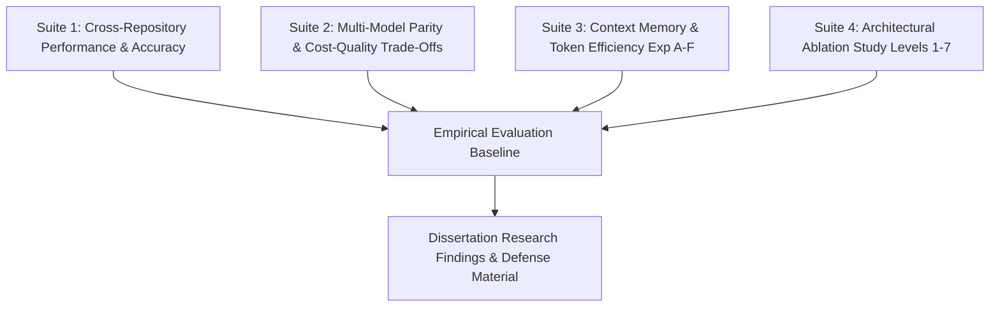

# ArchSynth v2.0 Experiment Protocol & Methodology

**Project**: ArchSynth v2.0 Research Evaluation  
**Document**: `benchmarks/experiments/experiment_protocol.md`  

---

## 1. Experimental Design Overview

The empirical evaluation of ArchSynth v2.0 is organized into four core experiment suites:

---

## 2. Suite 1: Cross-Repository Recovery Evaluation

- **Target**: Evaluate the accuracy of ArchSynth across 5 production ROS 2 repositories.
- **Reference Ground Truth**:
  - `eval/ground_truth/nav2/`: Historical expert-verified Nav2 reference specification.
  - `case_studies/slam_toolbox`: 100% reconciled AST & endpoint specification (37 source declarations, 143 C++ interface instances, 170 graph entities, 235 DDS endpoints).
  - `case_studies/ros2_control`: 1 node, 11 packages, 13 interfaces verified against upstream package manifests.
  - `case_studies/jaco2_sim_devkit`: 9 nodes, 12 launch files, 12 interfaces verified against Python AST.
  - `case_studies/behaviortree_cpp`: 2 nodes, 1 package verified against C++ AST.
  - `case_studies/express`: Negative baseline control (0 packages).

---

## 3. Suite 2: Multi-Model Parity Evaluation

- **Target**: Measure the impact of model family and parameter scale on schema adherence, hallucination rate, and execution latency.
- **Protocol**: Send identical JSON inputs from Phase 3 extraction to Gemini 2.5 Flash, Gemini 1.5 Pro, GPT-4o, Claude 3.5 Sonnet, and Llama 3.1 70B.

---

## 4. Suite 3: Context Memory & Token Efficiency (Exp A–F)

Investigating the core research question:  
*“How does structured, hierarchical, and retrieval-based context memory affect the accuracy, completeness, and token efficiency of LLM-assisted ROS 2 architecture recovery?”*

- **Experiment A (No Persistent Memory)**: Zero historical context passed. The LLM receives only raw file text per request.
- **Experiment B (Full Repository Context)**: Entire codebase concatenated into prompt (up to model context limit).
- **Experiment C (Structured Architecture Memory - ArchSynth Schema)**: Compact Pydantic v2 JSON state containing verified node declarations, launch profiles, and extracted interfaces.
- **Experiment D (Retrieval-Augmented Context - RAG)**: Semantic embedding retrieval (Top-k chunks) of source text based on cosine similarity.
- **Experiment E (Hierarchical Context Memory)**: Tiered memory structure (Repo Summary $\rightarrow$ Package Specs $\rightarrow$ Node Declarations $\rightarrow$ Interface Signatures).
- **Experiment F (Phase-Based Sequential Memory - ArchSynth Pipeline)**: Pipeline stages pass strictly validated Pydantic JSON artifacts (`nodes.json` $\rightarrow$ `launches.json` $\rightarrow$ `interfaces.json` $\rightarrow$ `subsystems.json`).

---

## 5. Suite 4: Architectural Ablation Study (Levels 1–7)

Systematically disables components of ArchSynth to isolate each stage's marginal contribution:
1. **Level 1**: Static Analysis Only (pure C++/Python AST without launch awareness).
2. **Level 2**: Static Analysis + Launch Analysis (resolves launch substitutions and remappings).
3. **Level 3**: Static + Launch + Deployment Resolution (identifies component containers and deployment profiles).
4. **Level 4**: Static + Launch + Communication Graph (reconstructs topic, service, and action topologies).
5. **Level 5**: Static + Launch + Comm Graph + LLM Synthesis (infers semantic subsystems and architecture narratives).
6. **Level 6**: Static + Comm + Structured Memory + LLM (applies Pydantic schema constraints to eliminate hallucinations).
7. **Level 7**: Full ArchSynth Pipeline v2.0 (complete multi-view ISO 42010 recovery with provenance sidecars).
