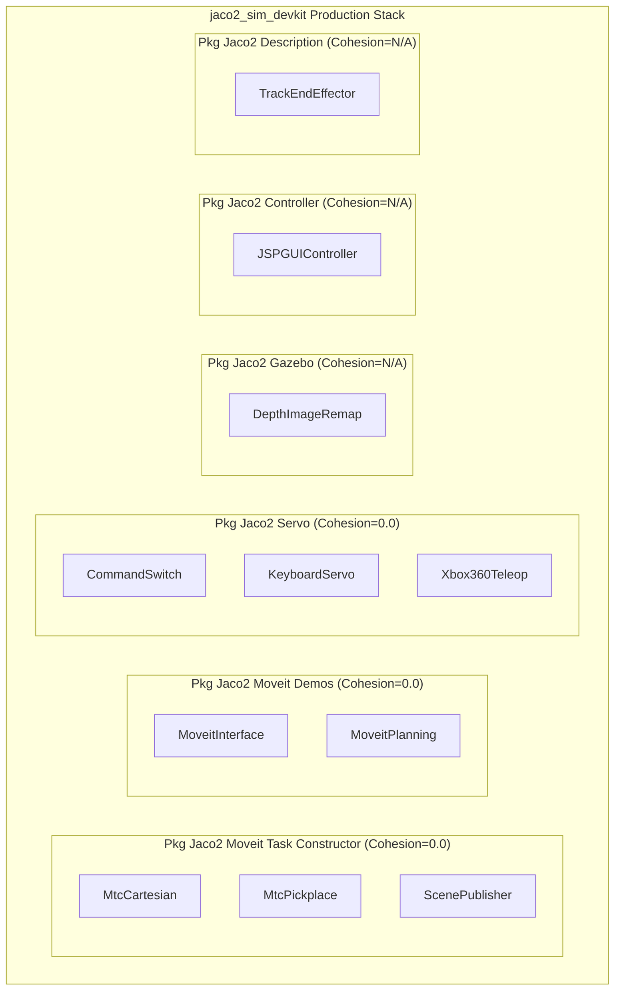
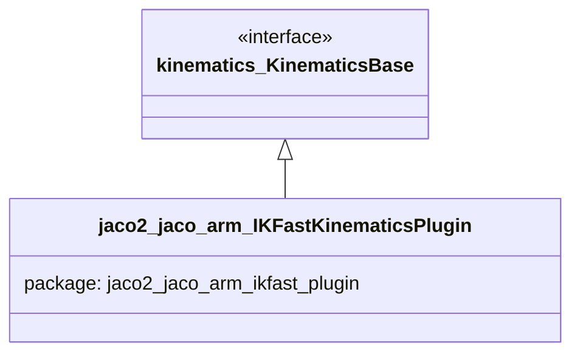
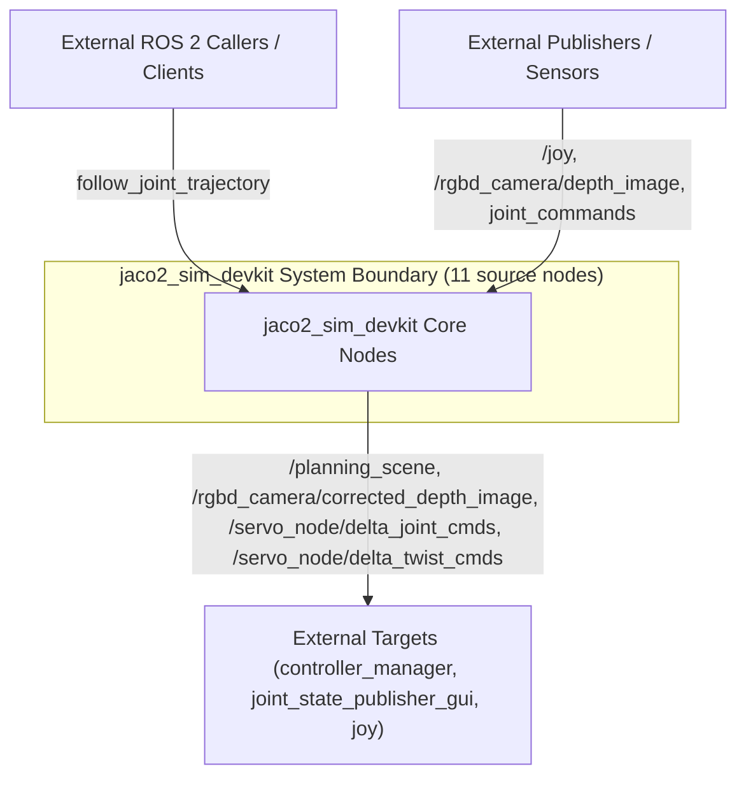
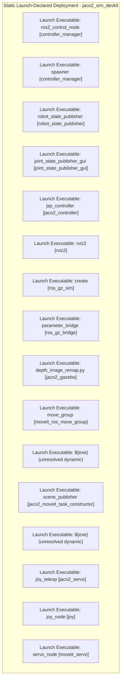
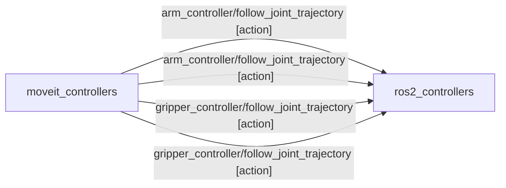
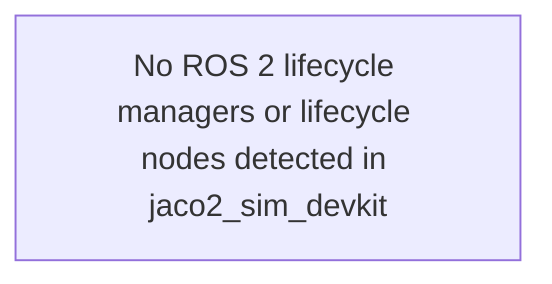
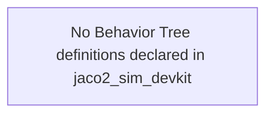

# jaco2_sim_devkit Architecture Documentation

> **Generated automatically by ArchSynth**  
> **Tool**: ArchSynth v2.0 — Evidence-Grounded ROS2 Architecture Recovery  
> **Repository**: [jaco2_sim_devkit](https://github.com/VibhuSharma19/jaco2_sim_devkit)  
> **Branch**: `main`  
> **Commit Hash**: `993a6e3de05e50fec4ce40c65a5b1d3a9d8ca9cc`  
> **Analysis Timestamp**: `2026-11-27T08:12:44.615986+00:00`  
> **LLM Provider & Model**: `gemini / gemini-1.5-flash`  
> **Analysis Duration**: `7.22s`  
> **Documentation Style**: ISO/IEC/IEEE 42010-aligned  

## Executive Summary

This document provides the reconstructed software architecture documentation for **jaco2_sim_devkit**. ArchSynth parsed **11 ROS2 nodes** and **12 launch files**, organizing them into **6 logical subsystems**. Every recovered architectural entity is grounded with source-code evidence (file:line citations).

### Architecture Overview Statistics

| Metric | Count |
| :--- | :--- |
| **Total Discovered Nodes** | 11 |
| **Parsed Launch Files** | 12 |
| **Logical Subsystems** | 6 |
| **Unique DDS Topics** | 9 |
| **Service Connections** | 3 |
| **Action Connections** | 3 |

---

## 1. System Context (C4 Level 1)

The `jaco2_sim_devkit` repository defines a comprehensive ROS2-based software architecture designed to facilitate the simulation, control, and motion planning for the Jaco2 robotic arm. Its primary purpose is to provide a robust development and testing environment for applications involving the Jaco2 manipulator without requiring physical hardware. This system serves robotics developers, researchers, and educators by offering a high-fidelity virtual representation of the robot, enabling rapid prototyping and validation of control algorithms and motion sequences.

Internally, the system is structured into 6 distinct subsystems, comprising 11 ROS2 nodes that communicate via 9 defined topics. Key architectural components include the `jaco2_description` package, which provides the kinematic and visual models of the Jaco2 arm, integrated into the Gazebo simulation environment via `jaco2_gazebo`. Control interfaces are managed by `jaco2_controller`, while advanced motion planning and task execution capabilities are enabled through `jaco2_moveit_config`, `jaco2_moveit_demos`, and `jaco2_moveit_task_constructor`, leveraging the MoveIt! framework. This modular design ensures clear separation of concerns and promotes extensibility within the ROS2 ecosystem.

---

## 2. Container View (C4 Level 2)

The system is composed of ROS2 package containers communicating over DDS topics, services, and action interfaces.

### Subsystems Summary

#### Subsystem: `pkg_jaco2_moveit_task_constructor`
Production subsystem responsible for pkg jaco2 moveit task constructor capabilities.
- **Assignment Rationale**: Grouped 3 node(s) from package(s) jaco2_moveit_task_constructor based on package boundary, functional role, and 0 internal / 3 external interface links.
- **Architectural Role**: `production_subsystem`
- **Intra-Subsystem Cohesion**: `0.0` | **Inter-Subsystem Coupling**: `3.0` (Internal: `0.0`, External: `3.0`) | **Interface Density**: `1.0`
- **Nodes (3)**: `jaco2_moveit_task_constructor::MtcCartesian`, `jaco2_moveit_task_constructor::MtcPickplace`, `jaco2_moveit_task_constructor::ScenePublisher`
- **Launch Files (1)**: `run.launch.py`

#### Subsystem: `pkg_jaco2_moveit_demos`
Production subsystem responsible for pkg jaco2 moveit demos capabilities.
- **Assignment Rationale**: Grouped 2 node(s) from package(s) jaco2_moveit_demos based on package boundary, functional role, and 0 internal / 1 external interface links.
- **Architectural Role**: `production_subsystem`
- **Intra-Subsystem Cohesion**: `0.0` | **Inter-Subsystem Coupling**: `1.0` (Internal: `0.0`, External: `1.0`) | **Interface Density**: `0.5`
- **Nodes (2)**: `jaco2_moveit_demos::MoveitInterface`, `jaco2_moveit_demos::MoveitPlanning`
- **Launch Files (1)**: `moveit_py.launch.py`

#### Subsystem: `pkg_jaco2_servo`
Production subsystem responsible for pkg jaco2 servo capabilities.
- **Assignment Rationale**: Grouped 3 node(s) from package(s) jaco2_servo based on package boundary, functional role, and 0 internal / 9 external interface links.
- **Architectural Role**: `production_subsystem`
- **Intra-Subsystem Cohesion**: `0.0` | **Inter-Subsystem Coupling**: `9.0` (Internal: `0.0`, External: `9.0`) | **Interface Density**: `3.0`
- **Nodes (3)**: `jaco2_servo::CommandSwitch`, `jaco2_servo::KeyboardServo`, `jaco2_servo::Xbox360Teleop`
- **Launch Files (2)**: `joystick_teleop.launch.py`, `keyboard_teleop.launch.py`

#### Subsystem: `pkg_jaco2_gazebo`
Production subsystem responsible for pkg jaco2 gazebo capabilities.
- **Assignment Rationale**: Grouped 1 node(s) from package(s) jaco2_gazebo based on package boundary, functional role, and 0 internal / 2 external interface links.
- **Architectural Role**: `production_subsystem`
- **Intra-Subsystem Cohesion**: N/A (<2 nodes) | **Inter-Subsystem Coupling**: `2.0` (Internal: `0.0`, External: `2.0`) | **Interface Density**: `2.0`
- **Nodes (1)**: `jaco2_gazebo::DepthImageRemap`
- **Launch Files (1)**: `gazebo_world.launch.py`

#### Subsystem: `pkg_jaco2_controller`
Production subsystem responsible for pkg jaco2 controller capabilities.
- **Assignment Rationale**: Grouped 1 node(s) from package(s) jaco2_controller based on package boundary, functional role, and 0 internal / 3 external interface links.
- **Architectural Role**: `production_subsystem`
- **Intra-Subsystem Cohesion**: N/A (<2 nodes) | **Inter-Subsystem Coupling**: `3.0` (Internal: `0.0`, External: `3.0`) | **Interface Density**: `3.0`
- **Nodes (1)**: `jaco2_controller::JSPGUIController`
- **Launch Files (1)**: `jsp_gui_control.launch.py`

#### Subsystem: `pkg_jaco2_description`
Production subsystem responsible for pkg jaco2 description capabilities.
- **Assignment Rationale**: Grouped 1 node(s) from package(s) jaco2_description based on package boundary, functional role, and 0 internal / 0 external interface links.
- **Architectural Role**: `production_subsystem`
- **Intra-Subsystem Cohesion**: N/A (<2 nodes) | **Inter-Subsystem Coupling**: `0.0` (Internal: `0.0`, External: `0.0`) | **Interface Density**: `0.0`
- **Nodes (1)**: `jaco2_description::TrackEndEffector`

### Architecture Metrics Definitions

| Metric | Mathematical Definition | Inputs & Edge Cases |
| :--- | :--- | :--- |
| **Intra-Subsystem Cohesion** | `E_internal / (N * (N - 1))` | Directed communication edges between nodes inside the subsystem divided by ordered node pairs. Reported as `N/A` when `N < 2`. |
| **Internal Coupling** | `E_cross_internal` | Directed topic/service/action edges crossing between this subsystem and other in-repository subsystems. |
| **External Coupling** | `I_unmatched_external` | Declared interfaces (pubs/subs/services/actions) on subsystem nodes whose peer resides outside the repository (e.g., `move_group`, `servo_node`, `ros2_control`). |
| **Total Coupling** | `Internal Coupling + External Coupling` | Total boundary-crossing interactions for the subsystem. |
| **Interface Density** | `Total_Interfaces / N` | Average declared ROS 2 endpoints (topics, services, actions) per node in the subsystem. |

---

## 3. Component View & System Diagram (C4 Level 3)

The following Mermaid diagram visualizes the reconstructed subsystem composition and communication graph:

---

## 4. Node Catalog

Overview of the core discovered ROS2 nodes in the system:

| Node Name | Package | Class / Executable | Architectural Classification | Pubs | Subs | Services | Actions | Evidence | Validation |
| :--- | :--- | :--- | :--- | :---: | :---: | :---: | :---: | :---: | :---: |
| [`JSPGUI_Controller`](nodes/jaco2_controller__JSPGUIController.md) | `jaco2_controller` | `JSPGUIController` | `unknown` | 2 | 1 | 0 | 0 | 1 item(s) | ✅ supported |
| [`track_ee`](nodes/jaco2_description__TrackEndEffector.md) | `jaco2_description` | `TrackEndEffector` | `unknown` | 0 | 0 | 0 | 0 | 1 item(s) | ✅ supported |
| [`depth_image_remaper`](nodes/jaco2_gazebo__DepthImageRemap.md) | `jaco2_gazebo` | `DepthImageRemap` | `unknown` | 1 | 1 | 0 | 0 | 1 item(s) | ✅ supported |
| [`MoveitInterface`](nodes/jaco2_moveit_demos__MoveitInterface.md) | `jaco2_moveit_demos` | `MoveitInterface` | `unknown` | 0 | 0 | 0 | 1 | 1 item(s) | ✅ supported |
| [`moveit_planning`](nodes/jaco2_moveit_demos__MoveitPlanning.md) | `jaco2_moveit_demos` | `MoveitPlanning` | `unknown` | 0 | 0 | 0 | 0 | 1 item(s) | ✅ supported |
| [`mtc_pickplace`](nodes/jaco2_moveit_task_constructor__MtcPickplace.md) | `jaco2_moveit_task_constructor` | `MtcPickplace` | `unknown` | 0 | 0 | 0 | 1 | 1 item(s) | ✅ supported |
| [`mtc_cartesian`](nodes/jaco2_moveit_task_constructor__MtcCartesian.md) | `jaco2_moveit_task_constructor` | `MtcCartesian` | `unknown` | 0 | 0 | 0 | 1 | 1 item(s) | ✅ supported |
| [`scene_publisher`](nodes/jaco2_moveit_task_constructor__ScenePublisher.md) | `jaco2_moveit_task_constructor` | `ScenePublisher` | `unknown` | 1 | 0 | 0 | 0 | 1 item(s) | ✅ supported |
| [`xbox360_teleop`](nodes/jaco2_servo__Xbox360Teleop.md) | `jaco2_servo` | `Xbox360Teleop` | `unknown` | 2 | 1 | 3 | 0 | 1 item(s) | ✅ supported |
| [`servo_keyboard_input`](nodes/jaco2_servo__KeyboardServo.md) | `jaco2_servo` | `KeyboardServo` | `unknown` | 2 | 0 | 0 | 0 | 1 item(s) | ✅ supported |
| [`command_switch`](nodes/jaco2_servo__CommandSwitch.md) | `jaco2_servo` | `CommandSwitch` | `unknown` | 0 | 0 | 1 | 0 | 1 item(s) | ✅ supported |

---

## 5. Launch File Composition

Parsed **12 launch files** across the repository.

Alternative standalone launch profiles are analyzed independently by default.

| Launch File | Architectural Classification | Direct Node | Direct LifecycleNode | ComposableNode | ComposableNodeContainer | LoadComposableNodes | Included Launch | Unresolved | Resolved Executable | Runtime Node Name | CMake Installed |
| :--- | :--- | :---: | :---: | :---: | :---: | :---: | :---: | :---: | :--- | :--- | :---: |
| `controller.launch.py` | `None` | 4 | 0 | 0 | 0 | 0 | 0 | 0 | `ros2_control_node, spawner` | `ros2_control_node, spawner` | Yes |
| `generic_controller.launch.py` | `None` | 6 | 0 | 0 | 0 | 0 | 0 | 0 | `robot_state_publisher, ros2_control_node, spawner` | `robot_state_publisher, ros2_control_node, spawner` | Yes |
| `jsp_gui_control.launch.py` | `None` | 2 | 0 | 0 | 0 | 0 | 0 | 0 | `joint_state_publisher_gui, jsp_controller` | `joint_state_publisher_gui, jsp_controller` | Yes |
| `display.launch.py` | `None` | 3 | 0 | 0 | 0 | 0 | 0 | 0 | `joint_state_publisher_gui, robot_state_publisher, rviz2` | `joint_state_publisher_gui, robot_state_publisher, rviz2` | Yes |
| `gazebo.launch.py` | `None` | 4 | 0 | 0 | 0 | 0 | 1 | 0 | `create, parameter_bridge, robot_state_publisher` | `create, parameter_bridge, robot_state_publisher` | Yes |
| `gazebo_world.launch.py` | `None` | 4 | 0 | 0 | 0 | 0 | 1 | 0 | `create, depth_image_remap.py, parameter_bridge, robot_state_publisher` | `create, depth_image_remap.py, parameter_bridge, robot_state_publisher` | Yes |
| `jaco2_move_group.launch.py` | `None` | 2 | 0 | 0 | 0 | 0 | 0 | 0 | `move_group, rviz2` | `move_group, rviz2` | Yes |
| `moveit_py.launch.py` | `None` | 2 | 0 | 0 | 0 | 0 | 0 | 0 | `${exe}, rviz2` | `${exe}, rviz2` | Yes |
| `move_group.launch.py` | `None` | 2 | 0 | 0 | 0 | 0 | 0 | 0 | `move_group, rviz2` | `move_group, rviz2` | Yes |
| `run.launch.py` | `None` | 2 | 0 | 0 | 0 | 0 | 0 | 0 | `${exe}, scene_publisher` | `${exe}, scene_publisher` | Yes |
| `joystick_teleop.launch.py` | `None` | 4 | 0 | 0 | 0 | 0 | 0 | 0 | `joy_node, joy_teleop, rviz2, servo_node` | `joy_node, joy_teleop, rviz2, servo_node` | Yes |
| `keyboard_teleop.launch.py` | `None` | 3 | 0 | 0 | 0 | 0 | 0 | 0 | `key_teleop, rviz2, servo_node` | `key_teleop, rviz2, servo_node` | Yes |

---

## 6. Communication Matrix

### Topic Connections

| Topic Name | Publisher Nodes | Subscriber Nodes |
| :--- | :--- | :--- |
| `/joy` | *External* | `xbox360_teleop` |
| `/planning_scene` | `scene_publisher` | *External* |
| `/rgbd_camera/corrected_depth_image` | `depth_image_remaper` | *External* |
| `/rgbd_camera/depth_image` | *External* | `depth_image_remaper` |
| `/servo_node/delta_joint_cmds` | `servo_keyboard_input`, `xbox360_teleop` | *External* |
| `/servo_node/delta_twist_cmds` | `servo_keyboard_input`, `xbox360_teleop` | *External* |
| `arm_controller/joint_trajectory` | `JSPGUI_Controller` | *External* |
| `gripper_controller/joint_trajectory` | `JSPGUI_Controller` | *External* |
| `joint_commands` | *External* | `JSPGUI_Controller` |

### Service Connections

| Service Name | Servers | Clients |
| :--- | :--- | :--- |
| `/servo_node/start_servo` | *External* | `xbox360_teleop` |
| `/servo_node/stop_servo` | *External* | `xbox360_teleop` |
| `/servo_node/switch_command_type` | *External* | `command_switch`, `xbox360_teleop` |

### Action Connections

| Action Name | Servers | Clients |
| :--- | :--- | :--- |
| `/arm_controller/follow_joint_trajectory` | `config::ros2_controllers` | `config::moveit_controllers` |
| `/gripper_controller/follow_joint_trajectory` | `config::ros2_controllers` | `config::moveit_controllers` |
| `follow_joint_trajectory` | *External* | `MoveitInterface`, `jaco2_moveit_demos::MoveitInterface`, `jaco2_moveit_task_constructor::MtcCartesian`, `jaco2_moveit_task_constructor::MtcPickplace`, `mtc_cartesian`, `mtc_pickplace` |

---

## 7. ROS 2 Lifecycle Management Architecture

No ROS 2 lifecycle managers or managed lifecycle nodes were declared in **jaco2_sim_devkit**.

---

## 8. Pluginlib Extensibility Architecture

ArchSynth recovered **1 pluginlib plugins** categorized across **1 architectural extension points**.
Status summary: **0 selected in default parameters**, **1 available in codebase**.

### Plugin Categories

| Extension Category | Base Class / Interface | Plugins Declared | Selected Active Plugin |
| :--- | :--- | :---: | :--- |
| `kinematics_plugin` | `kinematics::KinematicsBase` | 1 | `*None (Available)*` |

### Plugin Extensibility Class Diagram

---

## 10. ISO/IEC/IEEE 42010 Architecture Views (8 Views)

ArchSynth provides multi-perspective architectural representations conforming to ISO/IEC/IEEE 42010:

### View: System Context View (`system_context`)

System boundary for jaco2_sim_devkit derived from 11 source nodes, unmatched external-peer interfaces, and 9 external launch packages.

- **Architectural Concerns**: System boundaries, External interfaces, Operational environment
- **Target Stakeholders**: System Architects, Robotics Integrators, Application Engineers

### View: Package Dependency View (`package_dependency`)

Directed package dependency graph across 11 repository packages and 55 external dependencies (package.xml, setup.py, and resolved source dependencies).

- **Architectural Concerns**: Package coupling, Build layering, Modular reusability
- **Target Stakeholders**: Software Maintainers, Build Engineers, Component Developers

```mermaid
flowchart TD
    jaco2_bringup["jaco2_bringup (ament_cmake)"]
    jaco2_controller["jaco2_controller (ament_python)"]
    jaco2_description["jaco2_description (ament_cmake)"]
    jaco2_gazebo["jaco2_gazebo (ament_cmake)"]
    jaco2_jaco_arm_ikfast_plugin["jaco2_jaco_arm_ikfast_plugin (ament_cmake)"]
    jaco2_moveit_config["jaco2_moveit_config (ament_cmake)"]
    jaco2_moveit_demos["jaco2_moveit_demos (ament_python)"]
    jaco2_moveit_task_constructor["jaco2_moveit_task_constructor (ament_python)"]
    jaco2_servo["jaco2_servo (ament_python)"]
    jaco2_sim_devkit["jaco2_sim_devkit (ament_cmake)"]
    jaco2_utils["jaco2_utils (ament_python)"]
    controller_manager["controller_manager (external)"]
    jaco2_controller -->|"build_depend"| controller_manager
    jaco2_controller -->|"build_depend"| jaco2_description
    jaco2_controller -->|"exec_depend"| controller_manager
    jaco2_controller -->|"exec_depend"| jaco2_description
    xacro["xacro (external)"]
    jaco2_description -->|"depend"| xacro
    tf2_ros["tf2_ros (external)"]
    jaco2_description -->|"depend"| tf2_ros
    jaco2_description -.->|"source_import"| tf2_ros
    jaco2_description -.->|"source_import"| jaco2_utils
    tf2_kdl["tf2_kdl (external)"]
    jaco2_jaco_arm_ikfast_plugin -->|"build_depend"| tf2_kdl
    tf2_eigen["tf2_eigen (external)"]
    jaco2_jaco_arm_ikfast_plugin -->|"build_depend"| tf2_eigen
    moveit_core["moveit_core (external)"]
    jaco2_jaco_arm_ikfast_plugin -->|"build_depend"| moveit_core
    jaco2_jaco_arm_ikfast_plugin -->|"exec_depend"| moveit_core
    moveit["moveit (external)"]
    jaco2_jaco_arm_ikfast_plugin -.->|"source_include"| moveit
    jaco2_jaco_arm_ikfast_plugin -.->|"source_include"| tf2_kdl
    jaco2_jaco_arm_ikfast_plugin -.->|"source_include"| tf2_eigen
    moveit_ros_move_group["moveit_ros_move_group (external)"]
    jaco2_moveit_config -->|"exec_depend"| moveit_ros_move_group
    moveit_kinematics["moveit_kinematics (external)"]
    jaco2_moveit_config -->|"exec_depend"| moveit_kinematics
    moveit_planners["moveit_planners (external)"]
    jaco2_moveit_config -->|"exec_depend"| moveit_planners
    moveit_simple_controller_manager["moveit_simple_controller_manager (external)"]
    jaco2_moveit_config -->|"exec_depend"| moveit_simple_controller_manager
    jaco2_moveit_config -->|"exec_depend"| tf2_ros
    jaco2_moveit_config -->|"exec_depend"| xacro
    jaco2_moveit_config -->|"exec_depend"| controller_manager
    jaco2_moveit_config -->|"exec_depend"| jaco2_description
    moveit_configs_utils["moveit_configs_utils (external)"]
    jaco2_moveit_config -->|"exec_depend"| moveit_configs_utils
    jaco2_moveit_config -.->|"source_import"| moveit_configs_utils
    jaco2_moveit_demos -->|"exec_depend"| moveit
    jaco2_moveit_demos -.->|"source_import"| moveit
    jaco2_moveit_task_constructor -->|"exec_depend"| moveit
    jaco2_moveit_task_constructor -.->|"source_import"| moveit
    jaco2_moveit_task_constructor -.->|"source_import"| jaco2_utils
    jaco2_sim_devkit -->|"depend"| jaco2_description
    jaco2_sim_devkit -->|"depend"| jaco2_controller
    jaco2_sim_devkit -->|"depend"| jaco2_moveit_config
    jaco2_sim_devkit -->|"depend"| jaco2_moveit_demos
    jaco2_sim_devkit -->|"depend"| jaco2_servo
    jaco2_sim_devkit -->|"depend"| jaco2_utils
    jaco2_sim_devkit -->|"depend"| jaco2_moveit_task_constructor
    jaco2_sim_devkit -->|"depend"| jaco2_gazebo
    jaco2_sim_devkit -->|"depend"| jaco2_bringup
    jaco2_sim_devkit -->|"depend"| jaco2_jaco_arm_ikfast_plugin
```

### View: Subsystem / Component View (`subsystem_component`)

Recovered functional software subsystems, metrics, and inter-subsystem communication edges for jaco2_sim_devkit.

- **Architectural Concerns**: Functional decomposition, Subsystem cohesion, Coupling minimization
- **Target Stakeholders**: Lead Architects, Functional Leads, Domain Engineers

### View: Runtime Deployment View (`runtime_deployment`)

Static launch-declared deployment topology for jaco2_sim_devkit (0 containers, 38 launch instances). Note: OS process hosting is inferred from launch declarations, not runtime-observed.

- **Architectural Concerns**: Process allocation, IPC vs Intra-process communication, Deployment efficiency
- **Target Stakeholders**: Deployment Engineers, Embedded Systems Leads, Performance Engineers

### View: Communication View (`communication_topology`)

Recovered interaction topology displaying topics, services, and actions for jaco2_sim_devkit.

- **Architectural Concerns**: Dataflow, Message passing latency, Interface compatibility
- **Target Stakeholders**: Integration Engineers, Safety Engineers, Robotics Developers

### View: Lifecycle View (`lifecycle_architecture`)

No ROS 2 lifecycle nodes, lifecycle managers, or lifecycle configurations were detected in jaco2_sim_devkit. System-specific lifecycle diagram omitted.

- **Architectural Concerns**: Deterministic startup, State consistency, Fault isolation
- **Target Stakeholders**: System Engineers, Safety Certification Authorities, Operations

### View: Plugin Architecture View (`plugin_architecture`)

Pluginlib extensibility patterns and implementations recovered for jaco2_sim_devkit.

- **Architectural Concerns**: Extensibility, Algorithm swappability, Runtime polymorphism
- **Target Stakeholders**: Algorithm Developers, Extension Authors, Software Architects

### View: Behavior Tree View (`behavior_tree_orchestration`)

Behavior Tree navigation orchestration is not utilized in jaco2_sim_devkit.

- **Architectural Concerns**: Autonomous mission execution, Reactive recovery, Blackboard dataflow
- **Target Stakeholders**: Autonomy Engineers, Behavior Designers, Test Engineers

---

## 11. Evidence / Traceability

> This section documents the source-code evidence supporting each recovered architectural entity.
> Evidence-grounded recovery distinguishes schema-valid claims from factually-supported claims.

### Node Evidence

| Node | Evidence File | Lines | Evidence Type |
| :--- | :--- | :--- | :--- |
| `JSPGUI_Controller` | `jaco2_controller/jaco2_controller/jsp_gui_controller.py` | `L9–L47` | `node_definition` |
| `track_ee` | `jaco2_description/scripts/track_end_effector.py` | `L14–L96` | `node_definition` |
| `depth_image_remaper` | `jaco2_gazebo/scripts/depth_image_remap.py` | `L10–L48` | `node_definition` |
| `MoveitInterface` | `jaco2_moveit_demos/jaco2_moveit_demos/moveit_interface.py` | `L15–L161` | `node_definition` |
| `moveit_planning` | `jaco2_moveit_demos/jaco2_moveit_demos/moveit_planning.py` | `L14–L160` | `node_definition` |
| `mtc_pickplace` | `jaco2_moveit_task_constructor/jaco2_moveit_task_constructor/pickplace.py` | `L14` | `node_definition` |
| `mtc_cartesian` | `jaco2_moveit_task_constructor/jaco2_moveit_task_constructor/planner.py` | `L12` | `node_definition` |
| `scene_publisher` | `jaco2_moveit_task_constructor/jaco2_moveit_task_constructor/scene_publisher.py` | `L10–L53` | `node_definition` |
| `xbox360_teleop` | `jaco2_servo/jaco2_servo/joystick_teleop.py` | `L43–L189` | `node_definition` |
| `servo_keyboard_input` | `jaco2_servo/jaco2_servo/keyboard_teleop.py` | `L88–L210` | `node_definition` |
| `command_switch` | `jaco2_servo/jaco2_servo/servo_cmd_switch.py` | `L12–L80` | `node_definition` |

### Topic Evidence (Sample)

| Topic | Direction | Node | Evidence File | Lines |
| :--- | :--- | :--- | :--- | :--- |
| `arm_controller/joint_trajectory` | publish | `JSPGUI_Controller` | `jaco2_controller/jaco2_controller/jsp_gui_controller.py` | `L17` |
| `gripper_controller/joint_trajectory` | publish | `JSPGUI_Controller` | `jaco2_controller/jaco2_controller/jsp_gui_controller.py` | `L18` |
| `joint_commands` | subscribe | `JSPGUI_Controller` | `jaco2_controller/jaco2_controller/jsp_gui_controller.py` | `L19` |
| `/rgbd_camera/corrected_depth_image` | publish | `depth_image_remaper` | `jaco2_gazebo/scripts/depth_image_remap.py` | `L25` |
| `/rgbd_camera/depth_image` | subscribe | `depth_image_remaper` | `jaco2_gazebo/scripts/depth_image_remap.py` | `L19–L23` |
| `/planning_scene` | publish | `scene_publisher` | `jaco2_moveit_task_constructor/jaco2_moveit_task_constructor/scene_publisher.py` | `L23` |
| `/servo_node/delta_joint_cmds` | publish | `xbox360_teleop` | `jaco2_servo/jaco2_servo/joystick_teleop.py` | `L57` |
| `/servo_node/delta_twist_cmds` | publish | `xbox360_teleop` | `jaco2_servo/jaco2_servo/joystick_teleop.py` | `L58` |
| `/joy` | subscribe | `xbox360_teleop` | `jaco2_servo/jaco2_servo/joystick_teleop.py` | `L63` |

---

## 11b. Structured Node & Executable Inventory

Distinguishes repository-defined source nodes, composable components, external ROS 2 launch executables, dynamically loaded plugins, and unresolved dynamic entries:

| Name / Identifier | Package | Executable | Classification | Origin | Confidence | Evidence |
| :--- | :--- | :--- | :--- | :--- | :---: | :--- |
| `JSPGUI_Controller` | `jaco2_controller` | `jsp_controller` | `repository_defined_node` | `repository_source` | 1.00 | `jaco2_controller/jaco2_controller/jsp_gui_controller.py:L9` |
| `track_ee` | `jaco2_description` | `(library/script)` | `repository_defined_node` | `repository_source` | 1.00 | `jaco2_description/scripts/track_end_effector.py:L14` |
| `depth_image_remaper` | `jaco2_gazebo` | `(library/script)` | `repository_defined_node` | `repository_source` | 1.00 | `jaco2_gazebo/scripts/depth_image_remap.py:L10` |
| `MoveitInterface` | `jaco2_moveit_demos` | `moveit_py` | `repository_defined_node` | `repository_source` | 1.00 | `jaco2_moveit_demos/jaco2_moveit_demos/moveit_interface.py:L15` |
| `moveit_planning` | `jaco2_moveit_demos` | `moveit_planning` | `repository_defined_node` | `repository_source` | 1.00 | `jaco2_moveit_demos/jaco2_moveit_demos/moveit_planning.py:L14` |
| `mtc_pickplace` | `jaco2_moveit_task_constructor` | `pickplace` | `repository_defined_node` | `repository_source` | 1.00 | `jaco2_moveit_task_constructor/jaco2_moveit_task_constructor/pickplace.py:L14` |
| `mtc_cartesian` | `jaco2_moveit_task_constructor` | `planner` | `repository_defined_node` | `repository_source` | 1.00 | `jaco2_moveit_task_constructor/jaco2_moveit_task_constructor/planner.py:L12` |
| `scene_publisher` | `jaco2_moveit_task_constructor` | `scene_publisher` | `repository_defined_node` | `repository_source` | 1.00 | `jaco2_moveit_task_constructor/jaco2_moveit_task_constructor/scene_publisher.py:L10` |
| `xbox360_teleop` | `jaco2_servo` | `joy_teleop` | `repository_defined_node` | `repository_source` | 1.00 | `jaco2_servo/jaco2_servo/joystick_teleop.py:L43` |
| `servo_keyboard_input` | `jaco2_servo` | `key_teleop` | `repository_defined_node` | `repository_source` | 1.00 | `jaco2_servo/jaco2_servo/keyboard_teleop.py:L88` |
| `command_switch` | `jaco2_servo` | `cmd_switch` | `repository_defined_node` | `repository_source` | 1.00 | `jaco2_servo/jaco2_servo/servo_cmd_switch.py:L12` |
| `ros2_control_node` | `controller_manager` | `ros2_control_node` | `external_ros_node` | `launch_declaration` | 0.95 | `jaco2_controller/launch/controller.launch.py:L30` |
| `spawner` | `controller_manager` | `spawner` | `external_ros_node` | `launch_declaration` | 0.95 | `jaco2_controller/launch/controller.launch.py:L42` |
| `robot_state_publisher` | `robot_state_publisher` | `robot_state_publisher` | `external_ros_node` | `launch_declaration` | 0.95 | `jaco2_controller/launch/generic_controller.launch.py:L46` |
| `joint_state_publisher_gui` | `joint_state_publisher_gui` | `joint_state_publisher_gui` | `external_ros_node` | `launch_declaration` | 0.95 | `jaco2_controller/launch/jsp_gui_control.launch.py:L31` |
| `rviz2` | `rviz2` | `rviz2` | `external_ros_node` | `launch_declaration` | 0.95 | `jaco2_description/launch/display.launch.py:L36` |
| `create` | `ros_gz_sim` | `create` | `external_ros_node` | `launch_declaration` | 0.95 | `jaco2_description/launch/gazebo.launch.py:L88` |
| `parameter_bridge` | `ros_gz_bridge` | `parameter_bridge` | `external_ros_node` | `launch_declaration` | 0.95 | `jaco2_description/launch/gazebo.launch.py:L99` |
| `depth_image_remap.py` | `jaco2_gazebo` | `depth_image_remap.py` | `internal_launch_instance` | `launch_declaration` | 0.85 | `jaco2_gazebo/launch/gazebo_world.launch.py:L64` |
| `move_group` | `moveit_ros_move_group` | `move_group` | `external_ros_node` | `launch_declaration` | 0.95 | `jaco2_moveit_config/launch/jaco2_move_group.launch.py:L47` |
| `${exe}` | `jaco2_moveit_demos` | `${exe}` | `unresolved_executable` | `launch_declaration` | 0.40 | `jaco2_moveit_demos/launch/moveit_py.launch.py:L38` |
| `${exe}` | `jaco2_moveit_task_constructor` | `${exe}` | `unresolved_executable` | `launch_declaration` | 0.40 | `jaco2_moveit_task_constructor/launch/run.launch.py:L34` |
| `joy_node` | `joy` | `joy_node` | `external_ros_node` | `launch_declaration` | 0.95 | `jaco2_servo/launch/joystick_teleop.launch.py:L54` |
| `servo_node` | `moveit_servo` | `servo_node` | `external_ros_node` | `launch_declaration` | 0.95 | `jaco2_servo/launch/joystick_teleop.launch.py:L61` |
| `jaco2_jaco_arm::IKFastKinematicsPlugin` | `jaco2_jaco_arm_ikfast_plugin` | `(pluginlib)` | `dynamically_loaded_component` | `pluginlib_manifest` | 1.00 | `jaco2_jaco_arm_ikfast_plugin/jaco2_jaco_arm_moveit_ikfast_plugin_description.xml:L1` |

---

## 11c. Package Dependency Architecture

Recovered **11 internal packages**, **55 external dependencies**, and **196 directed dependency edges** from `package.xml`, `setup.py`, and source `#include`/`import` statements.

| Source Package | Target Package | Dependency Type | Origin | Target Scope | Evidence |
| :--- | :--- | :--- | :--- | :---: | :--- |
| `jaco2_bringup` | `ament_cmake` | `buildtool_depend` | `declared_manifest` | External | `jaco2_bringup/package.xml:L10` |
| `jaco2_bringup` | `ament_lint_auto` | `test_depend` | `declared_manifest` | External | `jaco2_bringup/package.xml:L12` |
| `jaco2_bringup` | `ament_lint_common` | `test_depend` | `declared_manifest` | External | `jaco2_bringup/package.xml:L13` |
| `jaco2_controller` | `controller_manager` | `build_depend` | `declared_manifest` | External | `jaco2_controller/package.xml:L17` |
| `jaco2_controller` | `jaco2_description` | `build_depend` | `declared_manifest` | Internal | `jaco2_controller/package.xml:L18` |
| `jaco2_controller` | `ament_python` | `buildtool_depend` | `declared_manifest` | External | `jaco2_controller/package.xml:L10` |
| `jaco2_controller` | `controller_manager` | `exec_depend` | `declared_manifest` | External | `jaco2_controller/package.xml:L20` |
| `jaco2_controller` | `jaco2_description` | `exec_depend` | `declared_manifest` | Internal | `jaco2_controller/package.xml:L21` |
| `jaco2_controller` | `joint_state_publisher_gui` | `exec_depend` | `declared_manifest` | External | `jaco2_controller/package.xml:L22` |
| `jaco2_controller` | `ament_copyright` | `test_depend` | `declared_manifest` | External | `jaco2_controller/package.xml:L12` |
| `jaco2_controller` | `ament_flake8` | `test_depend` | `declared_manifest` | External | `jaco2_controller/package.xml:L13` |
| `jaco2_controller` | `ament_pep257` | `test_depend` | `declared_manifest` | External | `jaco2_controller/package.xml:L14` |
| `jaco2_controller` | `python3-pytest` | `test_depend` | `declared_manifest` | External | `jaco2_controller/package.xml:L15` |
| `jaco2_controller` | `setuptools` | `exec_depend` | `declared_manifest` | External | `jaco2_controller/setup.py` |
| `jaco2_controller` | `rclpy` | `source_import` | `observed_source` | External | `jaco2_controller/jaco2_controller/jsp_gui_controller.py:L3` |
| `jaco2_controller` | `sensor_msgs` | `source_import` | `observed_source` | External | `jaco2_controller/jaco2_controller/jsp_gui_controller.py:L5` |
| `jaco2_controller` | `trajectory_msgs` | `source_import` | `observed_source` | External | `jaco2_controller/jaco2_controller/jsp_gui_controller.py:L6` |
| `jaco2_controller` | `ament_index_python` | `source_import` | `observed_source` | External | `jaco2_controller/launch/controller.launch.py:L2` |
| `jaco2_controller` | `launch` | `source_import` | `observed_source` | External | `jaco2_controller/launch/controller.launch.py:L4` |
| `jaco2_controller` | `launch_ros` | `source_import` | `observed_source` | External | `jaco2_controller/launch/controller.launch.py:L9` |
| `jaco2_controller` | `ament_copyright` | `source_import` | `observed_source` | External | `jaco2_controller/test/test_copyright.py:L15` |
| `jaco2_controller` | `ament_flake8` | `source_import` | `observed_source` | External | `jaco2_controller/test/test_flake8.py:L15` |
| `jaco2_controller` | `ament_pep257` | `source_import` | `observed_source` | External | `jaco2_controller/test/test_pep257.py:L15` |
| `jaco2_description` | `xacro` | `depend` | `declared_manifest` | External | `jaco2_description/package.xml:L16` |
| `jaco2_description` | `jaco2_utlis` | `depend` | `declared_manifest` | External | `jaco2_description/package.xml:L17` |
| `jaco2_description` | `tf2_ros` | `depend` | `declared_manifest` | External | `jaco2_description/package.xml:L18` |
| `jaco2_description` | `geometry_msgs` | `depend` | `declared_manifest` | External | `jaco2_description/package.xml:L19` |
| `jaco2_description` | `rclpy` | `depend` | `declared_manifest` | External | `jaco2_description/package.xml:L20` |
| `jaco2_description` | `ament_cmake` | `buildtool_depend` | `declared_manifest` | External | `jaco2_description/package.xml:L10` |
| `jaco2_description` | `ament_cmake_python` | `buildtool_depend` | `declared_manifest` | External | `jaco2_description/package.xml:L11` |
| `jaco2_description` | `python3` | `exec_depend` | `declared_manifest` | External | `jaco2_description/package.xml:L22` |
| `jaco2_description` | `ament_lint_auto` | `test_depend` | `declared_manifest` | External | `jaco2_description/package.xml:L13` |
| `jaco2_description` | `ament_lint_common` | `test_depend` | `declared_manifest` | External | `jaco2_description/package.xml:L14` |
| `jaco2_description` | `ament_index_python` | `source_import` | `observed_source` | External | `jaco2_description/launch/display.launch.py:L2` |
| `jaco2_description` | `launch` | `source_import` | `observed_source` | External | `jaco2_description/launch/display.launch.py:L3` |
| `jaco2_description` | `jaco2_utils` | `source_import` | `observed_source` | Internal | `jaco2_description/scripts/track_end_effector.py:L10` |
| `jaco2_moveit_config` | `jaco2_description` | `exec_depend` | `declared_manifest` | Internal | `jaco2_moveit_config/package.xml:L34` |
| `jaco2_moveit_task_constructor` | `jaco2_utils` | `source_import` | `observed_source` | Internal | `jaco2_moveit_task_constructor/jaco2_moveit_task_constructor/pickplace.py:L9` |
| `jaco2_sim_devkit` | `jaco2_description` | `depend` | `declared_manifest` | Internal | `jaco2_sim_devkit/package.xml:L16` |
| `jaco2_sim_devkit` | `jaco2_controller` | `depend` | `declared_manifest` | Internal | `jaco2_sim_devkit/package.xml:L17` |
| `jaco2_sim_devkit` | `jaco2_moveit_config` | `depend` | `declared_manifest` | Internal | `jaco2_sim_devkit/package.xml:L18` |
| `jaco2_sim_devkit` | `jaco2_moveit_demos` | `depend` | `declared_manifest` | Internal | `jaco2_sim_devkit/package.xml:L19` |
| `jaco2_sim_devkit` | `jaco2_servo` | `depend` | `declared_manifest` | Internal | `jaco2_sim_devkit/package.xml:L20` |
| `jaco2_sim_devkit` | `jaco2_utils` | `depend` | `declared_manifest` | Internal | `jaco2_sim_devkit/package.xml:L21` |
| `jaco2_sim_devkit` | `jaco2_moveit_task_constructor` | `depend` | `declared_manifest` | Internal | `jaco2_sim_devkit/package.xml:L22` |
| `jaco2_sim_devkit` | `jaco2_gazebo` | `depend` | `declared_manifest` | Internal | `jaco2_sim_devkit/package.xml:L23` |
| `jaco2_sim_devkit` | `jaco2_bringup` | `depend` | `declared_manifest` | Internal | `jaco2_sim_devkit/package.xml:L24` |
| `jaco2_sim_devkit` | `jaco2_jaco_arm_ikfast_plugin` | `depend` | `declared_manifest` | Internal | `jaco2_sim_devkit/package.xml:L25` |

---

## 11d. Architecture Consistency Validation & Unresolved Elements

Findings summary: **Confirmed**: 10, **Warning**: 8, **Unresolved**: 21, **Potential inconsistency**: 11

| ID | Severity | Category | Entity | Details |
| :--- | :--- | :--- | :--- | :--- |
| `VAL-001` | **Confirmed** | `external_launch_executable` | `controller_manager::ros2_control_node` | External ROS 2 executable 'ros2_control_node' from external package 'controller_manager' declared in jaco2_controller/launch/controller.launch.py. |
| `VAL-002` | **Confirmed** | `external_launch_executable` | `controller_manager::spawner` | External ROS 2 executable 'spawner' from external package 'controller_manager' declared in jaco2_controller/launch/controller.launch.py. |
| `VAL-003` | **Confirmed** | `external_launch_executable` | `robot_state_publisher::robot_state_publisher` | External ROS 2 executable 'robot_state_publisher' from external package 'robot_state_publisher' declared in jaco2_controller/launch/generic_controller.launch.py. |
| `VAL-004` | **Confirmed** | `external_launch_executable` | `joint_state_publisher_gui::joint_state_publisher_gui` | External ROS 2 executable 'joint_state_publisher_gui' from external package 'joint_state_publisher_gui' declared in jaco2_controller/launch/jsp_gui_control.launch.py. |
| `VAL-005` | **Confirmed** | `external_launch_executable` | `rviz2::rviz2` | External ROS 2 executable 'rviz2' from external package 'rviz2' declared in jaco2_description/launch/display.launch.py. |
| `VAL-006` | **Confirmed** | `external_launch_executable` | `ros_gz_sim::create` | External ROS 2 executable 'create' from external package 'ros_gz_sim' declared in jaco2_description/launch/gazebo.launch.py. |
| `VAL-007` | **Confirmed** | `external_launch_executable` | `ros_gz_bridge::parameter_bridge` | External ROS 2 executable 'parameter_bridge' from external package 'ros_gz_bridge' declared in jaco2_description/launch/gazebo.launch.py. |
| `VAL-008` | **Warning** | `launch_node_mismatch` | `jaco2_gazebo::depth_image_remap.py` | Launch file jaco2_gazebo/launch/gazebo_world.launch.py invokes 'depth_image_remap.py' in internal package 'jaco2_gazebo', which was not matched to a parsed node class. |
| `VAL-009` | **Confirmed** | `external_launch_executable` | `moveit_ros_move_group::move_group` | External ROS 2 executable 'move_group' from external package 'moveit_ros_move_group' declared in jaco2_moveit_config/launch/jaco2_move_group.launch.py. |
| `VAL-010` | **Unresolved** | `unresolved_launch_substitution` | `jaco2_moveit_demos::${exe}` | Launch executable '${exe}' in jaco2_moveit_demos/launch/moveit_py.launch.py depends on unresolved launch argument/substitution. |
| `VAL-011` | **Unresolved** | `unresolved_launch_substitution` | `jaco2_moveit_task_constructor::${exe}` | Launch executable '${exe}' in jaco2_moveit_task_constructor/launch/run.launch.py depends on unresolved launch argument/substitution. |
| `VAL-012` | **Confirmed** | `external_launch_executable` | `joy::joy_node` | External ROS 2 executable 'joy_node' from external package 'joy' declared in jaco2_servo/launch/joystick_teleop.launch.py. |
| `VAL-013` | **Confirmed** | `external_launch_executable` | `moveit_servo::servo_node` | External ROS 2 executable 'servo_node' from external package 'moveit_servo' declared in jaco2_servo/launch/joystick_teleop.launch.py. |
| `VAL-014` | **Warning** | `unlaunched_source_node` | `jaco2_description::TrackEndEffector` | Source node 'track_ee' (jaco2_description/scripts/track_end_effector.py) is not referenced by any analyzed launch file (may be invoked directly via ros2 run or library API). |
| `VAL-015` | **Warning** | `unlaunched_source_node` | `jaco2_gazebo::DepthImageRemap` | Source node 'depth_image_remaper' (jaco2_gazebo/scripts/depth_image_remap.py) is not referenced by any analyzed launch file (may be invoked directly via ros2 run or library API). |
| `VAL-016` | **Warning** | `unlaunched_source_node` | `jaco2_moveit_demos::MoveitInterface` | Source node 'MoveitInterface' (jaco2_moveit_demos/jaco2_moveit_demos/moveit_interface.py) is not referenced by any analyzed launch file (may be invoked directly via ros2 run or library API). |
| `VAL-017` | **Warning** | `unlaunched_source_node` | `jaco2_moveit_demos::MoveitPlanning` | Source node 'moveit_planning' (jaco2_moveit_demos/jaco2_moveit_demos/moveit_planning.py) is not referenced by any analyzed launch file (may be invoked directly via ros2 run or library API). |
| `VAL-018` | **Warning** | `unlaunched_source_node` | `jaco2_moveit_task_constructor::MtcPickplace` | Source node 'mtc_pickplace' (jaco2_moveit_task_constructor/jaco2_moveit_task_constructor/pickplace.py) is not referenced by any analyzed launch file (may be invoked directly via ros2 run or library API). |
| `VAL-019` | **Warning** | `unlaunched_source_node` | `jaco2_moveit_task_constructor::MtcCartesian` | Source node 'mtc_cartesian' (jaco2_moveit_task_constructor/jaco2_moveit_task_constructor/planner.py) is not referenced by any analyzed launch file (may be invoked directly via ros2 run or library API). |
| `VAL-020` | **Warning** | `unlaunched_source_node` | `jaco2_servo::CommandSwitch` | Source node 'command_switch' (jaco2_servo/jaco2_servo/servo_cmd_switch.py) is not referenced by any analyzed launch file (may be invoked directly via ros2 run or library API). |
| `VAL-021` | **Unresolved** | `subscriber_without_publisher` | `/joy` | Topic '/joy' has internal subscriber(s) ['xbox360_teleop'] with no in-repo publisher (likely published by external drivers/sensors such as joy_node or camera bridge). |
| `VAL-022` | **Unresolved** | `publisher_without_subscriber` | `/planning_scene` | Topic '/planning_scene' has internal publisher(s) ['scene_publisher'] with no in-repo subscriber (likely consumed by external nodes such as move_group, servo_node, or gazebo). |
| `VAL-023` | **Unresolved** | `publisher_without_subscriber` | `/rgbd_camera/corrected_depth_image` | Topic '/rgbd_camera/corrected_depth_image' has internal publisher(s) ['depth_image_remaper'] with no in-repo subscriber (likely consumed by external nodes such as move_group, servo_node, or gazebo). |
| `VAL-024` | **Unresolved** | `subscriber_without_publisher` | `/rgbd_camera/depth_image` | Topic '/rgbd_camera/depth_image' has internal subscriber(s) ['depth_image_remaper'] with no in-repo publisher (likely published by external drivers/sensors such as joy_node or camera bridge). |
| `VAL-025` | **Unresolved** | `publisher_without_subscriber` | `/servo_node/delta_joint_cmds` | Topic '/servo_node/delta_joint_cmds' has internal publisher(s) ['servo_keyboard_input', 'xbox360_teleop'] with no in-repo subscriber (likely consumed by external nodes such as move_group, servo_node, or gazebo). |
| `VAL-026` | **Unresolved** | `publisher_without_subscriber` | `/servo_node/delta_twist_cmds` | Topic '/servo_node/delta_twist_cmds' has internal publisher(s) ['servo_keyboard_input', 'xbox360_teleop'] with no in-repo subscriber (likely consumed by external nodes such as move_group, servo_node, or gazebo). |
| `VAL-027` | **Unresolved** | `publisher_without_subscriber` | `arm_controller/joint_trajectory` | Topic 'arm_controller/joint_trajectory' has internal publisher(s) ['JSPGUI_Controller'] with no in-repo subscriber (likely consumed by external nodes such as move_group, servo_node, or gazebo). |
| `VAL-028` | **Unresolved** | `publisher_without_subscriber` | `gripper_controller/joint_trajectory` | Topic 'gripper_controller/joint_trajectory' has internal publisher(s) ['JSPGUI_Controller'] with no in-repo subscriber (likely consumed by external nodes such as move_group, servo_node, or gazebo). |
| `VAL-029` | **Unresolved** | `subscriber_without_publisher` | `joint_commands` | Topic 'joint_commands' has internal subscriber(s) ['JSPGUI_Controller'] with no in-repo publisher (likely published by external drivers/sensors such as joy_node or camera bridge). |
| `VAL-030` | **Unresolved** | `unresolved_service_client` | `/servo_node/start_servo` | Service '/servo_node/start_servo' is called by ['xbox360_teleop'] with no in-repo server (provided by external ROS 2 package). |
| `VAL-031` | **Unresolved** | `unresolved_service_client` | `/servo_node/stop_servo` | Service '/servo_node/stop_servo' is called by ['xbox360_teleop'] with no in-repo server (provided by external ROS 2 package). |
| `VAL-032` | **Unresolved** | `unresolved_service_client` | `/servo_node/switch_command_type` | Service '/servo_node/switch_command_type' is called by ['command_switch', 'xbox360_teleop'] with no in-repo server (provided by external ROS 2 package). |
| `VAL-033` | **Unresolved** | `unresolved_action_client` | `follow_joint_trajectory` | Action 'follow_joint_trajectory' has client(s) ['MoveitInterface', 'jaco2_moveit_demos::MoveitInterface', 'jaco2_moveit_task_constructor::MtcCartesian', 'jaco2_moveit_task_constructor::MtcPickplace', 'mtc_cartesian', 'mtc_pickplace'] with no in-repo server (provided by external controller/MoveIt node). |
| `VAL-034` | **Potential inconsistency** | `missing_package_dependency` | `jaco2_controller -> sensor_msgs` | Source file jaco2_controller/jaco2_controller/jsp_gui_controller.py:L5 uses 'sensor_msgs' (source_import), which is not declared in package.xml. |
| `VAL-035` | **Potential inconsistency** | `missing_package_dependency` | `jaco2_controller -> trajectory_msgs` | Source file jaco2_controller/jaco2_controller/jsp_gui_controller.py:L6 uses 'trajectory_msgs' (source_import), which is not declared in package.xml. |
| `VAL-036` | **Potential inconsistency** | `missing_package_dependency` | `jaco2_description -> jaco2_utils` | Source file jaco2_description/scripts/track_end_effector.py:L10 uses 'jaco2_utils' (source_import), which is not declared in package.xml. |
| `VAL-037` | **Potential inconsistency** | `missing_package_dependency` | `jaco2_gazebo -> sensor_msgs` | Source file jaco2_gazebo/scripts/depth_image_remap.py:L6 uses 'sensor_msgs' (source_import), which is not declared in package.xml. |
| `VAL-038` | **Potential inconsistency** | `missing_package_dependency` | `jaco2_gazebo -> std_msgs` | Source file jaco2_gazebo/scripts/depth_image_remap.py:L7 uses 'std_msgs' (source_import), which is not declared in package.xml. |
| `VAL-039` | **Potential inconsistency** | `missing_package_dependency` | `jaco2_moveit_demos -> moveit_msgs` | Source file jaco2_moveit_demos/jaco2_moveit_demos/moveit_planning.py:L11 uses 'moveit_msgs' (source_import), which is not declared in package.xml. |
| `VAL-040` | **Potential inconsistency** | `missing_package_dependency` | `jaco2_moveit_demos -> shape_msgs` | Source file jaco2_moveit_demos/jaco2_moveit_demos/moveit_planning.py:L12 uses 'shape_msgs' (source_import), which is not declared in package.xml. |
---

## 12. Experiment Metadata & Reproducibility

| Field | Value |
| :--- | :--- |
| **Tool** | ArchSynth v2.0 (M.Tech Dissertation Project) |
| **Repository Name** | `jaco2_sim_devkit` |
| **Repository URL** | `https://github.com/VibhuSharma19/jaco2_sim_devkit` |
| **Branch** | `main` |
| **Commit Hash** | `993a6e3de05e50fec4ce40c65a5b1d3a9d8ca9cc` |
| **Analysis Timestamp** | `2026-11-27T08:12:44.615986+00:00` |
| **ArchSynth Version** | `2.0` |
| **LLM Provider** | `gemini` |
| **LLM Model** | `gemini-1.5-flash` |
| **Nodes Analyzed** | 11 |
| **Launch Files Analyzed** | 12 |
| **Processing Time** | 7.22s |
| **Documentation Style** | ISO/IEC/IEEE 42010-aligned architecture description |

> *ArchSynth uses evidence-grounded, schema-constrained hybrid static analysis and LLM synthesis*
> *for ROS2 architecture recovery. All architectural claims are traceable to source evidence.*