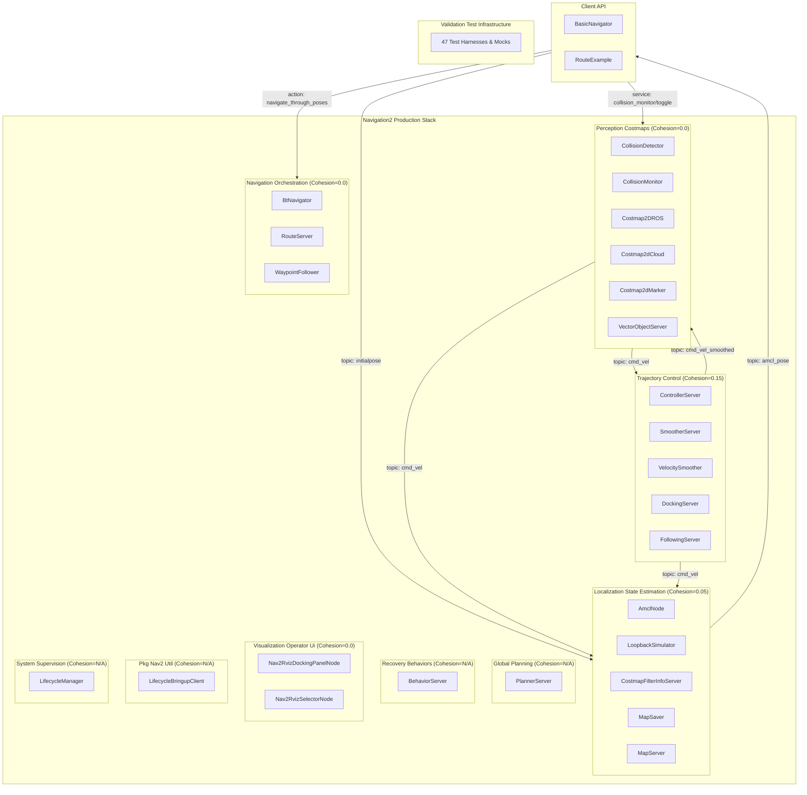
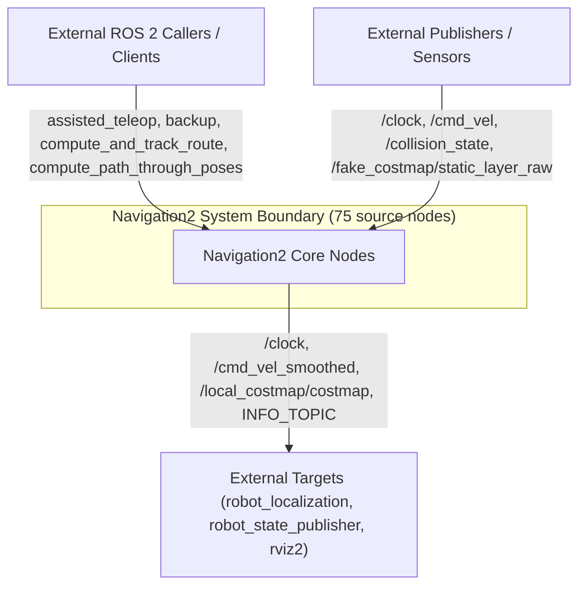
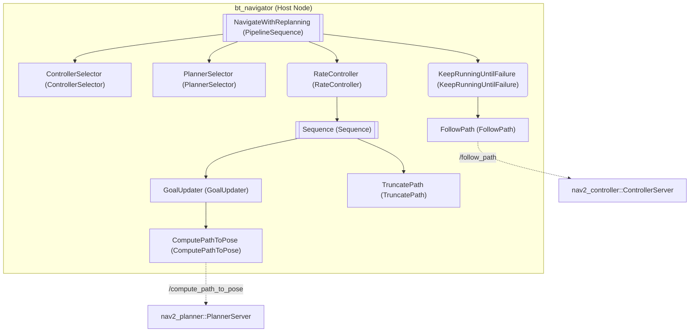

# Navigation2 Architecture Documentation

> **Generated automatically by ArchSynth**  
> **Tool**: ArchSynth v2.0 — Evidence-Grounded ROS2 Architecture Recovery  
> **Repository**: [Navigation2](https://github.com/ros-planning/navigation2)  
> **Branch**: `main`  
> **Commit Hash**: `6dbf4549ae1914188916b06dcc19dd3a8115d0a5`  
> **Analysis Timestamp**: `2026-11-27T08:13:44.232507+00:00`  
> **LLM Provider & Model**: `gemini / gemini-1.5-flash`  
> **Analysis Duration**: `14.92s`  
> **Documentation Style**: ISO/IEC/IEEE 42010-aligned  

## Executive Summary

This document provides the reconstructed software architecture documentation for **Navigation2**. ArchSynth parsed **75 ROS2 nodes** and **41 launch files**, organizing them into **11 logical subsystems**. Every recovered architectural entity is grounded with source-code evidence (file:line citations).

### Architecture Overview Statistics

| Metric | Count |
| :--- | :--- |
| **Total Discovered Nodes** | 75 |
| **Parsed Launch Files** | 41 |
| **Logical Subsystems** | 11 |
| **Unique DDS Topics** | 70 |
| **Service Connections** | 38 |
| **Action Connections** | 17 |

---

## 1. System Context (C4 Level 1)

The ROS2 Navigation2 repository defines a comprehensive, modular software architecture for autonomous mobile robot navigation. As a distributed system comprising 75 distinct ROS2 nodes organized into 11 logical subsystems, its primary purpose is to enable robots to localize themselves, plan paths, and execute motion commands to reach specified goals while robustly avoiding obstacles in dynamic environments.

The system boundary encompasses all components responsible for perception-to-action navigation logic. Externally, Navigation2 interfaces with robot hardware (e.g., base controllers for velocity commands, sensor drivers for odometry, LiDAR, IMU data), human operators (for goal specification and monitoring), and potentially external mapping services. Internally, its 70 inter-node topics facilitate robust data exchange across critical functions such as localization (`nav2_amcl`), high-level mission execution (`nav2_behavior_tree`, `nav2_bt_navigator`), primitive behavior execution (`nav2_behaviors`), and real-time safety monitoring (`nav2_collision_monitor`). The `nav2_bringup` package orchestrates the initialization and configuration of these diverse components.

---

## 2. Container View (C4 Level 2)

The system is composed of ROS2 package containers communicating over DDS topics, services, and action interfaces.

### Subsystems Summary

#### Subsystem: `localization_state_estimation`
Production subsystem responsible for localization state estimation capabilities.
- **Assignment Rationale**: Grouped 5 node(s) from package(s) nav2_amcl, nav2_loopback_sim, nav2_map_server based on package boundary, functional role, and 1 internal / 12 external interface links.
- **Architectural Role**: `production_subsystem`
- **Intra-Subsystem Cohesion**: `0.05` | **Inter-Subsystem Coupling**: `43.0` (Internal: `31.0`, External: `12.0`) | **Interface Density**: `3.8`
- **Nodes (5)**: `nav2_amcl::AmclNode`, `nav2_loopback_sim::LoopbackSimulator`, `nav2_map_server::CostmapFilterInfoServer`, `nav2_map_server::MapSaver`, `nav2_map_server::MapServer`
- **Boundary Interfaces (5)**: `topic::amcl_pose`, `topic::cmd_vel`, `topic::initialpose`, `topic::map`, `topic::map_topic_`
- **Launch Files (13)**: `keepout_zone_launch.py`, `localization_launch.py`, `slam_launch.py`, `speed_zone_launch.py`, `tb3_loopback_simulation_launch.py`

#### Subsystem: `perception_costmaps`
Production subsystem responsible for perception costmaps capabilities.
- **Assignment Rationale**: Grouped 7 node(s) from package(s) nav2_collision_monitor, nav2_costmap_2d, nav2_map_server, nav2_util based on package boundary, functional role, and 0 internal / 16 external interface links.
- **Architectural Role**: `production_subsystem`
- **Intra-Subsystem Cohesion**: `0.0` | **Inter-Subsystem Coupling**: `26.0` (Internal: `10.0`, External: `16.0`) | **Interface Density**: `3.0`
- **Nodes (7)**: `nav2_collision_monitor::CollisionDetector`, `nav2_collision_monitor::CollisionMonitor`, `nav2_costmap_2d::Costmap2DROS`, `nav2_costmap_2d::Costmap2dCloud`, `nav2_costmap_2d::Costmap2dMarker`, `nav2_map_server::VectorObjectServer`, `nav2_util::BaseFootprintPublisher`
- **Boundary Interfaces (6)**: `service::collision_monitor/toggle`, `topic::cmd_vel`, `topic::cmd_vel_smoothed`, `topic::map_topic_`, `topic::voxel_marked_cloud`, `topic::voxel_unknown_cloud`
- **Launch Files (15)**: `keepout_zone_launch.py`, `localization_launch.py`, `navigation_launch.py`, `slam_launch.py`, `speed_zone_launch.py`

#### Subsystem: `navigation_orchestration`
Production subsystem responsible for navigation orchestration capabilities.
- **Assignment Rationale**: Grouped 3 node(s) from package(s) nav2_bt_navigator, nav2_route, nav2_waypoint_follower based on package boundary, functional role, and 0 internal / 8 external interface links.
- **Architectural Role**: `production_subsystem`
- **Intra-Subsystem Cohesion**: `0.0` | **Inter-Subsystem Coupling**: `15.0` (Internal: `7.0`, External: `8.0`) | **Interface Density**: `3.333`
- **Nodes (3)**: `nav2_bt_navigator::BtNavigator`, `nav2_route::RouteServer`, `nav2_waypoint_follower::WaypointFollower`
- **Boundary Interfaces (2)**: `action::navigate_through_poses`, `action::navigate_to_pose`
- **Launch Files (1)**: `navigation_launch.py`

#### Subsystem: `trajectory_control`
Production subsystem responsible for trajectory control capabilities.
- **Assignment Rationale**: Grouped 5 node(s) from package(s) nav2_controller, nav2_smoother, nav2_velocity_smoother, opennav_docking, opennav_following based on package boundary, functional role, and 3 internal / 11 external interface links.
- **Architectural Role**: `production_subsystem`
- **Intra-Subsystem Cohesion**: `0.15` | **Inter-Subsystem Coupling**: `25.0` (Internal: `14.0`, External: `11.0`) | **Interface Density**: `3.2`
- **Nodes (5)**: `nav2_controller::ControllerServer`, `nav2_smoother::SmootherServer`, `nav2_velocity_smoother::VelocitySmoother`, `opennav_docking::DockingServer`, `opennav_following::FollowingServer`
- **Boundary Interfaces (2)**: `topic::cmd_vel`, `topic::cmd_vel_smoothed`
- **Launch Files (1)**: `navigation_launch.py`

#### Subsystem: `global_planning`
Production subsystem responsible for global planning capabilities.
- **Assignment Rationale**: Grouped 1 node(s) from package(s) nav2_planner based on package boundary, functional role, and 0 internal / 2 external interface links.
- **Architectural Role**: `production_subsystem`
- **Intra-Subsystem Cohesion**: N/A (<2 nodes) | **Inter-Subsystem Coupling**: `3.0` (Internal: `1.0`, External: `2.0`) | **Interface Density**: `3.0`
- **Nodes (1)**: `nav2_planner::PlannerServer`
- **Boundary Interfaces (1)**: `topic::plan`
- **Launch Files (1)**: `navigation_launch.py`

#### Subsystem: `recovery_behaviors`
Production subsystem responsible for recovery behaviors capabilities.
- **Assignment Rationale**: Grouped 1 node(s) from package(s) nav2_behaviors based on package boundary, functional role, and 0 internal / 0 external interface links.
- **Architectural Role**: `production_subsystem`
- **Intra-Subsystem Cohesion**: N/A (<2 nodes) | **Inter-Subsystem Coupling**: `0.0` (Internal: `0.0`, External: `0.0`) | **Interface Density**: `0.0`
- **Nodes (1)**: `nav2_behaviors::behavior_server::BehaviorServer`
- **Launch Files (4)**: `navigation_launch.py`, `test_backup_behavior.launch.py`, `test_drive_on_heading_behavior.launch.py`, `test_spin_behavior.launch.py`

#### Subsystem: `visualization_operator_ui`
Production subsystem responsible for visualization operator ui capabilities.
- **Assignment Rationale**: Grouped 2 node(s) from package(s) nav2_rviz_plugins based on package boundary, functional role, and 0 internal / 10 external interface links.
- **Architectural Role**: `production_subsystem`
- **Intra-Subsystem Cohesion**: `0.0` | **Inter-Subsystem Coupling**: `10.0` (Internal: `0.0`, External: `10.0`) | **Interface Density**: `5.0`
- **Nodes (2)**: `nav2_rviz_plugins::Nav2RvizDockingPanelNode`, `nav2_rviz_plugins::Nav2RvizSelectorNode`

#### Subsystem: `pkg_nav2_util`
Production subsystem responsible for pkg nav2 util capabilities.
- **Assignment Rationale**: Grouped 1 node(s) from package(s) nav2_util based on package boundary, functional role, and 0 internal / 0 external interface links.
- **Architectural Role**: `production_subsystem`
- **Intra-Subsystem Cohesion**: N/A (<2 nodes) | **Inter-Subsystem Coupling**: `0.0` (Internal: `0.0`, External: `0.0`) | **Interface Density**: `0.0`
- **Nodes (1)**: `nav2_util::LifecycleBringupClient`

#### Subsystem: `system_supervision`
Production subsystem responsible for system supervision capabilities.
- **Assignment Rationale**: Grouped 1 node(s) from package(s) nav2_lifecycle_manager based on package boundary, functional role, and 0 internal / 3 external interface links.
- **Architectural Role**: `production_subsystem`
- **Intra-Subsystem Cohesion**: N/A (<2 nodes) | **Inter-Subsystem Coupling**: `3.0` (Internal: `0.0`, External: `3.0`) | **Interface Density**: `3.0`
- **Nodes (1)**: `nav2_lifecycle_manager::LifecycleManager`
- **Launch Files (16)**: `keepout_zone_launch.py`, `localization_launch.py`, `navigation_launch.py`, `slam_launch.py`, `speed_zone_launch.py`

#### Subsystem: `client_autonomy_api`
Client-side autonomy application APIs and mission control nodes.
- **Assignment Rationale**: Client-side autonomy API nodes separated from core server stack.
- **Architectural Role**: `client_interface`
- **Intra-Subsystem Cohesion**: `0.0` | **Inter-Subsystem Coupling**: `34.0` (Internal: `7.0`, External: `27.0`) | **Interface Density**: `16.0`
- **Nodes (2)**: `nav2_simple_commander::BasicNavigator`, `nav2_simple_commander::RouteExample`
- **Boundary Interfaces (5)**: `action::navigate_through_poses`, `action::navigate_to_pose`, `service::collision_monitor/toggle`, `topic::amcl_pose`, `topic::initialpose`

#### Subsystem: `validation_test_infrastructure`
System integration test harnesses, mock nodes, and verification testers.
- **Architectural Role**: `test_harness`
- **Intra-Subsystem Cohesion**: `0.0` | **Inter-Subsystem Coupling**: `0.0` (Internal: `0.0`, External: `0.0`) | **Interface Density**: `0.0`
- **Nodes (47)**: `nav2_behavior_tree::FibonacciActionServer`, `nav2_behavior_tree::RecoveryDummy`, `nav2_behavior_tree::TestActionServer`, `nav2_behavior_tree::TestService`, `nav2_collision_monitor::FakeCMSource`, `nav2_collision_monitor::MetricsCatcher`, `nav2_collision_monitor::TestNode`, `nav2_controller::TestLifecycleNode`, `nav2_costmap_2d::BinaryStateSubscriber`, `nav2_costmap_2d::CostmapRosLifecycleNode`

### Architecture Metrics Definitions

| Metric | Mathematical Definition | Inputs & Edge Cases |
| :--- | :--- | :--- |
| **Intra-Subsystem Cohesion** | `E_internal / (N * (N - 1))` | Directed communication edges between nodes inside the subsystem divided by ordered node pairs. Reported as `N/A` when `N < 2`. |
| **Internal Coupling** | `E_cross_internal` | Directed topic/service/action edges crossing between this subsystem and other in-repository subsystems. |
| **External Coupling** | `I_unmatched_external` | Declared interfaces (pubs/subs/services/actions) on subsystem nodes whose peer resides outside the repository (e.g., `move_group`, `servo_node`, `ros2_control`). |
| **Total Coupling** | `Internal Coupling + External Coupling` | Total boundary-crossing interactions for the subsystem. |
| **Interface Density** | `Total_Interfaces / N` | Average declared ROS 2 endpoints (topics, services, actions) per node in the subsystem. |

### Subsystem Clustering Evaluation (vs. Reference Nav2 Hypothesis)

> **Clustering Algorithm**: `multi_criteria_evidence_affinity_clustering`  
> **Mean Jaccard Similarity**: `0.700` across evaluated functional subsystems.  
> **Evaluation Reference Set**: The ground-truth reference model defines 8 canonical Navigation2 functional domains (`perception_costmaps`, `localization_state_estimation`, `navigation_orchestration`, `global_planning`, `trajectory_control`, `recovery_behaviors`, `system_supervision`, `client_autonomy_api`). Reconstructed subsystems are compared against this ground truth to measure precision, recall, and Jaccard boundary recovery accuracy.

| Subsystem Domain | Reference Nodes | Recovered Nodes | Precision | Recall | Jaccard Similarity |
| :--- | :---: | :---: | :---: | :---: | :---: |
| `perception_costmaps` | 5 | 7 | 0.429 | 0.600 | **0.333** |
| `localization_state_estimation` | 5 | 5 | 0.800 | 0.800 | **0.667** |
| `navigation_orchestration` | 3 | 3 | 1.000 | 1.000 | **1.000** |
| `global_planning` | 1 | 1 | 1.000 | 1.000 | **1.000** |
| `trajectory_control` | 3 | 5 | 0.600 | 1.000 | **0.600** |
| `recovery_behaviors` | 2 | 1 | 1.000 | 0.500 | **0.500** |
| `system_supervision` | 1 | 1 | 1.000 | 1.000 | **1.000** |
| `client_autonomy_api` | 1 | 2 | 0.500 | 1.000 | **0.500** |

---

## 3. Component View & System Diagram (C4 Level 3)

The following Mermaid diagram visualizes the reconstructed subsystem composition and communication graph:



---

## 4. Node Catalog

Overview of the core discovered ROS2 nodes in the system:

| Node Name | Package | Class / Executable | Architectural Classification | Pubs | Subs | Services | Actions | Evidence | Validation |
| :--- | :--- | :--- | :--- | :---: | :---: | :---: | :---: | :---: | :---: |
| [`fake_cm_bag_source`](nodes/nav2_collision_monitor__FakeCMSource.md) | `nav2_collision_monitor` | `FakeCMSource` | `test` | 3 | 0 | 0 | 0 | 1 item(s) | ✅ supported |
| [`test_docking_server`](nodes/opennav_docking__TestDockingServer.md) | `opennav_docking` | `TestDockingServer` | `test` | 2 | 1 | 0 | 3 | 1 item(s) | ✅ supported |
| [`test_object_pose_publisher`](nodes/opennav_following__TestObjectPosePublisher.md) | `opennav_following` | `TestObjectPosePublisher` | `test` | 1 | 1 | 0 | 1 | 1 item(s) | ✅ supported |
| [`test_following_server`](nodes/opennav_following__TestFollowingServer.md) | `opennav_following` | `TestFollowingServer` | `test` | 1 | 1 | 0 | 1 | 1 item(s) | ✅ supported |
| [`route_example`](nodes/nav2_simple_commander__RouteExample.md) | `nav2_simple_commander` | `RouteExample` | `client` | 0 | 0 | 0 | 0 | 1 item(s) | ✅ supported |
| [`basic_navigator`](nodes/nav2_simple_commander__BasicNavigator.md) | `nav2_simple_commander` | `BasicNavigator` | `client` | 1 | 1 | 13 | 17 | 1 item(s) | ✅ supported |
| [`backup_tester`](nodes/nav2_system_tests__BackupTest.md) | `nav2_system_tests` | `BackupTest` | `test` | 2 | 0 | 1 | 1 | 1 item(s) | ✅ supported |
| [`drive_tester`](nodes/nav2_system_tests__DriveTest.md) | `nav2_system_tests` | `DriveTest` | `test` | 2 | 0 | 1 | 1 | 1 item(s) | ✅ supported |
| [`spin_tester`](nodes/nav2_system_tests__SpinTest.md) | `nav2_system_tests` | `SpinTest` | `test` | 2 | 0 | 1 | 1 | 1 item(s) | ✅ supported |
| [`nav2_tester`](nodes/nav2_system_tests__NavTester_src__costmap_filters__tester_node.md) | `nav2_system_tests` | `NavTester` | `test` | 2 | 8 | 3 | 1 | 1 item(s) | ✅ supported |
| [`nav2_gps_waypoint_tester`](nodes/nav2_system_tests__GpsWaypointFollowerTest.md) | `nav2_system_tests` | `GpsWaypointFollowerTest` | `test` | 0 | 0 | 2 | 1 | 1 item(s) | ✅ supported |
| [`nav2_tester`](nodes/nav2_system_tests__RouteTester.md) | `nav2_system_tests` | `RouteTester` | `test` | 1 | 1 | 4 | 2 | 1 item(s) | ✅ supported |
| [`nav2_tester`](nodes/nav2_system_tests__NavTester_src__system__nav_through_poses_tester_error_msg_node.md) | `nav2_system_tests` | `NavTester` | `test` | 3 | 1 | 4 | 1 | 1 item(s) | ✅ supported |
| [`nav2_tester`](nodes/nav2_system_tests__NavTester_src__system__nav_through_poses_tester_node.md) | `nav2_system_tests` | `NavTester` | `test` | 1 | 1 | 3 | 1 | 1 item(s) | ✅ supported |
| [`nav2_tester`](nodes/nav2_system_tests__NavTester_src__system__nav_to_pose_tester_node.md) | `nav2_system_tests` | `NavTester` | `test` | 2 | 1 | 3 | 1 | 1 item(s) | ✅ supported |
| [`nav2_tester`](nodes/nav2_system_tests__NavTester_src__system_failure__tester_node.md) | `nav2_system_tests` | `NavTester` | `test` | 2 | 1 | 3 | 1 | 1 item(s) | ✅ supported |
| [`nav2_waypoint_tester`](nodes/nav2_system_tests__WaypointFollowerTest.md) | `nav2_system_tests` | `WaypointFollowerTest` | `test` | 1 | 1 | 3 | 1 | 1 item(s) | ✅ supported |
| [`amcl`](nodes/nav2_amcl__AmclNode.md) | `nav2_amcl` | `nav2_amcl::AmclNode` | `localization` | 2 | 3 | 3 | 0 | 5 item(s) | ✅ supported |
| [`behavior_server`](nodes/nav2_behaviors__behavior_server__BehaviorServer.md) | `nav2_behaviors` | `behavior_server::BehaviorServer` | `behavior` | 0 | 0 | 0 | 0 | 5 item(s) | ✅ supported |
| [`fibonacci_node`](nodes/nav2_behavior_tree__FibonacciActionServer.md) | `nav2_behavior_tree` | `FibonacciActionServer` | `test` | 0 | 0 | 0 | 0 | 1 item(s) | ✅ supported |
| [`recovery_dummy`](nodes/nav2_behavior_tree__RecoveryDummy.md) | `nav2_behavior_tree` | `RecoveryDummy` | `test` | 0 | 0 | 0 | 0 | 1 item(s) | ✅ supported |
| [`test_action_server`](nodes/nav2_behavior_tree__TestActionServer.md) | `nav2_behavior_tree` | `TestActionServer` | `test` | 0 | 0 | 0 | 0 | 1 item(s) | ✅ supported |
| [`test_service`](nodes/nav2_behavior_tree__TestService.md) | `nav2_behavior_tree` | `TestService` | `test` | 0 | 0 | 1 | 0 | 1 item(s) | ✅ supported |
| [`bt_navigator`](nodes/nav2_bt_navigator__BtNavigator.md) | `nav2_bt_navigator` | `nav2_bt_navigator::BtNavigator` | `behavior` | 0 | 0 | 0 | 2 | 5 item(s) | ✅ supported |
| [`cm_metrics_catcher`](nodes/nav2_collision_monitor__MetricsCatcher.md) | `nav2_collision_monitor` | `MetricsCatcher` | `test` | 0 | 4 | 0 | 0 | 1 item(s) | ✅ supported |
| [`exclusion_zone_test_node`](nodes/nav2_collision_monitor__TestNode.md) | `nav2_collision_monitor` | `TestNode` | `test` | 0 | 1 | 2 | 0 | 1 item(s) | ✅ supported |
| [`collision_detector`](nodes/nav2_collision_monitor__CollisionDetector.md) | `nav2_collision_monitor` | `nav2_collision_monitor::CollisionDetector` | `infrastructure` | 3 | 0 | 0 | 0 | 5 item(s) | ✅ supported |
| [`collision_monitor`](nodes/nav2_collision_monitor__CollisionMonitor.md) | `nav2_collision_monitor` | `nav2_collision_monitor::CollisionMonitor` | `infrastructure` | 4 | 1 | 1 | 0 | 5 item(s) | ✅ supported |
| [`test_lifecycle_node`](nodes/nav2_controller__TestLifecycleNode.md) | `nav2_controller` | `TestLifecycleNode` | `test` | 0 | 0 | 0 | 0 | 1 item(s) | ✅ supported |
| [`controller_server`](nodes/nav2_controller__ControllerServer.md) | `nav2_controller` | `nav2_controller::ControllerServer` | `control` | 3 | 1 | 0 | 1 | 5 item(s) | ✅ supported |
| [`costmap_2d_cloud`](nodes/nav2_costmap_2d__Costmap2dCloud.md) | `nav2_costmap_2d` | `Costmap2dCloud` | `infrastructure` | 2 | 1 | 0 | 0 | 2 item(s) | ✅ supported |
| [`costmap_2d_marker`](nodes/nav2_costmap_2d__Costmap2dMarker.md) | `nav2_costmap_2d` | `Costmap2dMarker` | `infrastructure` | 1 | 1 | 0 | 0 | 2 item(s) | ✅ supported |
| [`test_lifecycle_node`](nodes/nav2_costmap_2d__TestLifecycleNode.md) | `nav2_costmap_2d` | `TestLifecycleNode` | `test` | 0 | 0 | 0 | 0 | 2 item(s) | ✅ supported |
| [`costmap_ros_lifecycle_node`](nodes/nav2_costmap_2d__CostmapRosLifecycleNode.md) | `nav2_costmap_2d` | `CostmapRosLifecycleNode` | `test` | 0 | 1 | 0 | 0 | 2 item(s) | ✅ supported |
| [`test_collision_checker`](nodes/nav2_costmap_2d__TestCollisionChecker.md) | `nav2_costmap_2d` | `TestCollisionChecker` | `test` | 0 | 0 | 0 | 0 | 2 item(s) | ✅ supported |
| [`costmap_filter_info_pub`](nodes/nav2_costmap_2d__InfoPublisher.md) | `nav2_costmap_2d` | `InfoPublisher` | `test` | 2 | 1 | 0 | 0 | 2 item(s) | ✅ supported |
| [`mask_pub`](nodes/nav2_costmap_2d__MaskPublisher.md) | `nav2_costmap_2d` | `MaskPublisher` | `test` | 2 | 1 | 0 | 0 | 2 item(s) | ✅ supported |
| [`binary_state_sub`](nodes/nav2_costmap_2d__BinaryStateSubscriber.md) | `nav2_costmap_2d` | `BinaryStateSubscriber` | `test` | 2 | 1 | 0 | 0 | 2 item(s) | ✅ supported |
| [`path_pub`](nodes/nav2_costmap_2d__PathPublisher.md) | `nav2_costmap_2d` | `PathPublisher` | `test` | 4 | 1 | 0 | 0 | 2 item(s) | ✅ supported |
| [`odom_pub`](nodes/nav2_costmap_2d__OdomPublisher.md) | `nav2_costmap_2d` | `OdomPublisher` | `test` | 4 | 1 | 0 | 0 | 2 item(s) | ✅ supported |
| [`speed_limit_sub`](nodes/nav2_costmap_2d__SpeedLimitSubscriber.md) | `nav2_costmap_2d` | `SpeedLimitSubscriber` | `test` | 4 | 1 | 0 | 0 | 2 item(s) | ✅ supported |
| [`zpf_state_sub`](nodes/nav2_costmap_2d__StateEventSubscriber.md) | `nav2_costmap_2d` | `StateEventSubscriber` | `test` | 2 | 1 | 0 | 0 | 2 item(s) | ✅ supported |
| [`zpf_target_node`](nodes/nav2_costmap_2d__TargetNode.md) | `nav2_costmap_2d` | `TargetNode` | `test` | 2 | 1 | 0 | 0 | 2 item(s) | ✅ supported |
| [`zpf_second_target`](nodes/nav2_costmap_2d__SecondTargetNode.md) | `nav2_costmap_2d` | `SecondTargetNode` | `test` | 2 | 1 | 0 | 0 | 2 item(s) | ✅ supported |
| [`costmap`](nodes/nav2_costmap_2d__Costmap2DROS.md) | `nav2_costmap_2d` | `nav2_costmap_2d::Costmap2DROS` | `infrastructure` | 1 | 1 | 1 | 0 | 3 item(s) | ✅ supported |
| [`test_collision_checker`](nodes/opennav_docking__TestCollisionChecker.md) | `opennav_docking` | `opennav_docking::TestCollisionChecker` | `test` | 1 | 0 | 0 | 0 | 2 item(s) | ✅ supported |
| [`dummy_navigator`](nodes/opennav_docking__DummyNavigationServer.md) | `opennav_docking` | `opennav_docking::DummyNavigationServer` | `test` | 0 | 0 | 0 | 0 | 2 item(s) | ✅ supported |
| [`docking_server`](nodes/opennav_docking__DockingServer.md) | `opennav_docking` | `opennav_docking::DockingServer` | `unknown` | 1 | 0 | 0 | 2 | 5 item(s) | ✅ supported |
| [`following_server`](nodes/opennav_following__FollowingServer.md) | `opennav_following` | `opennav_following::FollowingServer` | `unknown` | 2 | 1 | 0 | 1 | 5 item(s) | ✅ supported |
| [`test_lifecycle_node`](nodes/nav2_lifecycle_manager__TestLifecycleNode.md) | `nav2_lifecycle_manager` | `TestLifecycleNode` | `test` | 0 | 0 | 0 | 0 | 1 item(s) | ✅ supported |
| [`lifecycle_node_test`](nodes/nav2_lifecycle_manager__LifecycleNodeTest.md) | `nav2_lifecycle_manager` | `LifecycleNodeTest` | `test` | 0 | 0 | 0 | 0 | 1 item(s) | ✅ supported |
| [`lifecycle_manager`](nodes/nav2_lifecycle_manager__LifecycleManager.md) | `nav2_lifecycle_manager` | `nav2_lifecycle_manager::LifecycleManager` | `infrastructure` | 1 | 0 | 2 | 0 | 5 item(s) | ✅ supported |
| [`loopback_simulator`](nodes/nav2_loopback_sim__LoopbackSimulator.md) | `nav2_loopback_sim` | `nav2_loopback_sim::LoopbackSimulator` | `unknown` | 2 | 2 | 1 | 0 | 5 item(s) | ✅ supported |
| [`map_publisher`](nodes/nav2_map_server__TestPublisher.md) | `nav2_map_server` | `TestPublisher` | `test` | 2 | 0 | 0 | 0 | 2 item(s) | ✅ supported |
| [`costmap_filter_info_server`](nodes/nav2_map_server__CostmapFilterInfoServer.md) | `nav2_map_server` | `nav2_map_server::CostmapFilterInfoServer` | `infrastructure` | 1 | 0 | 0 | 0 | 5 item(s) | ✅ supported |
| [`map_saver`](nodes/nav2_map_server__MapSaver.md) | `nav2_map_server` | `nav2_map_server::MapSaver` | `infrastructure` | 0 | 1 | 1 | 0 | 5 item(s) | ✅ supported |
| [`map_server`](nodes/nav2_map_server__MapServer.md) | `nav2_map_server` | `nav2_map_server::MapServer` | `infrastructure` | 1 | 0 | 2 | 0 | 5 item(s) | ✅ supported |
| [`vector_object_server`](nodes/nav2_map_server__VectorObjectServer.md) | `nav2_map_server` | `nav2_map_server::VectorObjectServer` | `infrastructure` | 1 | 0 | 3 | 0 | 5 item(s) | ✅ supported |
| [`planner_server`](nodes/nav2_planner__PlannerServer.md) | `nav2_planner` | `nav2_planner::PlannerServer` | `planning` | 1 | 0 | 0 | 2 | 5 item(s) | ✅ supported |
| [`fibonacci_server_node`](nodes/nav2_ros_common__FibonacciServerNode.md) | `nav2_ros_common` | `FibonacciServerNode` | `test` | 5 | 5 | 1 | 0 | 1 item(s) | ✅ supported |
| [`action_test_node`](nodes/nav2_ros_common__ActionTestNode.md) | `nav2_ros_common` | `ActionTestNode` | `test` | 5 | 5 | 1 | 0 | 1 item(s) | ✅ supported |
| [`test_node`](nodes/nav2_ros_common__LifecycleTransitionTestNode.md) | `nav2_ros_common` | `LifecycleTransitionTestNode` | `test` | 0 | 0 | 0 | 0 | 1 item(s) | ✅ supported |
| [`my_node_type`](nodes/nav2_ros_common__MyNodeType.md) | `nav2_ros_common` | `MyNodeType` | `test` | 0 | 0 | 0 | 0 | 1 item(s) | ✅ supported |
| [`route_server`](nodes/nav2_route__RouteServer.md) | `nav2_route` | `nav2_route::RouteServer` | `unknown` | 2 | 0 | 1 | 2 | 5 item(s) | ✅ supported |
| [`nav2_rviz_docking_panel_node`](nodes/nav2_rviz_plugins__Nav2RvizDockingPanelNode.md) | `nav2_rviz_plugins` | `Nav2RvizDockingPanelNode` | `unknown` | 0 | 3 | 1 | 0 | 1 item(s) | ✅ supported |
| [`nav2_rviz_selector_node`](nodes/nav2_rviz_plugins__Nav2RvizSelectorNode.md) | `nav2_rviz_plugins` | `Nav2RvizSelectorNode` | `unknown` | 6 | 0 | 0 | 0 | 1 item(s) | ✅ supported |
| [`smoother_server`](nodes/nav2_smoother__SmootherServer.md) | `nav2_smoother` | `nav2_smoother::SmootherServer` | `infrastructure` | 1 | 0 | 0 | 1 | 5 item(s) | ✅ supported |
| [`DummyController`](nodes/nav2_system_tests__DummyController.md) | `nav2_system_tests` | `nav2_system_tests::DummyController` | `test` | 1 | 0 | 0 | 0 | 3 item(s) | ✅ supported |
| [`DummyPlanner`](nodes/nav2_system_tests__DummyPlanner.md) | `nav2_system_tests` | `nav2_system_tests::DummyPlanner` | `test` | 0 | 0 | 0 | 0 | 3 item(s) | ✅ supported |
| [`PlannerTester`](nodes/nav2_system_tests__PlannerTester.md) | `nav2_system_tests` | `nav2_system_tests::PlannerTester` | `test` | 1 | 0 | 1 | 0 | 2 item(s) | ✅ supported |
| [`lifecycle_bringup_client`](nodes/nav2_util__LifecycleBringupClient.md) | `nav2_util` | `LifecycleBringupClient` | `unknown` | 0 | 0 | 0 | 0 | 2 item(s) | ✅ supported |
| [`nav2_test_cli`](nodes/nav2_util__DummyNode.md) | `nav2_util` | `DummyNode` | `test` | 0 | 0 | 0 | 0 | 1 item(s) | ✅ supported |
| [`base_footprint_publisher`](nodes/nav2_util__BaseFootprintPublisher.md) | `nav2_util` | `nav2_util::BaseFootprintPublisher` | `unknown` | 0 | 0 | 0 | 0 | 2 item(s) | ✅ supported |
| [`velocity_smoother`](nodes/nav2_velocity_smoother__VelocitySmoother.md) | `nav2_velocity_smoother` | `nav2_velocity_smoother::VelocitySmoother` | `infrastructure` | 1 | 1 | 0 | 0 | 5 item(s) | ✅ supported |
| [`waypoint_follower`](nodes/nav2_waypoint_follower__WaypointFollower.md) | `nav2_waypoint_follower` | `nav2_waypoint_follower::WaypointFollower` | `infrastructure` | 0 | 0 | 1 | 2 | 5 item(s) | ✅ supported |

---

## 5. Launch File Composition

Parsed **41 launch files** across the repository.

Alternative standalone launch profiles are analyzed independently by default.

| Launch File | Architectural Classification | Direct Node | Direct LifecycleNode | ComposableNode | ComposableNodeContainer | LoadComposableNodes | Included Launch | Unresolved | Resolved Executable | Runtime Node Name | CMake Installed |
| :--- | :--- | :---: | :---: | :---: | :---: | :---: | :---: | :---: | :--- | :--- | :---: |
| `bringup_launch.py` | `None` | 0 | 0 | 0 | 1 | 0 | 5 | 0 | `component_container` | `${container_name}` | Yes |
| `cloned_multi_tb3_simulation_launch.py` | `None` | 0 | 0 | 0 | 0 | 0 | 2 | 0 | `-` | `-` | Yes |
| `keepout_zone_launch.py` | `None` | 3 | 0 | 3 | 0 | 0 | 0 | 3 | `costmap_filter_info_server, lifecycle_manager, map_server` | `keepout_costmap_filter_info_server, keepout_filter_mask_server, lifecycle_manager_keepout_zone` | Yes |
| `localization_launch.py` | `None` | 4 | 0 | 4 | 0 | 0 | 0 | 4 | `amcl, lifecycle_manager, map_server` | `amcl, lifecycle_manager_localization, map_server` | Yes |
| `navigation_launch.py` | `None` | 12 | 0 | 12 | 0 | 0 | 0 | 12 | `behavior_server, bt_navigator, collision_monitor, controller_server, lifecycle_manager, opennav_docking, opennav_following, planner_server, route_server, smoother_server, velocity_smoother, waypoint_follower` | `behavior_server, bt_navigator, collision_monitor, controller_server, docking_server, following_server, lifecycle_manager_navigation, planner_server, route_server, smoother_server, velocity_smoother, waypoint_follower` | Yes |
| `rviz_launch.py` | `None` | 1 | 0 | 0 | 0 | 0 | 0 | 0 | `rviz2` | `rviz2` | Yes |
| `slam_launch.py` | `None` | 2 | 0 | 0 | 0 | 0 | 2 | 0 | `lifecycle_manager, map_saver_server` | `lifecycle_manager_slam, map_saver_server` | Yes |
| `speed_zone_launch.py` | `None` | 3 | 0 | 3 | 0 | 0 | 0 | 3 | `costmap_filter_info_server, lifecycle_manager, map_server` | `lifecycle_manager_speed_zone, speed_costmap_filter_info_server, speed_filter_mask_server` | Yes |
| `tb3_loopback_simulation_launch.py` | `None` | 3 | 0 | 2 | 0 | 0 | 3 | 2 | `lifecycle_manager, map_server, robot_state_publisher` | `lifecycle_manager_map_server, map_server, robot_state_publisher` | Yes |
| `tb3_simulation_launch.py` | `None` | 1 | 0 | 0 | 0 | 0 | 4 | 0 | `robot_state_publisher` | `robot_state_publisher` | Yes |
| `tb4_loopback_simulation_launch.py` | `None` | 4 | 0 | 2 | 0 | 0 | 3 | 2 | `lifecycle_manager, map_server, robot_state_publisher, static_transform_publisher` | `lifecycle_manager_map_server, map_server, robot_state_publisher, static_transform_publisher` | Yes |
| `tb4_simulation_launch.py` | `None` | 1 | 0 | 0 | 0 | 0 | 4 | 0 | `robot_state_publisher` | `robot_state_publisher` | Yes |
| `unique_multi_tb3_simulation_launch.py` | `None` | 0 | 0 | 0 | 0 | 0 | 2 | 0 | `-` | `-` | Yes |
| `collision_detector_node.launch.py` | `None` | 2 | 0 | 2 | 0 | 0 | 0 | 2 | `collision_detector, lifecycle_manager` | `collision_detector, lifecycle_manager_collision_detector` | Yes |
| `collision_monitor_node.launch.py` | `None` | 2 | 0 | 2 | 0 | 0 | 0 | 2 | `collision_monitor, lifecycle_manager` | `collision_monitor, lifecycle_manager_collision_monitor` | Yes |
| `has_node_params.py` | `None` | 0 | 0 | 0 | 0 | 0 | 0 | 0 | `-` | `-` | No (Excluded) |
| `launch_config_as_bool.py` | `None` | 0 | 0 | 0 | 0 | 0 | 0 | 0 | `-` | `-` | No (Excluded) |
| `replace_string.py` | `None` | 0 | 0 | 0 | 0 | 0 | 0 | 0 | `-` | `-` | No (Excluded) |
| `rewritten_yaml.py` | `None` | 0 | 0 | 0 | 0 | 0 | 0 | 0 | `-` | `-` | No (Excluded) |
| `costmap_map_server.launch.py` | `None` | 1 | 0 | 0 | 0 | 0 | 0 | 0 | `map_server` | `map_server` | No (Excluded) |
| `loopback_simulation.launch.py` | `None` | 0 | 1 | 0 | 0 | 0 | 0 | 0 | `loopback_simulator` | `loopback_simulator` | Yes |
| `map_saver_server.launch.py` | `None` | 2 | 0 | 0 | 0 | 0 | 0 | 0 | `lifecycle_manager, map_saver_server` | `lifecycle_manager, map_saver_server` | Yes |
| `vector_object_server.launch.py` | `None` | 3 | 0 | 3 | 0 | 0 | 0 | 3 | `costmap_filter_info_server, lifecycle_manager, vector_object_server` | `costmap_filter_info_server, lifecycle_manager_vo_server, vector_object_server` | Yes |
| `map_saver_node.launch.py` | `None` | 1 | 0 | 0 | 0 | 0 | 0 | 0 | `map_saver_server` | `map_saver_server` | Yes |
| `map_server_node.launch.py` | `None` | 1 | 0 | 0 | 0 | 0 | 0 | 0 | `map_server` | `map_server` | Yes |
| `route_tool.launch.py` | `None` | 3 | 0 | 0 | 0 | 0 | 0 | 0 | `lifecycle_manager, map_server, rviz2` | `lifecycle_manager, map_server, rviz2` | Yes |
| `assisted_teleop_example_launch.py` | `None` | 2 | 0 | 0 | 0 | 0 | 5 | 0 | `example_assisted_teleop, robot_state_publisher` | `example_assisted_teleop, robot_state_publisher` | Yes |
| `follow_path_example_launch.py` | `None` | 2 | 0 | 0 | 0 | 0 | 5 | 0 | `example_follow_path, robot_state_publisher` | `example_follow_path, robot_state_publisher` | Yes |
| `inspection_demo_launch.py` | `None` | 2 | 0 | 0 | 0 | 0 | 5 | 0 | `demo_inspection, robot_state_publisher` | `demo_inspection, robot_state_publisher` | Yes |
| `nav_through_poses_example_launch.py` | `None` | 2 | 0 | 0 | 0 | 0 | 5 | 0 | `example_nav_through_poses, robot_state_publisher` | `example_nav_through_poses, robot_state_publisher` | Yes |
| `nav_to_pose_example_launch.py` | `None` | 2 | 0 | 0 | 0 | 0 | 5 | 0 | `example_nav_to_pose, robot_state_publisher` | `example_nav_to_pose, robot_state_publisher` | Yes |
| `picking_demo_launch.py` | `None` | 2 | 0 | 0 | 0 | 0 | 5 | 0 | `demo_picking, robot_state_publisher` | `demo_picking, robot_state_publisher` | Yes |
| `recoveries_example_launch.py` | `None` | 2 | 0 | 0 | 0 | 0 | 5 | 0 | `demo_recoveries, robot_state_publisher` | `demo_recoveries, robot_state_publisher` | Yes |
| `route_example_launch.py` | `None` | 2 | 0 | 0 | 0 | 0 | 5 | 0 | `example_route, robot_state_publisher` | `example_route, robot_state_publisher` | Yes |
| `security_demo_launch.py` | `None` | 2 | 0 | 0 | 0 | 0 | 5 | 0 | `demo_security, robot_state_publisher` | `demo_security, robot_state_publisher` | Yes |
| `waypoint_follower_example_launch.py` | `None` | 2 | 0 | 0 | 0 | 0 | 5 | 0 | `example_waypoint_follower, robot_state_publisher` | `example_waypoint_follower, robot_state_publisher` | Yes |
| `test_backup_behavior.launch.py` | `None` | 4 | 0 | 0 | 0 | 0 | 1 | 0 | `behavior_server, lifecycle_manager, robot_state_publisher, static_transform_publisher` | `behavior_server, lifecycle_manager_navigation, robot_state_publisher, static_transform_publisher` | No (Excluded) |
| `test_drive_on_heading_behavior.launch.py` | `None` | 4 | 0 | 0 | 0 | 0 | 1 | 0 | `behavior_server, lifecycle_manager, robot_state_publisher, static_transform_publisher` | `behavior_server, lifecycle_manager_navigation, robot_state_publisher, static_transform_publisher` | No (Excluded) |
| `test_spin_behavior.launch.py` | `None` | 4 | 0 | 0 | 0 | 0 | 1 | 0 | `behavior_server, lifecycle_manager, robot_state_publisher, static_transform_publisher` | `behavior_server, lifecycle_manager_navigation, robot_state_publisher, static_transform_publisher` | No (Excluded) |
| `dual_ekf_navsat.launch.py` | `None` | 4 | 0 | 0 | 0 | 0 | 0 | 0 | `ekf_node, lifecycle_manager, navsat_transform_node` | `ekf_filter_node_map, ekf_filter_node_odom, lifecycle_manager_localization, navsat_transform` | No (Excluded) |
| `test_case_py.launch.py` | `None` | 1 | 0 | 0 | 0 | 0 | 3 | 0 | `robot_state_publisher` | `robot_state_publisher` | No (Excluded) |

---

## 6. Communication Matrix

### Topic Connections

| Topic Name | Publisher Nodes | Subscriber Nodes |
| :--- | :--- | :--- |
| `/clock` | `fake_cm_bag_source` | `cm_metrics_catcher` |
| `/cmd_vel` | *External* | `cm_metrics_catcher` |
| `/cmd_vel_smoothed` | `fake_cm_bag_source` | *External* |
| `/collision_state` | *External* | `cm_metrics_catcher` |
| `/fake_costmap/static_layer_raw` | *External* | `costmap_ros_lifecycle_node` |
| `/local_costmap/costmap` | `fake_cm_bag_source` | `cm_metrics_catcher` |
| `INFO_TOPIC` | `binary_state_sub`, `costmap_filter_info_pub`, `mask_pub`, `odom_pub`, `path_pub`, `speed_limit_sub` | *External* |
| `MASK_TOPIC` | `binary_state_sub`, `costmap_filter_info_pub`, `mask_pub`, `odom_pub`, `path_pub`, `speed_limit_sub` | *External* |
| `activate_server` | `action_test_node`, `fibonacci_server_node` | `action_test_node`, `fibonacci_server_node` |
| `allow_goal` | `action_test_node`, `fibonacci_server_node` | `action_test_node`, `fibonacci_server_node` |
| `amcl_pose` | `amcl` | `basic_navigator`, `nav2_tester`, `nav2_waypoint_tester` |
| `battery_state` | `test_docking_server` | *External* |
| `binary_state_topic` | *External* | `binary_state_sub`, `costmap_filter_info_pub`, `mask_pub` |
| `cmd_vel` | `DummyController`, `collision_monitor`, `controller_server`, `docking_server`, `following_server` | `loopback_simulator`, `test_docking_server`, `test_following_server`, `test_object_pose_publisher`, `velocity_smoother` |
| `cmd_vel_smoothed` | `velocity_smoother` | `collision_monitor` |
| `collision_detector_state` | `collision_detector` | *External* |
| `controller_selector` | `nav2_rviz_selector_node` | *External* |
| `cost_cloud` | *External* | `nav2_tester` |
| `costmap_filter_info` | `costmap_filter_info_server` | *External* |
| `deactivate_server` | `action_test_node`, `fibonacci_server_node` | `action_test_node`, `fibonacci_server_node` |
| `dock_robot/_action/feedback` | *External* | `nav2_rviz_docking_panel_node` |
| `dock_robot/_action/status` | *External* | `nav2_rviz_docking_panel_node` |
| `filter_mask` | *External* | `nav2_tester` |
| `filtered_dynamic_pose` | `following_server` | *External* |
| `footprint` | *External* | `costmap` |
| `goal_checker_selector` | `nav2_rviz_selector_node`, `nav2_tester` | *External* |
| `goal_pose` | `nav2_tester` | *External* |
| `initialpose` | `basic_navigator`, `nav2_tester`, `nav2_waypoint_tester` | `amcl`, `loopback_simulator` |
| `kInfoTopic` | `zpf_second_target`, `zpf_state_sub`, `zpf_target_node` | *External* |
| `kMaskTopic` | `zpf_second_target`, `zpf_state_sub`, `zpf_target_node` | *External* |
| `lifecycle_manager/managed_nodes_activated` | `lifecycle_manager` | *External* |
| `local_costmap/clearing_endpoints` | *External* | `nav2_tester` |
| `local_costmap/costmap_raw` | `backup_tester`, `drive_tester`, `spin_tester` | *External* |
| `local_costmap/published_footprint` | `backup_tester`, `drive_tester`, `spin_tester` | *External* |
| `malformed_map` | `map_publisher` | *External* |

### Service Connections

| Service Name | Servers | Clients |
| :--- | :--- | :--- |
| `/controller_server/set_parameters` | *External* | `nav2_tester` |
| `/fromLL` | *External* | `waypoint_follower` |
| `/map_server/map` | *External* | `loopback_simulator` |
| `/waypoint_follower/set_parameters` | *External* | `nav2_gps_waypoint_tester`, `nav2_waypoint_tester` |
| `client_node_` | *External* | `nav2_rviz_docking_panel_node` |
| `collision_monitor/toggle` | *External* | `basic_navigator` |
| `fibonacci` | *External* | `action_test_node`, `fibonacci_server_node` |
| `get_cost_costmap` | `costmap` | *External* |
| `global_costmap/clear_costmap_around_pose` | *External* | `basic_navigator` |
| `global_costmap/clear_entirely_global_costmap` | *External* | `basic_navigator` |
| `global_costmap/get_costmap` | *External* | `basic_navigator` |
| `is_path_valid` | *External* | `PlannerTester` |
| `lifecycle_manager/is_active` | `lifecycle_manager` | *External* |
| `lifecycle_manager/manage_nodes` | `lifecycle_manager` | *External* |
| `local_costmap/clear_costmap_around_pose` | *External* | `basic_navigator` |
| `local_costmap/clear_costmap_around_robot` | *External* | `basic_navigator` |
| `local_costmap/clear_costmap_except_region` | *External* | `basic_navigator` |
| `local_costmap/clear_entirely_local_costmap` | *External* | `basic_navigator` |
| `local_costmap/get_costmap` | *External* | `basic_navigator` |
| `map_saver/save_map_service_name_` | `map_saver` | *External* |
| `map_server/load_map` | *External* | `basic_navigator` |
| `map_server/load_map_service_name_` | `map_server` | *External* |
| `map_server/service_name_` | `map_server` | *External* |
| `node_service` | *External* | `basic_navigator`, `nav2_tester` |
| `reinitialize_global_localization` | `amcl` | *External* |

### Action Connections

| Action Name | Servers | Clients |
| :--- | :--- | :--- |
| `assisted_teleop` | *External* | `basic_navigator`, `nav2_simple_commander::BasicNavigator` |
| `backup` | *External* | `backup_tester`, `basic_navigator`, `nav2_simple_commander::BasicNavigator`, `nav2_system_tests::BackupTest` |
| `compute_and_track_route` | `nav2_route::RouteServer`, `route_server` | `basic_navigator`, `nav2_simple_commander::BasicNavigator`, `nav2_system_tests::RouteTester`, `nav2_tester` |
| `compute_path_through_poses` | `nav2_planner::PlannerServer`, `planner_server` | `basic_navigator`, `nav2_simple_commander::BasicNavigator` |
| `compute_path_to_pose` | `nav2_planner::PlannerServer`, `planner_server` | `basic_navigator`, `nav2_simple_commander::BasicNavigator` |
| `compute_route` | `nav2_route::RouteServer`, `route_server` | `basic_navigator`, `nav2_simple_commander::BasicNavigator`, `nav2_system_tests::RouteTester`, `nav2_tester` |
| `dock_robot` | `docking_server`, `opennav_docking::DockingServer` | `basic_navigator`, `nav2_simple_commander::BasicNavigator`, `opennav_docking::TestDockingServer`, `test_docking_server` |
| `drive_on_heading` | *External* | `basic_navigator`, `drive_tester`, `nav2_simple_commander::BasicNavigator`, `nav2_system_tests::DriveTest` |
| `follow_gps_waypoints` | `nav2_waypoint_follower::WaypointFollower`, `waypoint_follower` | `basic_navigator`, `nav2_gps_waypoint_tester`, `nav2_simple_commander::BasicNavigator`, `nav2_system_tests::GpsWaypointFollowerTest` |
| `follow_object` | `following_server`, `opennav_following::FollowingServer` | `basic_navigator`, `nav2_simple_commander::BasicNavigator`, `opennav_following::TestFollowingServer`, `opennav_following::TestObjectPosePublisher`, `test_following_server`, `test_object_pose_publisher` |
| `follow_path` | `controller_server`, `nav2_controller::ControllerServer` | `basic_navigator`, `nav2_simple_commander::BasicNavigator` |
| `follow_waypoints` | `nav2_waypoint_follower::WaypointFollower`, `waypoint_follower` | `basic_navigator`, `nav2_simple_commander::BasicNavigator`, `nav2_system_tests::WaypointFollowerTest`, `nav2_waypoint_tester` |
| `navigate_through_poses` | `bt_navigator`, `nav2_bt_navigator::BtNavigator` | `basic_navigator`, `nav2_simple_commander::BasicNavigator`, `nav2_system_tests::NavTester#src__system__nav_through_poses_tester_error_msg_node`, `nav2_system_tests::NavTester#src__system__nav_through_poses_tester_node`, `nav2_tester` |
| `navigate_to_pose` | `bt_navigator`, `nav2_bt_navigator::BtNavigator`, `opennav_docking::TestDockingServer`, `test_docking_server` | `basic_navigator`, `nav2_simple_commander::BasicNavigator`, `nav2_system_tests::NavTester#src__costmap_filters__tester_node`, `nav2_system_tests::NavTester#src__system__nav_to_pose_tester_node`, `nav2_system_tests::NavTester#src__system_failure__tester_node`, `nav2_tester` |
| `smooth_path` | `nav2_smoother::SmootherServer`, `smoother_server` | `basic_navigator`, `nav2_simple_commander::BasicNavigator` |
| `spin` | *External* | `basic_navigator`, `nav2_simple_commander::BasicNavigator`, `nav2_system_tests::SpinTest`, `spin_tester` |
| `undock_robot` | `docking_server`, `opennav_docking::DockingServer` | `basic_navigator`, `nav2_simple_commander::BasicNavigator`, `opennav_docking::TestDockingServer`, `test_docking_server` |

---

## 7. ROS 2 Lifecycle Management Architecture

**Navigation2** orchestrates **23 lifecycle managers** controlling deterministic startup and state transitions for **43 managed node instances**.

### Lifecycle Managers

| Manager Name | Launch File | Autostart | Managed Nodes |
| :--- | :--- | :---: | :--- |
| `lifecycle_manager_filters` | `nav2_system_tests/src/costmap_filters/test_keepout_launch.py` | `True` | `filter_mask_server`, `costmap_filter_info_server` |
| `lifecycle_manager_filters` | `nav2_system_tests/src/costmap_filters/test_speed_launch.py` | `True` | `filter_mask_server`, `costmap_filter_info_server` |
| `lifecycle_manager_navigation` | `nav2_system_tests/src/error_codes/test_error_codes_launch.py` | `True` | `controller_server`, `planner_server`, `smoother_server` |
| `lifecycle_manager_localization` | `nav2_system_tests/src/gps_navigation/dual_ekf_navsat.launch.py` | `True` | `ekf_filter_node_odom`, `ekf_filter_node_map` |
| `lifecycle_manager` | `nav2_system_tests/src/localization/test_localization_launch.py` | `True` | `map_server`, `amcl` |
| `lifecycle_manager_navigation` | `nav2_system_tests/src/behaviors/backup/test_backup_behavior.launch.py` | `True` | `behavior_server` |
| `lifecycle_manager_navigation` | `nav2_system_tests/src/behaviors/drive_on_heading/test_drive_on_heading_behavior.launch.py` | `True` | `behavior_server` |
| `lifecycle_manager_navigation` | `nav2_system_tests/src/behaviors/spin/test_spin_behavior.launch.py` | `True` | `behavior_server` |
| `lifecycle_manager` | `nav2_rviz_plugins/launch/route_tool.launch.py` | `True` | `map_server` |
| `lifecycle_manager` | `nav2_map_server/launch/map_saver_server.launch.py` | `True` | `map_saver` |
| `lifecycle_manager_vo_server` | `nav2_map_server/launch/vector_object_server.launch.py` | `True` | `vector_object_server`, `costmap_filter_info_server` |
| `lifecycle_manager_test` | `nav2_lifecycle_manager/test/launch_bond_test.py` | `False` | `bond_tester` |
| `lifecycle_manager_test` | `nav2_lifecycle_manager/test/launch_lifecycle_test.py` | `False` | `lifecycle_node_test` |
| `lifecycle_manager` | `nav2_costmap_2d/test/integration/costmap_tests_launch.py` | `True` | `map_server` |
| `lifecycle_manager_collision_detector` | `nav2_collision_monitor/launch/collision_detector_node.launch.py` | `True` | `collision_detector` |
| `lifecycle_manager_collision_monitor` | `nav2_collision_monitor/launch/collision_monitor_node.launch.py` | `True` | `collision_monitor` |
| `lifecycle_manager_keepout_zone` | `nav2_bringup/launch/keepout_zone_launch.py` | `True` | `keepout_filter_mask_server`, `keepout_costmap_filter_info_server` |
| `lifecycle_manager_localization` | `nav2_bringup/launch/localization_launch.py` | `True` | `map_server`, `amcl` |
| `lifecycle_manager_navigation` | `nav2_bringup/launch/navigation_launch.py` | `True` | `controller_server`, `smoother_server`, `planner_server`, `route_server`, `behavior_server` ... (+6 more) |
| `lifecycle_manager_slam` | `nav2_bringup/launch/slam_launch.py` | `True` | `map_saver` |
| `lifecycle_manager_speed_zone` | `nav2_bringup/launch/speed_zone_launch.py` | `True` | `speed_filter_mask_server`, `speed_costmap_filter_info_server` |
| `lifecycle_manager_map_server` | `nav2_bringup/launch/tb3_loopback_simulation_launch.py` | `True` | `map_server` |
| `lifecycle_manager_map_server` | `nav2_bringup/launch/tb4_loopback_simulation_launch.py` | `True` | `map_server` |

### Managed Nodes & Source Callback Handlers

| Node ID | Launch Name | Managing Manager | Transition Index | C++ Callbacks Implemented | Target State |
| :--- | :--- | :--- | :---: | :--- | :---: |
| `unresolved::filter_mask_server` | `filter_mask_server` | `lifecycle_manager_filters` | 0 | *standard* | **Active** |
| `nav2_map_server::CostmapFilterInfoServer` | `costmap_filter_info_server` | `lifecycle_manager_filters` | 1 | `on_activate`, `on_cleanup`, `on_configure`, `on_deactivate`, `on_shutdown` | **Active** |
| `unresolved::filter_mask_server` | `filter_mask_server` | `lifecycle_manager_filters` | 0 | *standard* | **Active** |
| `nav2_map_server::CostmapFilterInfoServer` | `costmap_filter_info_server` | `lifecycle_manager_filters` | 1 | `on_activate`, `on_cleanup`, `on_configure`, `on_deactivate`, `on_shutdown` | **Active** |
| `nav2_controller::ControllerServer` | `controller_server` | `lifecycle_manager_navigation` | 0 | `on_activate`, `on_cleanup`, `on_configure`, `on_deactivate`, `on_shutdown` | **Active** |
| `nav2_planner::PlannerServer` | `planner_server` | `lifecycle_manager_navigation` | 1 | `on_activate`, `on_cleanup`, `on_configure`, `on_deactivate`, `on_shutdown` | **Active** |
| `nav2_smoother::SmootherServer` | `smoother_server` | `lifecycle_manager_navigation` | 2 | `on_activate`, `on_cleanup`, `on_configure`, `on_deactivate`, `on_shutdown` | **Active** |
| `unresolved::ekf_filter_node_odom` | `ekf_filter_node_odom` | `lifecycle_manager_localization` | 0 | *standard* | **Active** |
| `unresolved::ekf_filter_node_map` | `ekf_filter_node_map` | `lifecycle_manager_localization` | 1 | *standard* | **Active** |
| `nav2_map_server::MapServer` | `map_server` | `lifecycle_manager` | 0 | `on_activate`, `on_cleanup`, `on_configure`, `on_deactivate`, `on_shutdown` | **Active** |
| `nav2_amcl::AmclNode` | `amcl` | `lifecycle_manager` | 1 | `on_activate`, `on_cleanup`, `on_configure`, `on_deactivate`, `on_shutdown` | **Active** |
| `nav2_behaviors::behavior_server::BehaviorServer` | `behavior_server` | `lifecycle_manager_navigation` | 0 | `on_activate`, `on_cleanup`, `on_configure`, `on_deactivate`, `on_shutdown` | **Active** |
| `nav2_behaviors::behavior_server::BehaviorServer` | `behavior_server` | `lifecycle_manager_navigation` | 0 | `on_activate`, `on_cleanup`, `on_configure`, `on_deactivate`, `on_shutdown` | **Active** |
| `nav2_behaviors::behavior_server::BehaviorServer` | `behavior_server` | `lifecycle_manager_navigation` | 0 | `on_activate`, `on_cleanup`, `on_configure`, `on_deactivate`, `on_shutdown` | **Active** |
| `nav2_map_server::MapServer` | `map_server` | `lifecycle_manager` | 0 | `on_activate`, `on_cleanup`, `on_configure`, `on_deactivate`, `on_shutdown` | **Active** |
| `nav2_map_server::MapSaver` | `map_saver` | `lifecycle_manager` | 0 | `on_activate`, `on_cleanup`, `on_configure`, `on_deactivate`, `on_shutdown` | **Active** |
| `nav2_map_server::VectorObjectServer` | `vector_object_server` | `lifecycle_manager_vo_server` | 0 | `on_activate`, `on_cleanup`, `on_configure`, `on_deactivate`, `on_shutdown` | **Active** |
| `nav2_map_server::CostmapFilterInfoServer` | `costmap_filter_info_server` | `lifecycle_manager_vo_server` | 1 | `on_activate`, `on_cleanup`, `on_configure`, `on_deactivate`, `on_shutdown` | **Active** |
| `unresolved::bond_tester` | `bond_tester` | `lifecycle_manager_test` | 0 | *standard* | **Inactive** |
| `nav2_lifecycle_manager::LifecycleNodeTest` | `lifecycle_node_test` | `lifecycle_manager_test` | 0 | `on_activate`, `on_cleanup`, `on_configure`, `on_deactivate`, `on_error`, `on_shutdown` | **Inactive** |
| `nav2_map_server::MapServer` | `map_server` | `lifecycle_manager` | 0 | `on_activate`, `on_cleanup`, `on_configure`, `on_deactivate`, `on_shutdown` | **Active** |
| `nav2_collision_monitor::CollisionDetector` | `collision_detector` | `lifecycle_manager_collision_detector` | 0 | `on_activate`, `on_cleanup`, `on_configure`, `on_deactivate`, `on_shutdown` | **Active** |
| `nav2_collision_monitor::CollisionMonitor` | `collision_monitor` | `lifecycle_manager_collision_monitor` | 0 | `on_activate`, `on_cleanup`, `on_configure`, `on_deactivate`, `on_shutdown` | **Active** |
| `unresolved::keepout_filter_mask_server` | `keepout_filter_mask_server` | `lifecycle_manager_keepout_zone` | 0 | *standard* | **Active** |
| `unresolved::keepout_costmap_filter_info_server` | `keepout_costmap_filter_info_server` | `lifecycle_manager_keepout_zone` | 1 | *standard* | **Active** |
| `nav2_map_server::MapServer` | `map_server` | `lifecycle_manager_localization` | 0 | `on_activate`, `on_cleanup`, `on_configure`, `on_deactivate`, `on_shutdown` | **Active** |
| `nav2_amcl::AmclNode` | `amcl` | `lifecycle_manager_localization` | 1 | `on_activate`, `on_cleanup`, `on_configure`, `on_deactivate`, `on_shutdown` | **Active** |
| `nav2_controller::ControllerServer` | `controller_server` | `lifecycle_manager_navigation` | 0 | `on_activate`, `on_cleanup`, `on_configure`, `on_deactivate`, `on_shutdown` | **Active** |
| `nav2_smoother::SmootherServer` | `smoother_server` | `lifecycle_manager_navigation` | 1 | `on_activate`, `on_cleanup`, `on_configure`, `on_deactivate`, `on_shutdown` | **Active** |
| `nav2_planner::PlannerServer` | `planner_server` | `lifecycle_manager_navigation` | 2 | `on_activate`, `on_cleanup`, `on_configure`, `on_deactivate`, `on_shutdown` | **Active** |
| `nav2_route::RouteServer` | `route_server` | `lifecycle_manager_navigation` | 3 | `on_activate`, `on_cleanup`, `on_configure`, `on_deactivate`, `on_shutdown` | **Active** |
| `nav2_behaviors::behavior_server::BehaviorServer` | `behavior_server` | `lifecycle_manager_navigation` | 4 | `on_activate`, `on_cleanup`, `on_configure`, `on_deactivate`, `on_shutdown` | **Active** |
| `nav2_velocity_smoother::VelocitySmoother` | `velocity_smoother` | `lifecycle_manager_navigation` | 5 | `on_activate`, `on_cleanup`, `on_configure`, `on_deactivate`, `on_shutdown` | **Active** |
| `nav2_collision_monitor::CollisionMonitor` | `collision_monitor` | `lifecycle_manager_navigation` | 6 | `on_activate`, `on_cleanup`, `on_configure`, `on_deactivate`, `on_shutdown` | **Active** |
| `nav2_bt_navigator::BtNavigator` | `bt_navigator` | `lifecycle_manager_navigation` | 7 | `on_activate`, `on_cleanup`, `on_configure`, `on_deactivate`, `on_shutdown` | **Active** |
| `nav2_waypoint_follower::WaypointFollower` | `waypoint_follower` | `lifecycle_manager_navigation` | 8 | `on_activate`, `on_cleanup`, `on_configure`, `on_deactivate`, `on_shutdown` | **Active** |
| `opennav_docking::DockingServer` | `docking_server` | `lifecycle_manager_navigation` | 9 | `on_activate`, `on_cleanup`, `on_configure`, `on_deactivate`, `on_shutdown` | **Active** |
| `opennav_following::FollowingServer` | `following_server` | `lifecycle_manager_navigation` | 10 | `on_activate`, `on_cleanup`, `on_configure`, `on_deactivate`, `on_shutdown` | **Active** |
| `nav2_map_server::MapSaver` | `map_saver` | `lifecycle_manager_slam` | 0 | `on_activate`, `on_cleanup`, `on_configure`, `on_deactivate`, `on_shutdown` | **Active** |
| `unresolved::speed_filter_mask_server` | `speed_filter_mask_server` | `lifecycle_manager_speed_zone` | 0 | *standard* | **Active** |
| `unresolved::speed_costmap_filter_info_server` | `speed_costmap_filter_info_server` | `lifecycle_manager_speed_zone` | 1 | *standard* | **Active** |
| `nav2_map_server::MapServer` | `map_server` | `lifecycle_manager_map_server` | 0 | `on_activate`, `on_cleanup`, `on_configure`, `on_deactivate`, `on_shutdown` | **Active** |
| `nav2_map_server::MapServer` | `map_server` | `lifecycle_manager_map_server` | 0 | `on_activate`, `on_cleanup`, `on_configure`, `on_deactivate`, `on_shutdown` | **Active** |

### Lifecycle State Machine Diagram

```mermaid
stateDiagram-v2
    [*] --> Unconfigured
    Unconfigured --> Configuring : configure() [ID 1]
    Configuring --> Inactive : success
    Configuring --> Unconfigured : failure
    Inactive --> Activating : activate() [ID 3]
    Activating --> Active : success
    Activating --> Inactive : failure
    Active --> Deactivating : deactivate() [ID 4]
    Deactivating --> Inactive : success
    Inactive --> CleaningUp : cleanup() [ID 2]
    CleaningUp --> Unconfigured : success
    Active --> ShuttingDown : shutdown() [ID 7]
    Inactive --> ShuttingDown : shutdown() [ID 6]
    Unconfigured --> ShuttingDown : shutdown() [ID 5]
    ShuttingDown --> Finalized : success
    Finalized --> [*]

    note right of Active : <b>lifecycle_manager_filters</b> (autostart=True)\n- filter_mask_server\n- costmap_filter_info_server
    note right of Active : <b>lifecycle_manager_filters</b> (autostart=True)\n- filter_mask_server\n- costmap_filter_info_server
    note right of Active : <b>lifecycle_manager_navigation</b> (autostart=True)\n- controller_server\n- planner_server\n- smoother_server
    note right of Active : <b>lifecycle_manager_localization</b> (autostart=True)\n- ekf_filter_node_odom\n- ekf_filter_node_map
    note right of Active : <b>lifecycle_manager</b> (autostart=True)\n- map_server\n- amcl
    note right of Active : <b>lifecycle_manager_navigation</b> (autostart=True)\n- behavior_server
    note right of Active : <b>lifecycle_manager_navigation</b> (autostart=True)\n- behavior_server
    note right of Active : <b>lifecycle_manager_navigation</b> (autostart=True)\n- behavior_server
    note right of Active : <b>lifecycle_manager</b> (autostart=True)\n- map_server
    note right of Active : <b>lifecycle_manager</b> (autostart=True)\n- map_saver
    note right of Active : <b>lifecycle_manager_vo_server</b> (autostart=True)\n- vector_object_server\n- costmap_filter_info_server
    note right of Active : <b>lifecycle_manager_test</b> (autostart=False)\n- bond_tester
    note right of Active : <b>lifecycle_manager_test</b> (autostart=False)\n- lifecycle_node_test
    note right of Active : <b>lifecycle_manager</b> (autostart=True)\n- map_server
    note right of Active : <b>lifecycle_manager_collision_detector</b> (autostart=True)\n- collision_detector
    note right of Active : <b>lifecycle_manager_collision_monitor</b> (autostart=True)\n- collision_monitor
    note right of Active : <b>lifecycle_manager_keepout_zone</b> (autostart=True)\n- keepout_filter_mask_server\n- keepout_costmap_filter_info_server
    note right of Active : <b>lifecycle_manager_localization</b> (autostart=True)\n- map_server\n- amcl
    note right of Active : <b>lifecycle_manager_navigation</b> (autostart=True)\n- controller_server\n- smoother_server\n- planner_server\n- route_server\n- behavior_server\n- velocity_smoother\n- collision_monitor\n- bt_navigator\n- waypoint_follower\n- docking_server\n- following_server
    note right of Active : <b>lifecycle_manager_slam</b> (autostart=True)\n- map_saver
    note right of Active : <b>lifecycle_manager_speed_zone</b> (autostart=True)\n- speed_filter_mask_server\n- speed_costmap_filter_info_server
    note right of Active : <b>lifecycle_manager_map_server</b> (autostart=True)\n- map_server
    note right of Active : <b>lifecycle_manager_map_server</b> (autostart=True)\n- map_server
```



---

## 8. Pluginlib Extensibility Architecture

ArchSynth recovered **123 pluginlib plugins** categorized across **20 architectural extension points**.
Status summary: **28 selected in default parameters**, **95 available in codebase**.

### Plugin Categories

| Extension Category | Base Class / Interface | Plugins Declared | Selected Active Plugin |
| :--- | :--- | :---: | :--- |
| `nav2_amcl_MotionModel` | `nav2_amcl::MotionModel` | 2 | `*None (Available)*` |
| `recovery_behavior` | `nav2_core::Behavior` | 5 | `nav2_behaviors::Spin` |
| `navigator` | `nav2_core::NavigatorBase` | 2 | `nav2_bt_navigator::NavigateToPoseNavigator` |
| `smoother` | `nav2_core::Smoother` | 9 | `nav2_smoother::SimpleSmoother` |
| `progress_checker` | `nav2_core::ProgressChecker` | 2 | `nav2_controller::SimpleProgressChecker` |
| `goal_checker` | `nav2_core::GoalChecker` | 7 | `nav2_controller::SimpleGoalChecker` |
| `nav2_core_PathHandler` | `nav2_core::PathHandler` | 1 | `nav2_controller::FeasiblePathHandler` |
| `costmap_layer` | `nav2_costmap_2d::Layer` | 14 | `nav2_costmap_2d::InflationLayer` |
| `controller` | `nav2_core::Controller` | 11 | `nav2_mppi_controller::MPPIController` |
| `trajectory_critic` | `dwb_core::TrajectoryCritic`, `mppi::critics::CriticFunction` | 21 | `*None (Available)*` |
| `mppi_MotionModel` | `mppi::MotionModel` | 3 | `mppi::DiffDriveMotionModel` |
| `mppi_OptimalTrajectoryValidator` | `mppi::OptimalTrajectoryValidator` | 1 | `mppi::DefaultOptimalTrajectoryValidator` |
| `global_planner` | `nav2_core::GlobalPlanner` | 15 | `nav2_navfn_planner::NavfnPlanner` |
| `route_plugin` | `nav2_route::EdgeCostFunction`, `nav2_route::GraphFileLoader`, `nav2_route::GraphFileSaver`, `nav2_route::RouteOperation` | 15 | `nav2_route::DistanceScorer` |
| `rviz_common_Tool` | `rviz_common::Tool` | 2 | `*None (Available)*` |
| `rviz_common_Panel` | `rviz_common::Panel` | 4 | `*None (Available)*` |
| `rviz_common_Display` | `rviz_common::Display` | 1 | `*None (Available)*` |
| `waypoint_task_executor` | `nav2_core::WaypointTaskExecutor` | 3 | `nav2_waypoint_follower::WaitAtWaypoint` |
| `dwb_core_TrajectoryGenerator` | `dwb_core::TrajectoryGenerator` | 2 | `*None (Available)*` |
| `dock_plugin` | `opennav_docking_core::ChargingDock` | 3 | `opennav_docking::SimpleChargingDock` |

### Runtime Plugin Configuration

| Server Node | Plugin Slot | Configured Plugin Name | Selected Implementation Type |
| :--- | :--- | :--- | :--- |
| `bt_navigator` | `navigate_to_pose` | `navigate_to_pose` | `nav2_bt_navigator::NavigateToPoseNavigator` |
| `bt_navigator` | `navigate_through_poses` | `navigate_through_poses` | `nav2_bt_navigator::NavigateThroughPosesNavigator` |
| `controller_server` | `progress_checker` | `progress_checker` | `nav2_controller::SimpleProgressChecker` |
| `controller_server` | `general_goal_checker` | `general_goal_checker` | `nav2_controller::SimpleGoalChecker` |
| `controller_server` | `PathHandler` | `PathHandler` | `nav2_controller::FeasiblePathHandler` |
| `controller_server` | `FollowPath` | `FollowPath` | `nav2_mppi_controller::MPPIController` |
| `controller_server` | `diff_drive` | `diff_drive` | `mppi::DiffDriveMotionModel` |
| `controller_server` | `TrajectoryValidator` | `TrajectoryValidator` | `mppi::DefaultOptimalTrajectoryValidator` |
| `local_costmap` | `keepout_filter` | `keepout_filter` | `nav2_costmap_2d::KeepoutFilter` |
| `local_costmap` | `inflation_layer` | `inflation_layer` | `nav2_costmap_2d::InflationLayer` |
| `local_costmap` | `voxel_layer` | `voxel_layer` | `nav2_costmap_2d::VoxelLayer` |
| `local_costmap` | `static_layer` | `static_layer` | `nav2_costmap_2d::StaticLayer` |
| `global_costmap` | `keepout_filter` | `keepout_filter` | `nav2_costmap_2d::KeepoutFilter` |
| `global_costmap` | `speed_filter` | `speed_filter` | `nav2_costmap_2d::SpeedFilter` |
| `global_costmap` | `obstacle_layer` | `obstacle_layer` | `nav2_costmap_2d::ObstacleLayer` |

### Plugin Extensibility Class Diagram

```mermaid
classDiagram
    direction TB
    class nav2_core_GlobalPlanner {
        <<interface>>
        +createPlan()
    }
    class nav2_core_Controller {
        <<interface>>
        +computeVelocityCommands()
    }
    class nav2_costmap_2d_Layer {
        <<interface>>
        +updateBounds()
        +updateCosts()
    }
    class nav2_core_Smoother {
        <<interface>>
        +smooth()
    }
    class nav2_core_Behavior {
        <<interface>>
        +onRun()
        +onCycleUpdate()
    }

    class nav2_behaviors_Spin {
        <<SELECTED>>
        package: nav2_behaviors
    }
    nav2_core_Behavior <|-- nav2_behaviors_Spin
    class nav2_behaviors_BackUp {
        <<SELECTED>>
        package: nav2_behaviors
    }
    nav2_core_Behavior <|-- nav2_behaviors_BackUp
    class nav2_behaviors_DriveOnHeading__ {
        <<SELECTED>>
        package: nav2_behaviors
    }
    nav2_core_Behavior <|-- nav2_behaviors_DriveOnHeading__
    class nav2_behaviors_Wait {
        <<SELECTED>>
        package: nav2_behaviors
    }
    nav2_core_Behavior <|-- nav2_behaviors_Wait
    class nav2_behaviors_AssistedTeleop {
        <<SELECTED>>
        package: nav2_behaviors
    }
    nav2_core_Behavior <|-- nav2_behaviors_AssistedTeleop
    class nav2_bt_navigator_NavigateToPoseNavigator {
        <<SELECTED>>
        package: nav2_bt_navigator
    }
    class nav2_bt_navigator_NavigateThroughPosesNavigator {
        <<SELECTED>>
        package: nav2_bt_navigator
    }
    class nav2_controller_SimpleProgressChecker {
        <<SELECTED>>
        package: nav2_controller
    }
    class nav2_controller_SimpleGoalChecker {
        <<SELECTED>>
        package: nav2_controller
    }
    class nav2_controller_FeasiblePathHandler {
        <<SELECTED>>
        package: nav2_controller
    }
    class nav2_costmap_2d_InflationLayer {
        <<SELECTED>>
        package: nav2_costmap_2d
    }
    nav2_costmap_2d_Layer <|-- nav2_costmap_2d_InflationLayer
    class nav2_costmap_2d_ObstacleLayer {
        <<SELECTED>>
        package: nav2_costmap_2d
    }
    nav2_costmap_2d_Layer <|-- nav2_costmap_2d_ObstacleLayer
    class nav2_costmap_2d_StaticLayer {
        <<SELECTED>>
        package: nav2_costmap_2d
    }
    nav2_costmap_2d_Layer <|-- nav2_costmap_2d_StaticLayer
    class nav2_costmap_2d_VoxelLayer {
        <<SELECTED>>
        package: nav2_costmap_2d
    }
    nav2_costmap_2d_Layer <|-- nav2_costmap_2d_VoxelLayer
    class nav2_costmap_2d_KeepoutFilter {
        <<SELECTED>>
        package: nav2_costmap_2d
    }
    nav2_costmap_2d_Layer <|-- nav2_costmap_2d_KeepoutFilter
    class nav2_costmap_2d_SpeedFilter {
        <<SELECTED>>
        package: nav2_costmap_2d
    }
    nav2_costmap_2d_Layer <|-- nav2_costmap_2d_SpeedFilter
    class mppi_DiffDriveMotionModel {
        <<SELECTED>>
        package: nav2_mppi_controller
    }
    class nav2_mppi_controller_MPPIController {
        <<SELECTED>>
        package: nav2_mppi_controller
    }
    nav2_core_Controller <|-- nav2_mppi_controller_MPPIController
    class mppi_OptimalTrajectoryValidator {
        <<SELECTED>>
        package: nav2_mppi_controller
    }
    class nav2_navfn_planner_NavfnPlanner {
        <<SELECTED>>
        package: nav2_navfn_planner
    }
    nav2_core_GlobalPlanner <|-- nav2_navfn_planner_NavfnPlanner
    class nav2_route_DistanceScorer {
        <<SELECTED>>
        package: nav2_route
    }
    class nav2_route_CostmapScorer {
        <<SELECTED>>
        package: nav2_route
    }
    class nav2_route_AdjustSpeedLimit {
        <<SELECTED>>
        package: nav2_route
    }
    class nav2_route_ReroutingService {
        <<SELECTED>>
        package: nav2_route
    }
    class nav2_route_CollisionMonitor {
        <<SELECTED>>
        package: nav2_route
    }
    class nav2_smoother_SimpleSmoother {
        <<SELECTED>>
        package: nav2_smoother
    }
    nav2_core_Smoother <|-- nav2_smoother_SimpleSmoother
    class nav2_waypoint_follower_WaitAtWaypoint {
        <<SELECTED>>
        package: nav2_waypoint_follower
    }
    class opennav_docking_SimpleChargingDock {
        <<SELECTED>>
        package: nav2_docking
    }
```



---

## 9. Behavior Tree Navigation Orchestration

**Navigation2** orchestrates autonomous missions via BehaviorTree.CPP. ArchSynth parsed **17 behavior tree XML definitions** comprising **740 tree nodes**.
All BT leaf nodes are **hosted components inside `nav2_bt_navigator::BtNavigator`**, maintaining clean separation between orchestration and ROS 2 process nodes.

### Blackboard Shared Variables (49 unique keys)

`{backup_error_code}`, `{backup_error_msg}`, `{compute_path_error_code}`, `{compute_path_error_msg}`, `{compute_route_error_code}`, `{compute_route_error_msg}`, `{current_pose}`, `{dock_id}`, `{dock_robot_error_code}`, `{dock_robot_error_msg}`, `{dock_type}`, `{drive_on_heading_error_code}`, `{drive_on_heading_error_msg}`, `{first_mile_path}`, `{follow_path_error_code}`, `{follow_path_error_msg}`, `{goal}`, `{goals}`, `{last_mile_path}`, `{nav_to_pose__error_code}`, `{nav_to_pose_error_code}`, `{nav_to_pose_error_msg}`, `{path}`, `{picking_location}`, `{placing_location}` ...

### Behavior Tree Action & Service Bindings

| Behavior Tree Leaf Node | Invocation Type | Bound ROS 2 Interface | Calling Client (BT Host) | Remote Target Server |
| :--- | :---: | :--- | :--- | :--- |
| `ComputePathToPose` | `ACTION` | `/compute_path_to_pose` | `nav2_bt_navigator::BtNavigator` | `nav2_planner::PlannerServer` |
| `FollowPath` | `ACTION` | `/follow_path` | `nav2_bt_navigator::BtNavigator` | `nav2_controller::ControllerServer` |
| `SmoothPath` | `ACTION` | `/smooth_path` | `nav2_bt_navigator::BtNavigator` | `nav2_smoother::SmootherServer` |
| `Wait` | `ACTION` | `/wait` | `nav2_bt_navigator::BtNavigator` | `behavior_server::BehaviorServer` |
| `BackUp` | `ACTION` | `/backup` | `nav2_bt_navigator::BtNavigator` | `behavior_server::BehaviorServer` |
| `ClearEntireCostmap` | `SERVICE` | `/global_costmap/clear_entirely_global_costmap` | `nav2_bt_navigator::BtNavigator` | `nav2_costmap_2d::Costmap2DROS` |
| `ComputePathThroughPoses` | `ACTION` | `/compute_path_through_poses` | `nav2_bt_navigator::BtNavigator` | `nav2_planner::PlannerServer` |
| `Spin` | `ACTION` | `/spin` | `nav2_bt_navigator::BtNavigator` | `behavior_server::BehaviorServer` |
| `DriveOnHeading` | `ACTION` | `/drive_on_heading` | `nav2_bt_navigator::BtNavigator` | `behavior_server::BehaviorServer` |
| `UndockRobot` | `ACTION` | `/undock_robot` | `nav2_bt_navigator::BtNavigator` | `opennav_docking::DockingServer` |
| `DockRobot` | `ACTION` | `/dock_robot` | `nav2_bt_navigator::BtNavigator` | `opennav_docking::DockingServer` |

---

## 10. ISO/IEC/IEEE 42010 Architecture Views (8 Views)

ArchSynth provides multi-perspective architectural representations conforming to ISO/IEC/IEEE 42010:

### View: System Context View (`system_context`)

System boundary for Navigation2 derived from 75 source nodes, unmatched external-peer interfaces, and 4 external launch packages.

- **Architectural Concerns**: System boundaries, External interfaces, Operational environment
- **Target Stakeholders**: System Architects, Robotics Integrators, Application Engineers



### View: Package Dependency View (`package_dependency`)

Directed package dependency graph across 46 repository packages and 99 external dependencies (package.xml, setup.py, and resolved source dependencies).

- **Architectural Concerns**: Package coupling, Build layering, Modular reusability
- **Target Stakeholders**: Software Maintainers, Build Engineers, Component Developers

```mermaid
flowchart TD
    costmap_queue["costmap_queue (ament_cmake)"]
    dwb_core["dwb_core (ament_cmake)"]
    dwb_critics["dwb_critics (ament_cmake)"]
    dwb_msgs["dwb_msgs (ament_cmake)"]
    dwb_plugins["dwb_plugins (ament_cmake)"]
    nav2_amcl["nav2_amcl (ament_cmake)"]
    nav2_behavior_tree["nav2_behavior_tree (ament_cmake)"]
    nav2_behaviors["nav2_behaviors (ament_cmake)"]
    nav2_bringup["nav2_bringup (ament_cmake)"]
    nav2_bt_navigator["nav2_bt_navigator (ament_cmake)"]
    nav2_collision_monitor["nav2_collision_monitor (ament_cmake)"]
    nav2_common["nav2_common (ament_cmake)"]
    nav2_constrained_smoother["nav2_constrained_smoother (ament_cmake)"]
    nav2_controller["nav2_controller (ament_cmake)"]
    nav2_core["nav2_core (ament_cmake)"]
    nav2_costmap_2d["nav2_costmap_2d (ament_cmake)"]
    nav2_dwb_controller["nav2_dwb_controller (ament_cmake)"]
    nav2_graceful_controller["nav2_graceful_controller (ament_cmake)"]
    nav2_lifecycle_manager["nav2_lifecycle_manager (ament_cmake)"]
    nav2_loopback_sim["nav2_loopback_sim (ament_cmake)"]
    nav2_map_server["nav2_map_server (ament_cmake)"]
    nav2_mppi_controller["nav2_mppi_controller (ament_cmake)"]
    nav2_msgs["nav2_msgs (ament_cmake)"]
    nav2_navfn_planner["nav2_navfn_planner (ament_cmake)"]
    nav2_planner["nav2_planner (ament_cmake)"]
    nav2_regulated_pure_pursuit_controller["nav2_regulated_pure_pursuit_controller (ament_cmake)"]
    nav2_ros_common["nav2_ros_common (ament_cmake)"]
    nav2_rotation_shim_controller["nav2_rotation_shim_controller (ament_cmake)"]
    nav2_route["nav2_route (ament_cmake)"]
    nav2_rviz_plugins["nav2_rviz_plugins (ament_cmake)"]
    nav2_simple_commander["nav2_simple_commander (ament_python)"]
    nav2_smac_planner["nav2_smac_planner (ament_cmake)"]
    nav2_smoother["nav2_smoother (ament_cmake)"]
    nav2_system_tests["nav2_system_tests (ament_cmake)"]
    nav2_theta_star_planner["nav2_theta_star_planner (ament_cmake)"]
    nav2_util["nav2_util (ament_cmake)"]
    nav2_velocity_smoother["nav2_velocity_smoother (ament_cmake)"]
    nav2_voxel_grid["nav2_voxel_grid (ament_cmake)"]
    nav2_waypoint_follower["nav2_waypoint_follower (ament_cmake)"]
    nav_2d_msgs["nav_2d_msgs (ament_cmake)"]
    nav_2d_utils["nav_2d_utils (ament_cmake)"]
    navigation2["navigation2 (ament_cmake)"]
    opennav_docking["opennav_docking (ament_cmake)"]
    opennav_docking_bt["opennav_docking_bt (ament_cmake)"]
    opennav_docking_core["opennav_docking_core (ament_cmake)"]
    opennav_following["opennav_following (ament_cmake)"]
    costmap_queue -->|"depend"| nav2_costmap_2d
    costmap_queue -->|"build_depend"| nav2_common
    costmap_queue -.->|"source_include"| nav2_costmap_2d
    dwb_core -->|"depend"| dwb_msgs
    dwb_core -->|"depend"| nav2_core
    dwb_core -->|"depend"| nav2_costmap_2d
    dwb_core -->|"depend"| nav2_util
    dwb_core -->|"depend"| nav_2d_msgs
    dwb_core -->|"depend"| nav_2d_utils
    tf2_ros["tf2_ros (external)"]
    dwb_core -->|"depend"| tf2_ros
    tf2_geometry_msgs["tf2_geometry_msgs (external)"]
    dwb_core -->|"depend"| tf2_geometry_msgs
    dwb_core -->|"depend"| nav2_ros_common
    dwb_core -->|"build_depend"| nav2_common
    dwb_core -.->|"source_include"| nav2_core
    dwb_core -.->|"source_include"| nav_2d_msgs
    dwb_core -.->|"source_include"| nav2_ros_common
    dwb_core -.->|"source_include"| nav2_costmap_2d
    dwb_core -.->|"source_include"| dwb_msgs
    dwb_core -.->|"source_include"| nav_2d_utils
    dwb_core -.->|"source_include"| nav2_util
    tf2["tf2 (external)"]
    dwb_core -.->|"source_include"| tf2
    dwb_core -.->|"source_include"| tf2_geometry_msgs
    dwb_critics -->|"depend"| costmap_queue
    dwb_critics -->|"depend"| dwb_core
    dwb_critics -->|"depend"| dwb_msgs
    dwb_critics -->|"depend"| nav2_costmap_2d
    dwb_critics -->|"depend"| nav2_util
    dwb_critics -->|"depend"| nav_2d_msgs
    dwb_critics -->|"depend"| nav_2d_utils
    dwb_critics -->|"depend"| nav2_ros_common
    dwb_critics -->|"depend"| tf2
    dwb_critics -->|"depend"| tf2_geometry_msgs
    dwb_critics -->|"build_depend"| nav2_common
    dwb_critics -.->|"source_include"| dwb_core
    dwb_critics -.->|"source_include"| costmap_queue
    dwb_critics -.->|"source_include"| tf2
    dwb_critics -.->|"source_include"| tf2_geometry_msgs
    dwb_critics -.->|"source_include"| nav2_costmap_2d
    dwb_critics -.->|"source_include"| nav_2d_utils
    dwb_critics -.->|"source_include"| nav2_util
    dwb_critics -.->|"source_include"| nav2_ros_common
    dwb_msgs -->|"depend"| nav_2d_msgs
    dwb_plugins -->|"depend"| dwb_core
    dwb_plugins -->|"depend"| dwb_msgs
    dwb_plugins -->|"depend"| nav2_util
    dwb_plugins -->|"depend"| nav_2d_msgs
    dwb_plugins -->|"depend"| nav_2d_utils
    dwb_plugins -->|"depend"| nav2_ros_common
    dwb_plugins -->|"build_depend"| nav2_common
    dwb_plugins -->|"test_depend"| nav2_costmap_2d
    dwb_plugins -.->|"source_include"| nav2_ros_common
    dwb_plugins -.->|"source_include"| dwb_core
    dwb_plugins -.->|"source_include"| nav_2d_msgs
    dwb_plugins -.->|"source_include"| nav2_costmap_2d
    dwb_plugins -.->|"source_include"| tf2
    dwb_plugins -.->|"source_include"| tf2_geometry_msgs
    nav2_amcl -->|"depend"| nav2_msgs
    nav2_amcl -->|"depend"| nav2_util
    nav2_amcl -->|"depend"| tf2
    nav2_amcl -->|"depend"| tf2_geometry_msgs
    nav2_amcl -->|"depend"| tf2_ros
    nav2_amcl -->|"depend"| nav2_ros_common
    nav2_amcl -->|"build_depend"| nav2_common
    nav2_amcl -.->|"source_include"| nav2_ros_common
    nav2_amcl -.->|"source_include"| nav2_msgs
    nav2_amcl -.->|"source_include"| nav2_util
    nav2_amcl -.->|"source_include"| tf2
    nav2_amcl -.->|"source_include"| tf2_geometry_msgs
    behaviortree_cpp["behaviortree_cpp (external)"]
    nav2_behavior_tree -->|"depend"| behaviortree_cpp
    nav2_behavior_tree -->|"depend"| nav2_msgs
    nav2_behavior_tree -->|"depend"| nav2_util
    nav2_behavior_tree -->|"depend"| tf2
    nav2_behavior_tree -->|"depend"| tf2_ros
    nav2_behavior_tree -->|"depend"| nav2_ros_common
    nav2_behavior_tree -->|"build_depend"| nav2_common
    nav2_behavior_tree -.->|"source_include"| behaviortree_cpp
    nav2_behavior_tree -.->|"source_include"| nav2_ros_common
    nav2_behavior_tree -.->|"source_include"| nav2_msgs
    nav2_behavior_tree -.->|"source_include"| tf2
    nav2_behavior_tree -.->|"source_include"| tf2_ros
    nav2_behavior_tree -.->|"source_include"| nav2_util
    nav2_behavior_tree -.->|"source_include"| tf2_geometry_msgs
    tf2_msgs["tf2_msgs (external)"]
    nav2_behavior_tree -.->|"source_include"| tf2_msgs
    nav2_behaviors -->|"depend"| nav2_core
    nav2_behaviors -->|"depend"| nav2_costmap_2d
    nav2_behaviors -->|"depend"| nav2_msgs
    nav2_behaviors -->|"depend"| nav2_util
    nav2_behaviors -->|"depend"| tf2
    nav2_behaviors -->|"depend"| tf2_geometry_msgs
    nav2_behaviors -->|"depend"| tf2_ros
    nav2_behaviors -->|"depend"| nav2_ros_common
    nav2_behaviors -->|"build_depend"| nav2_common
    nav2_behaviors -.->|"source_include"| nav2_ros_common
    nav2_behaviors -.->|"source_include"| nav2_core
    nav2_behaviors -.->|"source_include"| nav2_util
    nav2_behaviors -.->|"source_include"| tf2
    nav2_behaviors -.->|"source_include"| nav2_msgs
    nav2_bringup -->|"build_depend"| nav2_common
    nav2_bringup -->|"build_depend"| navigation2
    diff_drive_controller["diff_drive_controller (external)"]
    nav2_bringup -->|"exec_depend"| diff_drive_controller
    nav2_bringup -->|"exec_depend"| navigation2
    nav2_bringup -->|"exec_depend"| nav2_common
    ros_gz_bridge["ros_gz_bridge (external)"]
    nav2_bringup -->|"exec_depend"| ros_gz_bridge
    ros_gz_sim["ros_gz_sim (external)"]
    nav2_bringup -->|"exec_depend"| ros_gz_sim
    xacro["xacro (external)"]
    nav2_bringup -->|"exec_depend"| xacro
    nav2_minimal_tb4_sim["nav2_minimal_tb4_sim (external)"]
    nav2_bringup -->|"exec_depend"| nav2_minimal_tb4_sim
    nav2_minimal_tb3_sim["nav2_minimal_tb3_sim (external)"]
    nav2_bringup -->|"exec_depend"| nav2_minimal_tb3_sim
    nav2_bringup -->|"exec_depend"| nav2_loopback_sim
    nav2_bringup -.->|"source_import"| nav2_common
    nav2_bt_navigator -->|"depend"| nav2_behavior_tree
    nav2_bt_navigator -->|"depend"| nav2_core
    nav2_bt_navigator -->|"depend"| nav2_msgs
    nav2_bt_navigator -->|"depend"| nav2_util
    nav2_bt_navigator -->|"depend"| tf2_ros
    nav2_bt_navigator -->|"depend"| nav2_ros_common
    nav2_bt_navigator -->|"build_depend"| nav2_common
    nav2_bt_navigator -.->|"source_include"| nav2_ros_common
    nav2_bt_navigator -.->|"source_include"| nav2_util
    nav2_bt_navigator -.->|"source_include"| nav2_core
    nav2_bt_navigator -.->|"source_include"| nav2_msgs
    nav2_bt_navigator -.->|"source_include"| nav2_behavior_tree
    nav2_collision_monitor -->|"depend"| nav2_util
    nav2_collision_monitor -->|"depend"| nav2_costmap_2d
    nav2_collision_monitor -->|"depend"| nav2_msgs
    nav2_collision_monitor -->|"depend"| tf2
    nav2_collision_monitor -->|"depend"| tf2_ros
    nav2_collision_monitor -->|"depend"| nav2_ros_common
    nav2_collision_monitor -->|"build_depend"| nav2_common
    nav2_collision_monitor -.->|"source_include"| nav2_ros_common
    nav2_collision_monitor -.->|"source_include"| tf2
    nav2_collision_monitor -.->|"source_include"| nav2_msgs
    nav2_collision_monitor -.->|"source_include"| nav2_util
    nav2_collision_monitor -.->|"source_include"| nav2_costmap_2d
    nav2_collision_monitor -.->|"source_import"| nav2_common
    nav2_collision_monitor -.->|"source_include"| tf2_ros
    nav2_collision_monitor -.->|"source_include"| tf2_geometry_msgs
    nav2_collision_monitor -.->|"source_import"| nav2_msgs
    nav2_constrained_smoother -->|"depend"| nav2_core
    nav2_constrained_smoother -->|"depend"| nav2_costmap_2d
    nav2_constrained_smoother -->|"depend"| nav2_msgs
    nav2_constrained_smoother -->|"depend"| nav2_util
    nav2_constrained_smoother -->|"depend"| tf2_ros
    nav2_constrained_smoother -->|"depend"| nav2_ros_common
    nav2_constrained_smoother -->|"build_depend"| nav2_common
    nav2_constrained_smoother -.->|"source_include"| nav2_core
    nav2_constrained_smoother -.->|"source_include"| nav2_ros_common
    nav2_constrained_smoother -.->|"source_include"| nav2_util
    nav2_constrained_smoother -.->|"source_include"| nav2_costmap_2d
    nav2_constrained_smoother -.->|"source_include"| tf2
    nav2_constrained_smoother -.->|"source_include"| tf2_geometry_msgs
    nav2_controller -->|"depend"| nav2_core
    nav2_controller -->|"depend"| nav2_costmap_2d
    nav2_controller -->|"depend"| nav2_msgs
    nav2_controller -->|"depend"| nav2_util
    nav2_controller -->|"depend"| tf2_ros
    nav2_controller -->|"depend"| nav2_ros_common
    nav2_controller -->|"build_depend"| nav2_common
    nav2_controller -.->|"source_include"| nav2_core
    nav2_controller -.->|"source_include"| nav2_costmap_2d
    nav2_controller -.->|"source_include"| nav2_ros_common
    nav2_controller -.->|"source_include"| nav2_msgs
    nav2_controller -.->|"source_include"| nav2_util
    nav2_controller -.->|"source_include"| tf2
    nav2_controller -.->|"source_include"| tf2_geometry_msgs
    nav2_core -->|"depend"| nav2_behavior_tree
    nav2_core -->|"depend"| nav2_costmap_2d
    nav2_core -->|"depend"| nav2_util
    nav2_core -->|"depend"| tf2_ros
    nav2_core -->|"build_depend"| nav2_common
    nav2_core -.->|"source_include"| nav2_ros_common
    nav2_core -.->|"source_include"| nav2_costmap_2d
    nav2_core -.->|"source_include"| nav2_util
    nav2_core -.->|"source_include"| nav2_behavior_tree
    nav2_core -.->|"source_include"| nav2_msgs
    nav2_costmap_2d -->|"depend"| nav2_msgs
    nav2_costmap_2d -->|"depend"| nav2_util
    nav2_costmap_2d -->|"depend"| nav2_voxel_grid
    nav2_costmap_2d -->|"depend"| tf2
    nav2_costmap_2d -->|"depend"| tf2_geometry_msgs
    nav2_costmap_2d -->|"depend"| tf2_ros
    tf2_sensor_msgs["tf2_sensor_msgs (external)"]
    nav2_costmap_2d -->|"depend"| tf2_sensor_msgs
    nav2_costmap_2d -->|"depend"| nav2_ros_common
    nav2_costmap_2d -->|"build_depend"| nav2_common
    nav2_costmap_2d -->|"test_depend"| nav2_map_server
    nav2_costmap_2d -->|"test_depend"| nav2_lifecycle_manager
    nav2_costmap_2d -.->|"source_include"| nav2_msgs
    nav2_costmap_2d -.->|"source_include"| nav2_ros_common
    nav2_costmap_2d -.->|"source_include"| tf2
    nav2_costmap_2d -.->|"source_include"| tf2_geometry_msgs
    nav2_costmap_2d -.->|"source_include"| nav2_util
    nav2_costmap_2d -.->|"source_include"| tf2_sensor_msgs
    nav2_costmap_2d -.->|"source_include"| nav2_voxel_grid
    nav2_dwb_controller -->|"build_depend"| nav2_common
    nav2_dwb_controller -->|"exec_depend"| costmap_queue
    nav2_dwb_controller -->|"exec_depend"| dwb_core
    nav2_dwb_controller -->|"exec_depend"| dwb_critics
    nav2_dwb_controller -->|"exec_depend"| dwb_msgs
    nav2_dwb_controller -->|"exec_depend"| dwb_plugins
    nav2_dwb_controller -->|"exec_depend"| nav_2d_msgs
    nav2_dwb_controller -->|"exec_depend"| nav_2d_utils
    nav2_graceful_controller -->|"depend"| nav2_core
    nav2_graceful_controller -->|"depend"| nav2_costmap_2d
    nav2_graceful_controller -->|"depend"| nav2_util
    nav2_graceful_controller -->|"depend"| tf2
    nav2_graceful_controller -->|"depend"| tf2_geometry_msgs
    nav2_graceful_controller -->|"depend"| tf2_ros
    nav2_graceful_controller -->|"depend"| nav2_ros_common
    nav2_graceful_controller -->|"build_depend"| nav2_common
    nav2_graceful_controller -->|"test_depend"| nav2_controller
    nav2_graceful_controller -.->|"source_include"| tf2
    nav2_graceful_controller -.->|"source_include"| nav2_core
    nav2_graceful_controller -.->|"source_include"| nav2_costmap_2d
    nav2_graceful_controller -.->|"source_include"| nav2_ros_common
    nav2_graceful_controller -.->|"source_include"| nav2_util
    nav2_graceful_controller -.->|"source_include"| tf2_geometry_msgs
    nav2_graceful_controller -.->|"source_include"| nav2_controller
    nav2_lifecycle_manager -->|"depend"| nav2_msgs
    nav2_lifecycle_manager -->|"depend"| nav2_util
    nav2_lifecycle_manager -->|"depend"| nav2_ros_common
    nav2_lifecycle_manager -->|"build_depend"| nav2_common
    nav2_lifecycle_manager -.->|"source_include"| nav2_util
    nav2_lifecycle_manager -.->|"source_include"| nav2_ros_common
    nav2_lifecycle_manager -.->|"source_include"| nav2_msgs
    nav2_loopback_sim -->|"depend"| nav2_ros_common
    nav2_loopback_sim -->|"depend"| nav2_util
    nav2_loopback_sim -->|"depend"| tf2
    nav2_loopback_sim -->|"depend"| tf2_geometry_msgs
    nav2_loopback_sim -->|"depend"| tf2_ros
    nav2_loopback_sim -->|"build_depend"| nav2_common
    nav2_loopback_sim -.->|"source_include"| nav2_ros_common
    nav2_loopback_sim -.->|"source_include"| nav2_util
    nav2_loopback_sim -.->|"source_include"| tf2
    nav2_loopback_sim -.->|"source_include"| tf2_geometry_msgs
    nav2_loopback_sim -.->|"source_include"| tf2_msgs
    nav2_map_server -->|"depend"| tf2
    nav2_map_server -->|"depend"| tf2_ros
    nav2_map_server -->|"depend"| nav2_msgs
    nav2_map_server -->|"depend"| nav2_util
    nav2_map_server -->|"depend"| nav2_ros_common
    nav2_map_server -->|"build_depend"| nav2_common
    nav2_map_server -.->|"source_include"| nav2_ros_common
    nav2_map_server -.->|"source_include"| nav2_msgs
    nav2_map_server -.->|"source_include"| nav2_util
    nav2_map_server -.->|"source_import"| nav2_common
    nav2_map_server -.->|"source_include"| tf2
    nav2_mppi_controller -->|"depend"| nav2_core
    nav2_mppi_controller -->|"depend"| nav2_costmap_2d
    nav2_mppi_controller -->|"depend"| nav2_msgs
    nav2_mppi_controller -->|"depend"| nav2_util
    nav2_mppi_controller -->|"depend"| tf2
    nav2_mppi_controller -->|"depend"| tf2_geometry_msgs
    nav2_mppi_controller -->|"depend"| tf2_ros
    nav2_mppi_controller -->|"depend"| nav2_ros_common
    nav2_mppi_controller -->|"build_depend"| nav2_common
    nav2_mppi_controller -.->|"source_include"| nav2_costmap_2d
    nav2_mppi_controller -.->|"source_include"| nav2_core
    nav2_mppi_controller -.->|"source_include"| nav2_ros_common
    nav2_mppi_controller -.->|"source_include"| nav2_msgs
    nav2_mppi_controller -.->|"source_include"| nav2_util
    nav2_mppi_controller -.->|"source_include"| tf2_geometry_msgs
    nav2_mppi_controller -.->|"source_include"| tf2
    nav2_msgs -->|"build_depend"| nav2_common
    nav2_navfn_planner -->|"depend"| nav2_costmap_2d
    nav2_navfn_planner -->|"depend"| nav2_core
    nav2_navfn_planner -->|"depend"| nav2_util
    nav2_navfn_planner -->|"depend"| tf2_ros
    nav2_navfn_planner -->|"depend"| nav2_ros_common
    nav2_navfn_planner -->|"build_depend"| nav2_common
    nav2_navfn_planner -.->|"source_include"| nav2_core
    nav2_navfn_planner -.->|"source_include"| nav2_util
    nav2_navfn_planner -.->|"source_include"| nav2_ros_common
    nav2_navfn_planner -.->|"source_include"| nav2_costmap_2d
    nav2_planner -->|"depend"| nav2_core
    nav2_planner -->|"depend"| nav2_costmap_2d
    nav2_planner -->|"depend"| nav2_msgs
    nav2_planner -->|"depend"| nav2_util
    nav2_planner -->|"depend"| tf2
    nav2_planner -->|"depend"| tf2_ros
    nav2_planner -->|"depend"| nav2_ros_common
    nav2_planner -->|"build_depend"| nav2_common
    nav2_planner -.->|"source_include"| nav2_msgs
    nav2_planner -.->|"source_include"| nav2_costmap_2d
    nav2_planner -.->|"source_include"| nav2_util
    nav2_planner -.->|"source_include"| nav2_ros_common
    nav2_planner -.->|"source_include"| tf2
    nav2_planner -.->|"source_include"| nav2_core
    nav2_regulated_pure_pursuit_controller -->|"depend"| nav2_core
    nav2_regulated_pure_pursuit_controller -->|"depend"| nav2_costmap_2d
    nav2_regulated_pure_pursuit_controller -->|"depend"| nav2_msgs
    nav2_regulated_pure_pursuit_controller -->|"depend"| nav2_util
    nav2_regulated_pure_pursuit_controller -->|"depend"| tf2
    nav2_regulated_pure_pursuit_controller -->|"depend"| tf2_ros
    nav2_regulated_pure_pursuit_controller -->|"depend"| nav2_ros_common
    nav2_regulated_pure_pursuit_controller -->|"build_depend"| nav2_common
    nav2_regulated_pure_pursuit_controller -->|"test_depend"| nav2_controller
    nav2_regulated_pure_pursuit_controller -->|"test_depend"| tf2_geometry_msgs
    nav2_regulated_pure_pursuit_controller -.->|"source_include"| nav2_ros_common
    nav2_regulated_pure_pursuit_controller -.->|"source_include"| nav2_costmap_2d
    nav2_regulated_pure_pursuit_controller -.->|"source_include"| nav2_util
    nav2_regulated_pure_pursuit_controller -.->|"source_include"| nav2_core
    nav2_regulated_pure_pursuit_controller -.->|"source_include"| nav2_controller
    nav2_regulated_pure_pursuit_controller -.->|"source_include"| tf2_geometry_msgs
    nav2_ros_common -->|"depend"| nav2_msgs
    nav2_ros_common -->|"depend"| tf2
    nav2_ros_common -->|"depend"| tf2_geometry_msgs
    nav2_ros_common -->|"depend"| tf2_ros
    nav2_ros_common -->|"build_depend"| nav2_common
    nav2_ros_common -.->|"source_include"| tf2_ros
    nav2_rotation_shim_controller -->|"depend"| nav2_core
    nav2_rotation_shim_controller -->|"depend"| nav2_controller
    nav2_rotation_shim_controller -->|"depend"| nav2_costmap_2d
    nav2_rotation_shim_controller -->|"depend"| nav2_msgs
    nav2_rotation_shim_controller -->|"depend"| nav2_util
    nav2_rotation_shim_controller -->|"depend"| tf2
    nav2_rotation_shim_controller -->|"depend"| tf2_ros
    nav2_rotation_shim_controller -->|"depend"| nav2_ros_common
    nav2_rotation_shim_controller -->|"build_depend"| nav2_common
    nav2_rotation_shim_controller -->|"test_depend"| nav2_regulated_pure_pursuit_controller
    nav2_rotation_shim_controller -->|"test_depend"| nav2_controller
    nav2_rotation_shim_controller -.->|"source_include"| nav2_core
    nav2_rotation_shim_controller -.->|"source_include"| nav2_costmap_2d
    nav2_rotation_shim_controller -.->|"source_include"| nav2_ros_common
    nav2_rotation_shim_controller -.->|"source_include"| nav2_util
    nav2_rotation_shim_controller -.->|"source_include"| nav2_controller
    nav2_route -->|"depend"| nav2_costmap_2d
    nav2_route -->|"depend"| nav2_msgs
    nav2_route -->|"depend"| tf2_ros
    nav2_route -->|"depend"| nav2_util
    nav2_route -->|"depend"| nav2_core
    nav2_route -->|"depend"| nav2_ros_common
    nav2_route -->|"build_depend"| nav2_common
    nav2_route -.->|"source_include"| nav2_ros_common
    nav2_route -.->|"source_include"| nav2_core
    nav2_route -.->|"source_include"| nav2_util
    nav2_route -.->|"source_include"| nav2_msgs
    nav2_route -.->|"source_include"| nav2_costmap_2d
    nav2_route -.->|"source_include"| tf2_geometry_msgs
    nav2_route -.->|"source_include"| tf2
    nav2_rviz_plugins -->|"depend"| nav2_lifecycle_manager
    nav2_rviz_plugins -->|"depend"| nav2_msgs
    nav2_rviz_plugins -->|"depend"| nav2_util
    nav2_rviz_plugins -->|"depend"| nav2_route
    nav2_rviz_plugins -->|"depend"| tf2_geometry_msgs
    nav2_rviz_plugins -->|"depend"| nav2_ros_common
    nav2_rviz_plugins -->|"build_depend"| nav2_common
    nav2_rviz_plugins -.->|"source_include"| nav2_msgs
    nav2_rviz_plugins -.->|"source_include"| nav2_ros_common
    nav2_rviz_plugins -.->|"source_include"| nav2_lifecycle_manager
    nav2_rviz_plugins -.->|"source_include"| tf2_geometry_msgs
    nav2_rviz_plugins -.->|"source_include"| nav2_util
    nav2_rviz_plugins -.->|"source_include"| nav2_route
    nav2_simple_commander -->|"exec_depend"| nav2_msgs
    nav2_simple_commander -.->|"source_import"| nav2_msgs
    nav2_smac_planner -->|"depend"| nav2_core
    nav2_smac_planner -->|"depend"| nav2_costmap_2d
    nav2_smac_planner -->|"depend"| nav2_util
    nav2_smac_planner -->|"depend"| tf2_ros
    nav2_smac_planner -->|"depend"| tf2
    nav2_smac_planner -->|"depend"| nav2_ros_common
    nav2_smac_planner -->|"build_depend"| nav2_common
    nav2_smac_planner -.->|"source_include"| nav2_costmap_2d
    nav2_smac_planner -.->|"source_include"| nav2_core
    nav2_smac_planner -.->|"source_include"| nav2_ros_common
    nav2_smac_planner -.->|"source_include"| tf2
    nav2_smac_planner -.->|"source_include"| nav2_util
    nav2_smoother -->|"depend"| nav2_core
    nav2_smoother -->|"depend"| nav2_costmap_2d
    nav2_smoother -->|"depend"| nav2_msgs
    nav2_smoother -->|"depend"| nav2_util
    nav2_smoother -->|"depend"| tf2
    nav2_smoother -->|"depend"| tf2_ros
    nav2_smoother -->|"depend"| nav2_ros_common
    nav2_smoother -->|"build_depend"| nav2_common
    nav2_smoother -.->|"source_include"| nav2_core
    nav2_smoother -.->|"source_include"| nav2_costmap_2d
    nav2_smoother -.->|"source_include"| nav2_msgs
    nav2_smoother -.->|"source_include"| nav2_ros_common
    nav2_smoother -.->|"source_include"| nav2_util
    nav2_smoother -.->|"source_include"| tf2
    nav2_system_tests -->|"build_depend"| nav2_common
    nav2_system_tests -->|"test_depend"| nav2_amcl
    nav2_system_tests -->|"test_depend"| nav2_behavior_tree
    nav2_system_tests -->|"test_depend"| nav2_bringup
    nav2_system_tests -->|"test_depend"| nav2_lifecycle_manager
    nav2_system_tests -->|"test_depend"| nav2_map_server
    nav2_system_tests -->|"test_depend"| nav2_minimal_tb3_sim
    nav2_system_tests -->|"test_depend"| nav2_msgs
    nav2_system_tests -->|"test_depend"| nav2_navfn_planner
    nav2_system_tests -->|"test_depend"| nav2_planner
    nav2_system_tests -->|"test_depend"| nav2_util
    nav2_system_tests -->|"test_depend"| navigation2
    nav2_system_tests -->|"test_depend"| tf2
    nav2_system_tests -->|"test_depend"| tf2_geometry_msgs
    nav2_system_tests -->|"test_depend"| tf2_ros
    nav2_system_tests -->|"test_depend"| nav2_ros_common
    nav2_system_tests -.->|"source_include"| nav2_util
    nav2_system_tests -.->|"source_include"| nav2_ros_common
    nav2_system_tests -.->|"source_include"| nav2_costmap_2d
    nav2_system_tests -.->|"source_include"| nav2_msgs
    nav2_system_tests -.->|"source_include"| tf2
    nav2_system_tests -.->|"source_import"| nav2_common
    nav2_system_tests -.->|"source_import"| nav2_msgs
    nav2_system_tests -.->|"source_include"| behaviortree_cpp
    nav2_system_tests -.->|"source_include"| nav2_behavior_tree
    nav2_system_tests -.->|"source_import"| nav2_simple_commander
    nav2_system_tests -.->|"source_include"| nav2_core
    nav2_system_tests -.->|"source_include"| nav2_map_server
    nav2_system_tests -.->|"source_include"| nav2_planner
    nav2_system_tests -.->|"source_include"| nav2_lifecycle_manager
    nav2_theta_star_planner -->|"depend"| nav2_core
    nav2_theta_star_planner -->|"depend"| nav2_costmap_2d
    nav2_theta_star_planner -->|"depend"| nav2_util
    nav2_theta_star_planner -->|"depend"| tf2_ros
    nav2_theta_star_planner -->|"depend"| nav2_ros_common
    nav2_theta_star_planner -->|"build_depend"| nav2_common
    nav2_theta_star_planner -.->|"source_include"| nav2_ros_common
    nav2_theta_star_planner -.->|"source_include"| nav2_util
    nav2_theta_star_planner -.->|"source_include"| nav2_costmap_2d
    nav2_theta_star_planner -.->|"source_include"| nav2_core
    nav2_util -->|"depend"| nav2_msgs
    nav2_util -->|"depend"| tf2
    nav2_util -->|"depend"| tf2_geometry_msgs
    nav2_util -->|"depend"| tf2_msgs
    nav2_util -->|"depend"| tf2_ros
    nav2_util -->|"depend"| nav2_ros_common
    nav2_util -->|"build_depend"| nav2_common
    nav2_util -.->|"source_include"| nav2_ros_common
    nav2_util -.->|"source_include"| nav2_msgs
    nav2_util -.->|"source_include"| tf2_geometry_msgs
    nav2_util -.->|"source_include"| tf2
    nav2_util -.->|"source_include"| tf2_msgs
    nav2_velocity_smoother -->|"depend"| nav2_util
    nav2_velocity_smoother -->|"depend"| nav2_ros_common
    nav2_velocity_smoother -->|"build_depend"| nav2_common
    nav2_velocity_smoother -.->|"source_include"| nav2_ros_common
    nav2_velocity_smoother -.->|"source_include"| nav2_util
    nav2_voxel_grid -->|"build_depend"| nav2_common
    nav2_waypoint_follower -->|"depend"| nav2_core
    nav2_waypoint_follower -->|"depend"| nav2_msgs
    nav2_waypoint_follower -->|"depend"| nav2_util
    nav2_waypoint_follower -->|"depend"| tf2_ros
    nav2_waypoint_follower -->|"depend"| nav2_ros_common
    nav2_waypoint_follower -->|"build_depend"| nav2_common
    nav2_waypoint_follower -.->|"source_include"| nav2_ros_common
    nav2_waypoint_follower -.->|"source_include"| nav2_util
    nav2_waypoint_follower -.->|"source_include"| nav2_msgs
    nav2_waypoint_follower -.->|"source_include"| nav2_core
    nav2_waypoint_follower -.->|"source_include"| tf2_geometry_msgs
    nav_2d_utils -->|"depend"| nav_2d_msgs
    nav_2d_utils -->|"depend"| nav2_msgs
    nav_2d_utils -->|"depend"| nav2_util
    nav_2d_utils -->|"depend"| tf2
    nav_2d_utils -->|"depend"| tf2_geometry_msgs
    nav_2d_utils -->|"depend"| tf2_ros
    nav_2d_utils -->|"build_depend"| nav2_common
    nav_2d_utils -.->|"source_include"| nav_2d_msgs
    nav_2d_utils -.->|"source_include"| tf2
    nav_2d_utils -.->|"source_include"| tf2_geometry_msgs
    nav_2d_utils -.->|"source_include"| nav2_util
    nav_2d_utils -.->|"source_include"| nav2_ros_common
    navigation2 -->|"build_depend"| nav2_common
    navigation2 -->|"exec_depend"| nav2_amcl
    navigation2 -->|"exec_depend"| nav2_behavior_tree
    navigation2 -->|"exec_depend"| nav2_bt_navigator
    navigation2 -->|"exec_depend"| nav2_collision_monitor
    navigation2 -->|"exec_depend"| nav2_constrained_smoother
    navigation2 -->|"exec_depend"| nav2_controller
    navigation2 -->|"exec_depend"| nav2_core
    navigation2 -->|"exec_depend"| nav2_costmap_2d
    navigation2 -->|"exec_depend"| nav2_dwb_controller
    navigation2 -->|"exec_depend"| nav2_graceful_controller
    navigation2 -->|"exec_depend"| nav2_lifecycle_manager
    navigation2 -->|"exec_depend"| nav2_loopback_sim
    navigation2 -->|"exec_depend"| nav2_map_server
    navigation2 -->|"exec_depend"| nav2_msgs
    navigation2 -->|"exec_depend"| nav2_mppi_controller
    navigation2 -->|"exec_depend"| nav2_navfn_planner
    navigation2 -->|"exec_depend"| nav2_planner
    navigation2 -->|"exec_depend"| nav2_behaviors
    navigation2 -->|"exec_depend"| nav2_smoother
    navigation2 -->|"exec_depend"| nav2_regulated_pure_pursuit_controller
    navigation2 -->|"exec_depend"| nav2_ros_common
    navigation2 -->|"exec_depend"| nav2_route
    navigation2 -->|"exec_depend"| nav2_rotation_shim_controller
    navigation2 -->|"exec_depend"| nav2_rviz_plugins
    navigation2 -->|"exec_depend"| nav2_simple_commander
    navigation2 -->|"exec_depend"| nav2_smac_planner
    navigation2 -->|"exec_depend"| nav2_theta_star_planner
    navigation2 -->|"exec_depend"| nav2_util
    navigation2 -->|"exec_depend"| nav2_velocity_smoother
    navigation2 -->|"exec_depend"| nav2_voxel_grid
    navigation2 -->|"exec_depend"| nav2_waypoint_follower
    navigation2 -->|"exec_depend"| opennav_docking
    navigation2 -->|"exec_depend"| opennav_docking_bt
    navigation2 -->|"exec_depend"| opennav_docking_core
    navigation2 -->|"exec_depend"| opennav_following
    opennav_docking -->|"depend"| nav2_graceful_controller
    opennav_docking -->|"depend"| nav2_msgs
    opennav_docking -->|"depend"| nav2_util
    opennav_docking -->|"depend"| opennav_docking_core
    opennav_docking -->|"depend"| tf2
    opennav_docking -->|"depend"| tf2_geometry_msgs
    opennav_docking -->|"depend"| tf2_ros
    opennav_docking -->|"depend"| nav2_ros_common
    opennav_docking -->|"build_depend"| nav2_common
    opennav_docking -.->|"source_include"| nav2_costmap_2d
    opennav_docking -.->|"source_include"| nav2_graceful_controller
    opennav_docking -.->|"source_include"| nav2_ros_common
    opennav_docking -.->|"source_include"| nav2_util
    opennav_docking -.->|"source_include"| opennav_docking_core
    opennav_docking -.->|"source_include"| nav2_msgs
    opennav_docking -.->|"source_include"| tf2_geometry_msgs
    opennav_docking -.->|"source_include"| tf2
    opennav_docking -.->|"source_import"| nav2_common
    opennav_docking -.->|"source_import"| nav2_msgs
    opennav_docking -.->|"source_import"| tf2_ros
    opennav_docking_bt -->|"depend"| behaviortree_cpp
    opennav_docking_bt -->|"depend"| nav2_behavior_tree
    opennav_docking_bt -->|"depend"| nav2_core
    opennav_docking_bt -->|"depend"| nav2_msgs
    opennav_docking_bt -->|"depend"| nav2_util
    opennav_docking_bt -->|"depend"| nav2_ros_common
    opennav_docking_bt -->|"build_depend"| nav2_common
    opennav_docking_bt -.->|"source_include"| nav2_msgs
    opennav_docking_bt -.->|"source_include"| nav2_behavior_tree
    opennav_docking_bt -.->|"source_include"| behaviortree_cpp
    opennav_docking_core -->|"depend"| tf2_ros
    opennav_docking_core -->|"depend"| nav2_ros_common
    opennav_docking_core -->|"build_depend"| nav2_common
    opennav_docking_core -.->|"source_include"| nav2_ros_common
    opennav_following -->|"depend"| nav2_msgs
    opennav_following -->|"depend"| nav2_ros_common
    opennav_following -->|"depend"| nav2_util
    opennav_following -->|"depend"| opennav_docking
    opennav_following -->|"depend"| opennav_docking_core
    opennav_following -->|"depend"| tf2
    opennav_following -->|"depend"| tf2_geometry_msgs
    opennav_following -->|"depend"| tf2_ros
    opennav_following -->|"build_depend"| nav2_common
    opennav_following -.->|"source_include"| nav2_msgs
    opennav_following -.->|"source_include"| nav2_ros_common
    opennav_following -.->|"source_include"| nav2_util
    opennav_following -.->|"source_include"| opennav_docking
    opennav_following -.->|"source_include"| opennav_docking_core
    opennav_following -.->|"source_include"| tf2_geometry_msgs
    opennav_following -.->|"source_include"| tf2
    opennav_following -.->|"source_import"| nav2_msgs
    opennav_following -.->|"source_import"| tf2_ros
```

### View: Subsystem / Component View (`subsystem_component`)

Recovered functional software subsystems, metrics, and inter-subsystem communication edges for Navigation2.

- **Architectural Concerns**: Functional decomposition, Subsystem cohesion, Coupling minimization
- **Target Stakeholders**: Lead Architects, Functional Leads, Domain Engineers

```mermaid
flowchart TB
    subgraph ProductionSubsystems ["Navigation2 Production Stack"]
        subgraph localization_state_estimation ["Localization State Estimation (Cohesion=0.05)"]
            localization_state_estimation_AmclNode["AmclNode"]
            localization_state_estimation_LoopbackSimulator["LoopbackSimulator"]
            localization_state_estimation_CostmapFilterInfoServer["CostmapFilterInfoServer"]
            localization_state_estimation_MapSaver["MapSaver"]
            localization_state_estimation_MapServer["MapServer"]
        end
        subgraph perception_costmaps ["Perception Costmaps (Cohesion=0.0)"]
            perception_costmaps_CollisionDetector["CollisionDetector"]
            perception_costmaps_CollisionMonitor["CollisionMonitor"]
            perception_costmaps_Costmap2DROS["Costmap2DROS"]
            perception_costmaps_Costmap2dCloud["Costmap2dCloud"]
            perception_costmaps_Costmap2dMarker["Costmap2dMarker"]
            perception_costmaps_VectorObjectServer["VectorObjectServer"]
        end
        subgraph navigation_orchestration ["Navigation Orchestration (Cohesion=0.0)"]
            navigation_orchestration_BtNavigator["BtNavigator"]
            navigation_orchestration_RouteServer["RouteServer"]
            navigation_orchestration_WaypointFollower["WaypointFollower"]
        end
        subgraph trajectory_control ["Trajectory Control (Cohesion=0.15)"]
            trajectory_control_ControllerServer["ControllerServer"]
            trajectory_control_SmootherServer["SmootherServer"]
            trajectory_control_VelocitySmoother["VelocitySmoother"]
            trajectory_control_DockingServer["DockingServer"]
            trajectory_control_FollowingServer["FollowingServer"]
        end
        subgraph global_planning ["Global Planning (Cohesion=N/A)"]
            global_planning_PlannerServer["PlannerServer"]
        end
        subgraph recovery_behaviors ["Recovery Behaviors (Cohesion=N/A)"]
            recovery_behaviors_BehaviorServer["BehaviorServer"]
        end
        subgraph visualization_operator_ui ["Visualization Operator Ui (Cohesion=0.0)"]
            visualization_operator_ui_Nav2RvizDockingPanelNode["Nav2RvizDockingPanelNode"]
            visualization_operator_ui_Nav2RvizSelectorNode["Nav2RvizSelectorNode"]
        end
        subgraph pkg_nav2_util ["Pkg Nav2 Util (Cohesion=N/A)"]
            pkg_nav2_util_LifecycleBringupClient["LifecycleBringupClient"]
        end
        subgraph system_supervision ["System Supervision (Cohesion=N/A)"]
            system_supervision_LifecycleManager["LifecycleManager"]
        end
    end
    subgraph client_autonomy_api ["Client API"]
        client_autonomy_api_BasicNavigator["BasicNavigator"]
        client_autonomy_api_RouteExample["RouteExample"]
    end
    subgraph TestInfra ["Validation Test Infrastructure"]
        Harnesses["47 Test Harnesses & Mocks"]
    end
    client_autonomy_api -->|"topic: initialpose"| localization_state_estimation
    localization_state_estimation -->|"topic: amcl_pose"| client_autonomy_api
    perception_costmaps -->|"topic: cmd_vel"| localization_state_estimation
    perception_costmaps -->|"topic: cmd_vel"| trajectory_control
    trajectory_control -->|"topic: cmd_vel"| localization_state_estimation
    trajectory_control -->|"topic: cmd_vel_smoothed"| perception_costmaps
    client_autonomy_api -->|"service: collision_monitor/toggle"| perception_costmaps
    client_autonomy_api -->|"action: navigate_through_poses"| navigation_orchestration
```



### View: Runtime Deployment View (`runtime_deployment`)

Static launch-declared deployment topology for Navigation2 (1 containers, 120 launch instances). Note: OS process hosting is inferred from launch declarations, not runtime-observed.

- **Architectural Concerns**: Process allocation, IPC vs Intra-process communication, Deployment efficiency
- **Target Stakeholders**: Deployment Engineers, Embedded Systems Leads, Performance Engineers

```mermaid
flowchart TD
    subgraph StaticLaunchDeployment ["Static Launch-Declared Deployment - Navigation2"]
        subgraph cont_${container_name} ["Container: ${container_name} (component_container)"]
        end
        proc_nav2_map_server_map_server["Launch Executable: map_server [nav2_map_server]"]
        proc_nav2_map_server_costmap_filter_info_server["Launch Executable: costmap_filter_info_server [nav2_map_server]"]
        proc_nav2_lifecycle_manager_lifecycle_manager["Launch Executable: lifecycle_manager [nav2_lifecycle_manager]"]
        proc_nav2_amcl_amcl["Launch Executable: amcl [nav2_amcl]"]
        proc_nav2_controller_controller_server["Launch Executable: controller_server [nav2_controller]"]
        proc_nav2_smoother_smoother_server["Launch Executable: smoother_server [nav2_smoother]"]
        proc_nav2_planner_planner_server["Launch Executable: planner_server [nav2_planner]"]
        proc_nav2_route_route_server["Launch Executable: route_server [nav2_route]"]
        proc_nav2_behaviors_behavior_server["Launch Executable: behavior_server [nav2_behaviors]"]
        proc_nav2_bt_navigator_bt_navigator["Launch Executable: bt_navigator [nav2_bt_navigator]"]
        proc_nav2_waypoint_follower_waypoint_follower["Launch Executable: waypoint_follower [nav2_waypoint_follower]"]
        proc_nav2_velocity_smoother_velocity_smoother["Launch Executable: velocity_smoother [nav2_velocity_smoother]"]
        proc_nav2_collision_monitor_collision_monitor["Launch Executable: collision_monitor [nav2_collision_monitor]"]
        proc_opennav_docking_opennav_docking["Launch Executable: opennav_docking [opennav_docking]"]
        proc_opennav_following_opennav_following["Launch Executable: opennav_following [opennav_following]"]
        proc_rviz2_rviz2["Launch Executable: rviz2 [rviz2]"]
        mgr_lifecycle_manager_filters["LifecycleManager: lifecycle_manager_filters"]
        mgr_lifecycle_manager_filters["LifecycleManager: lifecycle_manager_filters"]
        mgr_lifecycle_manager_navigation["LifecycleManager: lifecycle_manager_navigation"]
        mgr_lifecycle_manager_localization["LifecycleManager: lifecycle_manager_localization"]
    end
```

### View: Communication View (`communication_topology`)

Recovered interaction topology displaying topics, services, and actions for Navigation2.

- **Architectural Concerns**: Dataflow, Message passing latency, Interface compatibility
- **Target Stakeholders**: Integration Engineers, Safety Engineers, Robotics Developers

```mermaid
flowchart LR
    FakeCMSource["FakeCMSource"]
    MetricsCatcher["MetricsCatcher"]
    FakeCMSource -->|"clock [topic]"| MetricsCatcher
    FakeCMSource -->|"local_costmap/costmap [topic]"| MetricsCatcher
    BasicNavigator["BasicNavigator"]
    AmclNode["AmclNode"]
    BasicNavigator -->|"initialpose [topic]"| AmclNode
    LoopbackSimulator["LoopbackSimulator"]
    BasicNavigator -->|"initialpose [topic]"| LoopbackSimulator
    NavTester#src__costmap_filters__tester_node["NavTester#src__costmap_filters__tester_node"]
    NavTester#src__costmap_filters__tester_node -->|"initialpose [topic]"| AmclNode
    NavTester#src__costmap_filters__tester_node -->|"initialpose [topic]"| LoopbackSimulator
    RouteTester["RouteTester"]
    RouteTester -->|"initialpose [topic]"| AmclNode
    RouteTester -->|"initialpose [topic]"| LoopbackSimulator
    NavTester#src__system__nav_through_poses_tester_error_msg_node["NavTester#src__system__nav_through_poses_tester_error_msg_node"]
    NavTester#src__system__nav_through_poses_tester_error_msg_node -->|"initialpose [topic]"| AmclNode
    NavTester#src__system__nav_through_poses_tester_error_msg_node -->|"initialpose [topic]"| LoopbackSimulator
    NavTester#src__system__nav_through_poses_tester_node["NavTester#src__system__nav_through_poses_tester_node"]
    NavTester#src__system__nav_through_poses_tester_node -->|"initialpose [topic]"| AmclNode
    NavTester#src__system__nav_through_poses_tester_node -->|"initialpose [topic]"| LoopbackSimulator
    NavTester#src__system__nav_to_pose_tester_node["NavTester#src__system__nav_to_pose_tester_node"]
    NavTester#src__system__nav_to_pose_tester_node -->|"initialpose [topic]"| AmclNode
    NavTester#src__system__nav_to_pose_tester_node -->|"initialpose [topic]"| LoopbackSimulator
    NavTester#src__system_failure__tester_node["NavTester#src__system_failure__tester_node"]
    NavTester#src__system_failure__tester_node -->|"initialpose [topic]"| AmclNode
```



### View: Lifecycle View (`lifecycle_architecture`)

State machine sequencing and lifecycle management recovered for Navigation2.

- **Architectural Concerns**: Deterministic startup, State consistency, Fault isolation
- **Target Stakeholders**: System Engineers, Safety Certification Authorities, Operations


### View: Plugin Architecture View (`plugin_architecture`)

Pluginlib extensibility patterns and implementations recovered for Navigation2.

- **Architectural Concerns**: Extensibility, Algorithm swappability, Runtime polymorphism
- **Target Stakeholders**: Algorithm Developers, Extension Authors, Software Architects

```mermaid
classDiagram
    direction TB
    class nav2_amcl_MotionModel {
        <<interface>>
    }
    class nav2_amcl_DifferentialMotionModel {
        package: nav2_amcl
    }
    nav2_amcl_MotionModel <|-- nav2_amcl_DifferentialMotionModel
    class nav2_amcl_OmniMotionModel {
        package: nav2_amcl
    }
    nav2_amcl_MotionModel <|-- nav2_amcl_OmniMotionModel
    class nav2_core_Behavior {
        <<interface>>
    }
    class nav2_behaviors_Spin {
        package: nav2_behaviors
    }
    nav2_core_Behavior <|-- nav2_behaviors_Spin
    class nav2_behaviors_BackUp {
        package: nav2_behaviors
    }
    nav2_core_Behavior <|-- nav2_behaviors_BackUp
    class nav2_behaviors_DriveOnHeading__ {
        package: nav2_behaviors
    }
    nav2_core_Behavior <|-- nav2_behaviors_DriveOnHeading__
    class nav2_behaviors_Wait {
        package: nav2_behaviors
    }
    nav2_core_Behavior <|-- nav2_behaviors_Wait
    class nav2_behaviors_AssistedTeleop {
        package: nav2_behaviors
    }
    nav2_core_Behavior <|-- nav2_behaviors_AssistedTeleop
    class nav2_core_NavigatorBase {
        <<interface>>
    }
    class nav2_bt_navigator_NavigateToPoseNavigator {
        package: nav2_bt_navigator
    }
    nav2_core_NavigatorBase <|-- nav2_bt_navigator_NavigateToPoseNavigator
    class nav2_bt_navigator_NavigateThroughPosesNavigator {
        package: nav2_bt_navigator
    }
    nav2_core_NavigatorBase <|-- nav2_bt_navigator_NavigateThroughPosesNavigator
    class nav2_core_Smoother {
        <<interface>>
    }
    class nav2_constrained_smoother_ConstrainedSmoother {
        package: nav2_constrained_smoother
    }
    nav2_core_Smoother <|-- nav2_constrained_smoother_ConstrainedSmoother
    class nav2_core_ProgressChecker {
        <<interface>>
    }
    class nav2_controller_SimpleProgressChecker {
        package: nav2_controller
    }
    nav2_core_ProgressChecker <|-- nav2_controller_SimpleProgressChecker
    class nav2_controller_PoseProgressChecker {
        package: nav2_controller
    }
    nav2_core_ProgressChecker <|-- nav2_controller_PoseProgressChecker
    class nav2_core_GoalChecker {
        <<interface>>
    }
    class nav2_controller_SimpleGoalChecker {
        package: nav2_controller
    }
    nav2_core_GoalChecker <|-- nav2_controller_SimpleGoalChecker
    class nav2_controller_StoppedGoalChecker {
        package: nav2_controller
    }
    nav2_core_GoalChecker <|-- nav2_controller_StoppedGoalChecker
    class nav2_controller_PositionGoalChecker {
        package: nav2_controller
    }
    nav2_core_GoalChecker <|-- nav2_controller_PositionGoalChecker
    class nav2_controller_AdaptiveToleranceGoalChecker {
        package: nav2_controller
    }
    nav2_core_GoalChecker <|-- nav2_controller_AdaptiveToleranceGoalChecker
    class nav2_controller_AxisGoalChecker {
        package: nav2_controller
    }
    nav2_core_GoalChecker <|-- nav2_controller_AxisGoalChecker
    class nav2_core_PathHandler {
        <<interface>>
    }
    class nav2_controller_FeasiblePathHandler {
        package: nav2_controller
    }
    nav2_core_PathHandler <|-- nav2_controller_FeasiblePathHandler
    class nav2_costmap_2d_Layer {
        <<interface>>
    }
    class nav2_costmap_2d_InflationLayer {
        package: nav2_costmap_2d
    }
    nav2_costmap_2d_Layer <|-- nav2_costmap_2d_InflationLayer
    class nav2_costmap_2d_LegacyInflationLayer {
        package: nav2_costmap_2d
    }
    nav2_costmap_2d_Layer <|-- nav2_costmap_2d_LegacyInflationLayer
    class nav2_costmap_2d_AsymmetricInflationLayer {
        package: nav2_costmap_2d
    }
    nav2_costmap_2d_Layer <|-- nav2_costmap_2d_AsymmetricInflationLayer
    class nav2_costmap_2d_ObstacleLayer {
        package: nav2_costmap_2d
    }
    nav2_costmap_2d_Layer <|-- nav2_costmap_2d_ObstacleLayer
    class nav2_costmap_2d_StaticLayer {
        package: nav2_costmap_2d
    }
    nav2_costmap_2d_Layer <|-- nav2_costmap_2d_StaticLayer
    class nav2_costmap_2d_VoxelLayer {
        package: nav2_costmap_2d
    }
    nav2_costmap_2d_Layer <|-- nav2_costmap_2d_VoxelLayer
    class nav2_costmap_2d_RangeSensorLayer {
        package: nav2_costmap_2d
    }
    nav2_costmap_2d_Layer <|-- nav2_costmap_2d_RangeSensorLayer
    class nav2_costmap_2d_DenoiseLayer {
        package: nav2_costmap_2d
    }
    nav2_costmap_2d_Layer <|-- nav2_costmap_2d_DenoiseLayer
    class nav2_costmap_2d_PluginContainerLayer {
        package: nav2_costmap_2d
    }
    nav2_costmap_2d_Layer <|-- nav2_costmap_2d_PluginContainerLayer
    class nav2_costmap_2d_KeepoutFilter {
        package: nav2_costmap_2d
    }
    nav2_costmap_2d_Layer <|-- nav2_costmap_2d_KeepoutFilter
    class nav2_costmap_2d_SpeedFilter {
        package: nav2_costmap_2d
    }
    nav2_costmap_2d_Layer <|-- nav2_costmap_2d_SpeedFilter
    class nav2_costmap_2d_BinaryFilter {
        package: nav2_costmap_2d
    }
    nav2_costmap_2d_Layer <|-- nav2_costmap_2d_BinaryFilter
    class nav2_costmap_2d_ZoneParameterFilter {
        package: nav2_costmap_2d
    }
    nav2_costmap_2d_Layer <|-- nav2_costmap_2d_ZoneParameterFilter
    class nav2_core_Controller {
        <<interface>>
    }
    class nav2_graceful_controller_GracefulController {
        package: nav2_graceful_controller
    }
    nav2_core_Controller <|-- nav2_graceful_controller_GracefulController
    class mppi_critics_CriticFunction {
        <<interface>>
    }
    class mppi_critics_ObstaclesCritic {
        package: nav2_mppi_controller
    }
    mppi_critics_CriticFunction <|-- mppi_critics_ObstaclesCritic
    class mppi_critics_CostCritic {
        package: nav2_mppi_controller
    }
    mppi_critics_CriticFunction <|-- mppi_critics_CostCritic
    class mppi_critics_GoalCritic {
        package: nav2_mppi_controller
    }
    mppi_critics_CriticFunction <|-- mppi_critics_GoalCritic
```



### View: Behavior Tree View (`behavior_tree_orchestration`)

BehaviorTree orchestration showing control flow for Navigation2 (17 trees).

- **Architectural Concerns**: Autonomous mission execution, Reactive recovery, Blackboard dataflow
- **Target Stakeholders**: Autonomy Engineers, Behavior Designers, Test Engineers




---

## 11. Evidence / Traceability

> This section documents the source-code evidence supporting each recovered architectural entity.
> Evidence-grounded recovery distinguishes schema-valid claims from factually-supported claims.

### Node Evidence

| Node | Evidence File | Lines | Evidence Type |
| :--- | :--- | :--- | :--- |
| `fake_cm_bag_source` | `nav2_collision_monitor/test/bags/cm_moving_obstacle/fake_cm_bag_source.py` | `L39–L104` | `node_definition` |
| `test_docking_server` | `nav2_docking/opennav_docking/test/test_docking_server.py` | `L128` | `node_definition` |
| `test_object_pose_publisher` | `nav2_following/opennav_following/test/test_following_server.py` | `L102` | `node_definition` |
| `test_following_server` | `nav2_following/opennav_following/test/test_following_server.py` | `L195` | `node_definition` |
| `route_example` | `nav2_simple_commander/nav2_simple_commander/example_route.py` | `L38` | `node_definition` |
| `basic_navigator` | `nav2_simple_commander/nav2_simple_commander/robot_navigator.py` | `L72–L1294` | `node_definition` |
| `backup_tester` | `nav2_system_tests/src/behaviors/backup/backup_tester.py` | `L34–L319` | `node_definition` |
| `drive_tester` | `nav2_system_tests/src/behaviors/drive_on_heading/drive_tester.py` | `L34–L328` | `node_definition` |
| `spin_tester` | `nav2_system_tests/src/behaviors/spin/spin_tester.py` | `L34–L309` | `node_definition` |
| `nav2_tester` | `nav2_system_tests/src/costmap_filters/tester_node.py` | `L77–L424` | `node_definition` |
| `nav2_gps_waypoint_tester` | `nav2_system_tests/src/gps_navigation/tester.py` | `L33–L161` | `node_definition` |
| `nav2_tester` | `nav2_system_tests/src/route/tester_node.py` | `L35–L422` | `node_definition` |
| `nav2_tester` | `nav2_system_tests/src/system/nav_through_poses_tester_error_msg_node.py` | `L37–L251` | `node_definition` |
| `nav2_tester` | `nav2_system_tests/src/system/nav_through_poses_tester_node.py` | `L34–L273` | `node_definition` |
| `nav2_tester` | `nav2_system_tests/src/system/nav_to_pose_tester_node.py` | `L39–L389` | `node_definition` |
| `nav2_tester` | `nav2_system_tests/src/system_failure/tester_node.py` | `L35–L218` | `node_definition` |
| `nav2_waypoint_tester` | `nav2_system_tests/src/waypoint_follower/tester.py` | `L34–L205` | `node_definition` |
| `amcl` | `nav2_amcl/include/nav2_amcl/amcl_node.hpp` | `L59` | `node_definition` |
| `amcl` | `nav2_amcl/src/amcl_node.cpp` | `L57` | `node_definition` |
| `behavior_server` | `nav2_behaviors/include/nav2_behaviors/behavior_server.hpp` | `L37` | `node_definition` |
| `behavior_server` | `nav2_behaviors/src/behavior_server.cpp` | `L25` | `node_definition` |
| `fibonacci_node` | `nav2_behavior_tree/test/plugins/action/test_bt_action_node.cpp` | `L36` | `node_definition` |
| `recovery_dummy` | `nav2_behavior_tree/test/plugins/control/test_recovery_node.cpp` | `L24` | `node_definition` |
| `test_action_server` | `nav2_behavior_tree/include/nav2_behavior_tree/utils/test_action_server.hpp` | `L25` | `node_definition` |
| `test_service` | `nav2_behavior_tree/test/utils/test_service.hpp` | `L24` | `node_definition` |
| `bt_navigator` | `nav2_bt_navigator/include/nav2_bt_navigator/bt_navigator.hpp` | `L38` | `node_definition` |
| `bt_navigator` | `nav2_bt_navigator/src/bt_navigator.cpp` | `L35` | `node_definition` |
| `cm_metrics_catcher` | `nav2_collision_monitor/test/collision_monitor_node_bag.cpp` | `L43` | `node_definition` |
| `exclusion_zone_test_node` | `nav2_collision_monitor/test/exclusion_zone_test.cpp` | `L147` | `node_definition` |
| `collision_detector` | `nav2_collision_monitor/include/nav2_collision_monitor/collision_detector_node.hpp` | `L50` | `node_definition` |
| `collision_detector` | `nav2_collision_monitor/src/collision_detector_node.cpp` | `L29` | `node_definition` |
| `collision_monitor` | `nav2_collision_monitor/include/nav2_collision_monitor/collision_monitor_node.hpp` | `L54` | `node_definition` |
| `collision_monitor` | `nav2_collision_monitor/src/collision_monitor_node.cpp` | `L32` | `node_definition` |
| `test_lifecycle_node` | `nav2_controller/plugins/test/axis_goal_checker.cpp` | `L27` | `node_definition` |
| `controller_server` | `nav2_controller/include/nav2_controller/controller_server.hpp` | `L52` | `node_definition` |
| `controller_server` | `nav2_controller/src/controller_server.cpp` | `L38` | `node_definition` |
| `costmap_2d_cloud` | `nav2_costmap_2d/src/costmap_2d_cloud.cpp` | `L217` | `node_definition` |
| `costmap_2d_cloud` | `CMakeLists.txt` | `L169` | `cmake_target` |
| `costmap_2d_marker` | `nav2_costmap_2d/src/costmap_2d_markers.cpp` | `L152` | `node_definition` |
| `costmap_2d_marker` | `CMakeLists.txt` | `L154` | `cmake_target` |
| `test_lifecycle_node` | `nav2_costmap_2d/test/integration/obstacle_tests.cpp` | `L56` | `node_definition` |
| `test_lifecycle_node` | `CMakeLists.txt` | `L185` | `cmake_target` |
| `costmap_ros_lifecycle_node` | `nav2_costmap_2d/test/integration/test_costmap_2d_publisher.cpp` | `L25` | `node_definition` |
| `costmap_ros_lifecycle_node` | `CMakeLists.txt` | `L185` | `cmake_target` |
| `test_collision_checker` | `nav2_costmap_2d/test/integration/test_costmap_topic_collision_checker.cpp` | `L81` | `node_definition` |
| `test_collision_checker` | `CMakeLists.txt` | `L185` | `cmake_target` |
| `costmap_filter_info_pub` | `nav2_costmap_2d/test/unit/binary_filter_test.cpp` | `L51` | `node_definition` |
| `costmap_filter_info_pub` | `CMakeLists.txt` | `L185` | `cmake_target` |
| `mask_pub` | `nav2_costmap_2d/test/unit/binary_filter_test.cpp` | `L79` | `node_definition` |
| `mask_pub` | `CMakeLists.txt` | `L185` | `cmake_target` |
| `binary_state_sub` | `nav2_costmap_2d/test/unit/binary_filter_test.cpp` | `L101` | `node_definition` |
| `binary_state_sub` | `CMakeLists.txt` | `L185` | `cmake_target` |
| `path_pub` | `nav2_costmap_2d/test/unit/speed_filter_test.cpp` | `L113` | `node_definition` |
| `path_pub` | `CMakeLists.txt` | `L185` | `cmake_target` |
| `odom_pub` | `nav2_costmap_2d/test/unit/speed_filter_test.cpp` | `L133` | `node_definition` |
| `odom_pub` | `CMakeLists.txt` | `L185` | `cmake_target` |
| `speed_limit_sub` | `nav2_costmap_2d/test/unit/speed_filter_test.cpp` | `L161` | `node_definition` |
| `speed_limit_sub` | `CMakeLists.txt` | `L185` | `cmake_target` |
| `zpf_state_sub` | `nav2_costmap_2d/test/unit/zone_parameter_filter_test.cpp` | `L103` | `node_definition` |
| `zpf_state_sub` | `CMakeLists.txt` | `L185` | `cmake_target` |
| `zpf_target_node` | `nav2_costmap_2d/test/unit/zone_parameter_filter_test.cpp` | `L138` | `node_definition` |
| `zpf_target_node` | `CMakeLists.txt` | `L185` | `cmake_target` |
| `zpf_second_target` | `nav2_costmap_2d/test/unit/zone_parameter_filter_test.cpp` | `L158` | `node_definition` |
| `zpf_second_target` | `CMakeLists.txt` | `L185` | `cmake_target` |
| `costmap` | `nav2_costmap_2d/include/nav2_costmap_2d/costmap_2d_ros.hpp` | `L75` | `node_definition` |
| `costmap` | `nav2_costmap_2d/src/costmap_2d_ros.cpp` | `L64` | `node_definition` |
| `test_collision_checker` | `nav2_docking/opennav_docking/test/test_controller.cpp` | `L57` | `node_definition` |
| `test_collision_checker` | `CMakeLists.txt` | `L101` | `cmake_target` |
| `dummy_navigator` | `nav2_docking/opennav_docking/test/test_navigator.cpp` | `L27` | `node_definition` |
| `dummy_navigator` | `CMakeLists.txt` | `L101` | `cmake_target` |
| `docking_server` | `nav2_docking/opennav_docking/include/opennav_docking/docking_server.hpp` | `L46` | `node_definition` |
| `docking_server` | `nav2_docking/opennav_docking/src/docking_server.cpp` | `L28` | `node_definition` |
| `following_server` | `nav2_following/opennav_following/include/opennav_following/following_server.hpp` | `L45` | `node_definition` |
| `following_server` | `nav2_following/opennav_following/src/following_server.cpp` | `L32` | `node_definition` |
| `test_lifecycle_node` | `nav2_lifecycle_manager/test/test_bond.cpp` | `L29` | `node_definition` |
| `lifecycle_node_test` | `nav2_lifecycle_manager/test/test_lifecycle_manager.cpp` | `L25` | `node_definition` |
| `lifecycle_manager` | `nav2_lifecycle_manager/include/nav2_lifecycle_manager/lifecycle_manager.hpp` | `L62` | `node_definition` |
| `lifecycle_manager` | `nav2_lifecycle_manager/src/lifecycle_manager.cpp` | `L36` | `node_definition` |
| `loopback_simulator` | `nav2_loopback_sim/include/nav2_loopback_sim/loopback_simulator.hpp` | `L59` | `node_definition` |
| `loopback_simulator` | `nav2_loopback_sim/src/loopback_simulator.cpp` | `L34` | `node_definition` |
| `map_publisher` | `nav2_map_server/test/component/test_map_saver_publisher.cpp` | `L29` | `node_definition` |
| `map_publisher` | `test/component/CMakeLists.txt` | `L40` | `cmake_target` |
| `costmap_filter_info_server` | `nav2_map_server/include/nav2_map_server/costmap_filter_info_server.hpp` | `L28` | `node_definition` |
| `costmap_filter_info_server` | `nav2_map_server/src/costmap_filter_info/costmap_filter_info_server.cpp` | `L27` | `node_definition` |
| `map_saver` | `nav2_map_server/include/nav2_map_server/map_saver.hpp` | `L37` | `node_definition` |
| `map_saver` | `nav2_map_server/src/map_saver/map_saver.cpp` | `L44` | `node_definition` |
| `map_server` | `nav2_map_server/include/nav2_map_server/map_server.hpp` | `L37` | `node_definition` |
| `map_server` | `nav2_map_server/src/map_server/map_server.cpp` | `L65` | `node_definition` |
| `vector_object_server` | `nav2_map_server/include/nav2_map_server/vector_object_server.hpp` | `L39` | `node_definition` |
| `vector_object_server` | `nav2_map_server/src/vo_server/vector_object_server.cpp` | `L34` | `node_definition` |
| `planner_server` | `nav2_planner/include/nav2_planner/planner_server.hpp` | `L52` | `node_definition` |
| `planner_server` | `nav2_planner/src/planner_server.cpp` | `L46` | `node_definition` |
| `fibonacci_server_node` | `nav2_ros_common/test/test_actions.cpp` | `L30` | `node_definition` |
| `action_test_node` | `nav2_ros_common/test/test_actions.cpp` | `L219` | `node_definition` |
| `test_node` | `nav2_ros_common/test/test_lifecycle_node.cpp` | `L21` | `node_definition` |
| `my_node_type` | `nav2_ros_common/test/test_lifecycle_node.cpp` | `L92` | `node_definition` |
| `route_server` | `nav2_route/include/nav2_route/route_server.hpp` | `L54` | `node_definition` |
| `route_server` | `nav2_route/src/route_server.cpp` | `L23` | `node_definition` |
| `nav2_rviz_docking_panel_node` | `nav2_rviz_plugins/src/docking_panel.cpp` | `L172` | `node_definition` |
| `nav2_rviz_selector_node` | `nav2_rviz_plugins/src/selector.cpp` | `L26` | `node_definition` |
| `smoother_server` | `nav2_smoother/include/nav2_smoother/nav2_smoother.hpp` | `L46` | `node_definition` |
| `smoother_server` | `nav2_smoother/src/nav2_smoother.cpp` | `L33` | `node_definition` |
| `DummyController` | `nav2_system_tests/src/dummy_controller/dummy_controller.hpp` | `L26` | `node_definition` |
| `DummyController` | `nav2_system_tests/src/dummy_controller/dummy_controller.cpp` | `L28` | `node_definition` |
| `DummyPlanner` | `nav2_system_tests/src/dummy_planner/dummy_planner.hpp` | `L25` | `node_definition` |
| `DummyPlanner` | `nav2_system_tests/src/dummy_planner/dummy_planner.cpp` | `L26` | `node_definition` |
| `PlannerTester` | `nav2_system_tests/src/planning/planner_tester.hpp` | `L131` | `node_definition` |
| `PlannerTester` | `nav2_system_tests/src/planning/planner_tester.cpp` | `L41` | `node_definition` |
| `lifecycle_bringup_client` | `nav2_util/src/lifecycle_bringup_commandline.cpp` | `L90` | `node_definition` |
| `lifecycle_bringup_client` | `src/CMakeLists.txt` | `L39` | `cmake_target` |
| `nav2_test_cli` | `nav2_util/test/test_lifecycle_cli_node.cpp` | `L29` | `node_definition` |
| `base_footprint_publisher` | `nav2_util/src/base_footprint_publisher.hpp` | `L100` | `node_definition` |
| `base_footprint_publisher` | `src/CMakeLists.txt` | `L44` | `cmake_target` |
| `velocity_smoother` | `nav2_velocity_smoother/include/nav2_velocity_smoother/velocity_smoother.hpp` | `L41` | `node_definition` |
| `velocity_smoother` | `nav2_velocity_smoother/src/velocity_smoother.cpp` | `L31` | `node_definition` |
| `waypoint_follower` | `nav2_waypoint_follower/include/nav2_waypoint_follower/waypoint_follower.hpp` | `L67` | `node_definition` |
| `waypoint_follower` | `nav2_waypoint_follower/src/waypoint_follower.cpp` | `L32` | `node_definition` |

### Topic Evidence (Sample)

| Topic | Direction | Node | Evidence File | Lines |
| :--- | :--- | :--- | :--- | :--- |
| `/clock` | publish | `fake_cm_bag_source` | `nav2_collision_monitor/test/bags/cm_moving_obstacle/fake_cm_bag_source.py` | `L45` |
| `/local_costmap/costmap` | publish | `fake_cm_bag_source` | `nav2_collision_monitor/test/bags/cm_moving_obstacle/fake_cm_bag_source.py` | `L46–L47` |
| `/cmd_vel_smoothed` | publish | `fake_cm_bag_source` | `nav2_collision_monitor/test/bags/cm_moving_obstacle/fake_cm_bag_source.py` | `L48` |
| `odom` | publish | `test_docking_server` | `nav2_docking/opennav_docking/test/test_docking_server.py` | `L132` |
| `battery_state` | publish | `test_docking_server` | `nav2_docking/opennav_docking/test/test_docking_server.py` | `L250–L254` |
| `cmd_vel` | subscribe | `test_docking_server` | `nav2_docking/opennav_docking/test/test_docking_server.py` | `L241–L246` |
| `topic_name` | publish | `test_object_pose_publisher` | `nav2_following/opennav_following/test/test_following_server.py` | `L103` |
| `initialpose` | publish | `basic_navigator` | `nav2_simple_commander/nav2_simple_commander/robot_navigator.py` | `L146–L148` |
| `amcl_pose` | subscribe | `basic_navigator` | `nav2_simple_commander/nav2_simple_commander/robot_navigator.py` | `L140–L145` |
| `local_costmap/costmap_raw` | publish | `backup_tester` | `nav2_system_tests/src/behaviors/backup/backup_tester.py` | `L49–L50` |
| `local_costmap/published_footprint` | publish | `backup_tester` | `nav2_system_tests/src/behaviors/backup/backup_tester.py` | `L51–L52` |
| `goal_pose` | publish | `nav2_tester` | `nav2_system_tests/src/costmap_filters/tester_node.py` | `L89` |
| `local_costmap/clearing_endpoints` | subscribe | `nav2_tester` | `nav2_system_tests/src/costmap_filters/tester_node.py` | `L111–L116` |
| `plan` | subscribe | `nav2_tester` | `nav2_system_tests/src/costmap_filters/tester_node.py` | `L125–L127` |
| `voxel_marked_cloud` | subscribe | `nav2_tester` | `nav2_system_tests/src/costmap_filters/tester_node.py` | `L128–L130` |
| `voxel_unknown_cloud` | subscribe | `nav2_tester` | `nav2_system_tests/src/costmap_filters/tester_node.py` | `L131–L133` |
| `cost_cloud` | subscribe | `nav2_tester` | `nav2_system_tests/src/costmap_filters/tester_node.py` | `L134–L136` |
| `speed_limit` | subscribe | `nav2_tester` | `nav2_system_tests/src/costmap_filters/tester_node.py` | `L143–L145` |
| `filter_mask` | subscribe | `nav2_tester` | `nav2_system_tests/src/costmap_filters/tester_node.py` | `L148–L150` |
| `goal_checker_selector` | publish | `nav2_tester` | `nav2_system_tests/src/system/nav_through_poses_tester_error_msg_node.py` | `L52–L53` |

---

## 11b. Structured Node & Executable Inventory

Distinguishes repository-defined source nodes, composable components, external ROS 2 launch executables, dynamically loaded plugins, and unresolved dynamic entries:

| Name / Identifier | Package | Executable | Classification | Origin | Confidence | Evidence |
| :--- | :--- | :--- | :--- | :--- | :---: | :--- |
| `fake_cm_bag_source` | `nav2_collision_monitor` | `(library/script)` | `repository_test_node` | `repository_source` | 1.00 | `nav2_collision_monitor/test/bags/cm_moving_obstacle/fake_cm_bag_source.py:L39` |
| `test_docking_server` | `opennav_docking` | `(library/script)` | `repository_test_node` | `repository_source` | 1.00 | `nav2_docking/opennav_docking/test/test_docking_server.py:L128` |
| `test_object_pose_publisher` | `opennav_following` | `(library/script)` | `repository_test_node` | `repository_source` | 1.00 | `nav2_following/opennav_following/test/test_following_server.py:L102` |
| `test_following_server` | `opennav_following` | `(library/script)` | `repository_test_node` | `repository_source` | 1.00 | `nav2_following/opennav_following/test/test_following_server.py:L195` |
| `route_example` | `nav2_simple_commander` | `example_route` | `repository_defined_node` | `repository_source` | 1.00 | `nav2_simple_commander/nav2_simple_commander/example_route.py:L38` |
| `basic_navigator` | `nav2_simple_commander` | `(library/script)` | `repository_defined_node` | `repository_source` | 1.00 | `nav2_simple_commander/nav2_simple_commander/robot_navigator.py:L72` |
| `backup_tester` | `nav2_system_tests` | `(library/script)` | `repository_test_node` | `repository_source` | 1.00 | `nav2_system_tests/src/behaviors/backup/backup_tester.py:L34` |
| `drive_tester` | `nav2_system_tests` | `(library/script)` | `repository_test_node` | `repository_source` | 1.00 | `nav2_system_tests/src/behaviors/drive_on_heading/drive_tester.py:L34` |
| `spin_tester` | `nav2_system_tests` | `(library/script)` | `repository_test_node` | `repository_source` | 1.00 | `nav2_system_tests/src/behaviors/spin/spin_tester.py:L34` |
| `nav2_tester` | `nav2_system_tests` | `(library/script)` | `repository_test_node` | `repository_source` | 1.00 | `nav2_system_tests/src/costmap_filters/tester_node.py:L77` |
| `nav2_gps_waypoint_tester` | `nav2_system_tests` | `(library/script)` | `repository_test_node` | `repository_source` | 1.00 | `nav2_system_tests/src/gps_navigation/tester.py:L33` |
| `nav2_tester` | `nav2_system_tests` | `(library/script)` | `repository_test_node` | `repository_source` | 1.00 | `nav2_system_tests/src/route/tester_node.py:L35` |
| `nav2_tester` | `nav2_system_tests` | `(library/script)` | `repository_test_node` | `repository_source` | 1.00 | `nav2_system_tests/src/system/nav_through_poses_tester_error_msg_node.py:L37` |
| `nav2_tester` | `nav2_system_tests` | `(library/script)` | `repository_test_node` | `repository_source` | 1.00 | `nav2_system_tests/src/system/nav_through_poses_tester_node.py:L34` |
| `nav2_tester` | `nav2_system_tests` | `(library/script)` | `repository_test_node` | `repository_source` | 1.00 | `nav2_system_tests/src/system/nav_to_pose_tester_node.py:L39` |
| `nav2_tester` | `nav2_system_tests` | `(library/script)` | `repository_test_node` | `repository_source` | 1.00 | `nav2_system_tests/src/system_failure/tester_node.py:L35` |
| `nav2_waypoint_tester` | `nav2_system_tests` | `(library/script)` | `repository_test_node` | `repository_source` | 1.00 | `nav2_system_tests/src/waypoint_follower/tester.py:L34` |
| `amcl` | `nav2_amcl` | `amcl` | `composable_node` | `repository_source` | 1.00 | `nav2_amcl/include/nav2_amcl/amcl_node.hpp:L59`, `nav2_amcl/src/amcl_node.cpp:L57` |
| `behavior_server` | `nav2_behaviors` | `behavior_server` | `composable_node` | `repository_source` | 1.00 | `nav2_behaviors/include/nav2_behaviors/behavior_server.hpp:L37`, `nav2_behaviors/src/behavior_server.cpp:L25` |
| `fibonacci_node` | `nav2_behavior_tree` | `(library/script)` | `repository_test_node` | `repository_source` | 1.00 | `nav2_behavior_tree/test/plugins/action/test_bt_action_node.cpp:L36` |
| `recovery_dummy` | `nav2_behavior_tree` | `(library/script)` | `repository_test_node` | `repository_source` | 1.00 | `nav2_behavior_tree/test/plugins/control/test_recovery_node.cpp:L24` |
| `test_action_server` | `nav2_behavior_tree` | `(library/script)` | `repository_test_node` | `repository_source` | 1.00 | `nav2_behavior_tree/include/nav2_behavior_tree/utils/test_action_server.hpp:L25` |
| `test_service` | `nav2_behavior_tree` | `(library/script)` | `repository_test_node` | `repository_source` | 1.00 | `nav2_behavior_tree/test/utils/test_service.hpp:L24` |
| `bt_navigator` | `nav2_bt_navigator` | `bt_navigator` | `composable_node` | `repository_source` | 1.00 | `nav2_bt_navigator/include/nav2_bt_navigator/bt_navigator.hpp:L38`, `nav2_bt_navigator/src/bt_navigator.cpp:L35` |
| `cm_metrics_catcher` | `nav2_collision_monitor` | `(library/script)` | `repository_test_node` | `repository_source` | 1.00 | `nav2_collision_monitor/test/collision_monitor_node_bag.cpp:L43` |
| `exclusion_zone_test_node` | `nav2_collision_monitor` | `(library/script)` | `repository_test_node` | `repository_source` | 1.00 | `nav2_collision_monitor/test/exclusion_zone_test.cpp:L147` |
| `collision_detector` | `nav2_collision_monitor` | `collision_detector` | `composable_node` | `repository_source` | 1.00 | `nav2_collision_monitor/include/nav2_collision_monitor/collision_detector_node.hpp:L50`, `nav2_collision_monitor/src/collision_detector_node.cpp:L29` |
| `collision_monitor` | `nav2_collision_monitor` | `collision_monitor` | `composable_node` | `repository_source` | 1.00 | `nav2_collision_monitor/include/nav2_collision_monitor/collision_monitor_node.hpp:L54`, `nav2_collision_monitor/src/collision_monitor_node.cpp:L32` |
| `test_lifecycle_node` | `nav2_controller` | `(library/script)` | `repository_test_node` | `repository_source` | 1.00 | `nav2_controller/plugins/test/axis_goal_checker.cpp:L27` |
| `controller_server` | `nav2_controller` | `controller_server` | `composable_node` | `repository_source` | 1.00 | `nav2_controller/include/nav2_controller/controller_server.hpp:L52`, `nav2_controller/src/controller_server.cpp:L38` |
| `costmap_2d_cloud` | `nav2_costmap_2d` | `nav2_costmap_2d_cloud` | `repository_defined_node` | `repository_source` | 1.00 | `nav2_costmap_2d/src/costmap_2d_cloud.cpp:L217`, `CMakeLists.txt:L169` |
| `costmap_2d_marker` | `nav2_costmap_2d` | `nav2_costmap_2d_markers` | `repository_defined_node` | `repository_source` | 1.00 | `nav2_costmap_2d/src/costmap_2d_markers.cpp:L152`, `CMakeLists.txt:L154` |
| `test_lifecycle_node` | `nav2_costmap_2d` | `nav2_costmap_2d` | `repository_test_node` | `repository_source` | 1.00 | `nav2_costmap_2d/test/integration/obstacle_tests.cpp:L56`, `CMakeLists.txt:L185` |
| `costmap_ros_lifecycle_node` | `nav2_costmap_2d` | `nav2_costmap_2d` | `repository_test_node` | `repository_source` | 1.00 | `nav2_costmap_2d/test/integration/test_costmap_2d_publisher.cpp:L25`, `CMakeLists.txt:L185` |
| `test_collision_checker` | `nav2_costmap_2d` | `nav2_costmap_2d` | `repository_test_node` | `repository_source` | 1.00 | `nav2_costmap_2d/test/integration/test_costmap_topic_collision_checker.cpp:L81`, `CMakeLists.txt:L185` |
| `costmap_filter_info_pub` | `nav2_costmap_2d` | `nav2_costmap_2d` | `repository_test_node` | `repository_source` | 1.00 | `nav2_costmap_2d/test/unit/binary_filter_test.cpp:L51`, `CMakeLists.txt:L185` |
| `mask_pub` | `nav2_costmap_2d` | `nav2_costmap_2d` | `repository_test_node` | `repository_source` | 1.00 | `nav2_costmap_2d/test/unit/binary_filter_test.cpp:L79`, `CMakeLists.txt:L185` |
| `binary_state_sub` | `nav2_costmap_2d` | `nav2_costmap_2d` | `repository_test_node` | `repository_source` | 1.00 | `nav2_costmap_2d/test/unit/binary_filter_test.cpp:L101`, `CMakeLists.txt:L185` |
| `path_pub` | `nav2_costmap_2d` | `nav2_costmap_2d` | `repository_test_node` | `repository_source` | 1.00 | `nav2_costmap_2d/test/unit/speed_filter_test.cpp:L113`, `CMakeLists.txt:L185` |
| `odom_pub` | `nav2_costmap_2d` | `nav2_costmap_2d` | `repository_test_node` | `repository_source` | 1.00 | `nav2_costmap_2d/test/unit/speed_filter_test.cpp:L133`, `CMakeLists.txt:L185` |
| `speed_limit_sub` | `nav2_costmap_2d` | `nav2_costmap_2d` | `repository_test_node` | `repository_source` | 1.00 | `nav2_costmap_2d/test/unit/speed_filter_test.cpp:L161`, `CMakeLists.txt:L185` |
| `zpf_state_sub` | `nav2_costmap_2d` | `nav2_costmap_2d` | `repository_test_node` | `repository_source` | 1.00 | `nav2_costmap_2d/test/unit/zone_parameter_filter_test.cpp:L103`, `CMakeLists.txt:L185` |
| `zpf_target_node` | `nav2_costmap_2d` | `nav2_costmap_2d` | `repository_test_node` | `repository_source` | 1.00 | `nav2_costmap_2d/test/unit/zone_parameter_filter_test.cpp:L138`, `CMakeLists.txt:L185` |
| `zpf_second_target` | `nav2_costmap_2d` | `nav2_costmap_2d` | `repository_test_node` | `repository_source` | 1.00 | `nav2_costmap_2d/test/unit/zone_parameter_filter_test.cpp:L158`, `CMakeLists.txt:L185` |
| `costmap` | `nav2_costmap_2d` | `nav2_costmap_2d` | `repository_defined_node` | `repository_source` | 1.00 | `nav2_costmap_2d/include/nav2_costmap_2d/costmap_2d_ros.hpp:L75`, `nav2_costmap_2d/src/costmap_2d_ros.cpp:L64` |
| `test_collision_checker` | `opennav_docking` | `opennav_docking` | `repository_test_node` | `repository_source` | 1.00 | `nav2_docking/opennav_docking/test/test_controller.cpp:L57`, `CMakeLists.txt:L101` |
| `dummy_navigator` | `opennav_docking` | `opennav_docking` | `repository_test_node` | `repository_source` | 1.00 | `nav2_docking/opennav_docking/test/test_navigator.cpp:L27`, `CMakeLists.txt:L101` |
| `docking_server` | `opennav_docking` | `opennav_docking` | `composable_node` | `repository_source` | 1.00 | `nav2_docking/opennav_docking/include/opennav_docking/docking_server.hpp:L46`, `nav2_docking/opennav_docking/src/docking_server.cpp:L28` |
| `following_server` | `opennav_following` | `opennav_following` | `composable_node` | `repository_source` | 1.00 | `nav2_following/opennav_following/include/opennav_following/following_server.hpp:L45`, `nav2_following/opennav_following/src/following_server.cpp:L32` |
| `test_lifecycle_node` | `nav2_lifecycle_manager` | `(library/script)` | `repository_test_node` | `repository_source` | 1.00 | `nav2_lifecycle_manager/test/test_bond.cpp:L29` |
| `lifecycle_node_test` | `nav2_lifecycle_manager` | `(library/script)` | `repository_test_node` | `repository_source` | 1.00 | `nav2_lifecycle_manager/test/test_lifecycle_manager.cpp:L25` |
| `lifecycle_manager` | `nav2_lifecycle_manager` | `lifecycle_manager` | `composable_node` | `repository_source` | 1.00 | `nav2_lifecycle_manager/include/nav2_lifecycle_manager/lifecycle_manager.hpp:L62`, `nav2_lifecycle_manager/src/lifecycle_manager.cpp:L36` |
| `loopback_simulator` | `nav2_loopback_sim` | `loopback_simulator` | `composable_node` | `repository_source` | 1.00 | `nav2_loopback_sim/include/nav2_loopback_sim/loopback_simulator.hpp:L59`, `nav2_loopback_sim/src/loopback_simulator.cpp:L34` |
| `map_publisher` | `nav2_map_server` | `test_map_saver_publisher` | `repository_test_node` | `repository_source` | 1.00 | `nav2_map_server/test/component/test_map_saver_publisher.cpp:L29`, `test/component/CMakeLists.txt:L40` |
| `costmap_filter_info_server` | `nav2_map_server` | `map_server` | `composable_node` | `repository_source` | 1.00 | `nav2_map_server/include/nav2_map_server/costmap_filter_info_server.hpp:L28`, `nav2_map_server/src/costmap_filter_info/costmap_filter_info_server.cpp:L27` |
| `map_saver` | `nav2_map_server` | `map_server` | `composable_node` | `repository_source` | 1.00 | `nav2_map_server/include/nav2_map_server/map_saver.hpp:L37`, `nav2_map_server/src/map_saver/map_saver.cpp:L44` |
| `map_server` | `nav2_map_server` | `map_server` | `composable_node` | `repository_source` | 1.00 | `nav2_map_server/include/nav2_map_server/map_server.hpp:L37`, `nav2_map_server/src/map_server/map_server.cpp:L65` |
| `vector_object_server` | `nav2_map_server` | `vector_object_server` | `composable_node` | `repository_source` | 1.00 | `nav2_map_server/include/nav2_map_server/vector_object_server.hpp:L39`, `nav2_map_server/src/vo_server/vector_object_server.cpp:L34` |
| `planner_server` | `nav2_planner` | `planner_server` | `composable_node` | `repository_source` | 1.00 | `nav2_planner/include/nav2_planner/planner_server.hpp:L52`, `nav2_planner/src/planner_server.cpp:L46` |
| `fibonacci_server_node` | `nav2_ros_common` | `(library/script)` | `repository_test_node` | `repository_source` | 1.00 | `nav2_ros_common/test/test_actions.cpp:L30` |
| `action_test_node` | `nav2_ros_common` | `(library/script)` | `repository_test_node` | `repository_source` | 1.00 | `nav2_ros_common/test/test_actions.cpp:L219` |
| `test_node` | `nav2_ros_common` | `(library/script)` | `repository_test_node` | `repository_source` | 1.00 | `nav2_ros_common/test/test_lifecycle_node.cpp:L21` |
| `my_node_type` | `nav2_ros_common` | `(library/script)` | `repository_test_node` | `repository_source` | 1.00 | `nav2_ros_common/test/test_lifecycle_node.cpp:L92` |
| `route_server` | `nav2_route` | `route_server` | `composable_node` | `repository_source` | 1.00 | `nav2_route/include/nav2_route/route_server.hpp:L54`, `nav2_route/src/route_server.cpp:L23` |
| `nav2_rviz_docking_panel_node` | `nav2_rviz_plugins` | `(library/script)` | `repository_defined_node` | `repository_source` | 1.00 | `nav2_rviz_plugins/src/docking_panel.cpp:L172` |
| `nav2_rviz_selector_node` | `nav2_rviz_plugins` | `(library/script)` | `repository_defined_node` | `repository_source` | 1.00 | `nav2_rviz_plugins/src/selector.cpp:L26` |
| `smoother_server` | `nav2_smoother` | `smoother_server` | `composable_node` | `repository_source` | 1.00 | `nav2_smoother/include/nav2_smoother/nav2_smoother.hpp:L46`, `nav2_smoother/src/nav2_smoother.cpp:L33` |
| `DummyController` | `nav2_system_tests` | `dummy_controller_node` | `repository_test_node` | `repository_source` | 1.00 | `nav2_system_tests/src/dummy_controller/dummy_controller.hpp:L26`, `nav2_system_tests/src/dummy_controller/dummy_controller.cpp:L28` |
| `DummyPlanner` | `nav2_system_tests` | `dummy_planner_node` | `repository_test_node` | `repository_source` | 1.00 | `nav2_system_tests/src/dummy_planner/dummy_planner.hpp:L25`, `nav2_system_tests/src/dummy_planner/dummy_planner.cpp:L26` |
| `PlannerTester` | `nav2_system_tests` | `(library/script)` | `repository_test_node` | `repository_source` | 1.00 | `nav2_system_tests/src/planning/planner_tester.hpp:L131`, `nav2_system_tests/src/planning/planner_tester.cpp:L41` |
| `lifecycle_bringup_client` | `nav2_util` | `lifecycle_bringup` | `repository_defined_node` | `repository_source` | 1.00 | `nav2_util/src/lifecycle_bringup_commandline.cpp:L90`, `src/CMakeLists.txt:L39` |
| `nav2_test_cli` | `nav2_util` | `(library/script)` | `repository_test_node` | `repository_source` | 1.00 | `nav2_util/test/test_lifecycle_cli_node.cpp:L29` |
| `base_footprint_publisher` | `nav2_util` | `base_footprint_publisher` | `repository_defined_node` | `repository_source` | 1.00 | `nav2_util/src/base_footprint_publisher.hpp:L100`, `src/CMakeLists.txt:L44` |
| `velocity_smoother` | `nav2_velocity_smoother` | `velocity_smoother` | `composable_node` | `repository_source` | 1.00 | `nav2_velocity_smoother/include/nav2_velocity_smoother/velocity_smoother.hpp:L41`, `nav2_velocity_smoother/src/velocity_smoother.cpp:L31` |
| `waypoint_follower` | `nav2_waypoint_follower` | `waypoint_follower` | `composable_node` | `repository_source` | 1.00 | `nav2_waypoint_follower/include/nav2_waypoint_follower/waypoint_follower.hpp:L67`, `nav2_waypoint_follower/src/waypoint_follower.cpp:L32` |
| `keepout_filter_mask_server` | `nav2_map_server` | `map_server` | `internal_launch_instance` | `launch_declaration` | 0.85 | `nav2_bringup/launch/keepout_zone_launch.py:L128` |
| `keepout_costmap_filter_info_server` | `nav2_map_server` | `costmap_filter_info_server` | `internal_launch_instance` | `launch_declaration` | 0.85 | `nav2_bringup/launch/keepout_zone_launch.py:L140` |
| `lifecycle_manager_keepout_zone` | `nav2_lifecycle_manager` | `lifecycle_manager` | `internal_launch_instance` | `launch_declaration` | 0.85 | `nav2_bringup/launch/keepout_zone_launch.py:L152` |
| `keepout_filter_mask_server` | `nav2_map_server` | `nav2_map_server::MapServer` | `launch_composable_instance` | `launch_declaration` | 0.90 | `nav2_bringup/launch/keepout_zone_launch.py:L179` |
| `keepout_costmap_filter_info_server` | `nav2_map_server` | `nav2_map_server::CostmapFilterInfoServer` | `launch_composable_instance` | `launch_declaration` | 0.90 | `nav2_bringup/launch/keepout_zone_launch.py:L190` |
| `lifecycle_manager_keepout_zone` | `nav2_lifecycle_manager` | `nav2_lifecycle_manager::LifecycleManager` | `launch_composable_instance` | `launch_declaration` | 0.90 | `nav2_bringup/launch/keepout_zone_launch.py:L204` |
| `map_server` | `nav2_map_server` | `map_server` | `internal_launch_instance` | `launch_declaration` | 0.85 | `nav2_bringup/launch/localization_launch.py:L122` |
| `amcl` | `nav2_amcl` | `amcl` | `internal_launch_instance` | `launch_declaration` | 0.85 | `nav2_bringup/launch/localization_launch.py:L150` |
| `lifecycle_manager_localization` | `nav2_lifecycle_manager` | `lifecycle_manager` | `internal_launch_instance` | `launch_declaration` | 0.85 | `nav2_bringup/launch/localization_launch.py:L161` |
| `map_server` | `nav2_map_server` | `nav2_map_server::MapServer` | `launch_composable_instance` | `launch_declaration` | 0.90 | `nav2_bringup/launch/localization_launch.py:L190` |
| `amcl` | `nav2_amcl` | `nav2_amcl::AmclNode` | `launch_composable_instance` | `launch_declaration` | 0.90 | `nav2_bringup/launch/localization_launch.py:L222` |
| `lifecycle_manager_localization` | `nav2_lifecycle_manager` | `nav2_lifecycle_manager::LifecycleManager` | `launch_composable_instance` | `launch_declaration` | 0.90 | `nav2_bringup/launch/localization_launch.py:L230` |
| `controller_server` | `nav2_controller` | `controller_server` | `internal_launch_instance` | `launch_declaration` | 0.85 | `nav2_bringup/launch/navigation_launch.py:L163` |
| `smoother_server` | `nav2_smoother` | `smoother_server` | `internal_launch_instance` | `launch_declaration` | 0.85 | `nav2_bringup/launch/navigation_launch.py:L173` |
| `planner_server` | `nav2_planner` | `planner_server` | `internal_launch_instance` | `launch_declaration` | 0.85 | `nav2_bringup/launch/navigation_launch.py:L184` |
| `route_server` | `nav2_route` | `route_server` | `internal_launch_instance` | `launch_declaration` | 0.85 | `nav2_bringup/launch/navigation_launch.py:L195` |
| `behavior_server` | `nav2_behaviors` | `behavior_server` | `internal_launch_instance` | `launch_declaration` | 0.85 | `nav2_bringup/launch/navigation_launch.py:L205` |
| `bt_navigator` | `nav2_bt_navigator` | `bt_navigator` | `internal_launch_instance` | `launch_declaration` | 0.85 | `nav2_bringup/launch/navigation_launch.py:L216` |
| `waypoint_follower` | `nav2_waypoint_follower` | `waypoint_follower` | `internal_launch_instance` | `launch_declaration` | 0.85 | `nav2_bringup/launch/navigation_launch.py:L227` |
| `velocity_smoother` | `nav2_velocity_smoother` | `velocity_smoother` | `internal_launch_instance` | `launch_declaration` | 0.85 | `nav2_bringup/launch/navigation_launch.py:L238` |
| `collision_monitor` | `nav2_collision_monitor` | `collision_monitor` | `internal_launch_instance` | `launch_declaration` | 0.85 | `nav2_bringup/launch/navigation_launch.py:L250` |
| `docking_server` | `opennav_docking` | `opennav_docking` | `internal_launch_instance` | `launch_declaration` | 0.85 | `nav2_bringup/launch/navigation_launch.py:L261` |
| `following_server` | `opennav_following` | `opennav_following` | `internal_launch_instance` | `launch_declaration` | 0.85 | `nav2_bringup/launch/navigation_launch.py:L272` |
| `lifecycle_manager_navigation` | `nav2_lifecycle_manager` | `lifecycle_manager` | `internal_launch_instance` | `launch_declaration` | 0.85 | `nav2_bringup/launch/navigation_launch.py:L283` |
| `controller_server` | `nav2_controller` | `nav2_controller::ControllerServer` | `launch_composable_instance` | `launch_declaration` | 0.90 | `nav2_bringup/launch/navigation_launch.py:L305` |
| `smoother_server` | `nav2_smoother` | `nav2_smoother::SmootherServer` | `launch_composable_instance` | `launch_declaration` | 0.90 | `nav2_bringup/launch/navigation_launch.py:L313` |
| `planner_server` | `nav2_planner` | `nav2_planner::PlannerServer` | `launch_composable_instance` | `launch_declaration` | 0.90 | `nav2_bringup/launch/navigation_launch.py:L321` |
| `route_server` | `nav2_route` | `nav2_route::RouteServer` | `launch_composable_instance` | `launch_declaration` | 0.90 | `nav2_bringup/launch/navigation_launch.py:L329` |
| `behavior_server` | `nav2_behaviors` | `behavior_server::BehaviorServer` | `launch_composable_instance` | `launch_declaration` | 0.90 | `nav2_bringup/launch/navigation_launch.py:L337` |
| `bt_navigator` | `nav2_bt_navigator` | `nav2_bt_navigator::BtNavigator` | `launch_composable_instance` | `launch_declaration` | 0.90 | `nav2_bringup/launch/navigation_launch.py:L345` |
| `waypoint_follower` | `nav2_waypoint_follower` | `nav2_waypoint_follower::WaypointFollower` | `launch_composable_instance` | `launch_declaration` | 0.90 | `nav2_bringup/launch/navigation_launch.py:L353` |
| `velocity_smoother` | `nav2_velocity_smoother` | `nav2_velocity_smoother::VelocitySmoother` | `launch_composable_instance` | `launch_declaration` | 0.90 | `nav2_bringup/launch/navigation_launch.py:L361` |
| `collision_monitor` | `nav2_collision_monitor` | `nav2_collision_monitor::CollisionMonitor` | `launch_composable_instance` | `launch_declaration` | 0.90 | `nav2_bringup/launch/navigation_launch.py:L370` |
| `docking_server` | `opennav_docking` | `opennav_docking::DockingServer` | `launch_composable_instance` | `launch_declaration` | 0.90 | `nav2_bringup/launch/navigation_launch.py:L378` |
| `following_server` | `opennav_following` | `opennav_following::FollowingServer` | `launch_composable_instance` | `launch_declaration` | 0.90 | `nav2_bringup/launch/navigation_launch.py:L386` |
| `lifecycle_manager_navigation` | `nav2_lifecycle_manager` | `nav2_lifecycle_manager::LifecycleManager` | `launch_composable_instance` | `launch_declaration` | 0.90 | `nav2_bringup/launch/navigation_launch.py:L394` |
| `rviz2` | `rviz2` | `rviz2` | `external_ros_node` | `launch_declaration` | 0.95 | `nav2_bringup/launch/rviz_launch.py:L58` |
| `map_saver_server` | `nav2_map_server` | `map_saver_server` | `internal_launch_instance` | `launch_declaration` | 0.85 | `nav2_bringup/launch/slam_launch.py:L94` |
| `lifecycle_manager_slam` | `nav2_lifecycle_manager` | `lifecycle_manager` | `internal_launch_instance` | `launch_declaration` | 0.85 | `nav2_bringup/launch/slam_launch.py:L103` |
| `speed_filter_mask_server` | `nav2_map_server` | `map_server` | `internal_launch_instance` | `launch_declaration` | 0.85 | `nav2_bringup/launch/speed_zone_launch.py:L128` |
| `speed_costmap_filter_info_server` | `nav2_map_server` | `costmap_filter_info_server` | `internal_launch_instance` | `launch_declaration` | 0.85 | `nav2_bringup/launch/speed_zone_launch.py:L140` |
| `lifecycle_manager_speed_zone` | `nav2_lifecycle_manager` | `lifecycle_manager` | `internal_launch_instance` | `launch_declaration` | 0.85 | `nav2_bringup/launch/speed_zone_launch.py:L152` |
| `speed_filter_mask_server` | `nav2_map_server` | `nav2_map_server::MapServer` | `launch_composable_instance` | `launch_declaration` | 0.90 | `nav2_bringup/launch/speed_zone_launch.py:L179` |
| `speed_costmap_filter_info_server` | `nav2_map_server` | `nav2_map_server::CostmapFilterInfoServer` | `launch_composable_instance` | `launch_declaration` | 0.90 | `nav2_bringup/launch/speed_zone_launch.py:L190` |
| `lifecycle_manager_speed_zone` | `nav2_lifecycle_manager` | `nav2_lifecycle_manager::LifecycleManager` | `launch_composable_instance` | `launch_declaration` | 0.90 | `nav2_bringup/launch/speed_zone_launch.py:L204` |
| `robot_state_publisher` | `robot_state_publisher` | `robot_state_publisher` | `external_ros_node` | `launch_declaration` | 0.95 | `nav2_bringup/launch/tb3_loopback_simulation_launch.py:L120` |
| `static_transform_publisher` | `tf2_ros` | `static_transform_publisher` | `external_ros_node` | `launch_declaration` | 0.95 | `nav2_bringup/launch/tb4_loopback_simulation_launch.py:L169` |
| `loopback_simulator` | `nav2_loopback_sim` | `loopback_simulator` | `internal_launch_instance` | `launch_declaration` | 0.85 | `nav2_loopback_sim/launch/loopback_simulation.launch.py:L39` |
| `example_assisted_teleop` | `nav2_simple_commander` | `example_assisted_teleop` | `internal_launch_instance` | `launch_declaration` | 0.85 | `nav2_simple_commander/launch/assisted_teleop_example_launch.py:L122` |
| `example_follow_path` | `nav2_simple_commander` | `example_follow_path` | `internal_launch_instance` | `launch_declaration` | 0.85 | `nav2_simple_commander/launch/follow_path_example_launch.py:L121` |
| `demo_inspection` | `nav2_simple_commander` | `demo_inspection` | `internal_launch_instance` | `launch_declaration` | 0.85 | `nav2_simple_commander/launch/inspection_demo_launch.py:L121` |
| `example_nav_through_poses` | `nav2_simple_commander` | `example_nav_through_poses` | `internal_launch_instance` | `launch_declaration` | 0.85 | `nav2_simple_commander/launch/nav_through_poses_example_launch.py:L121` |
| `example_nav_to_pose` | `nav2_simple_commander` | `example_nav_to_pose` | `internal_launch_instance` | `launch_declaration` | 0.85 | `nav2_simple_commander/launch/nav_to_pose_example_launch.py:L121` |
| `demo_picking` | `nav2_simple_commander` | `demo_picking` | `internal_launch_instance` | `launch_declaration` | 0.85 | `nav2_simple_commander/launch/picking_demo_launch.py:L121` |
| `demo_recoveries` | `nav2_simple_commander` | `demo_recoveries` | `internal_launch_instance` | `launch_declaration` | 0.85 | `nav2_simple_commander/launch/recoveries_example_launch.py:L121` |
| `demo_security` | `nav2_simple_commander` | `demo_security` | `internal_launch_instance` | `launch_declaration` | 0.85 | `nav2_simple_commander/launch/security_demo_launch.py:L121` |
| `example_waypoint_follower` | `nav2_simple_commander` | `example_waypoint_follower` | `internal_launch_instance` | `launch_declaration` | 0.85 | `nav2_simple_commander/launch/waypoint_follower_example_launch.py:L121` |
| `ekf_filter_node_odom` | `robot_localization` | `ekf_node` | `external_ros_node` | `launch_declaration` | 0.95 | `nav2_system_tests/src/gps_navigation/dual_ekf_navsat.launch.py:L42` |
| `ekf_filter_node_map` | `robot_localization` | `ekf_node` | `external_ros_node` | `launch_declaration` | 0.95 | `nav2_system_tests/src/gps_navigation/dual_ekf_navsat.launch.py:L50` |
| `navsat_transform` | `robot_localization` | `navsat_transform_node` | `external_ros_node` | `launch_declaration` | 0.95 | `nav2_system_tests/src/gps_navigation/dual_ekf_navsat.launch.py:L58` |
| `nav2_amcl::DifferentialMotionModel` | `nav2_amcl` | `(pluginlib)` | `dynamically_loaded_component` | `pluginlib_manifest` | 1.00 | `nav2_amcl/plugins.xml:L1` |
| `nav2_amcl::OmniMotionModel` | `nav2_amcl` | `(pluginlib)` | `dynamically_loaded_component` | `pluginlib_manifest` | 1.00 | `nav2_amcl/plugins.xml:L1` |
| `nav2_behaviors::Spin` | `nav2_behaviors` | `(pluginlib)` | `dynamically_loaded_component` | `pluginlib_manifest` | 1.00 | `nav2_behaviors/behavior_plugin.xml:L1` |
| `nav2_behaviors::BackUp` | `nav2_behaviors` | `(pluginlib)` | `dynamically_loaded_component` | `pluginlib_manifest` | 1.00 | `nav2_behaviors/behavior_plugin.xml:L1` |
| `nav2_behaviors::DriveOnHeading<>` | `nav2_behaviors` | `(pluginlib)` | `dynamically_loaded_component` | `pluginlib_manifest` | 1.00 | `nav2_behaviors/behavior_plugin.xml:L1` |
| `nav2_behaviors::Wait` | `nav2_behaviors` | `(pluginlib)` | `dynamically_loaded_component` | `pluginlib_manifest` | 1.00 | `nav2_behaviors/behavior_plugin.xml:L1` |
| `nav2_behaviors::AssistedTeleop` | `nav2_behaviors` | `(pluginlib)` | `dynamically_loaded_component` | `pluginlib_manifest` | 1.00 | `nav2_behaviors/behavior_plugin.xml:L1` |
| `nav2_bt_navigator::NavigateToPoseNavigator` | `nav2_bt_navigator` | `(pluginlib)` | `dynamically_loaded_component` | `pluginlib_manifest` | 1.00 | `nav2_bt_navigator/navigator_plugins.xml:L1` |
| `nav2_bt_navigator::NavigateThroughPosesNavigator` | `nav2_bt_navigator` | `(pluginlib)` | `dynamically_loaded_component` | `pluginlib_manifest` | 1.00 | `nav2_bt_navigator/navigator_plugins.xml:L1` |
| `nav2_constrained_smoother::ConstrainedSmoother` | `nav2_constrained_smoother` | `(pluginlib)` | `dynamically_loaded_component` | `pluginlib_manifest` | 1.00 | `nav2_constrained_smoother/nav2_constrained_smoother.xml:L1` |
| `nav2_controller::SimpleProgressChecker` | `nav2_controller` | `(pluginlib)` | `dynamically_loaded_component` | `pluginlib_manifest` | 1.00 | `nav2_controller/plugins.xml:L1` |
| `nav2_controller::PoseProgressChecker` | `nav2_controller` | `(pluginlib)` | `dynamically_loaded_component` | `pluginlib_manifest` | 1.00 | `nav2_controller/plugins.xml:L1` |
| `nav2_controller::SimpleGoalChecker` | `nav2_controller` | `(pluginlib)` | `dynamically_loaded_component` | `pluginlib_manifest` | 1.00 | `nav2_controller/plugins.xml:L1` |
| `nav2_controller::StoppedGoalChecker` | `nav2_controller` | `(pluginlib)` | `dynamically_loaded_component` | `pluginlib_manifest` | 1.00 | `nav2_controller/plugins.xml:L1` |
| `nav2_controller::PositionGoalChecker` | `nav2_controller` | `(pluginlib)` | `dynamically_loaded_component` | `pluginlib_manifest` | 1.00 | `nav2_controller/plugins.xml:L1` |
| `nav2_controller::AdaptiveToleranceGoalChecker` | `nav2_controller` | `(pluginlib)` | `dynamically_loaded_component` | `pluginlib_manifest` | 1.00 | `nav2_controller/plugins.xml:L1` |
| `nav2_controller::AxisGoalChecker` | `nav2_controller` | `(pluginlib)` | `dynamically_loaded_component` | `pluginlib_manifest` | 1.00 | `nav2_controller/plugins.xml:L1` |
| `nav2_controller::FeasiblePathHandler` | `nav2_controller` | `(pluginlib)` | `dynamically_loaded_component` | `pluginlib_manifest` | 1.00 | `nav2_controller/plugins.xml:L1` |
| `nav2_costmap_2d::InflationLayer` | `nav2_costmap_2d` | `(pluginlib)` | `dynamically_loaded_component` | `pluginlib_manifest` | 1.00 | `nav2_costmap_2d/costmap_plugins.xml:L1` |
| `nav2_costmap_2d::LegacyInflationLayer` | `nav2_costmap_2d` | `(pluginlib)` | `dynamically_loaded_component` | `pluginlib_manifest` | 1.00 | `nav2_costmap_2d/costmap_plugins.xml:L1` |
| `nav2_costmap_2d::AsymmetricInflationLayer` | `nav2_costmap_2d` | `(pluginlib)` | `dynamically_loaded_component` | `pluginlib_manifest` | 1.00 | `nav2_costmap_2d/costmap_plugins.xml:L1` |
| `nav2_costmap_2d::ObstacleLayer` | `nav2_costmap_2d` | `(pluginlib)` | `dynamically_loaded_component` | `pluginlib_manifest` | 1.00 | `nav2_costmap_2d/costmap_plugins.xml:L1` |
| `nav2_costmap_2d::StaticLayer` | `nav2_costmap_2d` | `(pluginlib)` | `dynamically_loaded_component` | `pluginlib_manifest` | 1.00 | `nav2_costmap_2d/costmap_plugins.xml:L1` |
| `nav2_costmap_2d::VoxelLayer` | `nav2_costmap_2d` | `(pluginlib)` | `dynamically_loaded_component` | `pluginlib_manifest` | 1.00 | `nav2_costmap_2d/costmap_plugins.xml:L1` |
| `nav2_costmap_2d::RangeSensorLayer` | `nav2_costmap_2d` | `(pluginlib)` | `dynamically_loaded_component` | `pluginlib_manifest` | 1.00 | `nav2_costmap_2d/costmap_plugins.xml:L1` |
| `nav2_costmap_2d::DenoiseLayer` | `nav2_costmap_2d` | `(pluginlib)` | `dynamically_loaded_component` | `pluginlib_manifest` | 1.00 | `nav2_costmap_2d/costmap_plugins.xml:L1` |
| `nav2_costmap_2d::PluginContainerLayer` | `nav2_costmap_2d` | `(pluginlib)` | `dynamically_loaded_component` | `pluginlib_manifest` | 1.00 | `nav2_costmap_2d/costmap_plugins.xml:L1` |
| `nav2_costmap_2d::KeepoutFilter` | `nav2_costmap_2d` | `(pluginlib)` | `dynamically_loaded_component` | `pluginlib_manifest` | 1.00 | `nav2_costmap_2d/costmap_plugins.xml:L1` |
| `nav2_costmap_2d::SpeedFilter` | `nav2_costmap_2d` | `(pluginlib)` | `dynamically_loaded_component` | `pluginlib_manifest` | 1.00 | `nav2_costmap_2d/costmap_plugins.xml:L1` |
| `nav2_costmap_2d::BinaryFilter` | `nav2_costmap_2d` | `(pluginlib)` | `dynamically_loaded_component` | `pluginlib_manifest` | 1.00 | `nav2_costmap_2d/costmap_plugins.xml:L1` |
| `nav2_costmap_2d::ZoneParameterFilter` | `nav2_costmap_2d` | `(pluginlib)` | `dynamically_loaded_component` | `pluginlib_manifest` | 1.00 | `nav2_costmap_2d/costmap_plugins.xml:L1` |
| `nav2_graceful_controller::GracefulController` | `nav2_graceful_controller` | `(pluginlib)` | `dynamically_loaded_component` | `pluginlib_manifest` | 1.00 | `nav2_graceful_controller/graceful_controller_plugin.xml:L1` |
| `mppi::critics::ObstaclesCritic` | `nav2_mppi_controller` | `(pluginlib)` | `dynamically_loaded_component` | `pluginlib_manifest` | 1.00 | `nav2_mppi_controller/critics.xml:L1` |
| `mppi::critics::CostCritic` | `nav2_mppi_controller` | `(pluginlib)` | `dynamically_loaded_component` | `pluginlib_manifest` | 1.00 | `nav2_mppi_controller/critics.xml:L1` |
| `mppi::critics::GoalCritic` | `nav2_mppi_controller` | `(pluginlib)` | `dynamically_loaded_component` | `pluginlib_manifest` | 1.00 | `nav2_mppi_controller/critics.xml:L1` |
| `mppi::critics::GoalAngleCritic` | `nav2_mppi_controller` | `(pluginlib)` | `dynamically_loaded_component` | `pluginlib_manifest` | 1.00 | `nav2_mppi_controller/critics.xml:L1` |
| `mppi::critics::PathAlignCritic` | `nav2_mppi_controller` | `(pluginlib)` | `dynamically_loaded_component` | `pluginlib_manifest` | 1.00 | `nav2_mppi_controller/critics.xml:L1` |
| `mppi::critics::PathAngleCritic` | `nav2_mppi_controller` | `(pluginlib)` | `dynamically_loaded_component` | `pluginlib_manifest` | 1.00 | `nav2_mppi_controller/critics.xml:L1` |
| `mppi::critics::PathFollowCritic` | `nav2_mppi_controller` | `(pluginlib)` | `dynamically_loaded_component` | `pluginlib_manifest` | 1.00 | `nav2_mppi_controller/critics.xml:L1` |
| `mppi::critics::PreferForwardCritic` | `nav2_mppi_controller` | `(pluginlib)` | `dynamically_loaded_component` | `pluginlib_manifest` | 1.00 | `nav2_mppi_controller/critics.xml:L1` |
| `mppi::critics::TwirlingCritic` | `nav2_mppi_controller` | `(pluginlib)` | `dynamically_loaded_component` | `pluginlib_manifest` | 1.00 | `nav2_mppi_controller/critics.xml:L1` |
| `mppi::critics::ConstraintCritic` | `nav2_mppi_controller` | `(pluginlib)` | `dynamically_loaded_component` | `pluginlib_manifest` | 1.00 | `nav2_mppi_controller/critics.xml:L1` |
| `mppi::critics::VelocityDeadbandCritic` | `nav2_mppi_controller` | `(pluginlib)` | `dynamically_loaded_component` | `pluginlib_manifest` | 1.00 | `nav2_mppi_controller/critics.xml:L1` |
| `mppi::AckermannMotionModel` | `nav2_mppi_controller` | `(pluginlib)` | `dynamically_loaded_component` | `pluginlib_manifest` | 1.00 | `nav2_mppi_controller/motion_models.xml:L1` |
| `mppi::DiffDriveMotionModel` | `nav2_mppi_controller` | `(pluginlib)` | `dynamically_loaded_component` | `pluginlib_manifest` | 1.00 | `nav2_mppi_controller/motion_models.xml:L1` |
| `mppi::OmniMotionModel` | `nav2_mppi_controller` | `(pluginlib)` | `dynamically_loaded_component` | `pluginlib_manifest` | 1.00 | `nav2_mppi_controller/motion_models.xml:L1` |
| `nav2_mppi_controller::MPPIController` | `nav2_mppi_controller` | `(pluginlib)` | `dynamically_loaded_component` | `pluginlib_manifest` | 1.00 | `nav2_mppi_controller/mppic.xml:L1` |
| `mppi::OptimalTrajectoryValidator` | `nav2_mppi_controller` | `(pluginlib)` | `dynamically_loaded_component` | `pluginlib_manifest` | 1.00 | `nav2_mppi_controller/trajectory_validators.xml:L1` |
| `nav2_navfn_planner::NavfnPlanner` | `nav2_navfn_planner` | `(pluginlib)` | `dynamically_loaded_component` | `pluginlib_manifest` | 1.00 | `nav2_navfn_planner/global_planner_plugin.xml:L1` |
| `nav2_regulated_pure_pursuit_controller::RegulatedPurePursuitController` | `nav2_regulated_pure_pursuit_controller` | `(pluginlib)` | `dynamically_loaded_component` | `pluginlib_manifest` | 1.00 | `nav2_regulated_pure_pursuit_controller/nav2_regulated_pure_pursuit_controller.xml:L1` |
| `nav2_rotation_shim_controller::RotationShimController` | `nav2_rotation_shim_controller` | `(pluginlib)` | `dynamically_loaded_component` | `pluginlib_manifest` | 1.00 | `nav2_rotation_shim_controller/nav2_rotation_shim_controller.xml:L1` |
| `nav2_route::DistanceScorer` | `nav2_route` | `(pluginlib)` | `dynamically_loaded_component` | `pluginlib_manifest` | 1.00 | `nav2_route/plugins.xml:L1` |
| `nav2_route::DynamicEdgesScorer` | `nav2_route` | `(pluginlib)` | `dynamically_loaded_component` | `pluginlib_manifest` | 1.00 | `nav2_route/plugins.xml:L1` |
| `nav2_route::PenaltyScorer` | `nav2_route` | `(pluginlib)` | `dynamically_loaded_component` | `pluginlib_manifest` | 1.00 | `nav2_route/plugins.xml:L1` |
| `nav2_route::CostmapScorer` | `nav2_route` | `(pluginlib)` | `dynamically_loaded_component` | `pluginlib_manifest` | 1.00 | `nav2_route/plugins.xml:L1` |
| `nav2_route::SemanticScorer` | `nav2_route` | `(pluginlib)` | `dynamically_loaded_component` | `pluginlib_manifest` | 1.00 | `nav2_route/plugins.xml:L1` |
| `nav2_route::TimeScorer` | `nav2_route` | `(pluginlib)` | `dynamically_loaded_component` | `pluginlib_manifest` | 1.00 | `nav2_route/plugins.xml:L1` |
| `nav2_route::GoalOrientationScorer` | `nav2_route` | `(pluginlib)` | `dynamically_loaded_component` | `pluginlib_manifest` | 1.00 | `nav2_route/plugins.xml:L1` |
| `nav2_route::StartPoseOrientationScorer` | `nav2_route` | `(pluginlib)` | `dynamically_loaded_component` | `pluginlib_manifest` | 1.00 | `nav2_route/plugins.xml:L1` |
| `nav2_route::AdjustSpeedLimit` | `nav2_route` | `(pluginlib)` | `dynamically_loaded_component` | `pluginlib_manifest` | 1.00 | `nav2_route/plugins.xml:L1` |
| `nav2_route::ReroutingService` | `nav2_route` | `(pluginlib)` | `dynamically_loaded_component` | `pluginlib_manifest` | 1.00 | `nav2_route/plugins.xml:L1` |
| `nav2_route::TriggerEvent` | `nav2_route` | `(pluginlib)` | `dynamically_loaded_component` | `pluginlib_manifest` | 1.00 | `nav2_route/plugins.xml:L1` |
| `nav2_route::GeoJsonGraphFileLoader` | `nav2_route` | `(pluginlib)` | `dynamically_loaded_component` | `pluginlib_manifest` | 1.00 | `nav2_route/plugins.xml:L1` |
| `nav2_route::GeoJsonGraphFileSaver` | `nav2_route` | `(pluginlib)` | `dynamically_loaded_component` | `pluginlib_manifest` | 1.00 | `nav2_route/plugins.xml:L1` |
| `nav2_route::CollisionMonitor` | `nav2_route` | `(pluginlib)` | `dynamically_loaded_component` | `pluginlib_manifest` | 1.00 | `nav2_route/plugins.xml:L1` |
| `nav2_route::TimeMarker` | `nav2_route` | `(pluginlib)` | `dynamically_loaded_component` | `pluginlib_manifest` | 1.00 | `nav2_route/plugins.xml:L1` |
| `nav2_rviz_plugins::GoalTool` | `nav2_rviz_plugins` | `(pluginlib)` | `dynamically_loaded_component` | `pluginlib_manifest` | 1.00 | `nav2_rviz_plugins/plugins_description.xml:L1` |
| `nav2_rviz_plugins::Nav2Panel` | `nav2_rviz_plugins` | `(pluginlib)` | `dynamically_loaded_component` | `pluginlib_manifest` | 1.00 | `nav2_rviz_plugins/plugins_description.xml:L1` |
| `nav2_rviz_plugins::Selector` | `nav2_rviz_plugins` | `(pluginlib)` | `dynamically_loaded_component` | `pluginlib_manifest` | 1.00 | `nav2_rviz_plugins/plugins_description.xml:L1` |
| `nav2_rviz_plugins::DockingPanel` | `nav2_rviz_plugins` | `(pluginlib)` | `dynamically_loaded_component` | `pluginlib_manifest` | 1.00 | `nav2_rviz_plugins/plugins_description.xml:L1` |
| `nav2_rviz_plugins::CostmapCostTool` | `nav2_rviz_plugins` | `(pluginlib)` | `dynamically_loaded_component` | `pluginlib_manifest` | 1.00 | `nav2_rviz_plugins/plugins_description.xml:L1` |
| `nav2_rviz_plugins::ParticleCloudDisplay` | `nav2_rviz_plugins` | `(pluginlib)` | `dynamically_loaded_component` | `pluginlib_manifest` | 1.00 | `nav2_rviz_plugins/plugins_description.xml:L1` |
| `nav2_rviz_plugins::RouteTool` | `nav2_rviz_plugins` | `(pluginlib)` | `dynamically_loaded_component` | `pluginlib_manifest` | 1.00 | `nav2_rviz_plugins/plugins_description.xml:L1` |
| `nav2_smac_planner::SmacPlanner2D` | `nav2_smac_planner` | `(pluginlib)` | `dynamically_loaded_component` | `pluginlib_manifest` | 1.00 | `nav2_smac_planner/smac_plugin_2d.xml:L1` |
| `nav2_smac_planner::SmacPlannerHybrid` | `nav2_smac_planner` | `(pluginlib)` | `dynamically_loaded_component` | `pluginlib_manifest` | 1.00 | `nav2_smac_planner/smac_plugin_hybrid.xml:L1` |
| `nav2_smac_planner::SmacPlannerLattice` | `nav2_smac_planner` | `(pluginlib)` | `dynamically_loaded_component` | `pluginlib_manifest` | 1.00 | `nav2_smac_planner/smac_plugin_lattice.xml:L1` |
| `nav2_smoother::SimpleSmoother` | `nav2_smoother` | `(pluginlib)` | `dynamically_loaded_component` | `pluginlib_manifest` | 1.00 | `nav2_smoother/plugins.xml:L1` |
| `nav2_smoother::SavitzkyGolaySmoother` | `nav2_smoother` | `(pluginlib)` | `dynamically_loaded_component` | `pluginlib_manifest` | 1.00 | `nav2_smoother/plugins.xml:L1` |
| `nav2_theta_star_planner::ThetaStarPlanner` | `nav2_theta_star_planner` | `(pluginlib)` | `dynamically_loaded_component` | `pluginlib_manifest` | 1.00 | `nav2_theta_star_planner/theta_star_planner.xml:L1` |
| `nav2_waypoint_follower::WaitAtWaypoint` | `nav2_waypoint_follower` | `(pluginlib)` | `dynamically_loaded_component` | `pluginlib_manifest` | 1.00 | `nav2_waypoint_follower/plugins.xml:L1` |
| `nav2_waypoint_follower::PhotoAtWaypoint` | `nav2_waypoint_follower` | `(pluginlib)` | `dynamically_loaded_component` | `pluginlib_manifest` | 1.00 | `nav2_waypoint_follower/plugins.xml:L1` |
| `nav2_waypoint_follower::InputAtWaypoint` | `nav2_waypoint_follower` | `(pluginlib)` | `dynamically_loaded_component` | `pluginlib_manifest` | 1.00 | `nav2_waypoint_follower/plugins.xml:L1` |
| `nav2_system_tests::UnknownErrorController` | `nav2_system_tests` | `(pluginlib)` | `dynamically_loaded_component` | `pluginlib_manifest` | 1.00 | `nav2_system_tests/src/error_codes/controller_plugins.xml:L1` |
| `nav2_system_tests::TFErrorController` | `nav2_system_tests` | `(pluginlib)` | `dynamically_loaded_component` | `pluginlib_manifest` | 1.00 | `nav2_system_tests/src/error_codes/controller_plugins.xml:L1` |
| `nav2_system_tests::FailedToMakeProgressErrorController` | `nav2_system_tests` | `(pluginlib)` | `dynamically_loaded_component` | `pluginlib_manifest` | 1.00 | `nav2_system_tests/src/error_codes/controller_plugins.xml:L1` |
| `nav2_system_tests::PatienceExceededErrorController` | `nav2_system_tests` | `(pluginlib)` | `dynamically_loaded_component` | `pluginlib_manifest` | 1.00 | `nav2_system_tests/src/error_codes/controller_plugins.xml:L1` |
| `nav2_system_tests::InvalidPathErrorController` | `nav2_system_tests` | `(pluginlib)` | `dynamically_loaded_component` | `pluginlib_manifest` | 1.00 | `nav2_system_tests/src/error_codes/controller_plugins.xml:L1` |
| `nav2_system_tests::NoValidControlErrorController` | `nav2_system_tests` | `(pluginlib)` | `dynamically_loaded_component` | `pluginlib_manifest` | 1.00 | `nav2_system_tests/src/error_codes/controller_plugins.xml:L1` |
| `nav2_system_tests::UnknownErrorPlanner` | `nav2_system_tests` | `(pluginlib)` | `dynamically_loaded_component` | `pluginlib_manifest` | 1.00 | `nav2_system_tests/src/error_codes/planner_plugins.xml:L1` |
| `nav2_system_tests::StartOccupiedErrorPlanner` | `nav2_system_tests` | `(pluginlib)` | `dynamically_loaded_component` | `pluginlib_manifest` | 1.00 | `nav2_system_tests/src/error_codes/planner_plugins.xml:L1` |
| `nav2_system_tests::GoalOccupiedErrorPlanner` | `nav2_system_tests` | `(pluginlib)` | `dynamically_loaded_component` | `pluginlib_manifest` | 1.00 | `nav2_system_tests/src/error_codes/planner_plugins.xml:L1` |
| `nav2_system_tests::StartOutsideMapErrorPlanner` | `nav2_system_tests` | `(pluginlib)` | `dynamically_loaded_component` | `pluginlib_manifest` | 1.00 | `nav2_system_tests/src/error_codes/planner_plugins.xml:L1` |
| `nav2_system_tests::GoalOutsideMapErrorPlanner` | `nav2_system_tests` | `(pluginlib)` | `dynamically_loaded_component` | `pluginlib_manifest` | 1.00 | `nav2_system_tests/src/error_codes/planner_plugins.xml:L1` |
| `nav2_system_tests::NoValidPathErrorPlanner` | `nav2_system_tests` | `(pluginlib)` | `dynamically_loaded_component` | `pluginlib_manifest` | 1.00 | `nav2_system_tests/src/error_codes/planner_plugins.xml:L1` |
| `nav2_system_tests::TimedOutErrorPlanner` | `nav2_system_tests` | `(pluginlib)` | `dynamically_loaded_component` | `pluginlib_manifest` | 1.00 | `nav2_system_tests/src/error_codes/planner_plugins.xml:L1` |
| `nav2_system_tests::TFErrorPlanner` | `nav2_system_tests` | `(pluginlib)` | `dynamically_loaded_component` | `pluginlib_manifest` | 1.00 | `nav2_system_tests/src/error_codes/planner_plugins.xml:L1` |
| `nav2_system_tests::NoViapointsGivenErrorPlanner` | `nav2_system_tests` | `(pluginlib)` | `dynamically_loaded_component` | `pluginlib_manifest` | 1.00 | `nav2_system_tests/src/error_codes/planner_plugins.xml:L1` |
| `nav2_system_tests::CancelledPlanner` | `nav2_system_tests` | `(pluginlib)` | `dynamically_loaded_component` | `pluginlib_manifest` | 1.00 | `nav2_system_tests/src/error_codes/planner_plugins.xml:L1` |
| `nav2_system_tests::UnknownErrorSmoother` | `nav2_system_tests` | `(pluginlib)` | `dynamically_loaded_component` | `pluginlib_manifest` | 1.00 | `nav2_system_tests/src/error_codes/smoother_plugins.xml:L1` |
| `nav2_system_tests::TimeOutErrorSmoother` | `nav2_system_tests` | `(pluginlib)` | `dynamically_loaded_component` | `pluginlib_manifest` | 1.00 | `nav2_system_tests/src/error_codes/smoother_plugins.xml:L1` |
| `nav2_system_tests::SmoothedPathInCollision` | `nav2_system_tests` | `(pluginlib)` | `dynamically_loaded_component` | `pluginlib_manifest` | 1.00 | `nav2_system_tests/src/error_codes/smoother_plugins.xml:L1` |
| `nav2_system_tests::FailedToSmoothPath` | `nav2_system_tests` | `(pluginlib)` | `dynamically_loaded_component` | `pluginlib_manifest` | 1.00 | `nav2_system_tests/src/error_codes/smoother_plugins.xml:L1` |
| `nav2_system_tests::InvalidPath` | `nav2_system_tests` | `(pluginlib)` | `dynamically_loaded_component` | `pluginlib_manifest` | 1.00 | `nav2_system_tests/src/error_codes/smoother_plugins.xml:L1` |
| `DummySmoother` | `nav2_smoother` | `(pluginlib)` | `dynamically_loaded_component` | `pluginlib_manifest` | 1.00 | `nav2_smoother/test/plugins_test.xml:L1` |
| `dwb_core::DWBLocalPlanner` | `nav2_dwb_controller` | `(pluginlib)` | `dynamically_loaded_component` | `pluginlib_manifest` | 1.00 | `nav2_dwb_controller/dwb_core/local_planner_plugin.xml:L1` |
| `dwb_critics::PreferForwardCritic` | `nav2_dwb_controller` | `(pluginlib)` | `dynamically_loaded_component` | `pluginlib_manifest` | 1.00 | `nav2_dwb_controller/dwb_critics/default_critics.xml:L1` |
| `dwb_critics::GoalDistCritic` | `nav2_dwb_controller` | `(pluginlib)` | `dynamically_loaded_component` | `pluginlib_manifest` | 1.00 | `nav2_dwb_controller/dwb_critics/default_critics.xml:L1` |
| `dwb_critics::PathAlignCritic` | `nav2_dwb_controller` | `(pluginlib)` | `dynamically_loaded_component` | `pluginlib_manifest` | 1.00 | `nav2_dwb_controller/dwb_critics/default_critics.xml:L1` |
| `dwb_critics::GoalAlignCritic` | `nav2_dwb_controller` | `(pluginlib)` | `dynamically_loaded_component` | `pluginlib_manifest` | 1.00 | `nav2_dwb_controller/dwb_critics/default_critics.xml:L1` |
| `dwb_critics::PathDistCritic` | `nav2_dwb_controller` | `(pluginlib)` | `dynamically_loaded_component` | `pluginlib_manifest` | 1.00 | `nav2_dwb_controller/dwb_critics/default_critics.xml:L1` |
| `dwb_critics::OscillationCritic` | `nav2_dwb_controller` | `(pluginlib)` | `dynamically_loaded_component` | `pluginlib_manifest` | 1.00 | `nav2_dwb_controller/dwb_critics/default_critics.xml:L1` |
| `dwb_critics::RotateToGoalCritic` | `nav2_dwb_controller` | `(pluginlib)` | `dynamically_loaded_component` | `pluginlib_manifest` | 1.00 | `nav2_dwb_controller/dwb_critics/default_critics.xml:L1` |
| `dwb_critics::BaseObstacleCritic` | `nav2_dwb_controller` | `(pluginlib)` | `dynamically_loaded_component` | `pluginlib_manifest` | 1.00 | `nav2_dwb_controller/dwb_critics/default_critics.xml:L1` |
| `dwb_critics::ObstacleFootprintCritic` | `nav2_dwb_controller` | `(pluginlib)` | `dynamically_loaded_component` | `pluginlib_manifest` | 1.00 | `nav2_dwb_controller/dwb_critics/default_critics.xml:L1` |
| `dwb_critics::TwirlingCritic` | `nav2_dwb_controller` | `(pluginlib)` | `dynamically_loaded_component` | `pluginlib_manifest` | 1.00 | `nav2_dwb_controller/dwb_critics/default_critics.xml:L1` |
| `dwb_plugins::SimpleGoalChecker` | `nav2_dwb_controller` | `(pluginlib)` | `dynamically_loaded_component` | `pluginlib_manifest` | 1.00 | `nav2_dwb_controller/dwb_plugins/plugins.xml:L1` |
| `dwb_plugins::StandardTrajectoryGenerator` | `nav2_dwb_controller` | `(pluginlib)` | `dynamically_loaded_component` | `pluginlib_manifest` | 1.00 | `nav2_dwb_controller/dwb_plugins/plugins.xml:L1` |
| `dwb_plugins::LimitedAccelGenerator` | `nav2_dwb_controller` | `(pluginlib)` | `dynamically_loaded_component` | `pluginlib_manifest` | 1.00 | `nav2_dwb_controller/dwb_plugins/plugins.xml:L1` |
| `dwb_plugins::StoppedGoalChecker` | `nav2_dwb_controller` | `(pluginlib)` | `dynamically_loaded_component` | `pluginlib_manifest` | 1.00 | `nav2_dwb_controller/dwb_plugins/plugins.xml:L1` |
| `opennav_docking::SimpleChargingDock` | `nav2_docking` | `(pluginlib)` | `dynamically_loaded_component` | `pluginlib_manifest` | 1.00 | `nav2_docking/opennav_docking/plugins.xml:L1` |
| `opennav_docking::SimpleNonChargingDock` | `nav2_docking` | `(pluginlib)` | `dynamically_loaded_component` | `pluginlib_manifest` | 1.00 | `nav2_docking/opennav_docking/plugins.xml:L1` |
| `opennav_docking::TestFailureDock` | `nav2_docking` | `(pluginlib)` | `dynamically_loaded_component` | `pluginlib_manifest` | 1.00 | `nav2_docking/opennav_docking/plugins.xml:L1` |
| `nav2_costmap_2d::OrderLayer` | `nav2_costmap_2d` | `(pluginlib)` | `dynamically_loaded_component` | `pluginlib_manifest` | 1.00 | `nav2_costmap_2d/test/regression/order_layer.xml:L1` |

---

## 11c. Package Dependency Architecture

Recovered **46 internal packages**, **99 external dependencies**, and **1577 directed dependency edges** from `package.xml`, `setup.py`, and source `#include`/`import` statements.

| Source Package | Target Package | Dependency Type | Origin | Target Scope | Evidence |
| :--- | :--- | :--- | :--- | :---: | :--- |
| `costmap_queue` | `backward_ros` | `depend` | `declared_manifest` | External | `nav2_dwb_controller/costmap_queue/package.xml:L12` |
| `costmap_queue` | `nav2_costmap_2d` | `depend` | `declared_manifest` | Internal | `nav2_dwb_controller/costmap_queue/package.xml:L13` |
| `costmap_queue` | `nav2_common` | `build_depend` | `declared_manifest` | Internal | `nav2_dwb_controller/costmap_queue/package.xml:L10` |
| `costmap_queue` | `ament_cmake` | `buildtool_depend` | `declared_manifest` | External | `nav2_dwb_controller/costmap_queue/package.xml:L9` |
| `costmap_queue` | `ament_cmake_gtest` | `test_depend` | `declared_manifest` | External | `nav2_dwb_controller/costmap_queue/package.xml:L15` |
| `costmap_queue` | `ament_lint_common` | `test_depend` | `declared_manifest` | External | `nav2_dwb_controller/costmap_queue/package.xml:L16` |
| `costmap_queue` | `ament_lint_auto` | `test_depend` | `declared_manifest` | External | `nav2_dwb_controller/costmap_queue/package.xml:L17` |
| `costmap_queue` | `rclcpp` | `test_depend` | `declared_manifest` | External | `nav2_dwb_controller/costmap_queue/package.xml:L18` |
| `costmap_queue` | `ament_cmake_ros` | `test_depend` | `declared_manifest` | External | `nav2_dwb_controller/costmap_queue/package.xml:L19` |
| `costmap_queue` | `nav2_costmap_2d` | `source_include` | `observed_source` | Internal | `nav2_dwb_controller/costmap_queue/include/costmap_queue/costmap_queue.hpp:L42` |
| `costmap_queue` | `gtest` | `source_include` | `observed_source` | External | `nav2_dwb_controller/costmap_queue/test/mbq_test.cpp:L36` |
| `costmap_queue` | `rclcpp` | `source_include` | `observed_source` | External | `nav2_dwb_controller/costmap_queue/test/utest.cpp:L41` |
| `dwb_core` | `backward_ros` | `depend` | `declared_manifest` | External | `nav2_dwb_controller/dwb_core/package.xml:L13` |
| `dwb_core` | `builtin_interfaces` | `depend` | `declared_manifest` | External | `nav2_dwb_controller/dwb_core/package.xml:L14` |
| `dwb_core` | `dwb_msgs` | `depend` | `declared_manifest` | Internal | `nav2_dwb_controller/dwb_core/package.xml:L15` |
| `dwb_core` | `geometry_msgs` | `depend` | `declared_manifest` | External | `nav2_dwb_controller/dwb_core/package.xml:L16` |
| `dwb_core` | `nav2_core` | `depend` | `declared_manifest` | Internal | `nav2_dwb_controller/dwb_core/package.xml:L17` |
| `dwb_core` | `nav2_costmap_2d` | `depend` | `declared_manifest` | Internal | `nav2_dwb_controller/dwb_core/package.xml:L18` |
| `dwb_core` | `nav2_util` | `depend` | `declared_manifest` | Internal | `nav2_dwb_controller/dwb_core/package.xml:L19` |
| `dwb_core` | `nav_2d_msgs` | `depend` | `declared_manifest` | Internal | `nav2_dwb_controller/dwb_core/package.xml:L20` |
| `dwb_core` | `nav_2d_utils` | `depend` | `declared_manifest` | Internal | `nav2_dwb_controller/dwb_core/package.xml:L21` |
| `dwb_core` | `nav_msgs` | `depend` | `declared_manifest` | External | `nav2_dwb_controller/dwb_core/package.xml:L22` |
| `dwb_core` | `pluginlib` | `depend` | `declared_manifest` | External | `nav2_dwb_controller/dwb_core/package.xml:L23` |
| `dwb_core` | `rclcpp` | `depend` | `declared_manifest` | External | `nav2_dwb_controller/dwb_core/package.xml:L24` |
| `dwb_core` | `rclcpp_lifecycle` | `depend` | `declared_manifest` | External | `nav2_dwb_controller/dwb_core/package.xml:L25` |
| `dwb_core` | `sensor_msgs` | `depend` | `declared_manifest` | External | `nav2_dwb_controller/dwb_core/package.xml:L26` |
| `dwb_core` | `tf2_ros` | `depend` | `declared_manifest` | External | `nav2_dwb_controller/dwb_core/package.xml:L27` |
| `dwb_core` | `tf2_geometry_msgs` | `depend` | `declared_manifest` | External | `nav2_dwb_controller/dwb_core/package.xml:L28` |
| `dwb_core` | `visualization_msgs` | `depend` | `declared_manifest` | External | `nav2_dwb_controller/dwb_core/package.xml:L29` |
| `dwb_core` | `nav2_ros_common` | `depend` | `declared_manifest` | Internal | `nav2_dwb_controller/dwb_core/package.xml:L30` |
| `dwb_core` | `nav2_common` | `build_depend` | `declared_manifest` | Internal | `nav2_dwb_controller/dwb_core/package.xml:L11` |
| `dwb_core` | `ament_cmake` | `buildtool_depend` | `declared_manifest` | External | `nav2_dwb_controller/dwb_core/package.xml:L10` |
| `dwb_core` | `ament_cmake_gtest` | `test_depend` | `declared_manifest` | External | `nav2_dwb_controller/dwb_core/package.xml:L32` |
| `dwb_core` | `ament_lint_common` | `test_depend` | `declared_manifest` | External | `nav2_dwb_controller/dwb_core/package.xml:L33` |
| `dwb_core` | `ament_lint_auto` | `test_depend` | `declared_manifest` | External | `nav2_dwb_controller/dwb_core/package.xml:L34` |
| `dwb_core` | `nav2_core` | `source_include` | `observed_source` | Internal | `nav2_dwb_controller/dwb_core/include/dwb_core/dwb_local_planner.hpp:L42` |
| `dwb_core` | `nav_2d_msgs` | `source_include` | `observed_source` | Internal | `nav2_dwb_controller/dwb_core/include/dwb_core/dwb_local_planner.hpp:L48` |
| `dwb_core` | `nav2_ros_common` | `source_include` | `observed_source` | Internal | `nav2_dwb_controller/dwb_core/include/dwb_core/dwb_local_planner.hpp:L53` |
| `dwb_core` | `nav2_costmap_2d` | `source_include` | `observed_source` | Internal | `nav2_dwb_controller/dwb_core/include/dwb_core/publisher.hpp:L42` |
| `dwb_core` | `dwb_msgs` | `source_include` | `observed_source` | Internal | `nav2_dwb_controller/dwb_core/include/dwb_core/publisher.hpp:L44` |
| `dwb_core` | `nav_2d_utils` | `source_include` | `observed_source` | Internal | `nav2_dwb_controller/dwb_core/src/dwb_local_planner.cpp:L46` |
| `dwb_core` | `nav2_util` | `source_include` | `observed_source` | Internal | `nav2_dwb_controller/dwb_core/src/dwb_local_planner.cpp:L47` |
| `dwb_critics` | `costmap_queue` | `depend` | `declared_manifest` | Internal | `nav2_dwb_controller/dwb_critics/package.xml:L15` |
| `dwb_critics` | `dwb_core` | `depend` | `declared_manifest` | Internal | `nav2_dwb_controller/dwb_critics/package.xml:L16` |
| `dwb_critics` | `dwb_msgs` | `depend` | `declared_manifest` | Internal | `nav2_dwb_controller/dwb_critics/package.xml:L17` |
| `dwb_critics` | `nav2_costmap_2d` | `depend` | `declared_manifest` | Internal | `nav2_dwb_controller/dwb_critics/package.xml:L19` |
| `dwb_critics` | `nav2_util` | `depend` | `declared_manifest` | Internal | `nav2_dwb_controller/dwb_critics/package.xml:L20` |
| `dwb_critics` | `nav_2d_msgs` | `depend` | `declared_manifest` | Internal | `nav2_dwb_controller/dwb_critics/package.xml:L21` |
| `dwb_critics` | `nav_2d_utils` | `depend` | `declared_manifest` | Internal | `nav2_dwb_controller/dwb_critics/package.xml:L22` |
| `dwb_critics` | `nav2_ros_common` | `depend` | `declared_manifest` | Internal | `nav2_dwb_controller/dwb_critics/package.xml:L25` |
| `dwb_critics` | `nav2_common` | `build_depend` | `declared_manifest` | Internal | `nav2_dwb_controller/dwb_critics/package.xml:L11` |
| `dwb_critics` | `dwb_core` | `source_include` | `observed_source` | Internal | `nav2_dwb_controller/dwb_critics/include/dwb_critics/base_obstacle.hpp:L42` |
| `dwb_critics` | `costmap_queue` | `source_include` | `observed_source` | Internal | `nav2_dwb_controller/dwb_critics/include/dwb_critics/map_grid.hpp:L44` |
| `dwb_critics` | `nav2_costmap_2d` | `source_include` | `observed_source` | Internal | `nav2_dwb_controller/dwb_critics/src/base_obstacle.cpp:L41` |
| `dwb_critics` | `nav_2d_utils` | `source_include` | `observed_source` | Internal | `nav2_dwb_controller/dwb_critics/src/goal_dist.cpp:L38` |
| `dwb_critics` | `nav2_util` | `source_include` | `observed_source` | Internal | `nav2_dwb_controller/dwb_critics/src/rotate_to_goal.cpp:L41` |
| `dwb_critics` | `nav2_ros_common` | `source_include` | `observed_source` | Internal | `nav2_dwb_controller/dwb_critics/test/prefer_forward_test.cpp:L46` |
| `dwb_msgs` | `nav_2d_msgs` | `depend` | `declared_manifest` | Internal | `nav2_dwb_controller/dwb_msgs/package.xml:L16` |
| `dwb_plugins` | `dwb_core` | `depend` | `declared_manifest` | Internal | `nav2_dwb_controller/dwb_plugins/package.xml:L16` |
| `dwb_plugins` | `dwb_msgs` | `depend` | `declared_manifest` | Internal | `nav2_dwb_controller/dwb_plugins/package.xml:L17` |
| `dwb_plugins` | `nav2_util` | `depend` | `declared_manifest` | Internal | `nav2_dwb_controller/dwb_plugins/package.xml:L19` |
| `dwb_plugins` | `nav_2d_msgs` | `depend` | `declared_manifest` | Internal | `nav2_dwb_controller/dwb_plugins/package.xml:L20` |
| `dwb_plugins` | `nav_2d_utils` | `depend` | `declared_manifest` | Internal | `nav2_dwb_controller/dwb_plugins/package.xml:L21` |
| `dwb_plugins` | `nav2_ros_common` | `depend` | `declared_manifest` | Internal | `nav2_dwb_controller/dwb_plugins/package.xml:L25` |
| `dwb_plugins` | `nav2_common` | `build_depend` | `declared_manifest` | Internal | `nav2_dwb_controller/dwb_plugins/package.xml:L13` |
| `dwb_plugins` | `nav2_costmap_2d` | `test_depend` | `declared_manifest` | Internal | `nav2_dwb_controller/dwb_plugins/package.xml:L30` |
| `dwb_plugins` | `nav2_ros_common` | `source_include` | `observed_source` | Internal | `nav2_dwb_controller/dwb_plugins/include/dwb_plugins/kinematic_parameters.hpp:L43` |
| `dwb_plugins` | `dwb_core` | `source_include` | `observed_source` | Internal | `nav2_dwb_controller/dwb_plugins/include/dwb_plugins/standard_traj_generator.hpp:L43` |
| `dwb_plugins` | `nav_2d_msgs` | `source_include` | `observed_source` | Internal | `nav2_dwb_controller/dwb_plugins/include/dwb_plugins/velocity_iterator.hpp:L41` |
| `dwb_plugins` | `nav2_costmap_2d` | `source_include` | `observed_source` | Internal | `nav2_dwb_controller/dwb_plugins/src/kinematic_parameters.cpp:L41` |
| `nav2_amcl` | `nav2_msgs` | `depend` | `declared_manifest` | Internal | `nav2_amcl/package.xml:L31` |
| `nav2_amcl` | `nav2_util` | `depend` | `declared_manifest` | Internal | `nav2_amcl/package.xml:L32` |
| `nav2_amcl` | `nav2_ros_common` | `depend` | `declared_manifest` | Internal | `nav2_amcl/package.xml:L42` |
| `nav2_amcl` | `nav2_common` | `build_depend` | `declared_manifest` | Internal | `nav2_amcl/package.xml:L25` |
| `nav2_amcl` | `nav2_ros_common` | `source_include` | `observed_source` | Internal | `nav2_amcl/include/nav2_amcl/amcl_node.hpp:L37` |
| `nav2_amcl` | `nav2_msgs` | `source_include` | `observed_source` | Internal | `nav2_amcl/include/nav2_amcl/amcl_node.hpp:L40` |
| `nav2_amcl` | `nav2_util` | `source_include` | `observed_source` | Internal | `nav2_amcl/src/amcl_node.cpp:L36` |
| `nav2_behavior_tree` | `nav2_msgs` | `depend` | `declared_manifest` | Internal | `nav2_behavior_tree/package.xml:L20` |
| `nav2_behavior_tree` | `nav2_util` | `depend` | `declared_manifest` | Internal | `nav2_behavior_tree/package.xml:L21` |
| `nav2_behavior_tree` | `nav2_ros_common` | `depend` | `declared_manifest` | Internal | `nav2_behavior_tree/package.xml:L31` |
| `nav2_behavior_tree` | `nav2_common` | `build_depend` | `declared_manifest` | Internal | `nav2_behavior_tree/package.xml:L14` |
| `nav2_behavior_tree` | `nav2_ros_common` | `source_include` | `observed_source` | Internal | `nav2_behavior_tree/include/nav2_behavior_tree/behavior_tree_engine.hpp:L28` |
| `nav2_behavior_tree` | `nav2_msgs` | `source_include` | `observed_source` | Internal | `nav2_behavior_tree/include/nav2_behavior_tree/bt_action_server_impl.hpp:L28` |
| `nav2_behavior_tree` | `nav2_util` | `source_include` | `observed_source` | Internal | `nav2_behavior_tree/include/nav2_behavior_tree/plugins/action/append_goal_pose_to_goals_action.hpp:L25` |
| `nav2_behaviors` | `nav2_core` | `depend` | `declared_manifest` | Internal | `nav2_behaviors/package.xml:L16` |
| `nav2_behaviors` | `nav2_costmap_2d` | `depend` | `declared_manifest` | Internal | `nav2_behaviors/package.xml:L17` |
| `nav2_behaviors` | `nav2_msgs` | `depend` | `declared_manifest` | Internal | `nav2_behaviors/package.xml:L18` |
| `nav2_behaviors` | `nav2_util` | `depend` | `declared_manifest` | Internal | `nav2_behaviors/package.xml:L19` |
| `nav2_behaviors` | `nav2_ros_common` | `depend` | `declared_manifest` | Internal | `nav2_behaviors/package.xml:L28` |
| `nav2_behaviors` | `nav2_common` | `build_depend` | `declared_manifest` | Internal | `nav2_behaviors/package.xml:L12` |
| `nav2_behaviors` | `nav2_ros_common` | `source_include` | `observed_source` | Internal | `nav2_behaviors/include/nav2_behaviors/behavior_server.hpp:L21` |
| `nav2_behaviors` | `nav2_core` | `source_include` | `observed_source` | Internal | `nav2_behaviors/include/nav2_behaviors/behavior_server.hpp:L25` |
| `nav2_behaviors` | `nav2_util` | `source_include` | `observed_source` | Internal | `nav2_behaviors/include/nav2_behaviors/timed_behavior.hpp:L31` |
| `nav2_behaviors` | `nav2_msgs` | `source_include` | `observed_source` | Internal | `nav2_behaviors/include/nav2_behaviors/plugins/assisted_teleop.hpp:L25` |
| `nav2_bringup` | `nav2_common` | `build_depend` | `declared_manifest` | Internal | `nav2_bringup/package.xml:L13` |
| `nav2_bringup` | `navigation2` | `build_depend` | `declared_manifest` | Internal | `nav2_bringup/package.xml:L16` |
| `nav2_bringup` | `navigation2` | `exec_depend` | `declared_manifest` | Internal | `nav2_bringup/package.xml:L23` |
| `nav2_bringup` | `nav2_common` | `exec_depend` | `declared_manifest` | Internal | `nav2_bringup/package.xml:L24` |
| `nav2_bringup` | `nav2_loopback_sim` | `exec_depend` | `declared_manifest` | Internal | `nav2_bringup/package.xml:L31` |
| `nav2_bringup` | `nav2_common` | `source_import` | `observed_source` | Internal | `nav2_bringup/launch/bringup_launch.py:L26` |
| `nav2_bt_navigator` | `nav2_behavior_tree` | `depend` | `declared_manifest` | Internal | `nav2_bt_navigator/package.xml:L16` |
| `nav2_bt_navigator` | `nav2_core` | `depend` | `declared_manifest` | Internal | `nav2_bt_navigator/package.xml:L17` |
| `nav2_bt_navigator` | `nav2_msgs` | `depend` | `declared_manifest` | Internal | `nav2_bt_navigator/package.xml:L18` |
| `nav2_bt_navigator` | `nav2_util` | `depend` | `declared_manifest` | Internal | `nav2_bt_navigator/package.xml:L19` |
| `nav2_bt_navigator` | `nav2_ros_common` | `depend` | `declared_manifest` | Internal | `nav2_bt_navigator/package.xml:L27` |
| `nav2_bt_navigator` | `nav2_common` | `build_depend` | `declared_manifest` | Internal | `nav2_bt_navigator/package.xml:L11` |
| `nav2_bt_navigator` | `nav2_ros_common` | `source_include` | `observed_source` | Internal | `nav2_bt_navigator/include/nav2_bt_navigator/bt_navigator.hpp:L23` |
| `nav2_bt_navigator` | `nav2_util` | `source_include` | `observed_source` | Internal | `nav2_bt_navigator/include/nav2_bt_navigator/bt_navigator.hpp:L25` |
| `nav2_bt_navigator` | `nav2_core` | `source_include` | `observed_source` | Internal | `nav2_bt_navigator/include/nav2_bt_navigator/bt_navigator.hpp:L27` |
| `nav2_bt_navigator` | `nav2_msgs` | `source_include` | `observed_source` | Internal | `nav2_bt_navigator/include/nav2_bt_navigator/navigators/navigate_through_poses.hpp:L25` |
| `nav2_bt_navigator` | `nav2_behavior_tree` | `source_include` | `observed_source` | Internal | `nav2_bt_navigator/src/bt_navigator.cpp:L26` |
| `nav2_collision_monitor` | `nav2_util` | `depend` | `declared_manifest` | Internal | `nav2_collision_monitor/package.xml:L16` |
| `nav2_collision_monitor` | `nav2_costmap_2d` | `depend` | `declared_manifest` | Internal | `nav2_collision_monitor/package.xml:L17` |
| `nav2_collision_monitor` | `nav2_msgs` | `depend` | `declared_manifest` | Internal | `nav2_collision_monitor/package.xml:L18` |
| `nav2_collision_monitor` | `nav2_ros_common` | `depend` | `declared_manifest` | Internal | `nav2_collision_monitor/package.xml:L27` |
| `nav2_collision_monitor` | `nav2_common` | `build_depend` | `declared_manifest` | Internal | `nav2_collision_monitor/package.xml:L12` |
| `nav2_collision_monitor` | `nav2_ros_common` | `source_include` | `observed_source` | Internal | `nav2_collision_monitor/include/nav2_collision_monitor/circle.hpp:L25` |
| `nav2_collision_monitor` | `nav2_msgs` | `source_include` | `observed_source` | Internal | `nav2_collision_monitor/include/nav2_collision_monitor/collision_detector_node.hpp:L30` |
| `nav2_collision_monitor` | `nav2_util` | `source_include` | `observed_source` | Internal | `nav2_collision_monitor/include/nav2_collision_monitor/collision_monitor_node.hpp:L32` |
| `nav2_collision_monitor` | `nav2_costmap_2d` | `source_include` | `observed_source` | Internal | `nav2_collision_monitor/include/nav2_collision_monitor/polygon.hpp:L30` |
| `nav2_collision_monitor` | `nav2_common` | `source_import` | `observed_source` | Internal | `nav2_collision_monitor/launch/collision_detector_node.launch.py:L26` |
| `nav2_collision_monitor` | `nav2_msgs` | `source_import` | `observed_source` | Internal | `nav2_collision_monitor/test/bags/cm_moving_obstacle/fake_cm_bag_source.py:L19` |
| `nav2_constrained_smoother` | `nav2_core` | `depend` | `declared_manifest` | Internal | `nav2_constrained_smoother/package.xml:L19` |
| `nav2_constrained_smoother` | `nav2_costmap_2d` | `depend` | `declared_manifest` | Internal | `nav2_constrained_smoother/package.xml:L20` |
| `nav2_constrained_smoother` | `nav2_msgs` | `depend` | `declared_manifest` | Internal | `nav2_constrained_smoother/package.xml:L21` |
| `nav2_constrained_smoother` | `nav2_util` | `depend` | `declared_manifest` | Internal | `nav2_constrained_smoother/package.xml:L22` |
| `nav2_constrained_smoother` | `nav2_ros_common` | `depend` | `declared_manifest` | Internal | `nav2_constrained_smoother/package.xml:L27` |
| `nav2_constrained_smoother` | `nav2_common` | `build_depend` | `declared_manifest` | Internal | `nav2_constrained_smoother/package.xml:L15` |
| `nav2_constrained_smoother` | `nav2_core` | `source_include` | `observed_source` | Internal | `nav2_constrained_smoother/include/nav2_constrained_smoother/constrained_smoother.hpp:L25` |
| `nav2_constrained_smoother` | `nav2_ros_common` | `source_include` | `observed_source` | Internal | `nav2_constrained_smoother/include/nav2_constrained_smoother/constrained_smoother.hpp:L27` |
| `nav2_constrained_smoother` | `nav2_util` | `source_include` | `observed_source` | Internal | `nav2_constrained_smoother/include/nav2_constrained_smoother/constrained_smoother.hpp:L28` |
| `nav2_constrained_smoother` | `nav2_costmap_2d` | `source_include` | `observed_source` | Internal | `nav2_constrained_smoother/include/nav2_constrained_smoother/smoother_cost_function.hpp:L30` |
| `nav2_controller` | `nav2_core` | `depend` | `declared_manifest` | Internal | `nav2_controller/package.xml:L18` |
| `nav2_controller` | `nav2_costmap_2d` | `depend` | `declared_manifest` | Internal | `nav2_controller/package.xml:L19` |
| `nav2_controller` | `nav2_msgs` | `depend` | `declared_manifest` | Internal | `nav2_controller/package.xml:L20` |
| `nav2_controller` | `nav2_util` | `depend` | `declared_manifest` | Internal | `nav2_controller/package.xml:L21` |
| `nav2_controller` | `nav2_ros_common` | `depend` | `declared_manifest` | Internal | `nav2_controller/package.xml:L28` |
| `nav2_controller` | `nav2_common` | `build_depend` | `declared_manifest` | Internal | `nav2_controller/package.xml:L12` |
| `nav2_controller` | `nav2_core` | `source_include` | `observed_source` | Internal | `nav2_controller/include/nav2_controller/controller_server.hpp:L25` |
| `nav2_controller` | `nav2_costmap_2d` | `source_include` | `observed_source` | Internal | `nav2_controller/include/nav2_controller/controller_server.hpp:L29` |
| `nav2_controller` | `nav2_ros_common` | `source_include` | `observed_source` | Internal | `nav2_controller/include/nav2_controller/controller_server.hpp:L30` |
| `nav2_controller` | `nav2_msgs` | `source_include` | `observed_source` | Internal | `nav2_controller/include/nav2_controller/controller_server.hpp:L31` |
| `nav2_controller` | `nav2_util` | `source_include` | `observed_source` | Internal | `nav2_controller/include/nav2_controller/controller_server.hpp:L36` |
| `nav2_core` | `nav2_behavior_tree` | `depend` | `declared_manifest` | Internal | `nav2_core/package.xml:L16` |
| `nav2_core` | `nav2_costmap_2d` | `depend` | `declared_manifest` | Internal | `nav2_core/package.xml:L17` |
| `nav2_core` | `nav2_util` | `depend` | `declared_manifest` | Internal | `nav2_core/package.xml:L18` |
| `nav2_core` | `nav2_common` | `build_depend` | `declared_manifest` | Internal | `nav2_core/package.xml:L12` |
| `nav2_core` | `nav2_ros_common` | `source_include` | `observed_source` | Internal | `nav2_core/include/nav2_core/behavior.hpp:L22` |
| `nav2_core` | `nav2_costmap_2d` | `source_include` | `observed_source` | Internal | `nav2_core/include/nav2_core/behavior.hpp:L24` |
| `nav2_core` | `nav2_util` | `source_include` | `observed_source` | Internal | `nav2_core/include/nav2_core/behavior_tree_navigator.hpp:L24` |
| `nav2_core` | `nav2_behavior_tree` | `source_include` | `observed_source` | Internal | `nav2_core/include/nav2_core/behavior_tree_navigator.hpp:L29` |
| `nav2_core` | `nav2_msgs` | `source_include` | `observed_source` | Internal | `nav2_core/test/test_behavior_tree_navigator.cpp:L20` |
| `nav2_costmap_2d` | `nav2_msgs` | `depend` | `declared_manifest` | Internal | `nav2_costmap_2d/package.xml:L32` |
| `nav2_costmap_2d` | `nav2_util` | `depend` | `declared_manifest` | Internal | `nav2_costmap_2d/package.xml:L33` |
| `nav2_costmap_2d` | `nav2_voxel_grid` | `depend` | `declared_manifest` | Internal | `nav2_costmap_2d/package.xml:L34` |
| `nav2_costmap_2d` | `nav2_ros_common` | `depend` | `declared_manifest` | Internal | `nav2_costmap_2d/package.xml:L48` |
| `nav2_costmap_2d` | `nav2_common` | `build_depend` | `declared_manifest` | Internal | `nav2_costmap_2d/package.xml:L22` |
| `nav2_costmap_2d` | `nav2_map_server` | `test_depend` | `declared_manifest` | Internal | `nav2_costmap_2d/package.xml:L55` |
| `nav2_costmap_2d` | `nav2_lifecycle_manager` | `test_depend` | `declared_manifest` | Internal | `nav2_costmap_2d/package.xml:L60` |
| `nav2_costmap_2d` | `nav2_msgs` | `source_include` | `observed_source` | Internal | `nav2_costmap_2d/include/nav2_costmap_2d/clear_costmap_service.hpp:L24` |
| `nav2_costmap_2d` | `nav2_ros_common` | `source_include` | `observed_source` | Internal | `nav2_costmap_2d/include/nav2_costmap_2d/clear_costmap_service.hpp:L29` |
| `nav2_costmap_2d` | `nav2_util` | `source_include` | `observed_source` | Internal | `nav2_costmap_2d/include/nav2_costmap_2d/footprint_collision_checker.hpp:L29` |
| `nav2_costmap_2d` | `nav2_voxel_grid` | `source_include` | `observed_source` | Internal | `nav2_costmap_2d/include/nav2_costmap_2d/voxel_layer.hpp:L54` |
| `nav2_dwb_controller` | `nav2_common` | `build_depend` | `declared_manifest` | Internal | `nav2_dwb_controller/nav2_dwb_controller/package.xml:L15` |
| `nav2_dwb_controller` | `costmap_queue` | `exec_depend` | `declared_manifest` | Internal | `nav2_dwb_controller/nav2_dwb_controller/package.xml:L18` |
| `nav2_dwb_controller` | `dwb_core` | `exec_depend` | `declared_manifest` | Internal | `nav2_dwb_controller/nav2_dwb_controller/package.xml:L19` |
| `nav2_dwb_controller` | `dwb_critics` | `exec_depend` | `declared_manifest` | Internal | `nav2_dwb_controller/nav2_dwb_controller/package.xml:L20` |
| `nav2_dwb_controller` | `dwb_msgs` | `exec_depend` | `declared_manifest` | Internal | `nav2_dwb_controller/nav2_dwb_controller/package.xml:L21` |
| `nav2_dwb_controller` | `dwb_plugins` | `exec_depend` | `declared_manifest` | Internal | `nav2_dwb_controller/nav2_dwb_controller/package.xml:L22` |
| `nav2_dwb_controller` | `nav_2d_msgs` | `exec_depend` | `declared_manifest` | Internal | `nav2_dwb_controller/nav2_dwb_controller/package.xml:L23` |
| `nav2_dwb_controller` | `nav_2d_utils` | `exec_depend` | `declared_manifest` | Internal | `nav2_dwb_controller/nav2_dwb_controller/package.xml:L24` |
| `nav2_graceful_controller` | `nav2_core` | `depend` | `declared_manifest` | Internal | `nav2_graceful_controller/package.xml:L17` |
| `nav2_graceful_controller` | `nav2_costmap_2d` | `depend` | `declared_manifest` | Internal | `nav2_graceful_controller/package.xml:L18` |
| `nav2_graceful_controller` | `nav2_util` | `depend` | `declared_manifest` | Internal | `nav2_graceful_controller/package.xml:L19` |
| `nav2_graceful_controller` | `nav2_ros_common` | `depend` | `declared_manifest` | Internal | `nav2_graceful_controller/package.xml:L29` |
| `nav2_graceful_controller` | `nav2_common` | `build_depend` | `declared_manifest` | Internal | `nav2_graceful_controller/package.xml:L12` |
| `nav2_graceful_controller` | `nav2_controller` | `test_depend` | `declared_manifest` | Internal | `nav2_graceful_controller/package.xml:L34` |
| `nav2_graceful_controller` | `nav2_core` | `source_include` | `observed_source` | Internal | `nav2_graceful_controller/include/nav2_graceful_controller/graceful_controller.hpp:L25` |
| `nav2_graceful_controller` | `nav2_costmap_2d` | `source_include` | `observed_source` | Internal | `nav2_graceful_controller/include/nav2_graceful_controller/graceful_controller.hpp:L26` |
| `nav2_graceful_controller` | `nav2_ros_common` | `source_include` | `observed_source` | Internal | `nav2_graceful_controller/include/nav2_graceful_controller/graceful_controller.hpp:L33` |
| `nav2_graceful_controller` | `nav2_util` | `source_include` | `observed_source` | Internal | `nav2_graceful_controller/include/nav2_graceful_controller/parameter_handler.hpp:L24` |
| `nav2_graceful_controller` | `nav2_controller` | `source_include` | `observed_source` | Internal | `nav2_graceful_controller/test/test_graceful_controller.cpp:L19` |
| `nav2_lifecycle_manager` | `nav2_msgs` | `depend` | `declared_manifest` | Internal | `nav2_lifecycle_manager/package.xml:L18` |
| `nav2_lifecycle_manager` | `nav2_util` | `depend` | `declared_manifest` | Internal | `nav2_lifecycle_manager/package.xml:L19` |
| `nav2_lifecycle_manager` | `nav2_ros_common` | `depend` | `declared_manifest` | Internal | `nav2_lifecycle_manager/package.xml:L23` |
| `nav2_lifecycle_manager` | `nav2_common` | `build_depend` | `declared_manifest` | Internal | `nav2_lifecycle_manager/package.xml:L11` |
| `nav2_lifecycle_manager` | `nav2_util` | `source_include` | `observed_source` | Internal | `nav2_lifecycle_manager/include/nav2_lifecycle_manager/lifecycle_manager.hpp:L26` |
| `nav2_lifecycle_manager` | `nav2_ros_common` | `source_include` | `observed_source` | Internal | `nav2_lifecycle_manager/include/nav2_lifecycle_manager/lifecycle_manager.hpp:L27` |
| `nav2_lifecycle_manager` | `nav2_msgs` | `source_include` | `observed_source` | Internal | `nav2_lifecycle_manager/include/nav2_lifecycle_manager/lifecycle_manager.hpp:L33` |
| `nav2_loopback_sim` | `nav2_ros_common` | `depend` | `declared_manifest` | Internal | `nav2_loopback_sim/package.xml:L15` |
| `nav2_loopback_sim` | `nav2_util` | `depend` | `declared_manifest` | Internal | `nav2_loopback_sim/package.xml:L16` |
| `nav2_loopback_sim` | `nav2_common` | `build_depend` | `declared_manifest` | Internal | `nav2_loopback_sim/package.xml:L11` |
| `nav2_loopback_sim` | `nav2_ros_common` | `source_include` | `observed_source` | Internal | `nav2_loopback_sim/include/nav2_loopback_sim/clock_publisher.hpp:L22` |
| `nav2_loopback_sim` | `nav2_util` | `source_include` | `observed_source` | Internal | `nav2_loopback_sim/include/nav2_loopback_sim/loopback_simulator.hpp:L30` |
| `nav2_map_server` | `nav2_msgs` | `depend` | `declared_manifest` | Internal | `nav2_map_server/package.xml:L28` |
| `nav2_map_server` | `nav2_util` | `depend` | `declared_manifest` | Internal | `nav2_map_server/package.xml:L29` |
| `nav2_map_server` | `nav2_ros_common` | `depend` | `declared_manifest` | Internal | `nav2_map_server/package.xml:L32` |
| `nav2_map_server` | `nav2_common` | `build_depend` | `declared_manifest` | Internal | `nav2_map_server/package.xml:L16` |
| `nav2_map_server` | `nav2_ros_common` | `source_include` | `observed_source` | Internal | `nav2_map_server/include/nav2_map_server/costmap_filter_info_server.hpp:L22` |
| `nav2_map_server` | `nav2_msgs` | `source_include` | `observed_source` | Internal | `nav2_map_server/include/nav2_map_server/costmap_filter_info_server.hpp:L23` |
| `nav2_map_server` | `nav2_util` | `source_include` | `observed_source` | Internal | `nav2_map_server/include/nav2_map_server/vector_object_utils.hpp:L27` |
| `nav2_map_server` | `nav2_common` | `source_import` | `observed_source` | Internal | `nav2_map_server/launch/vector_object_server.launch.py:L26` |
| `nav2_mppi_controller` | `nav2_core` | `depend` | `declared_manifest` | Internal | `nav2_mppi_controller/package.xml:L20` |
| `nav2_mppi_controller` | `nav2_costmap_2d` | `depend` | `declared_manifest` | Internal | `nav2_mppi_controller/package.xml:L21` |
| `nav2_mppi_controller` | `nav2_msgs` | `depend` | `declared_manifest` | Internal | `nav2_mppi_controller/package.xml:L22` |
| `nav2_mppi_controller` | `nav2_util` | `depend` | `declared_manifest` | Internal | `nav2_mppi_controller/package.xml:L23` |
| `nav2_mppi_controller` | `nav2_ros_common` | `depend` | `declared_manifest` | Internal | `nav2_mppi_controller/package.xml:L33` |
| `nav2_mppi_controller` | `nav2_common` | `build_depend` | `declared_manifest` | Internal | `nav2_mppi_controller/package.xml:L16` |
| `nav2_mppi_controller` | `nav2_costmap_2d` | `source_include` | `observed_source` | Internal | `nav2_mppi_controller/benchmark/controller_benchmark.cpp:L25` |
| `nav2_mppi_controller` | `nav2_core` | `source_include` | `observed_source` | Internal | `nav2_mppi_controller/benchmark/controller_benchmark.cpp:L28` |
| `nav2_mppi_controller` | `nav2_ros_common` | `source_include` | `observed_source` | Internal | `nav2_mppi_controller/benchmark/controller_benchmark.cpp:L34` |
| `nav2_mppi_controller` | `nav2_msgs` | `source_include` | `observed_source` | Internal | `nav2_mppi_controller/include/nav2_mppi_controller/critic_manager.hpp:L26` |
| `nav2_mppi_controller` | `nav2_util` | `source_include` | `observed_source` | Internal | `nav2_mppi_controller/include/nav2_mppi_controller/optimizer.hpp:L39` |
| `nav2_msgs` | `nav2_common` | `build_depend` | `declared_manifest` | Internal | `nav2_msgs/package.xml:L15` |
| `nav2_navfn_planner` | `nav2_costmap_2d` | `depend` | `declared_manifest` | Internal | `nav2_navfn_planner/package.xml:L18` |
| `nav2_navfn_planner` | `nav2_core` | `depend` | `declared_manifest` | Internal | `nav2_navfn_planner/package.xml:L19` |
| `nav2_navfn_planner` | `nav2_util` | `depend` | `declared_manifest` | Internal | `nav2_navfn_planner/package.xml:L20` |
| `nav2_navfn_planner` | `nav2_ros_common` | `depend` | `declared_manifest` | Internal | `nav2_navfn_planner/package.xml:L26` |
| `nav2_navfn_planner` | `nav2_common` | `build_depend` | `declared_manifest` | Internal | `nav2_navfn_planner/package.xml:L13` |
| `nav2_navfn_planner` | `nav2_core` | `source_include` | `observed_source` | Internal | `nav2_navfn_planner/include/nav2_navfn_planner/navfn_planner.hpp:L27` |
| `nav2_navfn_planner` | `nav2_util` | `source_include` | `observed_source` | Internal | `nav2_navfn_planner/include/nav2_navfn_planner/navfn_planner.hpp:L32` |
| `nav2_navfn_planner` | `nav2_ros_common` | `source_include` | `observed_source` | Internal | `nav2_navfn_planner/include/nav2_navfn_planner/navfn_planner.hpp:L33` |
| `nav2_navfn_planner` | `nav2_costmap_2d` | `source_include` | `observed_source` | Internal | `nav2_navfn_planner/include/nav2_navfn_planner/navfn_planner.hpp:L34` |
| `nav2_planner` | `nav2_core` | `depend` | `declared_manifest` | Internal | `nav2_planner/package.xml:L16` |
| `nav2_planner` | `nav2_costmap_2d` | `depend` | `declared_manifest` | Internal | `nav2_planner/package.xml:L17` |
| `nav2_planner` | `nav2_msgs` | `depend` | `declared_manifest` | Internal | `nav2_planner/package.xml:L18` |
| `nav2_planner` | `nav2_util` | `depend` | `declared_manifest` | Internal | `nav2_planner/package.xml:L19` |
| `nav2_planner` | `nav2_ros_common` | `depend` | `declared_manifest` | Internal | `nav2_planner/package.xml:L27` |
| `nav2_planner` | `nav2_common` | `build_depend` | `declared_manifest` | Internal | `nav2_planner/package.xml:L11` |
| `nav2_planner` | `nav2_msgs` | `source_include` | `observed_source` | Internal | `nav2_planner/include/nav2_planner/is_path_valid_service.hpp:L24` |
| `nav2_planner` | `nav2_costmap_2d` | `source_include` | `observed_source` | Internal | `nav2_planner/include/nav2_planner/is_path_valid_service.hpp:L25` |
| `nav2_planner` | `nav2_util` | `source_include` | `observed_source` | Internal | `nav2_planner/include/nav2_planner/is_path_valid_service.hpp:L29` |
| `nav2_planner` | `nav2_ros_common` | `source_include` | `observed_source` | Internal | `nav2_planner/include/nav2_planner/is_path_valid_service.hpp:L30` |
| `nav2_planner` | `nav2_core` | `source_include` | `observed_source` | Internal | `nav2_planner/include/nav2_planner/planner_server.hpp:L39` |
| `nav2_regulated_pure_pursuit_controller` | `nav2_core` | `depend` | `declared_manifest` | Internal | `nav2_regulated_pure_pursuit_controller/package.xml:L18` |
| `nav2_regulated_pure_pursuit_controller` | `nav2_costmap_2d` | `depend` | `declared_manifest` | Internal | `nav2_regulated_pure_pursuit_controller/package.xml:L19` |
| `nav2_regulated_pure_pursuit_controller` | `nav2_msgs` | `depend` | `declared_manifest` | Internal | `nav2_regulated_pure_pursuit_controller/package.xml:L20` |
| `nav2_regulated_pure_pursuit_controller` | `nav2_util` | `depend` | `declared_manifest` | Internal | `nav2_regulated_pure_pursuit_controller/package.xml:L21` |
| `nav2_regulated_pure_pursuit_controller` | `nav2_ros_common` | `depend` | `declared_manifest` | Internal | `nav2_regulated_pure_pursuit_controller/package.xml:L29` |
| `nav2_regulated_pure_pursuit_controller` | `nav2_common` | `build_depend` | `declared_manifest` | Internal | `nav2_regulated_pure_pursuit_controller/package.xml:L13` |
| `nav2_regulated_pure_pursuit_controller` | `nav2_controller` | `test_depend` | `declared_manifest` | Internal | `nav2_regulated_pure_pursuit_controller/package.xml:L34` |
| `nav2_regulated_pure_pursuit_controller` | `nav2_ros_common` | `source_include` | `observed_source` | Internal | `nav2_regulated_pure_pursuit_controller/include/nav2_regulated_pure_pursuit_controller/collision_checker.hpp:L24` |
| `nav2_regulated_pure_pursuit_controller` | `nav2_costmap_2d` | `source_include` | `observed_source` | Internal | `nav2_regulated_pure_pursuit_controller/include/nav2_regulated_pure_pursuit_controller/collision_checker.hpp:L25` |
| `nav2_regulated_pure_pursuit_controller` | `nav2_util` | `source_include` | `observed_source` | Internal | `nav2_regulated_pure_pursuit_controller/include/nav2_regulated_pure_pursuit_controller/collision_checker.hpp:L27` |
| `nav2_regulated_pure_pursuit_controller` | `nav2_core` | `source_include` | `observed_source` | Internal | `nav2_regulated_pure_pursuit_controller/include/nav2_regulated_pure_pursuit_controller/collision_checker.hpp:L31` |
| `nav2_regulated_pure_pursuit_controller` | `nav2_controller` | `source_include` | `observed_source` | Internal | `nav2_regulated_pure_pursuit_controller/test/test_regulated_pp.cpp:L30` |
| `nav2_ros_common` | `nav2_msgs` | `depend` | `declared_manifest` | Internal | `nav2_ros_common/package.xml:L20` |
| `nav2_ros_common` | `nav2_common` | `build_depend` | `declared_manifest` | Internal | `nav2_ros_common/package.xml:L12` |
| `nav2_rotation_shim_controller` | `nav2_core` | `depend` | `declared_manifest` | Internal | `nav2_rotation_shim_controller/package.xml:L17` |
| `nav2_rotation_shim_controller` | `nav2_controller` | `depend` | `declared_manifest` | Internal | `nav2_rotation_shim_controller/package.xml:L18` |
| `nav2_rotation_shim_controller` | `nav2_costmap_2d` | `depend` | `declared_manifest` | Internal | `nav2_rotation_shim_controller/package.xml:L19` |
| `nav2_rotation_shim_controller` | `nav2_msgs` | `depend` | `declared_manifest` | Internal | `nav2_rotation_shim_controller/package.xml:L20` |
| `nav2_rotation_shim_controller` | `nav2_util` | `depend` | `declared_manifest` | Internal | `nav2_rotation_shim_controller/package.xml:L21` |
| `nav2_rotation_shim_controller` | `nav2_ros_common` | `depend` | `declared_manifest` | Internal | `nav2_rotation_shim_controller/package.xml:L28` |
| `nav2_rotation_shim_controller` | `nav2_common` | `build_depend` | `declared_manifest` | Internal | `nav2_rotation_shim_controller/package.xml:L12` |
| `nav2_rotation_shim_controller` | `nav2_regulated_pure_pursuit_controller` | `test_depend` | `declared_manifest` | Internal | `nav2_rotation_shim_controller/package.xml:L33` |
| `nav2_rotation_shim_controller` | `nav2_controller` | `test_depend` | `declared_manifest` | Internal | `nav2_rotation_shim_controller/package.xml:L34` |
| `nav2_rotation_shim_controller` | `nav2_core` | `source_include` | `observed_source` | Internal | `nav2_rotation_shim_controller/include/nav2_rotation_shim_controller/nav2_rotation_shim_controller.hpp:L28` |
| `nav2_rotation_shim_controller` | `nav2_costmap_2d` | `source_include` | `observed_source` | Internal | `nav2_rotation_shim_controller/include/nav2_rotation_shim_controller/nav2_rotation_shim_controller.hpp:L30` |
| `nav2_rotation_shim_controller` | `nav2_ros_common` | `source_include` | `observed_source` | Internal | `nav2_rotation_shim_controller/include/nav2_rotation_shim_controller/nav2_rotation_shim_controller.hpp:L32` |
| `nav2_rotation_shim_controller` | `nav2_util` | `source_include` | `observed_source` | Internal | `nav2_rotation_shim_controller/include/nav2_rotation_shim_controller/parameter_handler.hpp:L26` |
| `nav2_rotation_shim_controller` | `nav2_controller` | `source_include` | `observed_source` | Internal | `nav2_rotation_shim_controller/test/test_shim_controller.cpp:L26` |
| `nav2_route` | `nav2_costmap_2d` | `depend` | `declared_manifest` | Internal | `nav2_route/package.xml:L26` |
| `nav2_route` | `nav2_msgs` | `depend` | `declared_manifest` | Internal | `nav2_route/package.xml:L29` |
| `nav2_route` | `nav2_util` | `depend` | `declared_manifest` | Internal | `nav2_route/package.xml:L32` |
| `nav2_route` | `nav2_core` | `depend` | `declared_manifest` | Internal | `nav2_route/package.xml:L33` |
| `nav2_route` | `nav2_ros_common` | `depend` | `declared_manifest` | Internal | `nav2_route/package.xml:L34` |
| `nav2_route` | `nav2_common` | `build_depend` | `declared_manifest` | Internal | `nav2_route/package.xml:L13` |
| `nav2_route` | `nav2_ros_common` | `source_include` | `observed_source` | Internal | `nav2_route/include/nav2_route/edge_scorer.hpp:L22` |
| `nav2_route` | `nav2_core` | `source_include` | `observed_source` | Internal | `nav2_route/include/nav2_route/goal_intent_extractor.hpp:L23` |
| `nav2_route` | `nav2_util` | `source_include` | `observed_source` | Internal | `nav2_route/include/nav2_route/goal_intent_extractor.hpp:L24` |
| `nav2_route` | `nav2_msgs` | `source_include` | `observed_source` | Internal | `nav2_route/include/nav2_route/goal_intent_extractor.hpp:L26` |
| `nav2_route` | `nav2_costmap_2d` | `source_include` | `observed_source` | Internal | `nav2_route/include/nav2_route/goal_intent_extractor.hpp:L28` |
| `nav2_rviz_plugins` | `nav2_lifecycle_manager` | `depend` | `declared_manifest` | Internal | `nav2_rviz_plugins/package.xml:L17` |
| `nav2_rviz_plugins` | `nav2_msgs` | `depend` | `declared_manifest` | Internal | `nav2_rviz_plugins/package.xml:L18` |
| `nav2_rviz_plugins` | `nav2_util` | `depend` | `declared_manifest` | Internal | `nav2_rviz_plugins/package.xml:L19` |
| `nav2_rviz_plugins` | `nav2_route` | `depend` | `declared_manifest` | Internal | `nav2_rviz_plugins/package.xml:L20` |
| `nav2_rviz_plugins` | `nav2_ros_common` | `depend` | `declared_manifest` | Internal | `nav2_rviz_plugins/package.xml:L33` |
| `nav2_rviz_plugins` | `nav2_common` | `build_depend` | `declared_manifest` | Internal | `nav2_rviz_plugins/package.xml:L11` |
| `nav2_rviz_plugins` | `nav2_msgs` | `source_include` | `observed_source` | Internal | `nav2_rviz_plugins/include/nav2_rviz_plugins/costmap_cost_tool.hpp:L20` |
| `nav2_rviz_plugins` | `nav2_ros_common` | `source_include` | `observed_source` | Internal | `nav2_rviz_plugins/include/nav2_rviz_plugins/costmap_cost_tool.hpp:L26` |
| `nav2_rviz_plugins` | `nav2_lifecycle_manager` | `source_include` | `observed_source` | Internal | `nav2_rviz_plugins/include/nav2_rviz_plugins/docking_panel.hpp:L29` |
| `nav2_rviz_plugins` | `nav2_util` | `source_include` | `observed_source` | Internal | `nav2_rviz_plugins/include/nav2_rviz_plugins/nav2_panel.hpp:L39` |
| `nav2_rviz_plugins` | `nav2_route` | `source_include` | `observed_source` | Internal | `nav2_rviz_plugins/include/nav2_rviz_plugins/route_tool.hpp:L25` |
| `nav2_simple_commander` | `nav2_msgs` | `exec_depend` | `declared_manifest` | Internal | `nav2_simple_commander/package.xml:L12` |
| `nav2_simple_commander` | `nav2_msgs` | `source_import` | `observed_source` | Internal | `nav2_simple_commander/nav2_simple_commander/costmap_2d.py:L27` |
| `nav2_smac_planner` | `nav2_core` | `depend` | `declared_manifest` | Internal | `nav2_smac_planner/package.xml:L20` |
| `nav2_smac_planner` | `nav2_costmap_2d` | `depend` | `declared_manifest` | Internal | `nav2_smac_planner/package.xml:L21` |
| `nav2_smac_planner` | `nav2_util` | `depend` | `declared_manifest` | Internal | `nav2_smac_planner/package.xml:L22` |
| `nav2_smac_planner` | `nav2_ros_common` | `depend` | `declared_manifest` | Internal | `nav2_smac_planner/package.xml:L32` |
| `nav2_smac_planner` | `nav2_common` | `build_depend` | `declared_manifest` | Internal | `nav2_smac_planner/package.xml:L13` |
| `nav2_smac_planner` | `nav2_costmap_2d` | `source_include` | `observed_source` | Internal | `nav2_smac_planner/include/nav2_smac_planner/a_star.hpp:L26` |
| `nav2_smac_planner` | `nav2_core` | `source_include` | `observed_source` | Internal | `nav2_smac_planner/include/nav2_smac_planner/a_star.hpp:L27` |
| `nav2_smac_planner` | `nav2_ros_common` | `source_include` | `observed_source` | Internal | `nav2_smac_planner/include/nav2_smac_planner/smac_planner_2d.hpp:L33` |
| `nav2_smac_planner` | `nav2_util` | `source_include` | `observed_source` | Internal | `nav2_smac_planner/include/nav2_smac_planner/smac_planner_2d_impl.hpp:L26` |
| `nav2_smoother` | `nav2_core` | `depend` | `declared_manifest` | Internal | `nav2_smoother/package.xml:L18` |
| `nav2_smoother` | `nav2_costmap_2d` | `depend` | `declared_manifest` | Internal | `nav2_smoother/package.xml:L19` |
| `nav2_smoother` | `nav2_msgs` | `depend` | `declared_manifest` | Internal | `nav2_smoother/package.xml:L20` |
| `nav2_smoother` | `nav2_util` | `depend` | `declared_manifest` | Internal | `nav2_smoother/package.xml:L21` |
| `nav2_smoother` | `nav2_ros_common` | `depend` | `declared_manifest` | Internal | `nav2_smoother/package.xml:L28` |
| `nav2_smoother` | `nav2_common` | `build_depend` | `declared_manifest` | Internal | `nav2_smoother/package.xml:L14` |
| `nav2_smoother` | `nav2_core` | `source_include` | `observed_source` | Internal | `nav2_smoother/include/nav2_smoother/nav2_smoother.hpp:L25` |
| `nav2_smoother` | `nav2_costmap_2d` | `source_include` | `observed_source` | Internal | `nav2_smoother/include/nav2_smoother/nav2_smoother.hpp:L26` |
| `nav2_smoother` | `nav2_msgs` | `source_include` | `observed_source` | Internal | `nav2_smoother/include/nav2_smoother/nav2_smoother.hpp:L30` |
| `nav2_smoother` | `nav2_ros_common` | `source_include` | `observed_source` | Internal | `nav2_smoother/include/nav2_smoother/nav2_smoother.hpp:L31` |
| `nav2_smoother` | `nav2_util` | `source_include` | `observed_source` | Internal | `nav2_smoother/include/nav2_smoother/nav2_smoother.hpp:L33` |
| `nav2_system_tests` | `nav2_common` | `build_depend` | `declared_manifest` | Internal | `nav2_system_tests/package.xml:L11` |
| `nav2_system_tests` | `nav2_amcl` | `test_depend` | `declared_manifest` | Internal | `nav2_system_tests/package.xml:L24` |
| `nav2_system_tests` | `nav2_behavior_tree` | `test_depend` | `declared_manifest` | Internal | `nav2_system_tests/package.xml:L25` |
| `nav2_system_tests` | `nav2_bringup` | `test_depend` | `declared_manifest` | Internal | `nav2_system_tests/package.xml:L26` |
| `nav2_system_tests` | `nav2_lifecycle_manager` | `test_depend` | `declared_manifest` | Internal | `nav2_system_tests/package.xml:L27` |
| `nav2_system_tests` | `nav2_map_server` | `test_depend` | `declared_manifest` | Internal | `nav2_system_tests/package.xml:L28` |
| `nav2_system_tests` | `nav2_msgs` | `test_depend` | `declared_manifest` | Internal | `nav2_system_tests/package.xml:L30` |
| `nav2_system_tests` | `nav2_navfn_planner` | `test_depend` | `declared_manifest` | Internal | `nav2_system_tests/package.xml:L31` |
| `nav2_system_tests` | `nav2_planner` | `test_depend` | `declared_manifest` | Internal | `nav2_system_tests/package.xml:L32` |
| `nav2_system_tests` | `nav2_util` | `test_depend` | `declared_manifest` | Internal | `nav2_system_tests/package.xml:L33` |
| `nav2_system_tests` | `navigation2` | `test_depend` | `declared_manifest` | Internal | `nav2_system_tests/package.xml:L35` |
| `nav2_system_tests` | `nav2_ros_common` | `test_depend` | `declared_manifest` | Internal | `nav2_system_tests/package.xml:L46` |
| `nav2_system_tests` | `nav2_util` | `source_include` | `observed_source` | Internal | `nav2_system_tests/src/behaviors/assisted_teleop/assisted_teleop_behavior_tester.cpp:L26` |
| `nav2_system_tests` | `nav2_ros_common` | `source_include` | `observed_source` | Internal | `nav2_system_tests/src/behaviors/assisted_teleop/assisted_teleop_behavior_tester.cpp:L27` |
| `nav2_system_tests` | `nav2_costmap_2d` | `source_include` | `observed_source` | Internal | `nav2_system_tests/src/behaviors/assisted_teleop/assisted_teleop_behavior_tester.hpp:L29` |
| `nav2_system_tests` | `nav2_msgs` | `source_include` | `observed_source` | Internal | `nav2_system_tests/src/behaviors/assisted_teleop/assisted_teleop_behavior_tester.hpp:L30` |
| `nav2_system_tests` | `nav2_common` | `source_import` | `observed_source` | Internal | `nav2_system_tests/src/behaviors/assisted_teleop/test_assisted_teleop_behavior_launch.py:L27` |
| `nav2_system_tests` | `nav2_msgs` | `source_import` | `observed_source` | Internal | `nav2_system_tests/src/behaviors/backup/backup_tester.py:L22` |
| `nav2_system_tests` | `nav2_behavior_tree` | `source_include` | `observed_source` | Internal | `nav2_system_tests/src/behavior_tree/test_behavior_tree_node.cpp:L41` |
| `nav2_system_tests` | `nav2_simple_commander` | `source_import` | `observed_source` | Internal | `nav2_system_tests/src/error_codes/test_error_codes.py:L22` |
| `nav2_system_tests` | `nav2_core` | `source_include` | `observed_source` | Internal | `nav2_system_tests/src/error_codes/controller/controller_error_plugins.hpp:L21` |
| `nav2_system_tests` | `nav2_map_server` | `source_include` | `observed_source` | Internal | `nav2_system_tests/src/planning/planner_tester.cpp:L29` |
| `nav2_system_tests` | `nav2_planner` | `source_include` | `observed_source` | Internal | `nav2_system_tests/src/planning/planner_tester.hpp:L35` |
| `nav2_system_tests` | `nav2_lifecycle_manager` | `source_include` | `observed_source` | Internal | `nav2_system_tests/src/updown/test_updown.cpp:L21` |
| `nav2_theta_star_planner` | `nav2_core` | `depend` | `declared_manifest` | Internal | `nav2_theta_star_planner/package.xml:L16` |
| `nav2_theta_star_planner` | `nav2_costmap_2d` | `depend` | `declared_manifest` | Internal | `nav2_theta_star_planner/package.xml:L17` |
| `nav2_theta_star_planner` | `nav2_util` | `depend` | `declared_manifest` | Internal | `nav2_theta_star_planner/package.xml:L18` |
| `nav2_theta_star_planner` | `nav2_ros_common` | `depend` | `declared_manifest` | Internal | `nav2_theta_star_planner/package.xml:L25` |
| `nav2_theta_star_planner` | `nav2_common` | `build_depend` | `declared_manifest` | Internal | `nav2_theta_star_planner/package.xml:L12` |
| `nav2_theta_star_planner` | `nav2_ros_common` | `source_include` | `observed_source` | Internal | `nav2_theta_star_planner/include/nav2_theta_star_planner/parameter_handler.hpp:L25` |
| `nav2_theta_star_planner` | `nav2_util` | `source_include` | `observed_source` | Internal | `nav2_theta_star_planner/include/nav2_theta_star_planner/parameter_handler.hpp:L26` |
| `nav2_theta_star_planner` | `nav2_costmap_2d` | `source_include` | `observed_source` | Internal | `nav2_theta_star_planner/include/nav2_theta_star_planner/theta_star.hpp:L24` |
| `nav2_theta_star_planner` | `nav2_core` | `source_include` | `observed_source` | Internal | `nav2_theta_star_planner/include/nav2_theta_star_planner/theta_star_planner.hpp:L27` |
| `nav2_util` | `nav2_msgs` | `depend` | `declared_manifest` | Internal | `nav2_util/package.xml:L24` |
| `nav2_util` | `nav2_ros_common` | `depend` | `declared_manifest` | Internal | `nav2_util/package.xml:L36` |
| `nav2_util` | `nav2_common` | `build_depend` | `declared_manifest` | Internal | `nav2_util/package.xml:L15` |
| `nav2_util` | `nav2_ros_common` | `source_include` | `observed_source` | Internal | `nav2_util/include/nav2_util/costmap.hpp:L21` |
| `nav2_util` | `nav2_msgs` | `source_include` | `observed_source` | Internal | `nav2_util/include/nav2_util/costmap.hpp:L22` |
| `nav2_velocity_smoother` | `nav2_util` | `depend` | `declared_manifest` | Internal | `nav2_velocity_smoother/package.xml:L15` |
| `nav2_velocity_smoother` | `nav2_ros_common` | `depend` | `declared_manifest` | Internal | `nav2_velocity_smoother/package.xml:L19` |
| `nav2_velocity_smoother` | `nav2_common` | `build_depend` | `declared_manifest` | Internal | `nav2_velocity_smoother/package.xml:L11` |
| `nav2_velocity_smoother` | `nav2_ros_common` | `source_include` | `observed_source` | Internal | `nav2_velocity_smoother/include/nav2_velocity_smoother/velocity_smoother.hpp:L25` |
| `nav2_velocity_smoother` | `nav2_util` | `source_include` | `observed_source` | Internal | `nav2_velocity_smoother/include/nav2_velocity_smoother/velocity_smoother.hpp:L27` |
| `nav2_voxel_grid` | `nav2_common` | `build_depend` | `declared_manifest` | Internal | `nav2_voxel_grid/package.xml:L13` |
| `nav2_waypoint_follower` | `nav2_core` | `depend` | `declared_manifest` | Internal | `nav2_waypoint_follower/package.xml:L18` |
| `nav2_waypoint_follower` | `nav2_msgs` | `depend` | `declared_manifest` | Internal | `nav2_waypoint_follower/package.xml:L19` |
| `nav2_waypoint_follower` | `nav2_util` | `depend` | `declared_manifest` | Internal | `nav2_waypoint_follower/package.xml:L20` |
| `nav2_waypoint_follower` | `nav2_ros_common` | `depend` | `declared_manifest` | Internal | `nav2_waypoint_follower/package.xml:L31` |
| `nav2_waypoint_follower` | `nav2_common` | `build_depend` | `declared_manifest` | Internal | `nav2_waypoint_follower/package.xml:L11` |
| `nav2_waypoint_follower` | `nav2_ros_common` | `source_include` | `observed_source` | Internal | `nav2_waypoint_follower/include/nav2_waypoint_follower/parameter_handler.hpp:L25` |
| `nav2_waypoint_follower` | `nav2_util` | `source_include` | `observed_source` | Internal | `nav2_waypoint_follower/include/nav2_waypoint_follower/parameter_handler.hpp:L26` |
| `nav2_waypoint_follower` | `nav2_msgs` | `source_include` | `observed_source` | Internal | `nav2_waypoint_follower/include/nav2_waypoint_follower/waypoint_follower.hpp:L28` |
| `nav2_waypoint_follower` | `nav2_core` | `source_include` | `observed_source` | Internal | `nav2_waypoint_follower/include/nav2_waypoint_follower/waypoint_follower.hpp:L37` |
| `nav_2d_utils` | `nav_2d_msgs` | `depend` | `declared_manifest` | Internal | `nav2_dwb_controller/nav_2d_utils/package.xml:L15` |
| `nav_2d_utils` | `nav2_msgs` | `depend` | `declared_manifest` | Internal | `nav2_dwb_controller/nav_2d_utils/package.xml:L17` |
| `nav_2d_utils` | `nav2_util` | `depend` | `declared_manifest` | Internal | `nav2_dwb_controller/nav_2d_utils/package.xml:L18` |
| `nav_2d_utils` | `nav2_common` | `build_depend` | `declared_manifest` | Internal | `nav2_dwb_controller/nav_2d_utils/package.xml:L11` |
| `nav_2d_utils` | `nav_2d_msgs` | `source_include` | `observed_source` | Internal | `nav2_dwb_controller/nav_2d_utils/include/nav_2d_utils/conversions.hpp:L42` |
| `nav_2d_utils` | `nav2_util` | `source_include` | `observed_source` | Internal | `nav2_dwb_controller/nav_2d_utils/src/conversions.cpp:L51` |
| `nav_2d_utils` | `nav2_ros_common` | `source_include` | `observed_source` | Internal | `nav2_dwb_controller/nav_2d_utils/test/2d_utils_test.cpp:L43` |
| `navigation2` | `nav2_common` | `build_depend` | `declared_manifest` | Internal | `navigation2/package.xml:L14` |
| `navigation2` | `nav2_amcl` | `exec_depend` | `declared_manifest` | Internal | `navigation2/package.xml:L17` |
| `navigation2` | `nav2_behavior_tree` | `exec_depend` | `declared_manifest` | Internal | `navigation2/package.xml:L18` |
| `navigation2` | `nav2_bt_navigator` | `exec_depend` | `declared_manifest` | Internal | `navigation2/package.xml:L19` |
| `navigation2` | `nav2_collision_monitor` | `exec_depend` | `declared_manifest` | Internal | `navigation2/package.xml:L20` |
| `navigation2` | `nav2_constrained_smoother` | `exec_depend` | `declared_manifest` | Internal | `navigation2/package.xml:L21` |
| `navigation2` | `nav2_controller` | `exec_depend` | `declared_manifest` | Internal | `navigation2/package.xml:L22` |
| `navigation2` | `nav2_core` | `exec_depend` | `declared_manifest` | Internal | `navigation2/package.xml:L23` |
| `navigation2` | `nav2_costmap_2d` | `exec_depend` | `declared_manifest` | Internal | `navigation2/package.xml:L24` |
| `navigation2` | `nav2_dwb_controller` | `exec_depend` | `declared_manifest` | Internal | `navigation2/package.xml:L25` |
| `navigation2` | `nav2_graceful_controller` | `exec_depend` | `declared_manifest` | Internal | `navigation2/package.xml:L26` |
| `navigation2` | `nav2_lifecycle_manager` | `exec_depend` | `declared_manifest` | Internal | `navigation2/package.xml:L27` |
| `navigation2` | `nav2_loopback_sim` | `exec_depend` | `declared_manifest` | Internal | `navigation2/package.xml:L28` |
| `navigation2` | `nav2_map_server` | `exec_depend` | `declared_manifest` | Internal | `navigation2/package.xml:L29` |
| `navigation2` | `nav2_msgs` | `exec_depend` | `declared_manifest` | Internal | `navigation2/package.xml:L30` |
| `navigation2` | `nav2_mppi_controller` | `exec_depend` | `declared_manifest` | Internal | `navigation2/package.xml:L31` |
| `navigation2` | `nav2_navfn_planner` | `exec_depend` | `declared_manifest` | Internal | `navigation2/package.xml:L32` |
| `navigation2` | `nav2_planner` | `exec_depend` | `declared_manifest` | Internal | `navigation2/package.xml:L33` |
| `navigation2` | `nav2_behaviors` | `exec_depend` | `declared_manifest` | Internal | `navigation2/package.xml:L34` |
| `navigation2` | `nav2_smoother` | `exec_depend` | `declared_manifest` | Internal | `navigation2/package.xml:L35` |
| `navigation2` | `nav2_regulated_pure_pursuit_controller` | `exec_depend` | `declared_manifest` | Internal | `navigation2/package.xml:L36` |
| `navigation2` | `nav2_ros_common` | `exec_depend` | `declared_manifest` | Internal | `navigation2/package.xml:L37` |
| `navigation2` | `nav2_route` | `exec_depend` | `declared_manifest` | Internal | `navigation2/package.xml:L38` |
| `navigation2` | `nav2_rotation_shim_controller` | `exec_depend` | `declared_manifest` | Internal | `navigation2/package.xml:L39` |
| `navigation2` | `nav2_rviz_plugins` | `exec_depend` | `declared_manifest` | Internal | `navigation2/package.xml:L40` |
| `navigation2` | `nav2_simple_commander` | `exec_depend` | `declared_manifest` | Internal | `navigation2/package.xml:L41` |
| `navigation2` | `nav2_smac_planner` | `exec_depend` | `declared_manifest` | Internal | `navigation2/package.xml:L42` |
| `navigation2` | `nav2_smoother` | `exec_depend` | `declared_manifest` | Internal | `navigation2/package.xml:L35` |
| `navigation2` | `nav2_theta_star_planner` | `exec_depend` | `declared_manifest` | Internal | `navigation2/package.xml:L44` |
| `navigation2` | `nav2_util` | `exec_depend` | `declared_manifest` | Internal | `navigation2/package.xml:L45` |
| `navigation2` | `nav2_velocity_smoother` | `exec_depend` | `declared_manifest` | Internal | `navigation2/package.xml:L46` |
| `navigation2` | `nav2_voxel_grid` | `exec_depend` | `declared_manifest` | Internal | `navigation2/package.xml:L47` |
| `navigation2` | `nav2_waypoint_follower` | `exec_depend` | `declared_manifest` | Internal | `navigation2/package.xml:L48` |
| `navigation2` | `opennav_docking` | `exec_depend` | `declared_manifest` | Internal | `navigation2/package.xml:L49` |
| `navigation2` | `opennav_docking_bt` | `exec_depend` | `declared_manifest` | Internal | `navigation2/package.xml:L50` |
| `navigation2` | `opennav_docking_core` | `exec_depend` | `declared_manifest` | Internal | `navigation2/package.xml:L51` |
| `navigation2` | `opennav_following` | `exec_depend` | `declared_manifest` | Internal | `navigation2/package.xml:L52` |
| `opennav_docking` | `nav2_graceful_controller` | `depend` | `declared_manifest` | Internal | `nav2_docking/opennav_docking/package.xml:L17` |
| `opennav_docking` | `nav2_msgs` | `depend` | `declared_manifest` | Internal | `nav2_docking/opennav_docking/package.xml:L18` |
| `opennav_docking` | `nav2_util` | `depend` | `declared_manifest` | Internal | `nav2_docking/opennav_docking/package.xml:L19` |
| `opennav_docking` | `opennav_docking_core` | `depend` | `declared_manifest` | Internal | `nav2_docking/opennav_docking/package.xml:L21` |
| `opennav_docking` | `nav2_ros_common` | `depend` | `declared_manifest` | Internal | `nav2_docking/opennav_docking/package.xml:L34` |
| `opennav_docking` | `nav2_common` | `build_depend` | `declared_manifest` | Internal | `nav2_docking/opennav_docking/package.xml:L12` |
| `opennav_docking` | `nav2_costmap_2d` | `source_include` | `observed_source` | Internal | `nav2_docking/opennav_docking/include/opennav_docking/controller.hpp:L25` |
| `opennav_docking` | `nav2_graceful_controller` | `source_include` | `observed_source` | Internal | `nav2_docking/opennav_docking/include/opennav_docking/controller.hpp:L28` |
| `opennav_docking` | `nav2_ros_common` | `source_include` | `observed_source` | Internal | `nav2_docking/opennav_docking/include/opennav_docking/controller.hpp:L30` |
| `opennav_docking` | `nav2_util` | `source_include` | `observed_source` | Internal | `nav2_docking/opennav_docking/include/opennav_docking/docking_server.hpp:L29` |
| `opennav_docking` | `opennav_docking_core` | `source_include` | `observed_source` | Internal | `nav2_docking/opennav_docking/include/opennav_docking/docking_server.hpp:L37` |
| `opennav_docking` | `nav2_msgs` | `source_include` | `observed_source` | Internal | `nav2_docking/opennav_docking/include/opennav_docking/dock_database.hpp:L32` |
| `opennav_docking` | `nav2_common` | `source_import` | `observed_source` | Internal | `nav2_docking/opennav_docking/test/test_docking_server.py:L30` |
| `opennav_docking` | `nav2_msgs` | `source_import` | `observed_source` | Internal | `nav2_docking/opennav_docking/test/test_docking_server.py:L31` |
| `opennav_docking_bt` | `nav2_behavior_tree` | `depend` | `declared_manifest` | Internal | `nav2_docking/opennav_docking_bt/package.xml:L16` |
| `opennav_docking_bt` | `nav2_core` | `depend` | `declared_manifest` | Internal | `nav2_docking/opennav_docking_bt/package.xml:L17` |
| `opennav_docking_bt` | `nav2_msgs` | `depend` | `declared_manifest` | Internal | `nav2_docking/opennav_docking_bt/package.xml:L18` |
| `opennav_docking_bt` | `nav2_util` | `depend` | `declared_manifest` | Internal | `nav2_docking/opennav_docking_bt/package.xml:L19` |
| `opennav_docking_bt` | `nav2_ros_common` | `depend` | `declared_manifest` | Internal | `nav2_docking/opennav_docking_bt/package.xml:L23` |
| `opennav_docking_bt` | `nav2_common` | `build_depend` | `declared_manifest` | Internal | `nav2_docking/opennav_docking_bt/package.xml:L11` |
| `opennav_docking_bt` | `nav2_msgs` | `source_include` | `observed_source` | Internal | `nav2_docking/opennav_docking_bt/include/opennav_docking_bt/dock_robot.hpp:L22` |
| `opennav_docking_bt` | `nav2_behavior_tree` | `source_include` | `observed_source` | Internal | `nav2_docking/opennav_docking_bt/include/opennav_docking_bt/dock_robot.hpp:L24` |
| `opennav_docking_core` | `nav2_ros_common` | `depend` | `declared_manifest` | Internal | `nav2_docking/opennav_docking_core/package.xml:L17` |
| `opennav_docking_core` | `nav2_common` | `build_depend` | `declared_manifest` | Internal | `nav2_docking/opennav_docking_core/package.xml:L11` |
| `opennav_docking_core` | `nav2_ros_common` | `source_include` | `observed_source` | Internal | `nav2_docking/opennav_docking_core/include/opennav_docking_core/charging_dock.hpp:L21` |
| `opennav_following` | `nav2_msgs` | `depend` | `declared_manifest` | Internal | `nav2_following/opennav_following/package.xml:L16` |
| `opennav_following` | `nav2_ros_common` | `depend` | `declared_manifest` | Internal | `nav2_following/opennav_following/package.xml:L17` |
| `opennav_following` | `nav2_util` | `depend` | `declared_manifest` | Internal | `nav2_following/opennav_following/package.xml:L18` |
| `opennav_following` | `opennav_docking` | `depend` | `declared_manifest` | Internal | `nav2_following/opennav_following/package.xml:L19` |
| `opennav_following` | `opennav_docking_core` | `depend` | `declared_manifest` | Internal | `nav2_following/opennav_following/package.xml:L20` |
| `opennav_following` | `nav2_common` | `build_depend` | `declared_manifest` | Internal | `nav2_following/opennav_following/package.xml:L12` |
| `opennav_following` | `nav2_msgs` | `source_include` | `observed_source` | Internal | `nav2_following/opennav_following/include/opennav_following/following_server.hpp:L28` |
| `opennav_following` | `nav2_ros_common` | `source_include` | `observed_source` | Internal | `nav2_following/opennav_following/include/opennav_following/following_server.hpp:L29` |
| `opennav_following` | `nav2_util` | `source_include` | `observed_source` | Internal | `nav2_following/opennav_following/include/opennav_following/following_server.hpp:L32` |
| `opennav_following` | `opennav_docking` | `source_include` | `observed_source` | Internal | `nav2_following/opennav_following/include/opennav_following/following_server.hpp:L34` |
| `opennav_following` | `opennav_docking_core` | `source_include` | `observed_source` | Internal | `nav2_following/opennav_following/src/following_server.cpp:L18` |
| `opennav_following` | `nav2_msgs` | `source_import` | `observed_source` | Internal | `nav2_following/opennav_following/test/test_following_server.py:L30` |

---

## 11d. Architecture Consistency Validation & Unresolved Elements

Findings summary: **Warning**: 94, **Confirmed**: 5, **Unresolved**: 138, **Potential inconsistency**: 42

| ID | Severity | Category | Entity | Details |
| :--- | :--- | :--- | :--- | :--- |
| `VAL-001` | **Warning** | `launch_node_mismatch` | `nav2_map_server::map_server` | Launch file nav2_bringup/launch/keepout_zone_launch.py invokes 'map_server' in internal package 'nav2_map_server', which was not matched to a parsed node class. |
| `VAL-002` | **Warning** | `launch_node_mismatch` | `nav2_map_server::costmap_filter_info_server` | Launch file nav2_bringup/launch/keepout_zone_launch.py invokes 'costmap_filter_info_server' in internal package 'nav2_map_server', which was not matched to a parsed node class. |
| `VAL-003` | **Warning** | `launch_node_mismatch` | `nav2_lifecycle_manager::lifecycle_manager` | Launch file nav2_bringup/launch/keepout_zone_launch.py invokes 'lifecycle_manager' in internal package 'nav2_lifecycle_manager', which was not matched to a parsed node class. |
| `VAL-004` | **Warning** | `launch_node_mismatch` | `nav2_map_server::keepout_filter_mask_server` | Launch file nav2_bringup/launch/keepout_zone_launch.py invokes 'keepout_filter_mask_server' in internal package 'nav2_map_server', which was not matched to a parsed node class. |
| `VAL-005` | **Warning** | `launch_node_mismatch` | `nav2_map_server::keepout_costmap_filter_info_server` | Launch file nav2_bringup/launch/keepout_zone_launch.py invokes 'keepout_costmap_filter_info_server' in internal package 'nav2_map_server', which was not matched to a parsed node class. |
| `VAL-006` | **Warning** | `launch_node_mismatch` | `nav2_lifecycle_manager::lifecycle_manager_keepout_zone` | Launch file nav2_bringup/launch/keepout_zone_launch.py invokes 'lifecycle_manager_keepout_zone' in internal package 'nav2_lifecycle_manager', which was not matched to a parsed node class. |
| `VAL-007` | **Warning** | `launch_node_mismatch` | `nav2_map_server::map_server` | Launch file nav2_bringup/launch/localization_launch.py invokes 'map_server' in internal package 'nav2_map_server', which was not matched to a parsed node class. |
| `VAL-008` | **Warning** | `launch_node_mismatch` | `nav2_map_server::map_server` | Launch file nav2_bringup/launch/localization_launch.py invokes 'map_server' in internal package 'nav2_map_server', which was not matched to a parsed node class. |
| `VAL-009` | **Warning** | `launch_node_mismatch` | `nav2_amcl::amcl` | Launch file nav2_bringup/launch/localization_launch.py invokes 'amcl' in internal package 'nav2_amcl', which was not matched to a parsed node class. |
| `VAL-010` | **Warning** | `launch_node_mismatch` | `nav2_lifecycle_manager::lifecycle_manager` | Launch file nav2_bringup/launch/localization_launch.py invokes 'lifecycle_manager' in internal package 'nav2_lifecycle_manager', which was not matched to a parsed node class. |
| `VAL-011` | **Warning** | `launch_node_mismatch` | `nav2_map_server::map_server` | Launch file nav2_bringup/launch/localization_launch.py invokes 'map_server' in internal package 'nav2_map_server', which was not matched to a parsed node class. |
| `VAL-012` | **Warning** | `launch_node_mismatch` | `nav2_map_server::map_server` | Launch file nav2_bringup/launch/localization_launch.py invokes 'map_server' in internal package 'nav2_map_server', which was not matched to a parsed node class. |
| `VAL-013` | **Warning** | `launch_node_mismatch` | `nav2_amcl::amcl` | Launch file nav2_bringup/launch/localization_launch.py invokes 'amcl' in internal package 'nav2_amcl', which was not matched to a parsed node class. |
| `VAL-014` | **Warning** | `launch_node_mismatch` | `nav2_lifecycle_manager::lifecycle_manager_localization` | Launch file nav2_bringup/launch/localization_launch.py invokes 'lifecycle_manager_localization' in internal package 'nav2_lifecycle_manager', which was not matched to a parsed node class. |
| `VAL-015` | **Warning** | `launch_node_mismatch` | `nav2_controller::controller_server` | Launch file nav2_bringup/launch/navigation_launch.py invokes 'controller_server' in internal package 'nav2_controller', which was not matched to a parsed node class. |
| `VAL-016` | **Warning** | `launch_node_mismatch` | `nav2_smoother::smoother_server` | Launch file nav2_bringup/launch/navigation_launch.py invokes 'smoother_server' in internal package 'nav2_smoother', which was not matched to a parsed node class. |
| `VAL-017` | **Warning** | `launch_node_mismatch` | `nav2_planner::planner_server` | Launch file nav2_bringup/launch/navigation_launch.py invokes 'planner_server' in internal package 'nav2_planner', which was not matched to a parsed node class. |
| `VAL-018` | **Warning** | `launch_node_mismatch` | `nav2_route::route_server` | Launch file nav2_bringup/launch/navigation_launch.py invokes 'route_server' in internal package 'nav2_route', which was not matched to a parsed node class. |
| `VAL-019` | **Warning** | `launch_node_mismatch` | `nav2_behaviors::behavior_server` | Launch file nav2_bringup/launch/navigation_launch.py invokes 'behavior_server' in internal package 'nav2_behaviors', which was not matched to a parsed node class. |
| `VAL-020` | **Warning** | `launch_node_mismatch` | `nav2_bt_navigator::bt_navigator` | Launch file nav2_bringup/launch/navigation_launch.py invokes 'bt_navigator' in internal package 'nav2_bt_navigator', which was not matched to a parsed node class. |
| `VAL-021` | **Warning** | `launch_node_mismatch` | `nav2_waypoint_follower::waypoint_follower` | Launch file nav2_bringup/launch/navigation_launch.py invokes 'waypoint_follower' in internal package 'nav2_waypoint_follower', which was not matched to a parsed node class. |
| `VAL-022` | **Warning** | `launch_node_mismatch` | `nav2_velocity_smoother::velocity_smoother` | Launch file nav2_bringup/launch/navigation_launch.py invokes 'velocity_smoother' in internal package 'nav2_velocity_smoother', which was not matched to a parsed node class. |
| `VAL-023` | **Warning** | `launch_node_mismatch` | `nav2_collision_monitor::collision_monitor` | Launch file nav2_bringup/launch/navigation_launch.py invokes 'collision_monitor' in internal package 'nav2_collision_monitor', which was not matched to a parsed node class. |
| `VAL-024` | **Warning** | `launch_node_mismatch` | `opennav_docking::opennav_docking` | Launch file nav2_bringup/launch/navigation_launch.py invokes 'opennav_docking' in internal package 'opennav_docking', which was not matched to a parsed node class. |
| `VAL-025` | **Warning** | `launch_node_mismatch` | `opennav_following::opennav_following` | Launch file nav2_bringup/launch/navigation_launch.py invokes 'opennav_following' in internal package 'opennav_following', which was not matched to a parsed node class. |
| `VAL-026` | **Warning** | `launch_node_mismatch` | `nav2_lifecycle_manager::lifecycle_manager` | Launch file nav2_bringup/launch/navigation_launch.py invokes 'lifecycle_manager' in internal package 'nav2_lifecycle_manager', which was not matched to a parsed node class. |
| `VAL-027` | **Warning** | `launch_node_mismatch` | `nav2_controller::controller_server` | Launch file nav2_bringup/launch/navigation_launch.py invokes 'controller_server' in internal package 'nav2_controller', which was not matched to a parsed node class. |
| `VAL-028` | **Warning** | `launch_node_mismatch` | `nav2_smoother::smoother_server` | Launch file nav2_bringup/launch/navigation_launch.py invokes 'smoother_server' in internal package 'nav2_smoother', which was not matched to a parsed node class. |
| `VAL-029` | **Warning** | `launch_node_mismatch` | `nav2_planner::planner_server` | Launch file nav2_bringup/launch/navigation_launch.py invokes 'planner_server' in internal package 'nav2_planner', which was not matched to a parsed node class. |
| `VAL-030` | **Warning** | `launch_node_mismatch` | `nav2_route::route_server` | Launch file nav2_bringup/launch/navigation_launch.py invokes 'route_server' in internal package 'nav2_route', which was not matched to a parsed node class. |
| `VAL-031` | **Warning** | `launch_node_mismatch` | `nav2_behaviors::behavior_server` | Launch file nav2_bringup/launch/navigation_launch.py invokes 'behavior_server' in internal package 'nav2_behaviors', which was not matched to a parsed node class. |
| `VAL-032` | **Warning** | `launch_node_mismatch` | `nav2_bt_navigator::bt_navigator` | Launch file nav2_bringup/launch/navigation_launch.py invokes 'bt_navigator' in internal package 'nav2_bt_navigator', which was not matched to a parsed node class. |
| `VAL-033` | **Warning** | `launch_node_mismatch` | `nav2_waypoint_follower::waypoint_follower` | Launch file nav2_bringup/launch/navigation_launch.py invokes 'waypoint_follower' in internal package 'nav2_waypoint_follower', which was not matched to a parsed node class. |
| `VAL-034` | **Warning** | `launch_node_mismatch` | `nav2_velocity_smoother::velocity_smoother` | Launch file nav2_bringup/launch/navigation_launch.py invokes 'velocity_smoother' in internal package 'nav2_velocity_smoother', which was not matched to a parsed node class. |
| `VAL-035` | **Warning** | `launch_node_mismatch` | `nav2_collision_monitor::collision_monitor` | Launch file nav2_bringup/launch/navigation_launch.py invokes 'collision_monitor' in internal package 'nav2_collision_monitor', which was not matched to a parsed node class. |
| `VAL-036` | **Warning** | `launch_node_mismatch` | `opennav_docking::docking_server` | Launch file nav2_bringup/launch/navigation_launch.py invokes 'docking_server' in internal package 'opennav_docking', which was not matched to a parsed node class. |
| `VAL-037` | **Warning** | `launch_node_mismatch` | `opennav_following::following_server` | Launch file nav2_bringup/launch/navigation_launch.py invokes 'following_server' in internal package 'opennav_following', which was not matched to a parsed node class. |
| `VAL-038` | **Warning** | `launch_node_mismatch` | `nav2_lifecycle_manager::lifecycle_manager_navigation` | Launch file nav2_bringup/launch/navigation_launch.py invokes 'lifecycle_manager_navigation' in internal package 'nav2_lifecycle_manager', which was not matched to a parsed node class. |
| `VAL-039` | **Confirmed** | `external_launch_executable` | `rviz2::rviz2` | External ROS 2 executable 'rviz2' from external package 'rviz2' declared in nav2_bringup/launch/rviz_launch.py. |
| `VAL-040` | **Warning** | `launch_node_mismatch` | `nav2_map_server::map_saver_server` | Launch file nav2_bringup/launch/slam_launch.py invokes 'map_saver_server' in internal package 'nav2_map_server', which was not matched to a parsed node class. |
---

## 12. Experiment Metadata & Reproducibility

| Field | Value |
| :--- | :--- |
| **Tool** | ArchSynth v2.0 (M.Tech Dissertation Project) |
| **Repository Name** | `Navigation2` |
| **Repository URL** | `https://github.com/ros-planning/navigation2` |
| **Branch** | `main` |
| **Commit Hash** | `6dbf4549ae1914188916b06dcc19dd3a8115d0a5` |
| **Analysis Timestamp** | `2026-11-27T08:13:44.232507+00:00` |
| **ArchSynth Version** | `2.0` |
| **LLM Provider** | `gemini` |
| **LLM Model** | `gemini-1.5-flash` |
| **Nodes Analyzed** | 75 |
| **Launch Files Analyzed** | 41 |
| **Processing Time** | 14.92s |
| **Documentation Style** | ISO/IEC/IEEE 42010-aligned architecture description |

> *ArchSynth uses evidence-grounded, schema-constrained hybrid static analysis and LLM synthesis*
> *for ROS2 architecture recovery. All architectural claims are traceable to source evidence.*