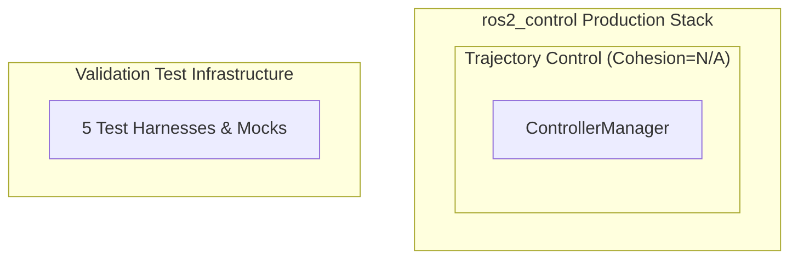
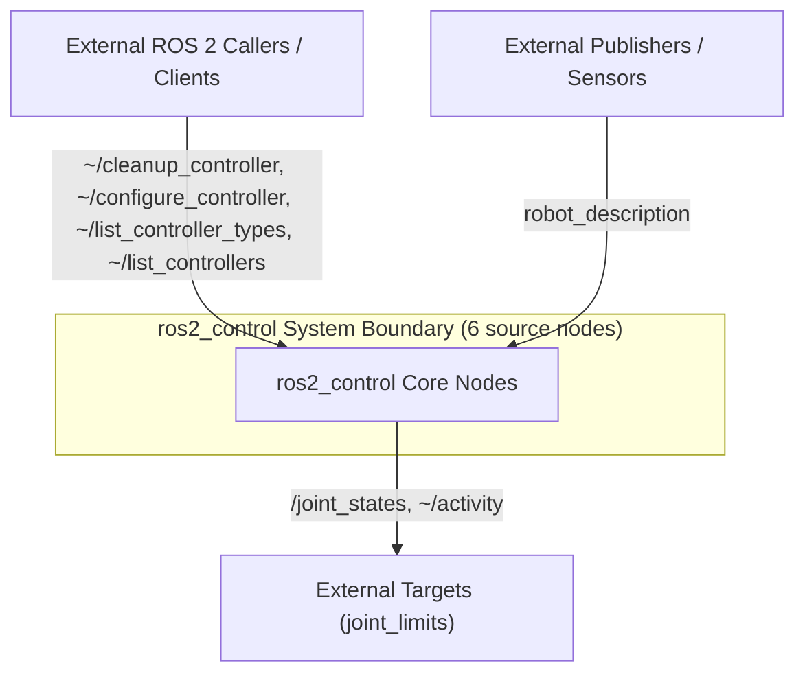
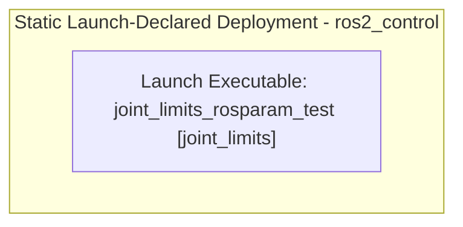
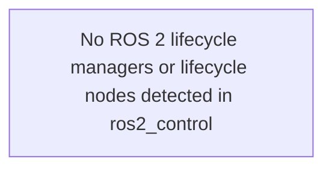
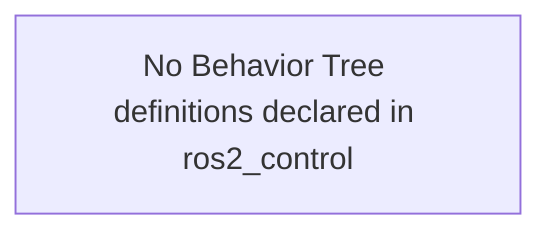

# ros2_control Architecture Documentation

> **Generated automatically by ArchSynth**  
> **Tool**: ArchSynth v2.0 — Evidence-Grounded ROS2 Architecture Recovery  
> **Repository**: [ros2_control](https://github.com/ros-controls/ros2_control)  
> **Branch**: `master`  
> **Commit Hash**: `4052b56d53bdcb562653935255d118f203398b22`  
> **Analysis Timestamp**: `2026-11-27T08:13:17.797916+00:00`  
> **LLM Provider & Model**: `gemini / gemini-1.5-flash`  
> **Analysis Duration**: `4.27s`  
> **Documentation Style**: ISO/IEC/IEEE 42010-aligned  

## Executive Summary

This document provides the reconstructed software architecture documentation for **ros2_control**. ArchSynth parsed **6 ROS2 nodes** and **1 launch files**, organizing them into **2 logical subsystems**. Every recovered architectural entity is grounded with source-code evidence (file:line citations).

### Architecture Overview Statistics

| Metric | Count |
| :--- | :--- |
| **Total Discovered Nodes** | 6 |
| **Parsed Launch Files** | 1 |
| **Logical Subsystems** | 2 |
| **Unique DDS Topics** | 3 |
| **Service Connections** | 11 |
| **Action Connections** | 0 |

---

## 1. System Context (C4 Level 1)

The `ros2_control` repository defines the core software architecture for robust and flexible robot hardware control within the ROS2 ecosystem. This system-of-interest, comprising two distinct subsystems and six active ROS2 nodes, is primarily concerned with providing a standardized, real-time capable framework for managing robot actuators and sensors. Architecturally, it is composed of two primary subsystems: the `controller_manager` and the framework for individual robot controllers, which includes critical components like `joint_limits` for safety and constraint enforcement.

The `controller_manager` subsystem acts as the central orchestrator, dynamically loading, starting, stopping, and unloading various robot controllers. These controllers, representing the second subsystem and leveraging components like `joint_limits` for safety and constraint enforcement, interact with the robot's hardware interface (an external dependency) to execute commands and read sensor data. Communication within `ros2_control` and with its environment is facilitated by three key ROS2 topics, enabling the exchange of joint states, commands, and feedback. The six discovered ROS2 nodes encapsulate specific control logic, such as the `controller_manager` itself, and various specialized controllers or limit enforcement mechanisms, ensuring modularity and extensibility for diverse robotic applications.

---

## 2. Container View (C4 Level 2)

The system is composed of ROS2 package containers communicating over DDS topics, services, and action interfaces.

### Subsystems Summary

#### Subsystem: `trajectory_control`
Production subsystem responsible for trajectory control capabilities.
- **Assignment Rationale**: Grouped 1 node(s) from package(s) controller_manager based on package boundary, functional role, and 0 internal / 13 external interface links.
- **Architectural Role**: `production_subsystem`
- **Intra-Subsystem Cohesion**: N/A (<2 nodes) | **Inter-Subsystem Coupling**: `13.0` (Internal: `0.0`, External: `13.0`) | **Interface Density**: `13.0`
- **Nodes (1)**: `controller_manager::ControllerManager`

#### Subsystem: `validation_test_infrastructure`
System integration test harnesses, mock nodes, and verification testers.
- **Architectural Role**: `test_harness`
- **Intra-Subsystem Cohesion**: `0.0` | **Inter-Subsystem Coupling**: `0.0` (Internal: `0.0`, External: `0.0`) | **Interface Density**: `0.0`
- **Nodes (5)**: `controller_manager::TestControllerClient`, `controller_manager::TestControllerSpawner#test__test_launch_utils__test_launch_utils_integration_dict`, `controller_manager::TestControllerSpawner#test__test_launch_utils__test_launch_utils_integration_list`, `controller_manager::TestNode#test__test_ros2_control_node_launch`, `controller_manager::TestNode#test__test_test_utils`

### Architecture Metrics Definitions

| Metric | Mathematical Definition | Inputs & Edge Cases |
| :--- | :--- | :--- |
| **Intra-Subsystem Cohesion** | `E_internal / (N * (N - 1))` | Directed communication edges between nodes inside the subsystem divided by ordered node pairs. Reported as `N/A` when `N < 2`. |
| **Internal Coupling** | `E_cross_internal` | Directed topic/service/action edges crossing between this subsystem and other in-repository subsystems. |
| **External Coupling** | `I_unmatched_external` | Declared interfaces (pubs/subs/services/actions) on subsystem nodes whose peer resides outside the repository (e.g., `move_group`, `servo_node`, `ros2_control`). |
| **Total Coupling** | `Internal Coupling + External Coupling` | Total boundary-crossing interactions for the subsystem. |
| **Interface Density** | `Total_Interfaces / N` | Average declared ROS 2 endpoints (topics, services, actions) per node in the subsystem. |

---

## 3. Component View & System Diagram (C4 Level 3)

The following Mermaid diagram visualizes the reconstructed subsystem composition and communication graph:



---

## 4. Node Catalog

Overview of the core discovered ROS2 nodes in the system:

| Node Name | Package | Class / Executable | Architectural Classification | Pubs | Subs | Services | Actions | Evidence | Validation |
| :--- | :--- | :--- | :--- | :---: | :---: | :---: | :---: | :---: | :---: |
| [`test_node`](nodes/controller_manager__TestNode_test__test_ros2_control_node_launch.md) | `controller_manager` | `TestNode` | `test` | 0 | 0 | 0 | 0 | 1 item(s) | ✅ supported |
| [`test_node`](nodes/controller_manager__TestNode_test__test_test_utils.md) | `controller_manager` | `TestNode` | `test` | 1 | 0 | 0 | 0 | 1 item(s) | ✅ supported |
| [`test_controller_spawner`](nodes/controller_manager__TestControllerSpawner_test__test_launch_utils__test_launch_utils_integration_dict.md) | `controller_manager` | `TestControllerSpawner` | `test` | 0 | 0 | 0 | 0 | 1 item(s) | ✅ supported |
| [`test_controller_spawner`](nodes/controller_manager__TestControllerSpawner_test__test_launch_utils__test_launch_utils_integration_list.md) | `controller_manager` | `TestControllerSpawner` | `test` | 0 | 0 | 0 | 0 | 1 item(s) | ✅ supported |
| [`test_controller_client`](nodes/controller_manager__TestControllerClient.md) | `controller_manager` | `TestControllerClient` | `test` | 0 | 0 | 0 | 0 | 1 item(s) | ✅ supported |
| [`controller_manager`](nodes/controller_manager__ControllerManager.md) | `controller_manager` | `controller_manager::ControllerManager` | `control` | 1 | 1 | 11 | 0 | 2 item(s) | ✅ supported |

---

## 5. Launch File Composition

Parsed **1 launch files** across the repository.

Alternative standalone launch profiles are analyzed independently by default.

| Launch File | Architectural Classification | Direct Node | Direct LifecycleNode | ComposableNode | ComposableNodeContainer | LoadComposableNodes | Included Launch | Unresolved | Resolved Executable | Runtime Node Name | CMake Installed |
| :--- | :--- | :---: | :---: | :---: | :---: | :---: | :---: | :---: | :--- | :--- | :---: |
| `joint_limits_rosparam.launch.py` | `None` | 1 | 0 | 0 | 0 | 0 | 0 | 0 | `joint_limits_rosparam_test` | `joint_limits_rosparam_test` | No (Excluded) |

---

## 6. Communication Matrix

### Topic Connections

| Topic Name | Publisher Nodes | Subscriber Nodes |
| :--- | :--- | :--- |
| `/joint_states` | `test_node` | *External* |
| `robot_description` | *External* | `controller_manager` |
| `~/activity` | `controller_manager` | *External* |

### Service Connections

| Service Name | Servers | Clients |
| :--- | :--- | :--- |
| `~/cleanup_controller` | `controller_manager` | *External* |
| `~/configure_controller` | `controller_manager` | *External* |
| `~/list_controller_types` | `controller_manager` | *External* |
| `~/list_controllers` | `controller_manager` | *External* |
| `~/list_hardware_components` | `controller_manager` | *External* |
| `~/list_hardware_interfaces` | `controller_manager` | *External* |
| `~/load_controller` | `controller_manager` | *External* |
| `~/reload_controller_libraries` | `controller_manager` | *External* |
| `~/set_hardware_component_state` | `controller_manager` | *External* |
| `~/switch_controller` | `controller_manager` | *External* |
| `~/unload_controller` | `controller_manager` | *External* |

---

## 7. ROS 2 Lifecycle Management Architecture

No ROS 2 lifecycle managers or managed lifecycle nodes were declared in **ros2_control**.

---

## 8. Pluginlib Extensibility Architecture

ArchSynth recovered **25 pluginlib plugins** categorized across **8 architectural extension points**.
Status summary: **0 selected in default parameters**, **25 available in codebase**.

### Plugin Categories

| Extension Category | Base Class / Interface | Plugins Declared | Selected Active Plugin |
| :--- | :--- | :---: | :--- |
| `hardware_interface_SystemInterface` | `hardware_interface::SystemInterface` | 5 | `*None (Available)*` |
| `joint_limits_JointLimiterInterface<trajectory_msgs_msg_JointTrajectoryPoint>` | `joint_limits::JointLimiterInterface<trajectory_msgs::msg::JointTrajectoryPoint>` | 1 | `*None (Available)*` |
| `joint_limits_JointLimiterInterface<joint_limits_JointControlInterfacesData>` | `joint_limits::JointLimiterInterface<joint_limits::JointControlInterfacesData>` | 2 | `*None (Available)*` |
| `rqt_gui_py_Plugin` | `rqt_gui_py::Plugin` | 1 | `*None (Available)*` |
| `transmission_interface_TransmissionLoader` | `transmission_interface::TransmissionLoader` | 3 | `*None (Available)*` |
| `hardware_interface_ActuatorInterface` | `hardware_interface::ActuatorInterface` | 4 | `*None (Available)*` |
| `hardware_interface_SensorInterface` | `hardware_interface::SensorInterface` | 4 | `*None (Available)*` |
| `controller` | `controller_interface::ChainableControllerInterface`, `controller_interface::ControllerInterface` | 5 | `*None (Available)*` |

### Plugin Extensibility Class Diagram

```mermaid
classDiagram
    direction TB
    class hardware_interface_SystemInterface {
        <<interface>>
    }
    class mock_components_GenericSystem {
        package: hardware_interface
    }
    hardware_interface_SystemInterface <|-- mock_components_GenericSystem
    class joint_limits_JointLimiterInterface_trajectory_msgs_msg_JointTrajectoryPoint_ {
        <<interface>>
    }
    class JointTrajectoryPointSaturationLimiter {
        package: joint_limits
    }
    joint_limits_JointLimiterInterface_trajectory_msgs_msg_JointTrajectoryPoint_ <|-- JointTrajectoryPointSaturationLimiter
    class joint_limits_JointLimiterInterface_joint_limits_JointControlInterfacesData_ {
        <<interface>>
    }
    class JointInterfacesSaturationLimiter {
        package: joint_limits
    }
    joint_limits_JointLimiterInterface_joint_limits_JointControlInterfacesData_ <|-- JointInterfacesSaturationLimiter
    class JointInterfacesSoftLimiter {
        package: joint_limits
    }
    joint_limits_JointLimiterInterface_joint_limits_JointControlInterfacesData_ <|-- JointInterfacesSoftLimiter
    class rqt_gui_py_Plugin {
        <<interface>>
    }
    class rqt_controller_manager.controller_manager.ControllerManager {
        package: rqt_controller_manager
    }
    rqt_gui_py_Plugin <|-- rqt_controller_manager.controller_manager.ControllerManager
    class transmission_interface_TransmissionLoader {
        <<interface>>
    }
    class transmission_interface_SimpleTransmissionLoader {
        package: transmission_interface
    }
    transmission_interface_TransmissionLoader <|-- transmission_interface_SimpleTransmissionLoader
    class transmission_interface_FourBarLinkageTransmissionLoader {
        package: transmission_interface
    }
    transmission_interface_TransmissionLoader <|-- transmission_interface_FourBarLinkageTransmissionLoader
    class transmission_interface_DifferentialTransmissionLoader {
        package: transmission_interface
    }
    transmission_interface_TransmissionLoader <|-- transmission_interface_DifferentialTransmissionLoader
    class hardware_interface_ActuatorInterface {
        <<interface>>
    }
    class TestActuator {
        package: hardware_interface_testing
    }
    hardware_interface_ActuatorInterface <|-- TestActuator
    class TestActuatorExclusiveInterfaces {
        package: hardware_interface_testing
    }
    hardware_interface_ActuatorInterface <|-- TestActuatorExclusiveInterfaces
    class hardware_interface_SensorInterface {
        <<interface>>
    }
    class TestSensor {
        package: hardware_interface_testing
    }
    hardware_interface_SensorInterface <|-- TestSensor
    class TestSystem {
        package: hardware_interface_testing
    }
    hardware_interface_SystemInterface <|-- TestSystem
    class TestUninitializableActuator {
        package: hardware_interface_testing
    }
    hardware_interface_ActuatorInterface <|-- TestUninitializableActuator
    class TestUninitializableSensor {
        package: hardware_interface_testing
    }
    hardware_interface_SensorInterface <|-- TestUninitializableSensor
    class TestUninitializableSystem {
        package: hardware_interface_testing
    }
    hardware_interface_SystemInterface <|-- TestUninitializableSystem
    class test_hardware_components_TestSingleJointActuator {
        package: hardware_interface
    }
    hardware_interface_ActuatorInterface <|-- test_hardware_components_TestSingleJointActuator
    class test_hardware_components_TestForceTorqueSensor {
        package: hardware_interface
    }
    hardware_interface_SensorInterface <|-- test_hardware_components_TestForceTorqueSensor
    class test_hardware_components_TestIMUSensor {
        package: hardware_interface
    }
    hardware_interface_SensorInterface <|-- test_hardware_components_TestIMUSensor
    class test_hardware_components_TestTwoJointSystem {
        package: hardware_interface
    }
    hardware_interface_SystemInterface <|-- test_hardware_components_TestTwoJointSystem
    class test_hardware_components_TestSystemCommandModes {
        package: hardware_interface
    }
    hardware_interface_SystemInterface <|-- test_hardware_components_TestSystemCommandModes
    class controller_interface_ChainableControllerInterface {
        <<interface>>
    }
    class test_chainable_controller_TestChainableController {
        package: controller_manager
    }
    controller_interface_ChainableControllerInterface <|-- test_chainable_controller_TestChainableController
    class controller_interface_ControllerInterface {
        <<interface>>
    }
    class test_controller_TestController {
        package: controller_manager
    }
    controller_interface_ControllerInterface <|-- test_controller_TestController
    class test_controller_failed_activate_TestControllerFailedActivate {
        package: controller_manager
    }
    controller_interface_ControllerInterface <|-- test_controller_failed_activate_TestControllerFailedActivate
    class test_controller_failed_init_TestControllerFailedInit {
        package: controller_manager
    }
    controller_interface_ControllerInterface <|-- test_controller_failed_init_TestControllerFailedInit
    class test_controller_with_interfaces_TestControllerWithInterfaces {
        package: controller_manager
    }
    controller_interface_ControllerInterface <|-- test_controller_with_interfaces_TestControllerWithInterfaces
```



---

## 10. ISO/IEC/IEEE 42010 Architecture Views (8 Views)

ArchSynth provides multi-perspective architectural representations conforming to ISO/IEC/IEEE 42010:

### View: System Context View (`system_context`)

System boundary for ros2_control derived from 6 source nodes, unmatched external-peer interfaces, and 1 external launch packages.

- **Architectural Concerns**: System boundaries, External interfaces, Operational environment
- **Target Stakeholders**: System Architects, Robotics Integrators, Application Engineers



### View: Package Dependency View (`package_dependency`)

Directed package dependency graph across 11 repository packages and 54 external dependencies (package.xml, setup.py, and resolved source dependencies).

- **Architectural Concerns**: Package coupling, Build layering, Modular reusability
- **Target Stakeholders**: Software Maintainers, Build Engineers, Component Developers

```mermaid
flowchart TD
    controller_interface["controller_interface (ament_cmake)"]
    controller_manager["controller_manager (ament_cmake)"]
    controller_manager_msgs["controller_manager_msgs (ament_cmake)"]
    hardware_interface["hardware_interface (ament_cmake)"]
    hardware_interface_testing["hardware_interface_testing (ament_cmake)"]
    joint_limits["joint_limits (ament_cmake)"]
    ros2_control["ros2_control (ament_cmake)"]
    ros2_control_test_assets["ros2_control_test_assets (ament_cmake)"]
    ros2controlcli["ros2controlcli (ament_python)"]
    rqt_controller_manager["rqt_controller_manager (ament_python)"]
    transmission_interface["transmission_interface (ament_cmake)"]
    controller_interface -->|"build_depend"| hardware_interface
    ros2_control_cmake["ros2_control_cmake (external)"]
    controller_interface -->|"build_depend"| ros2_control_cmake
    controller_interface -->|"build_export_depend"| hardware_interface
    controller_interface -.->|"source_include"| hardware_interface
    controller_interface -.->|"source_include"| joint_limits
    controller_manager -->|"depend"| controller_interface
    controller_manager -->|"depend"| controller_manager_msgs
    controller_manager -->|"depend"| hardware_interface
    controller_manager -->|"build_depend"| ros2_control_cmake
    controller_manager -->|"test_depend"| hardware_interface_testing
    controller_manager -->|"test_depend"| ros2_control_test_assets
    controller_manager -.->|"source_import"| controller_manager_msgs
    controller_manager -.->|"source_include"| controller_interface
    controller_manager -.->|"source_include"| controller_manager_msgs
    controller_manager -.->|"source_include"| hardware_interface
    controller_manager -.->|"source_include"| ros2_control_test_assets
    test_controller_with_interfaces["test_controller_with_interfaces (external)"]
    controller_manager -.->|"source_include"| test_controller_with_interfaces
    hardware_interface -->|"depend"| joint_limits
    hardware_interface -->|"build_depend"| ros2_control_cmake
    hardware_interface -->|"test_depend"| ros2_control_test_assets
    hardware_interface -.->|"source_include"| joint_limits
    hardware_interface -.->|"source_include"| ros2_control_test_assets
    hardware_interface_testing -->|"depend"| hardware_interface
    hardware_interface_testing -->|"depend"| ros2_control_test_assets
    hardware_interface_testing -->|"build_depend"| ros2_control_cmake
    hardware_interface_testing -.->|"source_include"| hardware_interface
    hardware_interface_testing -.->|"source_include"| ros2_control_test_assets
    joint_limits -->|"build_depend"| ros2_control_cmake
    ros2_control -->|"exec_depend"| controller_interface
    ros2_control -->|"exec_depend"| controller_manager
    ros2_control -->|"exec_depend"| controller_manager_msgs
    ros2_control -->|"exec_depend"| hardware_interface
    ros2_control -->|"exec_depend"| joint_limits
    ros2_control -->|"exec_depend"| ros2_control_test_assets
    ros2_control -->|"exec_depend"| ros2controlcli
    ros2_control -->|"exec_depend"| transmission_interface
    ros2_control_test_assets -->|"build_depend"| ros2_control_cmake
    ros2controlcli -->|"depend"| controller_manager
    ros2controlcli -->|"depend"| controller_manager_msgs
    ros2controlcli -.->|"source_import"| controller_manager
    ros2controlcli -.->|"source_import"| controller_manager_msgs
    rqt_controller_manager -->|"exec_depend"| controller_manager
    rqt_controller_manager -->|"exec_depend"| controller_manager_msgs
    rqt_controller_manager -.->|"source_import"| controller_manager
    rqt_controller_manager -.->|"source_import"| controller_manager_msgs
    transmission_interface -->|"depend"| hardware_interface
    transmission_interface -->|"build_depend"| ros2_control_cmake
    transmission_interface -->|"test_depend"| ros2_control_test_assets
    transmission_interface -.->|"source_include"| hardware_interface
    transmission_interface -.->|"source_include"| ros2_control_test_assets
```



### View: Subsystem / Component View (`subsystem_component`)

Recovered functional software subsystems, metrics, and inter-subsystem communication edges for ros2_control.

- **Architectural Concerns**: Functional decomposition, Subsystem cohesion, Coupling minimization
- **Target Stakeholders**: Lead Architects, Functional Leads, Domain Engineers


### View: Runtime Deployment View (`runtime_deployment`)

Static launch-declared deployment topology for ros2_control (0 containers, 1 launch instances). Note: OS process hosting is inferred from launch declarations, not runtime-observed.

- **Architectural Concerns**: Process allocation, IPC vs Intra-process communication, Deployment efficiency
- **Target Stakeholders**: Deployment Engineers, Embedded Systems Leads, Performance Engineers



### View: Communication View (`communication_topology`)

Recovered interaction topology displaying topics, services, and actions for ros2_control.

- **Architectural Concerns**: Dataflow, Message passing latency, Interface compatibility
- **Target Stakeholders**: Integration Engineers, Safety Engineers, Robotics Developers

```mermaid
flowchart LR
    node_controller_manager["controller_manager"]
    node_controller_manager -->|"~/activity"| topic_~_activity["~/activity"]
```

### View: Lifecycle View (`lifecycle_architecture`)

No ROS 2 lifecycle nodes, lifecycle managers, or lifecycle configurations were detected in ros2_control. System-specific lifecycle diagram omitted.

- **Architectural Concerns**: Deterministic startup, State consistency, Fault isolation
- **Target Stakeholders**: System Engineers, Safety Certification Authorities, Operations



### View: Plugin Architecture View (`plugin_architecture`)

Pluginlib extensibility patterns and implementations recovered for ros2_control.

- **Architectural Concerns**: Extensibility, Algorithm swappability, Runtime polymorphism
- **Target Stakeholders**: Algorithm Developers, Extension Authors, Software Architects


### View: Behavior Tree View (`behavior_tree_orchestration`)

Behavior Tree navigation orchestration is not utilized in ros2_control.

- **Architectural Concerns**: Autonomous mission execution, Reactive recovery, Blackboard dataflow
- **Target Stakeholders**: Autonomy Engineers, Behavior Designers, Test Engineers




---

## 11. Evidence / Traceability

> This section documents the source-code evidence supporting each recovered architectural entity.
> Evidence-grounded recovery distinguishes schema-valid claims from factually-supported claims.

### Node Evidence

| Node | Evidence File | Lines | Evidence Type |
| :--- | :--- | :--- | :--- |
| `test_node` | `controller_manager/test/test_ros2_control_node_launch.py` | `L104` | `node_definition` |
| `test_node` | `controller_manager/test/test_test_utils.py` | `L53` | `node_definition` |
| `test_controller_spawner` | `controller_manager/test/test_launch_utils/test_launch_utils_integration_dict.py` | `L103` | `node_definition` |
| `test_controller_spawner` | `controller_manager/test/test_launch_utils/test_launch_utils_integration_list.py` | `L96` | `node_definition` |
| `test_controller_client` | `controller_manager/test/test_launch_utils/test_launch_utils_integration_load.py` | `L90` | `node_definition` |
| `controller_manager` | `controller_manager/include/controller_manager/controller_manager.hpp` | `L65` | `node_definition` |
| `controller_manager` | `controller_manager/src/controller_manager.cpp` | `L531` | `node_definition` |

### Topic Evidence (Sample)

| Topic | Direction | Node | Evidence File | Lines |
| :--- | :--- | :--- | :--- | :--- |
| `/joint_states` | publish | `test_node` | `controller_manager/test/test_test_utils.py` | `L65` |
| `~/activity` | publish | `controller_manager` | `controller_manager/src/controller_manager.cpp` | `L657–L658` |
| `robot_description` | subscribe | `controller_manager` | `controller_manager/src/controller_manager.cpp` | `L754–L756` |

---

## 11b. Structured Node & Executable Inventory

Distinguishes repository-defined source nodes, composable components, external ROS 2 launch executables, dynamically loaded plugins, and unresolved dynamic entries:

| Name / Identifier | Package | Executable | Classification | Origin | Confidence | Evidence |
| :--- | :--- | :--- | :--- | :--- | :---: | :--- |
| `test_node` | `controller_manager` | `(library/script)` | `repository_test_node` | `repository_source` | 1.00 | `controller_manager/test/test_ros2_control_node_launch.py:L104` |
| `test_node` | `controller_manager` | `(library/script)` | `repository_test_node` | `repository_source` | 1.00 | `controller_manager/test/test_test_utils.py:L53` |
| `test_controller_spawner` | `controller_manager` | `(library/script)` | `repository_test_node` | `repository_source` | 1.00 | `controller_manager/test/test_launch_utils/test_launch_utils_integration_dict.py:L103` |
| `test_controller_spawner` | `controller_manager` | `(library/script)` | `repository_test_node` | `repository_source` | 1.00 | `controller_manager/test/test_launch_utils/test_launch_utils_integration_list.py:L96` |
| `test_controller_client` | `controller_manager` | `(library/script)` | `repository_test_node` | `repository_source` | 1.00 | `controller_manager/test/test_launch_utils/test_launch_utils_integration_load.py:L90` |
| `controller_manager` | `controller_manager` | `(library/script)` | `repository_defined_node` | `repository_source` | 1.00 | `controller_manager/include/controller_manager/controller_manager.hpp:L65`, `controller_manager/src/controller_manager.cpp:L531` |
| `joint_limits_rosparam_test` | `joint_limits` | `joint_limits_rosparam_test` | `internal_launch_instance` | `launch_declaration` | 0.85 | `joint_limits/test/joint_limits_rosparam.launch.py:L32` |
| `mock_components::GenericSystem` | `hardware_interface` | `(pluginlib)` | `dynamically_loaded_component` | `pluginlib_manifest` | 1.00 | `hardware_interface/mock_components_plugin_description.xml:L1` |
| `JointTrajectoryPointSaturationLimiter` | `joint_limits` | `(pluginlib)` | `dynamically_loaded_component` | `pluginlib_manifest` | 1.00 | `joint_limits/joint_limiters.xml:L1` |
| `JointInterfacesSaturationLimiter` | `joint_limits` | `(pluginlib)` | `dynamically_loaded_component` | `pluginlib_manifest` | 1.00 | `joint_limits/joint_limiters.xml:L1` |
| `JointInterfacesSoftLimiter` | `joint_limits` | `(pluginlib)` | `dynamically_loaded_component` | `pluginlib_manifest` | 1.00 | `joint_limits/joint_limiters.xml:L1` |
| `rqt_controller_manager.controller_manager.ControllerManager` | `rqt_controller_manager` | `(pluginlib)` | `dynamically_loaded_component` | `pluginlib_manifest` | 1.00 | `rqt_controller_manager/plugin.xml:L1` |
| `transmission_interface::SimpleTransmissionLoader` | `transmission_interface` | `(pluginlib)` | `dynamically_loaded_component` | `pluginlib_manifest` | 1.00 | `transmission_interface/ros2_control_plugins.xml:L1` |
| `transmission_interface::FourBarLinkageTransmissionLoader` | `transmission_interface` | `(pluginlib)` | `dynamically_loaded_component` | `pluginlib_manifest` | 1.00 | `transmission_interface/ros2_control_plugins.xml:L1` |
| `transmission_interface::DifferentialTransmissionLoader` | `transmission_interface` | `(pluginlib)` | `dynamically_loaded_component` | `pluginlib_manifest` | 1.00 | `transmission_interface/ros2_control_plugins.xml:L1` |
| `TestActuator` | `hardware_interface_testing` | `(pluginlib)` | `dynamically_loaded_component` | `pluginlib_manifest` | 1.00 | `hardware_interface_testing/test/test_components/test_components.xml:L1` |
| `TestActuatorExclusiveInterfaces` | `hardware_interface_testing` | `(pluginlib)` | `dynamically_loaded_component` | `pluginlib_manifest` | 1.00 | `hardware_interface_testing/test/test_components/test_components.xml:L1` |
| `TestSensor` | `hardware_interface_testing` | `(pluginlib)` | `dynamically_loaded_component` | `pluginlib_manifest` | 1.00 | `hardware_interface_testing/test/test_components/test_components.xml:L1` |
| `TestSystem` | `hardware_interface_testing` | `(pluginlib)` | `dynamically_loaded_component` | `pluginlib_manifest` | 1.00 | `hardware_interface_testing/test/test_components/test_components.xml:L1` |
| `TestUninitializableActuator` | `hardware_interface_testing` | `(pluginlib)` | `dynamically_loaded_component` | `pluginlib_manifest` | 1.00 | `hardware_interface_testing/test/test_components/test_components.xml:L1` |
| `TestUninitializableSensor` | `hardware_interface_testing` | `(pluginlib)` | `dynamically_loaded_component` | `pluginlib_manifest` | 1.00 | `hardware_interface_testing/test/test_components/test_components.xml:L1` |
| `TestUninitializableSystem` | `hardware_interface_testing` | `(pluginlib)` | `dynamically_loaded_component` | `pluginlib_manifest` | 1.00 | `hardware_interface_testing/test/test_components/test_components.xml:L1` |
| `test_hardware_components::TestSingleJointActuator` | `hardware_interface` | `(pluginlib)` | `dynamically_loaded_component` | `pluginlib_manifest` | 1.00 | `hardware_interface/test/test_hardware_components/test_hardware_components.xml:L1` |
| `test_hardware_components::TestForceTorqueSensor` | `hardware_interface` | `(pluginlib)` | `dynamically_loaded_component` | `pluginlib_manifest` | 1.00 | `hardware_interface/test/test_hardware_components/test_hardware_components.xml:L1` |
| `test_hardware_components::TestIMUSensor` | `hardware_interface` | `(pluginlib)` | `dynamically_loaded_component` | `pluginlib_manifest` | 1.00 | `hardware_interface/test/test_hardware_components/test_hardware_components.xml:L1` |
| `test_hardware_components::TestTwoJointSystem` | `hardware_interface` | `(pluginlib)` | `dynamically_loaded_component` | `pluginlib_manifest` | 1.00 | `hardware_interface/test/test_hardware_components/test_hardware_components.xml:L1` |
| `test_hardware_components::TestSystemCommandModes` | `hardware_interface` | `(pluginlib)` | `dynamically_loaded_component` | `pluginlib_manifest` | 1.00 | `hardware_interface/test/test_hardware_components/test_hardware_components.xml:L1` |
| `test_chainable_controller::TestChainableController` | `controller_manager` | `(pluginlib)` | `dynamically_loaded_component` | `pluginlib_manifest` | 1.00 | `controller_manager/test/test_chainable_controller/test_chainable_controller.xml:L1` |
| `test_controller::TestController` | `controller_manager` | `(pluginlib)` | `dynamically_loaded_component` | `pluginlib_manifest` | 1.00 | `controller_manager/test/test_controller/test_controller.xml:L1` |
| `test_controller_failed_activate::TestControllerFailedActivate` | `controller_manager` | `(pluginlib)` | `dynamically_loaded_component` | `pluginlib_manifest` | 1.00 | `controller_manager/test/test_controller_failed_activate/test_controller_failed_activate.xml:L1` |
| `test_controller_failed_init::TestControllerFailedInit` | `controller_manager` | `(pluginlib)` | `dynamically_loaded_component` | `pluginlib_manifest` | 1.00 | `controller_manager/test/test_controller_failed_init/test_controller_failed_init.xml:L1` |
| `test_controller_with_interfaces::TestControllerWithInterfaces` | `controller_manager` | `(pluginlib)` | `dynamically_loaded_component` | `pluginlib_manifest` | 1.00 | `controller_manager/test/test_controller_with_interfaces/test_controller_with_interfaces.xml:L1` |

---

## 11c. Package Dependency Architecture

Recovered **11 internal packages**, **54 external dependencies**, and **260 directed dependency edges** from `package.xml`, `setup.py`, and source `#include`/`import` statements.

| Source Package | Target Package | Dependency Type | Origin | Target Scope | Evidence |
| :--- | :--- | :--- | :--- | :---: | :--- |
| `controller_interface` | `fmt` | `build_depend` | `declared_manifest` | External | `controller_interface/package.xml:L16` |
| `controller_interface` | `hardware_interface` | `build_depend` | `declared_manifest` | Internal | `controller_interface/package.xml:L17` |
| `controller_interface` | `pal_statistics` | `build_depend` | `declared_manifest` | External | `controller_interface/package.xml:L18` |
| `controller_interface` | `rclcpp_lifecycle` | `build_depend` | `declared_manifest` | External | `controller_interface/package.xml:L19` |
| `controller_interface` | `realtime_tools` | `build_depend` | `declared_manifest` | External | `controller_interface/package.xml:L20` |
| `controller_interface` | `ros2_control_cmake` | `build_depend` | `declared_manifest` | External | `controller_interface/package.xml:L21` |
| `controller_interface` | `ament_cmake` | `buildtool_depend` | `declared_manifest` | External | `controller_interface/package.xml:L13` |
| `controller_interface` | `ament_cmake_gen_version_h` | `buildtool_depend` | `declared_manifest` | External | `controller_interface/package.xml:L14` |
| `controller_interface` | `hardware_interface` | `build_export_depend` | `declared_manifest` | Internal | `controller_interface/package.xml:L23` |
| `controller_interface` | `realtime_tools` | `build_export_depend` | `declared_manifest` | External | `controller_interface/package.xml:L24` |
| `controller_interface` | `rclcpp_lifecycle` | `build_export_depend` | `declared_manifest` | External | `controller_interface/package.xml:L25` |
| `controller_interface` | `realtime_tools` | `exec_depend` | `declared_manifest` | External | `controller_interface/package.xml:L27` |
| `controller_interface` | `ament_cmake_gmock` | `test_depend` | `declared_manifest` | External | `controller_interface/package.xml:L29` |
| `controller_interface` | `geometry_msgs` | `test_depend` | `declared_manifest` | External | `controller_interface/package.xml:L30` |
| `controller_interface` | `sensor_msgs` | `test_depend` | `declared_manifest` | External | `controller_interface/package.xml:L31` |
| `controller_interface` | `std_msgs` | `test_depend` | `declared_manifest` | External | `controller_interface/package.xml:L32` |
| `controller_interface` | `hardware_interface` | `source_include` | `observed_source` | Internal | `controller_interface/include/controller_interface/chainable_controller_interface.hpp:L24` |
| `controller_interface` | `realtime_tools` | `source_include` | `observed_source` | External | `controller_interface/include/controller_interface/controller_interface_base.hpp:L24` |
| `controller_interface` | `lifecycle_msgs` | `source_include` | `observed_source` | External | `controller_interface/include/controller_interface/controller_interface_base.hpp:L32` |
| `controller_interface` | `pal_statistics` | `source_include` | `observed_source` | External | `controller_interface/include/controller_interface/controller_interface_base.hpp:L33` |
| `controller_interface` | `rclcpp` | `source_include` | `observed_source` | External | `controller_interface/include/controller_interface/controller_interface_base.hpp:L34` |
| `controller_interface` | `rclcpp_lifecycle` | `source_include` | `observed_source` | External | `controller_interface/include/controller_interface/controller_interface_base.hpp:L35` |
| `controller_interface` | `joint_limits` | `source_include` | `observed_source` | Internal | `controller_interface/include/controller_interface/controller_interface_params.hpp:L21` |
| `controller_interface` | `geometry_msgs` | `source_include` | `observed_source` | External | `controller_interface/include/semantic_components/force_torque_sensor.hpp:L23` |
| `controller_interface` | `semantic_components` | `source_include` | `observed_source` | External | `controller_interface/include/semantic_components/force_torque_sensor.hpp:L25` |
| `controller_interface` | `sensor_msgs` | `source_include` | `observed_source` | External | `controller_interface/include/semantic_components/gps_sensor.hpp:L23` |
| `controller_interface` | `std_msgs` | `source_include` | `observed_source` | External | `controller_interface/include/semantic_components/led_rgb_device.hpp:L22` |
| `controller_interface` | `fmt` | `source_include` | `observed_source` | External | `controller_interface/src/chainable_controller_interface.cpp:L17` |
| `controller_interface` | `gmock` | `source_include` | `observed_source` | External | `controller_interface/test/test_chainable_controller_interface.cpp:L19` |
| `controller_interface` | `gtest` | `source_include` | `observed_source` | External | `controller_interface/test/test_controller_tf_prefix.hpp:L19` |
| `controller_manager` | `backward_ros` | `depend` | `declared_manifest` | External | `controller_manager/package.xml:L18` |
| `controller_manager` | `controller_interface` | `depend` | `declared_manifest` | Internal | `controller_manager/package.xml:L19` |
| `controller_manager` | `controller_manager_msgs` | `depend` | `declared_manifest` | Internal | `controller_manager/package.xml:L20` |
| `controller_manager` | `diagnostic_updater` | `depend` | `declared_manifest` | External | `controller_manager/package.xml:L21` |
| `controller_manager` | `fmt` | `depend` | `declared_manifest` | External | `controller_manager/package.xml:L22` |
| `controller_manager` | `hardware_interface` | `depend` | `declared_manifest` | Internal | `controller_manager/package.xml:L24` |
| `controller_manager` | `hardware_interface_testing` | `test_depend` | `declared_manifest` | Internal | `controller_manager/package.xml:L46` |
| `controller_manager` | `ros2_control_test_assets` | `test_depend` | `declared_manifest` | Internal | `controller_manager/package.xml:L50` |
| `controller_manager` | `controller_manager_msgs` | `source_import` | `observed_source` | Internal | `controller_manager/controller_manager/controller_manager_services.py:L15` |
| `controller_manager` | `controller_interface` | `source_include` | `observed_source` | Internal | `controller_manager/include/controller_manager/controller_manager.hpp:L25` |
| `controller_manager` | `controller_manager_msgs` | `source_include` | `observed_source` | Internal | `controller_manager/include/controller_manager/controller_manager.hpp:L30` |
| `controller_manager` | `hardware_interface` | `source_include` | `observed_source` | Internal | `controller_manager/include/controller_manager/controller_manager.hpp:L44` |
| `controller_manager` | `ros2_control_test_assets` | `source_include` | `observed_source` | Internal | `controller_manager/test/controller_manager_test_common.hpp:L30` |
| `hardware_interface` | `joint_limits` | `depend` | `declared_manifest` | Internal | `hardware_interface/package.xml:L18` |
| `hardware_interface` | `ros2_control_test_assets` | `test_depend` | `declared_manifest` | Internal | `hardware_interface/package.xml:L34` |
| `hardware_interface` | `joint_limits` | `source_include` | `observed_source` | Internal | `hardware_interface/include/hardware_interface/hardware_info.hpp:L25` |
| `hardware_interface` | `ros2_control_test_assets` | `source_include` | `observed_source` | Internal | `hardware_interface/test/test_component_interfaces.cpp:L39` |
| `hardware_interface_testing` | `hardware_interface` | `depend` | `declared_manifest` | Internal | `hardware_interface_testing/package.xml:L16` |
| `hardware_interface_testing` | `ros2_control_test_assets` | `depend` | `declared_manifest` | Internal | `hardware_interface_testing/package.xml:L20` |
| `hardware_interface_testing` | `hardware_interface` | `source_include` | `observed_source` | Internal | `hardware_interface_testing/test/test_resource_manager.cpp:L29` |
| `hardware_interface_testing` | `ros2_control_test_assets` | `source_include` | `observed_source` | Internal | `hardware_interface_testing/test/test_resource_manager.cpp:L35` |
| `ros2_control` | `controller_interface` | `exec_depend` | `declared_manifest` | Internal | `ros2_control/package.xml:L17` |
| `ros2_control` | `controller_manager` | `exec_depend` | `declared_manifest` | Internal | `ros2_control/package.xml:L18` |
| `ros2_control` | `controller_manager_msgs` | `exec_depend` | `declared_manifest` | Internal | `ros2_control/package.xml:L19` |
| `ros2_control` | `hardware_interface` | `exec_depend` | `declared_manifest` | Internal | `ros2_control/package.xml:L20` |
| `ros2_control` | `joint_limits` | `exec_depend` | `declared_manifest` | Internal | `ros2_control/package.xml:L21` |
| `ros2_control` | `ros2_control_test_assets` | `exec_depend` | `declared_manifest` | Internal | `ros2_control/package.xml:L22` |
| `ros2_control` | `ros2controlcli` | `exec_depend` | `declared_manifest` | Internal | `ros2_control/package.xml:L23` |
| `ros2_control` | `transmission_interface` | `exec_depend` | `declared_manifest` | Internal | `ros2_control/package.xml:L24` |
| `ros2controlcli` | `controller_manager` | `depend` | `declared_manifest` | Internal | `ros2controlcli/package.xml:L19` |
| `ros2controlcli` | `controller_manager_msgs` | `depend` | `declared_manifest` | Internal | `ros2controlcli/package.xml:L20` |
| `ros2controlcli` | `controller_manager` | `source_import` | `observed_source` | Internal | `ros2controlcli/ros2controlcli/api/__init__.py:L16` |
| `ros2controlcli` | `controller_manager_msgs` | `source_import` | `observed_source` | Internal | `ros2controlcli/ros2controlcli/verb/switch_controllers.py:L16` |
| `rqt_controller_manager` | `controller_manager` | `exec_depend` | `declared_manifest` | Internal | `rqt_controller_manager/package.xml:L24` |
| `rqt_controller_manager` | `controller_manager_msgs` | `exec_depend` | `declared_manifest` | Internal | `rqt_controller_manager/package.xml:L25` |
| `rqt_controller_manager` | `controller_manager` | `source_import` | `observed_source` | Internal | `rqt_controller_manager/rqt_controller_manager/controller_manager.py:L20` |
| `rqt_controller_manager` | `controller_manager_msgs` | `source_import` | `observed_source` | Internal | `rqt_controller_manager/rqt_controller_manager/controller_manager.py:L31` |
| `transmission_interface` | `hardware_interface` | `depend` | `declared_manifest` | Internal | `transmission_interface/package.xml:L17` |
| `transmission_interface` | `ros2_control_test_assets` | `test_depend` | `declared_manifest` | Internal | `transmission_interface/package.xml:L22` |
| `transmission_interface` | `hardware_interface` | `source_include` | `observed_source` | Internal | `transmission_interface/include/transmission_interface/differential_transmission.hpp:L24` |
| `transmission_interface` | `ros2_control_test_assets` | `source_include` | `observed_source` | Internal | `transmission_interface/test/differential_transmission_loader_test.cpp:L24` |

---

## 11d. Architecture Consistency Validation & Unresolved Elements

Findings summary: **Warning**: 2, **Unresolved**: 3, **Potential inconsistency**: 7

| ID | Severity | Category | Entity | Details |
| :--- | :--- | :--- | :--- | :--- |
| `VAL-001` | **Warning** | `launch_node_mismatch` | `joint_limits::joint_limits_rosparam_test` | Launch file joint_limits/test/joint_limits_rosparam.launch.py invokes 'joint_limits_rosparam_test' in internal package 'joint_limits', which was not matched to a parsed node class. |
| `VAL-002` | **Warning** | `unlaunched_source_node` | `controller_manager::ControllerManager` | Source node 'controller_manager' (controller_manager/src/controller_manager.cpp) is not referenced by any analyzed launch file (may be invoked directly via ros2 run or library API). |
| `VAL-003` | **Unresolved** | `publisher_without_subscriber` | `/joint_states` | Topic '/joint_states' has internal publisher(s) ['test_node'] with no in-repo subscriber (likely consumed by external nodes such as move_group, servo_node, or gazebo). |
| `VAL-004` | **Unresolved** | `subscriber_without_publisher` | `robot_description` | Topic 'robot_description' has internal subscriber(s) ['controller_manager'] with no in-repo publisher (likely published by external drivers/sensors such as joy_node or camera bridge). |
| `VAL-005` | **Unresolved** | `publisher_without_subscriber` | `~/activity` | Topic '~/activity' has internal publisher(s) ['controller_manager'] with no in-repo subscriber (likely consumed by external nodes such as move_group, servo_node, or gazebo). |
| `VAL-006` | **Potential inconsistency** | `missing_package_dependency` | `controller_interface -> lifecycle_msgs` | Source file controller_interface/include/controller_interface/controller_interface_base.hpp:L32 uses 'lifecycle_msgs' (source_include), which is not declared in package.xml. |
| `VAL-007` | **Potential inconsistency** | `missing_package_dependency` | `controller_interface -> joint_limits` | Source file controller_interface/include/controller_interface/controller_interface_params.hpp:L21 uses 'joint_limits' (source_include), which is not declared in package.xml. |
| `VAL-008` | **Potential inconsistency** | `missing_package_dependency` | `controller_manager -> test_controller_with_interfaces` | Source file controller_manager/test/test_release_interfaces.cpp:L23 uses 'test_controller_with_interfaces' (source_include), which is not declared in package.xml. |
| `VAL-009` | **Potential inconsistency** | `missing_package_dependency` | `joint_limits -> lifecycle_msgs` | Source file joint_limits/test/joint_limits_rosparam_test.cpp:L20 uses 'lifecycle_msgs' (source_include), which is not declared in package.xml. |
| `VAL-010` | **Potential inconsistency** | `missing_package_dependency` | `ros2controlcli -> lifecycle_msgs` | Source file ros2controlcli/ros2controlcli/verb/list_hardware_components.py:L17 uses 'lifecycle_msgs' (source_import), which is not declared in package.xml. |
| `VAL-011` | **Potential inconsistency** | `missing_package_dependency` | `rqt_controller_manager -> lifecycle_msgs` | Source file rqt_controller_manager/rqt_controller_manager/controller_manager.py:L33 uses 'lifecycle_msgs' (source_import), which is not declared in package.xml. |
| `VAL-012` | **Potential inconsistency** | `missing_package_dependency` | `rqt_controller_manager -> rcl_interfaces` | Source file rqt_controller_manager/rqt_controller_manager/controller_manager.py:L39 uses 'rcl_interfaces' (source_import), which is not declared in package.xml. |
---

## 12. Experiment Metadata & Reproducibility

| Field | Value |
| :--- | :--- |
| **Tool** | ArchSynth v2.0 (M.Tech Dissertation Project) |
| **Repository Name** | `ros2_control` |
| **Repository URL** | `https://github.com/ros-controls/ros2_control` |
| **Branch** | `master` |
| **Commit Hash** | `4052b56d53bdcb562653935255d118f203398b22` |
| **Analysis Timestamp** | `2026-11-27T08:13:17.797916+00:00` |
| **ArchSynth Version** | `2.0` |
| **LLM Provider** | `gemini` |
| **LLM Model** | `gemini-1.5-flash` |
| **Nodes Analyzed** | 6 |
| **Launch Files Analyzed** | 1 |
| **Processing Time** | 4.27s |
| **Documentation Style** | ISO/IEC/IEEE 42010-aligned architecture description |

> *ArchSynth uses evidence-grounded, schema-constrained hybrid static analysis and LLM synthesis*
> *for ROS2 architecture recovery. All architectural claims are traceable to source evidence.*