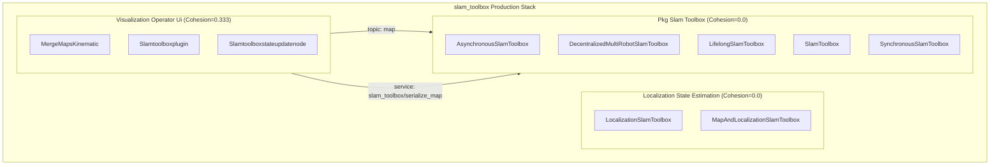
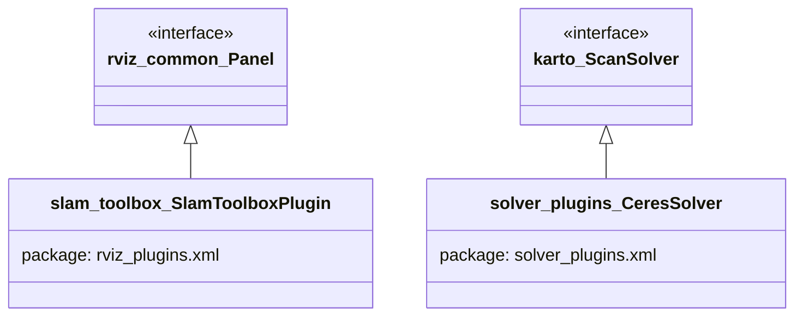
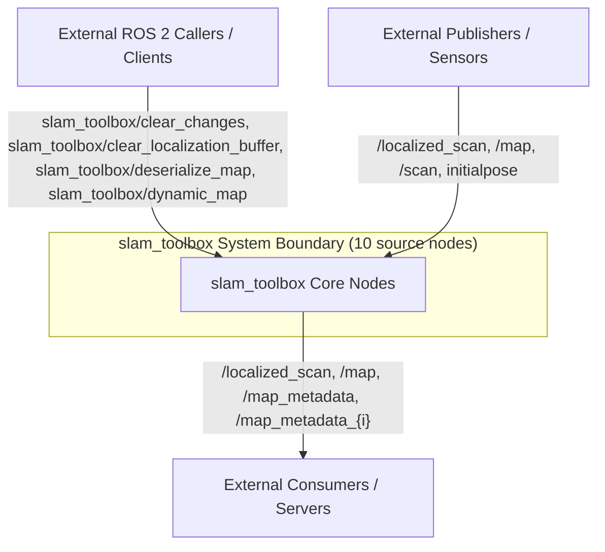
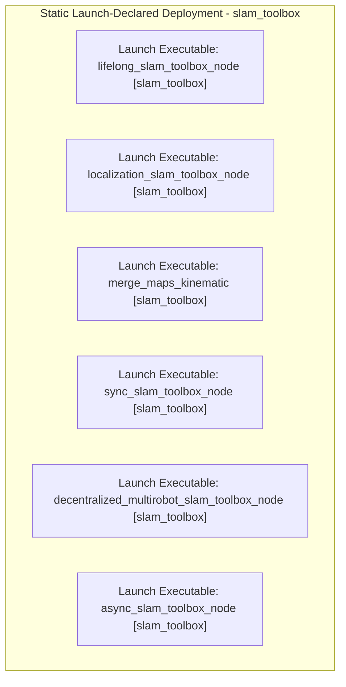
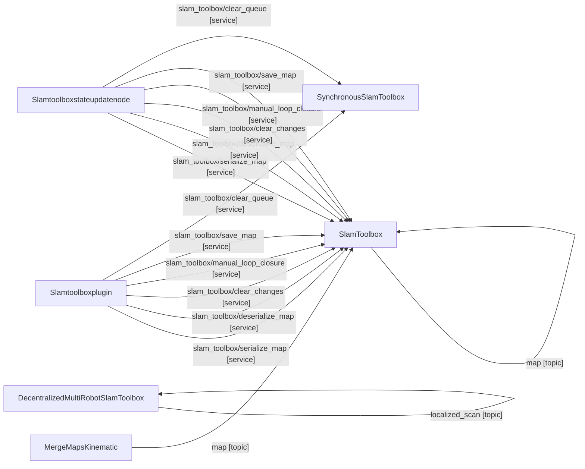
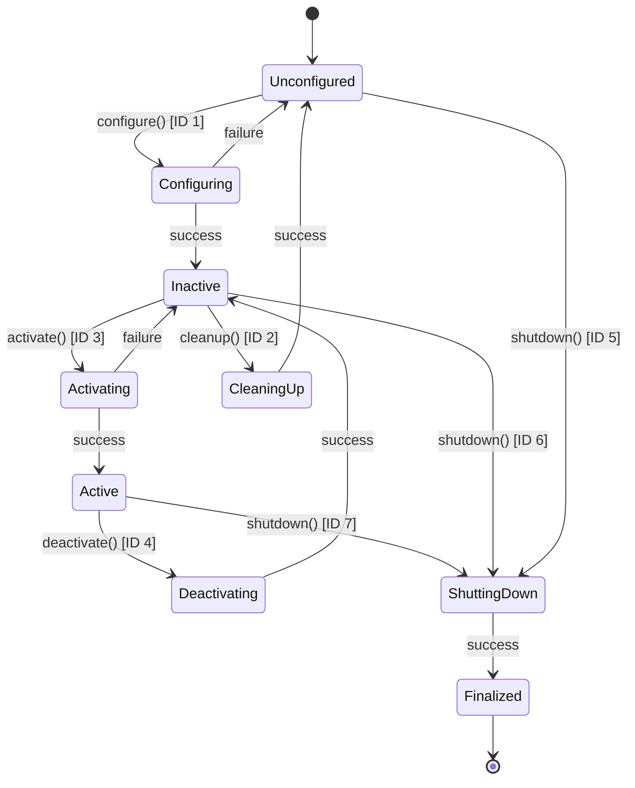

# slam_toolbox Architecture Documentation

> **Generated automatically by ArchSynth**  
> **Tool**: ArchSynth v2.0 — Evidence-Grounded ROS2 Architecture Recovery  
> **Repository**: [slam_toolbox](https://github.com/SteveMacenski/slam_toolbox)  
> **Branch**: `ros2`  
> **Commit Hash**: `eee0cd5e4a161bb10f8334b5420c93876b31ca99`  
> **Analysis Timestamp**: `2026-11-27T08:13:01.406070+00:00`  
> **LLM Provider & Model**: `gemini / gemini-1.5-flash`  
> **Analysis Duration**: `4.51s`  
> **Documentation Style**: ISO/IEC/IEEE 42010-aligned  

## Executive Summary

This document provides the reconstructed software architecture documentation for **slam_toolbox**. ArchSynth parsed **10 ROS2 nodes** and **7 launch files**, organizing them into **3 logical subsystems**. Every recovered architectural entity is grounded with source-code evidence (file:line citations).

### Architecture Overview Statistics

| Metric | Count |
| :--- | :--- |
| **Total Discovered Nodes** | 10 |
| **Parsed Launch Files** | 7 |
| **Logical Subsystems** | 3 |
| **Unique DDS Topics** | 13 |
| **Service Connections** | 14 |
| **Action Connections** | 0 |

---

## 1. System Context (C4 Level 1)

The `slam_toolbox` repository defines a critical ROS2 software architecture responsible for providing robust Simultaneous Localization and Mapping (SLAM) capabilities to autonomous robotic systems. Operating as a core component within a robot's perception and navigation stack, it processes diverse sensor data to concurrently build a consistent map of an unknown environment and accurately localize the robot within that map. Its primary mission is to enable autonomous navigation and environmental understanding for mobile robots by generating real-time pose estimates and persistent occupancy grids.

Internally, the `slam_toolbox` architecture is composed of 10 distinct ROS2 nodes, logically organized into 3 subsystems. This modular design facilitates specialized processing, such as sensor data ingestion, advanced map management, and sophisticated localization algorithms. These nodes communicate extensively via 13 ROS2 topics, forming the primary data conduits for sensor inputs (e.g., lidar scans, odometry) from external drivers, map updates, and robot pose estimates consumed by downstream navigation components or visualization tools. The entire functionality is encapsulated primarily within the `slam_toolbox` package, ensuring a cohesive and maintainable codebase that integrates seamlessly into broader ROS2 ecosystems.

---

## 2. Container View (C4 Level 2)

The system is composed of ROS2 package containers communicating over DDS topics, services, and action interfaces.

### Subsystems Summary

#### Subsystem: `localization_state_estimation`
Production subsystem responsible for localization state estimation capabilities.
- **Assignment Rationale**: Grouped 2 node(s) from package(s) slam_toolbox based on package boundary, functional role, and 0 internal / 43 external interface links.
- **Architectural Role**: `production_subsystem`
- **Intra-Subsystem Cohesion**: `0.0` | **Inter-Subsystem Coupling**: `43.0` (Internal: `0.0`, External: `43.0`) | **Interface Density**: `21.5`
- **Nodes (2)**: `slam_toolbox::LocalizationSlamToolbox`, `slam_toolbox::MapAndLocalizationSlamToolbox`
- **Launch Files (7)**: `lifelong_launch.py`, `localization_launch.py`, `merge_maps_kinematic_launch.py`, `offline_launch.py`, `online_async_decentralized_multirobot_launch.py`

#### Subsystem: `pkg_slam_toolbox`
Production subsystem responsible for pkg slam toolbox capabilities.
- **Assignment Rationale**: Grouped 5 node(s) from package(s) slam_toolbox based on package boundary, functional role, and 0 internal / 90 external interface links.
- **Architectural Role**: `production_subsystem`
- **Intra-Subsystem Cohesion**: `0.0` | **Inter-Subsystem Coupling**: `107.0` (Internal: `17.0`, External: `90.0`) | **Interface Density**: `19.6`
- **Nodes (5)**: `slam_toolbox::AsynchronousSlamToolbox`, `slam_toolbox::DecentralizedMultiRobotSlamToolbox`, `slam_toolbox::LifelongSlamToolbox`, `slam_toolbox::SlamToolbox`, `slam_toolbox::SynchronousSlamToolbox`
- **Boundary Interfaces (9)**: `service::slam_toolbox/clear_changes`, `service::slam_toolbox/clear_queue`, `service::slam_toolbox/deserialize_map`, `service::slam_toolbox/manual_loop_closure`, `service::slam_toolbox/pause_new_measurements`, `service::slam_toolbox/save_map`
- **Launch Files (7)**: `lifelong_launch.py`, `localization_launch.py`, `merge_maps_kinematic_launch.py`, `offline_launch.py`, `online_async_decentralized_multirobot_launch.py`

#### Subsystem: `visualization_operator_ui`
Production subsystem responsible for visualization operator ui capabilities.
- **Assignment Rationale**: Grouped 3 node(s) from package(s) slam_toolbox based on package boundary, functional role, and 2 internal / 6 external interface links.
- **Architectural Role**: `production_subsystem`
- **Intra-Subsystem Cohesion**: `0.333` | **Inter-Subsystem Coupling**: `23.0` (Internal: `17.0`, External: `6.0`) | **Interface Density**: `9.333`
- **Nodes (3)**: `slam_toolbox::MergeMapsKinematic`, `slam_toolbox::Slamtoolboxplugin`, `slam_toolbox::Slamtoolboxstateupdatenode`
- **Boundary Interfaces (9)**: `service::slam_toolbox/clear_changes`, `service::slam_toolbox/clear_queue`, `service::slam_toolbox/deserialize_map`, `service::slam_toolbox/manual_loop_closure`, `service::slam_toolbox/pause_new_measurements`, `service::slam_toolbox/save_map`
- **Launch Files (7)**: `lifelong_launch.py`, `localization_launch.py`, `merge_maps_kinematic_launch.py`, `offline_launch.py`, `online_async_decentralized_multirobot_launch.py`

### Architecture Metrics Definitions

| Metric | Mathematical Definition | Inputs & Edge Cases |
| :--- | :--- | :--- |
| **Intra-Subsystem Cohesion** | `E_internal / (N * (N - 1))` | Directed communication edges between nodes inside the subsystem divided by ordered node pairs. Reported as `N/A` when `N < 2`. |
| **Internal Coupling** | `E_cross_internal` | Directed topic/service/action edges crossing between this subsystem and other in-repository subsystems. |
| **External Coupling** | `I_unmatched_external` | Declared interfaces (pubs/subs/services/actions) on subsystem nodes whose peer resides outside the repository (e.g., `move_group`, `servo_node`, `ros2_control`). |
| **Total Coupling** | `Internal Coupling + External Coupling` | Total boundary-crossing interactions for the subsystem. |
| **Interface Density** | `Total_Interfaces / N` | Average declared ROS 2 endpoints (topics, services, actions) per node in the subsystem. |

---

## 3. Component View & System Diagram (C4 Level 3)

The following Mermaid diagram visualizes the reconstructed subsystem composition and communication graph:

---

## 4. Node Catalog

Overview of the core discovered ROS2 nodes in the system:

| Node Name | Package | Class / Executable | Architectural Classification | Pubs | Subs | Services | Actions | Evidence | Validation |
| :--- | :--- | :--- | :--- | :---: | :---: | :---: | :---: | :---: | :---: |
| [`SlamToolboxPlugin`](nodes/slam_toolbox__Slamtoolboxplugin.md) | `slam_toolbox` | `Slamtoolboxplugin` | `unknown` | 0 | 1 | 10 | 0 | 1 item(s) | ✅ supported |
| [`SlamToolboxStateUpdateNode`](nodes/slam_toolbox__Slamtoolboxstateupdatenode.md) | `slam_toolbox` | `Slamtoolboxstateupdatenode` | `unknown` | 0 | 1 | 10 | 0 | 1 item(s) | ✅ supported |
| [`map_merging`](nodes/slam_toolbox__MergeMapsKinematic.md) | `slam_toolbox` | `MergeMapsKinematic` | `unknown` | 4 | 0 | 2 | 0 | 3 item(s) | ✅ supported |
| [`slam_toolbox`](nodes/slam_toolbox__AsynchronousSlamToolbox.md) | `slam_toolbox` | `slam_toolbox::AsynchronousSlamToolbox` | `unknown` | 8 | 2 | 9 | 0 | 5 item(s) | ✅ supported |
| [`slam_toolbox`](nodes/slam_toolbox__SlamToolbox.md) | `slam_toolbox` | `slam_toolbox::SlamToolbox` | `unknown` | 8 | 2 | 9 | 0 | 2 item(s) | ✅ supported |
| [`slam_toolbox`](nodes/slam_toolbox__DecentralizedMultiRobotSlamToolbox.md) | `slam_toolbox` | `slam_toolbox::DecentralizedMultiRobotSlamToolbox` | `unknown` | 9 | 3 | 9 | 0 | 4 item(s) | ✅ supported |
| [`slam_toolbox`](nodes/slam_toolbox__LocalizationSlamToolbox.md) | `slam_toolbox` | `slam_toolbox::LocalizationSlamToolbox` | `unknown` | 8 | 3 | 10 | 0 | 5 item(s) | ✅ supported |
| [`slam_toolbox`](nodes/slam_toolbox__SynchronousSlamToolbox.md) | `slam_toolbox` | `slam_toolbox::SynchronousSlamToolbox` | `unknown` | 8 | 2 | 10 | 0 | 5 item(s) | ✅ supported |
| [`slam_toolbox`](nodes/slam_toolbox__LifelongSlamToolbox.md) | `slam_toolbox` | `slam_toolbox::LifelongSlamToolbox` | `unknown` | 8 | 2 | 9 | 0 | 5 item(s) | ✅ supported |
| [`slam_toolbox`](nodes/slam_toolbox__MapAndLocalizationSlamToolbox.md) | `slam_toolbox` | `slam_toolbox::MapAndLocalizationSlamToolbox` | `unknown` | 8 | 3 | 11 | 0 | 5 item(s) | ✅ supported |

---

## 5. Launch File Composition

Parsed **7 launch files** across the repository.

Alternative standalone launch profiles are analyzed independently by default.

| Launch File | Architectural Classification | Direct Node | Direct LifecycleNode | ComposableNode | ComposableNodeContainer | LoadComposableNodes | Included Launch | Unresolved | Resolved Executable | Runtime Node Name | CMake Installed |
| :--- | :--- | :---: | :---: | :---: | :---: | :---: | :---: | :---: | :--- | :--- | :---: |
| `lifelong_launch.py` | `None` | 0 | 1 | 0 | 0 | 0 | 0 | 0 | `lifelong_slam_toolbox_node` | `slam_toolbox` | No (Excluded) |
| `localization_launch.py` | `None` | 0 | 1 | 0 | 0 | 0 | 0 | 0 | `localization_slam_toolbox_node` | `slam_toolbox` | Yes |
| `merge_maps_kinematic_launch.py` | `None` | 1 | 0 | 0 | 0 | 0 | 0 | 0 | `merge_maps_kinematic` | `slam_toolbox` | Yes |
| `offline_launch.py` | `None` | 0 | 1 | 0 | 0 | 0 | 0 | 0 | `sync_slam_toolbox_node` | `slam_toolbox` | Yes |
| `online_async_decentralized_multirobot_launch.py` | `None` | 0 | 1 | 0 | 0 | 0 | 0 | 0 | `decentralized_multirobot_slam_toolbox_node` | `slam_toolbox` | Yes |
| `online_async_launch.py` | `None` | 0 | 1 | 0 | 0 | 0 | 0 | 0 | `async_slam_toolbox_node` | `slam_toolbox` | Yes |
| `online_sync_launch.py` | `None` | 0 | 1 | 0 | 0 | 0 | 0 | 0 | `sync_slam_toolbox_node` | `slam_toolbox` | Yes |

---

## 6. Communication Matrix

### Topic Connections

| Topic Name | Publisher Nodes | Subscriber Nodes |
| :--- | :--- | :--- |
| `/localized_scan` | `slam_toolbox` | `slam_toolbox` |
| `/map` | `map_merging`, `slam_toolbox` | `slam_toolbox` |
| `/map_metadata` | `map_merging`, `slam_toolbox` | *External* |
| `/scan` | *External* | `slam_toolbox` |
| `initialpose` | *External* | `SlamToolboxPlugin`, `SlamToolboxStateUpdateNode`, `slam_toolbox` |
| `pose` | `slam_toolbox` | *External* |
| `slam_toolbox/graph_visualization` | `slam_toolbox` | *External* |
| `slam_toolbox/loop_closure_event` | `slam_toolbox` | *External* |
| `slam_toolbox/new_node_event` | `slam_toolbox` | *External* |
| `slam_toolbox/pose_graph` | `slam_toolbox` | *External* |
| `slam_toolbox/scan_visualization` | `slam_toolbox` | *External* |

### Service Connections

| Service Name | Servers | Clients |
| :--- | :--- | :--- |
| `slam_toolbox/add_submap` | `map_merging` | `SlamToolboxPlugin`, `SlamToolboxStateUpdateNode` |
| `slam_toolbox/clear_changes` | `slam_toolbox` | `SlamToolboxPlugin`, `SlamToolboxStateUpdateNode` |
| `slam_toolbox/clear_localization_buffer` | `slam_toolbox` | *External* |
| `slam_toolbox/clear_queue` | `slam_toolbox` | `SlamToolboxPlugin`, `SlamToolboxStateUpdateNode` |
| `slam_toolbox/deserialize_map` | `slam_toolbox` | `SlamToolboxPlugin`, `SlamToolboxStateUpdateNode` |
| `slam_toolbox/dynamic_map` | `slam_toolbox` | *External* |
| `slam_toolbox/manual_loop_closure` | `slam_toolbox` | `SlamToolboxPlugin`, `SlamToolboxStateUpdateNode` |
| `slam_toolbox/merge_submaps` | `map_merging` | `SlamToolboxPlugin`, `SlamToolboxStateUpdateNode` |
| `slam_toolbox/pause_new_measurements` | `slam_toolbox` | `SlamToolboxPlugin`, `SlamToolboxStateUpdateNode` |
| `slam_toolbox/reset` | `slam_toolbox` | *External* |
| `slam_toolbox/save_map` | `slam_toolbox` | `SlamToolboxPlugin`, `SlamToolboxStateUpdateNode` |
| `slam_toolbox/serialize_map` | `slam_toolbox` | `SlamToolboxPlugin`, `SlamToolboxStateUpdateNode` |
| `slam_toolbox/set_localization_mode` | `slam_toolbox` | *External* |
| `slam_toolbox/toggle_interactive_mode` | `slam_toolbox` | `SlamToolboxPlugin`, `SlamToolboxStateUpdateNode` |

---

## 7. ROS 2 Lifecycle Management Architecture

No ROS 2 lifecycle managers or managed lifecycle nodes were declared in **slam_toolbox**.

---

## 8. Pluginlib Extensibility Architecture

ArchSynth recovered **2 pluginlib plugins** categorized across **2 architectural extension points**.
Status summary: **0 selected in default parameters**, **2 available in codebase**.

### Plugin Categories

| Extension Category | Base Class / Interface | Plugins Declared | Selected Active Plugin |
| :--- | :--- | :---: | :--- |
| `rviz_common_Panel` | `rviz_common::Panel` | 1 | `*None (Available)*` |
| `karto_ScanSolver` | `karto::ScanSolver` | 1 | `*None (Available)*` |

### Plugin Extensibility Class Diagram

---

## 10. ISO/IEC/IEEE 42010 Architecture Views (8 Views)

ArchSynth provides multi-perspective architectural representations conforming to ISO/IEC/IEEE 42010:

### View: System Context View (`system_context`)

System boundary for slam_toolbox derived from 10 source nodes, unmatched external-peer interfaces, and 0 external launch packages.

- **Architectural Concerns**: System boundaries, External interfaces, Operational environment
- **Target Stakeholders**: System Architects, Robotics Integrators, Application Engineers

### View: Package Dependency View (`package_dependency`)

Directed package dependency graph across 2 repository packages and 50 external dependencies (package.xml, setup.py, and resolved source dependencies).

- **Architectural Concerns**: Package coupling, Build layering, Modular reusability
- **Target Stakeholders**: Software Maintainers, Build Engineers, Component Developers

```mermaid
flowchart TD
    karto_sdk["karto_sdk (unknown)"]
    slam_toolbox["slam_toolbox (ament_cmake)"]
    rviz_common["rviz_common (external)"]
    slam_toolbox -->|"depend"| rviz_common
    rviz_default_plugins["rviz_default_plugins (external)"]
    slam_toolbox -->|"depend"| rviz_default_plugins
    rviz_ogre_vendor["rviz_ogre_vendor (external)"]
    slam_toolbox -->|"depend"| rviz_ogre_vendor
    rviz_rendering["rviz_rendering (external)"]
    slam_toolbox -->|"depend"| rviz_rendering
    tf2_ros["tf2_ros (external)"]
    slam_toolbox -->|"build_depend"| tf2_ros
    tf2["tf2 (external)"]
    slam_toolbox -->|"build_depend"| tf2
    tf2_sensor_msgs["tf2_sensor_msgs (external)"]
    slam_toolbox -->|"build_depend"| tf2_sensor_msgs
    tf2_geometry_msgs["tf2_geometry_msgs (external)"]
    slam_toolbox -->|"build_depend"| tf2_geometry_msgs
    slam_toolbox -->|"exec_depend"| tf2
    slam_toolbox -->|"exec_depend"| tf2_ros
    slam_toolbox -->|"exec_depend"| tf2_sensor_msgs
    slam_toolbox -->|"exec_depend"| tf2_geometry_msgs
    nav2_map_server["nav2_map_server (external)"]
    slam_toolbox -->|"exec_depend"| nav2_map_server
    slam_toolbox -.->|"source_include"| karto_sdk
    slam_toolbox -.->|"source_include"| tf2
    slam_toolbox -.->|"source_include"| tf2_ros
    slam_toolbox -.->|"source_include"| tf2_geometry_msgs
    slam_toolbox -.->|"source_include"| tf2_sensor_msgs
    slam_toolbox -.->|"source_include"| rviz_common
```

### View: Subsystem / Component View (`subsystem_component`)

Recovered functional software subsystems, metrics, and inter-subsystem communication edges for slam_toolbox.

- **Architectural Concerns**: Functional decomposition, Subsystem cohesion, Coupling minimization
- **Target Stakeholders**: Lead Architects, Functional Leads, Domain Engineers

### View: Runtime Deployment View (`runtime_deployment`)

Static launch-declared deployment topology for slam_toolbox (0 containers, 7 launch instances). Note: OS process hosting is inferred from launch declarations, not runtime-observed.

- **Architectural Concerns**: Process allocation, IPC vs Intra-process communication, Deployment efficiency
- **Target Stakeholders**: Deployment Engineers, Embedded Systems Leads, Performance Engineers

### View: Communication View (`communication_topology`)

Recovered interaction topology displaying topics, services, and actions for slam_toolbox.

- **Architectural Concerns**: Dataflow, Message passing latency, Interface compatibility
- **Target Stakeholders**: Integration Engineers, Safety Engineers, Robotics Developers

### View: Lifecycle View (`lifecycle_architecture`)

State machine sequencing and lifecycle management recovered for slam_toolbox.

- **Architectural Concerns**: Deterministic startup, State consistency, Fault isolation
- **Target Stakeholders**: System Engineers, Safety Certification Authorities, Operations

### View: Plugin Architecture View (`plugin_architecture`)

Pluginlib extensibility patterns and implementations recovered for slam_toolbox.

- **Architectural Concerns**: Extensibility, Algorithm swappability, Runtime polymorphism
- **Target Stakeholders**: Algorithm Developers, Extension Authors, Software Architects

### View: Behavior Tree View (`behavior_tree_orchestration`)

Behavior Tree navigation orchestration is not utilized in slam_toolbox.

- **Architectural Concerns**: Autonomous mission execution, Reactive recovery, Blackboard dataflow
- **Target Stakeholders**: Autonomy Engineers, Behavior Designers, Test Engineers

---

## 11. Evidence / Traceability

> This section documents the source-code evidence supporting each recovered architectural entity.
> Evidence-grounded recovery distinguishes schema-valid claims from factually-supported claims.

### Node Evidence

| Node | Evidence File | Lines | Evidence Type |
| :--- | :--- | :--- | :--- |
| `SlamToolboxPlugin` | `rviz_plugin/slam_toolbox_rviz_plugin.cpp` | `L48` | `node_definition` |
| `SlamToolboxStateUpdateNode` | `rviz_plugin/slam_toolbox_rviz_plugin.cpp` | `L580` | `node_definition` |
| `map_merging` | `include/slam_toolbox/merge_maps_kinematic.hpp` | `L52` | `node_definition` |
| `map_merging` | `src/merge_maps_kinematic.cpp` | `L26` | `node_definition` |
| `slam_toolbox` | `include/slam_toolbox/slam_toolbox_async.hpp` | `L29` | `node_definition` |
| `slam_toolbox` | `src/slam_toolbox_async.cpp` | `L27` | `node_definition` |
| `slam_toolbox` | `include/slam_toolbox/slam_toolbox_common.hpp` | `L68` | `node_definition` |
| `slam_toolbox` | `src/slam_toolbox_common.cpp` | `L39` | `node_definition` |
| `slam_toolbox` | `include/slam_toolbox/slam_toolbox_decentralized_multirobot.hpp` | `L28` | `node_definition` |
| `slam_toolbox` | `src/slam_toolbox_decentralized_multirobot.cpp` | `L23` | `node_definition` |
| `slam_toolbox` | `include/slam_toolbox/slam_toolbox_localization.hpp` | `L29` | `node_definition` |
| `slam_toolbox` | `src/slam_toolbox_localization.cpp` | `L27` | `node_definition` |
| `slam_toolbox` | `include/slam_toolbox/slam_toolbox_sync.hpp` | `L30` | `node_definition` |
| `slam_toolbox` | `src/slam_toolbox_sync.cpp` | `L27` | `node_definition` |
| `slam_toolbox` | `include/slam_toolbox/experimental/slam_toolbox_lifelong.hpp` | `L28` | `node_definition` |
| `slam_toolbox` | `src/experimental/slam_toolbox_lifelong.cpp` | `L38` | `node_definition` |
| `slam_toolbox` | `include/slam_toolbox/experimental/slam_toolbox_map_and_localization.hpp` | `L27` | `node_definition` |
| `slam_toolbox` | `src/experimental/slam_toolbox_map_and_localization.cpp` | `L25` | `node_definition` |

### Topic Evidence (Sample)

| Topic | Direction | Node | Evidence File | Lines |
| :--- | :--- | :--- | :--- | :--- |
| `initialpose` | subscribe | `SlamToolboxPlugin` | `rviz_plugin/slam_toolbox_rviz_plugin.cpp` | `L59–L61` |
| `/map` | publish | `map_merging` | `src/merge_maps_kinematic.cpp` | `L46–L47` |
| `/map_metadata` | publish | `map_merging` | `src/merge_maps_kinematic.cpp` | `L48–L49` |
| `pose` | publish | `slam_toolbox` | `src/slam_toolbox_common.cpp` | `L475–L476` |
| `slam_toolbox/pose_graph` | publish | `slam_toolbox` | `src/slam_toolbox_common.cpp` | `L502–L504` |
| `slam_toolbox/new_node_event` | publish | `slam_toolbox` | `src/slam_toolbox_common.cpp` | `L505–L506` |
| `slam_toolbox/loop_closure_event` | publish | `slam_toolbox` | `src/slam_toolbox_common.cpp` | `L507–L508` |
| `slam_toolbox/scan_visualization` | publish | `slam_toolbox` | `src/loop_closure_assistant.cpp` | `L62–L63` |
| `slam_toolbox/graph_visualization` | publish | `slam_toolbox` | `src/loop_closure_assistant.cpp` | `L76–L77` |
| `/scan` | subscribe | `slam_toolbox` | `src/slam_toolbox_common.cpp` | `L511–L512` |
| `/localized_scan` | publish | `slam_toolbox` | `src/slam_toolbox_decentralized_multirobot.cpp` | `L45–L46` |

---

## 11b. Structured Node & Executable Inventory

Distinguishes repository-defined source nodes, composable components, external ROS 2 launch executables, dynamically loaded plugins, and unresolved dynamic entries:

| Name / Identifier | Package | Executable | Classification | Origin | Confidence | Evidence |
| :--- | :--- | :--- | :--- | :--- | :---: | :--- |
| `SlamToolboxPlugin` | `slam_toolbox` | `(library/script)` | `repository_defined_node` | `repository_source` | 1.00 | `rviz_plugin/slam_toolbox_rviz_plugin.cpp:L48` |
| `SlamToolboxStateUpdateNode` | `slam_toolbox` | `(library/script)` | `repository_defined_node` | `repository_source` | 1.00 | `rviz_plugin/slam_toolbox_rviz_plugin.cpp:L580` |
| `map_merging` | `slam_toolbox` | `merge_maps_kinematic` | `repository_defined_node` | `repository_source` | 1.00 | `include/slam_toolbox/merge_maps_kinematic.hpp:L52`, `src/merge_maps_kinematic.cpp:L26` |
| `slam_toolbox` | `slam_toolbox` | `async_slam_toolbox_node` | `composable_node` | `repository_source` | 1.00 | `include/slam_toolbox/slam_toolbox_async.hpp:L29`, `src/slam_toolbox_async.cpp:L27` |
| `slam_toolbox` | `slam_toolbox` | `(library/script)` | `repository_defined_node` | `repository_source` | 1.00 | `include/slam_toolbox/slam_toolbox_common.hpp:L68`, `src/slam_toolbox_common.cpp:L39` |
| `slam_toolbox` | `slam_toolbox` | `decentralized_multirobot_slam_toolbox_node` | `composable_node` | `repository_source` | 1.00 | `include/slam_toolbox/slam_toolbox_decentralized_multirobot.hpp:L28`, `src/slam_toolbox_decentralized_multirobot.cpp:L23` |
| `slam_toolbox` | `slam_toolbox` | `localization_slam_toolbox_node` | `composable_node` | `repository_source` | 1.00 | `include/slam_toolbox/slam_toolbox_localization.hpp:L29`, `src/slam_toolbox_localization.cpp:L27` |
| `slam_toolbox` | `slam_toolbox` | `sync_slam_toolbox_node` | `composable_node` | `repository_source` | 1.00 | `include/slam_toolbox/slam_toolbox_sync.hpp:L30`, `src/slam_toolbox_sync.cpp:L27` |
| `slam_toolbox` | `slam_toolbox` | `lifelong_slam_toolbox_node` | `composable_node` | `repository_source` | 1.00 | `include/slam_toolbox/experimental/slam_toolbox_lifelong.hpp:L28`, `src/experimental/slam_toolbox_lifelong.cpp:L38` |
| `slam_toolbox` | `slam_toolbox` | `map_and_localization_slam_toolbox_node` | `composable_node` | `repository_source` | 1.00 | `include/slam_toolbox/experimental/slam_toolbox_map_and_localization.hpp:L27`, `src/experimental/slam_toolbox_map_and_localization.cpp:L25` |
| `solver_plugins::CeresSolver` | `slam_toolbox` | `(pluginlib)` | `dynamically_loaded_component` | `pluginlib_manifest` | 1.00 | `solver_plugins.xml:L1` |

---

## 11c. Package Dependency Architecture

Recovered **2 internal packages**, **50 external dependencies**, and **121 directed dependency edges** from `package.xml`, `setup.py`, and source `#include`/`import` statements.

| Source Package | Target Package | Dependency Type | Origin | Target Scope | Evidence |
| :--- | :--- | :--- | :--- | :---: | :--- |
| `karto_sdk` | `boost` | `build_depend` | `declared_manifest` | External | `lib/karto_sdk/package.xml:L13` |
| `karto_sdk` | `tbb` | `build_depend` | `declared_manifest` | External | `lib/karto_sdk/package.xml:L14` |
| `karto_sdk` | `libblas-dev` | `build_depend` | `declared_manifest` | External | `lib/karto_sdk/package.xml:L15` |
| `karto_sdk` | `liblapack-dev` | `build_depend` | `declared_manifest` | External | `lib/karto_sdk/package.xml:L16` |
| `karto_sdk` | `ament_cmake` | `buildtool_depend` | `declared_manifest` | External | `lib/karto_sdk/package.xml:L11` |
| `karto_sdk` | `boost` | `source_include` | `observed_source` | External | `lib/karto_sdk/include/karto_sdk/Karto.h:L26` |
| `karto_sdk` | `Poco` | `source_include` | `observed_source` | External | `lib/karto_sdk/include/karto_sdk/Karto.h:L56` |
| `karto_sdk` | `tbb` | `source_include` | `observed_source` | External | `lib/karto_sdk/include/karto_sdk/Mapper.h:L30` |
| `karto_sdk` | `Eigen` | `source_include` | `observed_source` | External | `lib/karto_sdk/include/karto_sdk/Mapper.h:L34` |
| `karto_sdk` | `rclcpp_lifecycle` | `source_include` | `observed_source` | External | `lib/karto_sdk/include/karto_sdk/Mapper.h:L35` |
| `slam_toolbox` | `rviz_common` | `depend` | `declared_manifest` | External | `package.xml:L45` |
| `slam_toolbox` | `rviz_default_plugins` | `depend` | `declared_manifest` | External | `package.xml:L46` |
| `slam_toolbox` | `rviz_ogre_vendor` | `depend` | `declared_manifest` | External | `package.xml:L47` |
| `slam_toolbox` | `rviz_rendering` | `depend` | `declared_manifest` | External | `package.xml:L48` |
| `slam_toolbox` | `geometry_msgs` | `depend` | `declared_manifest` | External | `package.xml:L49` |
| `slam_toolbox` | `pluginlib` | `build_depend` | `declared_manifest` | External | `package.xml:L16` |
| `slam_toolbox` | `eigen` | `build_depend` | `declared_manifest` | External | `package.xml:L17` |
| `slam_toolbox` | `message_filters` | `build_depend` | `declared_manifest` | External | `package.xml:L18` |
| `slam_toolbox` | `nav_msgs` | `build_depend` | `declared_manifest` | External | `package.xml:L19` |
| `slam_toolbox` | `rclcpp` | `build_depend` | `declared_manifest` | External | `package.xml:L20` |
| `slam_toolbox` | `sensor_msgs` | `build_depend` | `declared_manifest` | External | `package.xml:L21` |
| `slam_toolbox` | `tf2_ros` | `build_depend` | `declared_manifest` | External | `package.xml:L22` |
| `slam_toolbox` | `tf2` | `build_depend` | `declared_manifest` | External | `package.xml:L22` |
| `slam_toolbox` | `tf2_sensor_msgs` | `build_depend` | `declared_manifest` | External | `package.xml:L24` |
| `slam_toolbox` | `visualization_msgs` | `build_depend` | `declared_manifest` | External | `package.xml:L25` |
| `slam_toolbox` | `std_srvs` | `build_depend` | `declared_manifest` | External | `package.xml:L26` |
| `slam_toolbox` | `boost` | `build_depend` | `declared_manifest` | External | `package.xml:L27` |
| `slam_toolbox` | `interactive_markers` | `build_depend` | `declared_manifest` | External | `package.xml:L28` |
| `slam_toolbox` | `std_msgs` | `build_depend` | `declared_manifest` | External | `package.xml:L29` |
| `slam_toolbox` | `suitesparse` | `build_depend` | `declared_manifest` | External | `package.xml:L30` |
| `slam_toolbox` | `liblapack-dev` | `build_depend` | `declared_manifest` | External | `package.xml:L31` |
| `slam_toolbox` | `libomp-dev` | `build_depend` | `declared_manifest` | External | `package.xml:L32` |
| `slam_toolbox` | `libceres-dev` | `build_depend` | `declared_manifest` | External | `package.xml:L33` |
| `slam_toolbox` | `tf2_geometry_msgs` | `build_depend` | `declared_manifest` | External | `package.xml:L34` |
| `slam_toolbox` | `tbb` | `build_depend` | `declared_manifest` | External | `package.xml:L35` |
| `slam_toolbox` | `karto_sdk` | `source_include` | `observed_source` | Internal | `include/slam_toolbox/get_pose_helper.hpp:L25` |

---

## 11d. Architecture Consistency Validation & Unresolved Elements

Findings summary: **Warning**: 4, **Unresolved**: 17, **Potential inconsistency**: 1

| ID | Severity | Category | Entity | Details |
| :--- | :--- | :--- | :--- | :--- |
| `VAL-001` | **Warning** | `unlaunched_source_node` | `slam_toolbox::Slamtoolboxplugin` | Source node 'SlamToolboxPlugin' (rviz_plugin/slam_toolbox_rviz_plugin.cpp) is not referenced by any analyzed launch file (may be invoked directly via ros2 run or library API). |
| `VAL-002` | **Warning** | `unlaunched_source_node` | `slam_toolbox::Slamtoolboxstateupdatenode` | Source node 'SlamToolboxStateUpdateNode' (rviz_plugin/slam_toolbox_rviz_plugin.cpp) is not referenced by any analyzed launch file (may be invoked directly via ros2 run or library API). |
| `VAL-003` | **Warning** | `unlaunched_source_node` | `slam_toolbox::SlamToolbox` | Source node 'slam_toolbox' (src/slam_toolbox_common.cpp) is not referenced by any analyzed launch file (may be invoked directly via ros2 run or library API). |
| `VAL-004` | **Warning** | `unlaunched_source_node` | `slam_toolbox::MapAndLocalizationSlamToolbox` | Source node 'slam_toolbox' (src/experimental/slam_toolbox_map_and_localization.cpp) is not referenced by any analyzed launch file (may be invoked directly via ros2 run or library API). |
| `VAL-005` | **Unresolved** | `publisher_without_subscriber` | `/map_metadata` | Topic '/map_metadata' has internal publisher(s) ['map_merging', 'slam_toolbox'] with no in-repo subscriber (likely consumed by external nodes such as move_group, servo_node, or gazebo). |
| `VAL-006` | **Unresolved** | `publisher_without_subscriber` | `/map_metadata_{i}` | Topic '/map_metadata_{i}' has internal publisher(s) ['map_merging'] with no in-repo subscriber (likely consumed by external nodes such as move_group, servo_node, or gazebo). |
| `VAL-007` | **Unresolved** | `publisher_without_subscriber` | `/map_{i}` | Topic '/map_{i}' has internal publisher(s) ['map_merging'] with no in-repo subscriber (likely consumed by external nodes such as move_group, servo_node, or gazebo). |
| `VAL-008` | **Unresolved** | `subscriber_without_publisher` | `/scan` | Topic '/scan' has internal subscriber(s) ['slam_toolbox'] with no in-repo publisher (likely published by external drivers/sensors such as joy_node or camera bridge). |
| `VAL-009` | **Unresolved** | `subscriber_without_publisher` | `initialpose` | Topic 'initialpose' has internal subscriber(s) ['SlamToolboxPlugin', 'SlamToolboxStateUpdateNode', 'slam_toolbox'] with no in-repo publisher (likely published by external drivers/sensors such as joy_node or camera bridge). |
| `VAL-010` | **Unresolved** | `publisher_without_subscriber` | `pose` | Topic 'pose' has internal publisher(s) ['slam_toolbox'] with no in-repo subscriber (likely consumed by external nodes such as move_group, servo_node, or gazebo). |
| `VAL-011` | **Unresolved** | `publisher_without_subscriber` | `slam_toolbox/graph_visualization` | Topic 'slam_toolbox/graph_visualization' has internal publisher(s) ['slam_toolbox'] with no in-repo subscriber (likely consumed by external nodes such as move_group, servo_node, or gazebo). |
| `VAL-012` | **Unresolved** | `publisher_without_subscriber` | `slam_toolbox/loop_closure_event` | Topic 'slam_toolbox/loop_closure_event' has internal publisher(s) ['slam_toolbox'] with no in-repo subscriber (likely consumed by external nodes such as move_group, servo_node, or gazebo). |
| `VAL-013` | **Unresolved** | `publisher_without_subscriber` | `slam_toolbox/new_node_event` | Topic 'slam_toolbox/new_node_event' has internal publisher(s) ['slam_toolbox'] with no in-repo subscriber (likely consumed by external nodes such as move_group, servo_node, or gazebo). |
| `VAL-014` | **Unresolved** | `publisher_without_subscriber` | `slam_toolbox/pose_graph` | Topic 'slam_toolbox/pose_graph' has internal publisher(s) ['slam_toolbox'] with no in-repo subscriber (likely consumed by external nodes such as move_group, servo_node, or gazebo). |
| `VAL-015` | **Unresolved** | `publisher_without_subscriber` | `slam_toolbox/scan_visualization` | Topic 'slam_toolbox/scan_visualization' has internal publisher(s) ['slam_toolbox'] with no in-repo subscriber (likely consumed by external nodes such as move_group, servo_node, or gazebo). |
| `VAL-016` | **Potential inconsistency** | `missing_package_dependency` | `slam_toolbox -> karto_sdk` | Source file include/slam_toolbox/get_pose_helper.hpp:L25 uses 'karto_sdk' (source_include), which is not declared in package.xml. |
| `VAL-017` | **Unresolved** | `unresolved_launch_construct` | `launch/lifelong_launch.py` | Dynamic/opaque launch construct in launch/lifelong_launch.py: RegisterEventHandler(OnStateTransition()) at L70 |
| `VAL-018` | **Unresolved** | `unresolved_launch_construct` | `launch/localization_launch.py` | Dynamic/opaque launch construct in launch/localization_launch.py: RegisterEventHandler(OnStateTransition()) at L71 |
| `VAL-019` | **Unresolved** | `unresolved_launch_construct` | `launch/offline_launch.py` | Dynamic/opaque launch construct in launch/offline_launch.py: RegisterEventHandler(OnStateTransition()) at L47 |
| `VAL-020` | **Unresolved** | `unresolved_launch_construct` | `launch/online_async_decentralized_multirobot_launch.py` | Dynamic/opaque launch construct in launch/online_async_decentralized_multirobot_launch.py: RegisterEventHandler(OnStateTransition()) at L75 |
| `VAL-021` | **Unresolved** | `unresolved_launch_construct` | `launch/online_async_launch.py` | Dynamic/opaque launch construct in launch/online_async_launch.py: RegisterEventHandler(OnStateTransition()) at L70 |
| `VAL-022` | **Unresolved** | `unresolved_launch_construct` | `launch/online_sync_launch.py` | Dynamic/opaque launch construct in launch/online_sync_launch.py: RegisterEventHandler(OnStateTransition()) at L70 |
---

## 12. Experiment Metadata & Reproducibility

| Field | Value |
| :--- | :--- |
| **Tool** | ArchSynth v2.0 (M.Tech Dissertation Project) |
| **Repository Name** | `slam_toolbox` |
| **Repository URL** | `https://github.com/SteveMacenski/slam_toolbox` |
| **Branch** | `ros2` |
| **Commit Hash** | `eee0cd5e4a161bb10f8334b5420c93876b31ca99` |
| **Analysis Timestamp** | `2026-11-27T08:13:01.406070+00:00` |
| **ArchSynth Version** | `2.0` |
| **LLM Provider** | `gemini` |
| **LLM Model** | `gemini-1.5-flash` |
| **Nodes Analyzed** | 10 |
| **Launch Files Analyzed** | 7 |
| **Processing Time** | 4.51s |
| **Documentation Style** | ISO/IEC/IEEE 42010-aligned architecture description |

> *ArchSynth uses evidence-grounded, schema-constrained hybrid static analysis and LLM synthesis*
> *for ROS2 architecture recovery. All architectural claims are traceable to source evidence.*