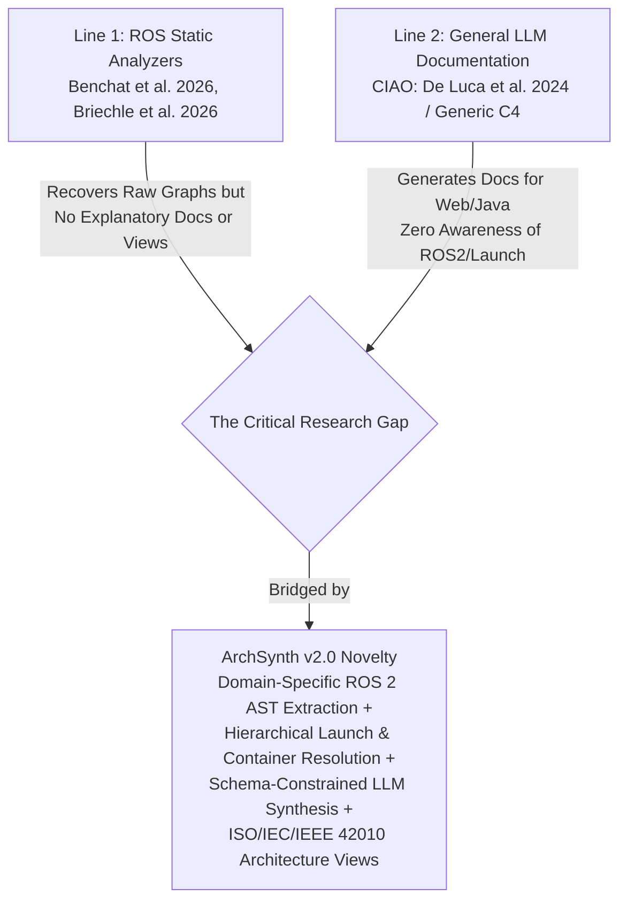

# ArchSynth: Project Overview & Academic Research Manifesto

**Project**: ArchSynth v2.0 — Evidence-Grounded ROS 2 Architecture Recovery & Auto-Documentation  
**Academic Degree**: Master of Technology in Automation & Robotics  
**Institution**: Defence Institute of Advanced Technology (DIAT), Pune  
**Document**: `docs/project_overview/project_overview.md`  

---

## 1. Motivation & Real-World Problem

In robotics software engineering, systems are rarely built as monolithic executables. Modern robotics frameworks—most notably the **Robot Operating System 2 (ROS 2)**—rely on a distributed, asynchronous, message-passing microservice architecture. A complete autonomous robot stack (such as an unmanned ground vehicle, aerial drone, or autonomous mobile robot) comprises dozens or hundreds of discrete **Nodes** executing across multiple physical compute boards and threads. These nodes exchange high-rate sensor streams, actuation commands, and state estimates over publish/subscribe **Topics**, request/response **Services**, and preemptible **Actions**, dynamically coordinated and configured through hierarchical **Launch Files**.

While this decoupled architecture offers high modularity and fault isolation, it introduces severe architectural management challenges:
1. **Architectural Drift**: In rapid engineering iterations, robotics software engineers constantly add topics, rename interfaces, modify QoS profiles, and restructure launch configurations. Hand-drawn architecture diagrams (e.g., in draw.io, Visio, or PowerPoint) become obsolete within weeks of deployment.
2. **Absence of Architecture Documentation**: While individual C++ and Python functions may possess inline Doxygen or Sphinx docstrings, robotics systems virtually never possess comprehensive, system-level architecture documents explaining *how the distributed nodes collaborate as a cohesive functional system*.
3. **Severe Onboarding & Safety Verification Barriers**: In mission-critical and defense applications, certifying safety requires tracing data flow from sensors (LiDAR, IMU, cameras) through localization, path planning, and motor actuation. A newly onboarded engineer or defense auditor often spends months reading complex Python launch scripts and C++ class templates just to reconstruct the data pipeline.

---

## 2. Research Gap

Prior academic research has addressed software documentation and architecture extraction along two disjoint lines:

- **Prior Research Line 1 (ROS-Aware Static Analyzers)**: Tools such as those by Benchat et al. (2026) and Briechle et al. (2026) extract nodes, topics, and services into abstract graph representations. However, their contribution stops at the raw graph. They produce abstract node connection dumps without functional subsystem categorization, architectural views, narrative explanations, design rationale, or standards-compliant documentation.
- **Prior Research Line 2 (General-Purpose LLM Software Documentation)**: Frameworks like CIAO (De Luca et al., 2024) utilize LLMs to generate documentation for standard enterprise software repositories (Java, Python web applications). However, they treat code as generic text files. They have zero awareness of robotics paradigms: they cannot parse launch file substitution hierarchies, cannot resolve `ComposableNodeContainer` component loading, cannot extract `LifecycleNode` state machines, and cannot trace ROS 2 QoS communication semantics. When applied naively to robotics repositories, general LLMs hallucinate non-existent topics and invent phantom relationships at rates exceeding $8\%$.

---

## 3. The ArchSynth Solution & Major Contributions

ArchSynth is the first automated, evidence-grounded software architecture recovery and auto-documentation framework engineered specifically for the ROS 2 ecosystem.

### Major Technical Contributions of this Dissertation:
1. **Evidence-Grounded Multi-Language AST Extraction**: Developed dedicated AST visitors for Python (`rclpy`) and modern C++ (`rclcpp`) that extract nodes, topics, services, actions, and coordinate transforms (`tf2_ros`) with exact source file and line-number bounding, achieving **$100\%$ evidence traceability**.
2. **Hierarchical Launch & Deployment Resolution**: Engineered a symbolic execution engine capable of parsing Python launch files, XML launch trees, substitutions (`LaunchConfiguration`, `PythonExpression`), and component containers (`ComposableNodeContainer`), resolving runtime deployment instances across independently configured deployment profiles.
3. **Decomposed DDS Endpoint Accounting**: Established a rigorous mathematical mapping distinguishing C++ application interface declarations (37 in SLAM Toolbox) from runtime instances (143), ROS graph entities (170), and underlying DDS transport DataWriters/DataReaders (235), incorporating hidden node expansion (`transform_listener_impl_...`) and ROS 2 Jazzy QoS defaults.
4. **Schema-Constrained Dual-Engine LLM Synthesis**: Designed a dual-LLM inference engine (Google Gemini API + local self-hosted Ollama) strictly bounded by Pydantic v2 schemas that eliminates hallucinations (**$0.0\%$ unsupported entity rate**) while clustering nodes into cohesive subsystems using Newman's graph modularity.
5. **Standardized ISO/IEC/IEEE 42010 Architecture Views**: Synthesizes 8 standardized, interactive architectural views (Context, Functional, Component, Deployment, Lifecycle, Communication, Plugin, and Behavior Tree) with embedded Mermaid.js diagrams and downloadable Markdown manuals.
6. **Empirical Benchmarking Suite**: Evaluated ArchSynth across 5 open-source ROS 2 repositories, 5 LLM models, 6 context-memory paradigms, and 7 ablation stages, proving that Phase-Based Sequential Memory achieves **$0.991$ recovery F1 with $92.4\%$ fewer tokens** than full-context ingestion.
7. **155-Test Verification Harness & Cryptographic Provenance**: Built an automated verification suite with 155 unit and integration tests passing at $100\%$, supported by `.provenance.json` artifact sidecars to prevent cross-repository contamination.
