# ArchSynth v2.0 — Comprehensive Thesis Figure & Diagram Inventory

**Project**: ArchSynth v2.0 Dissertation Material  
**Document**: `docs/thesis_material/figure_inventory.md`  
**Diagram Format**: Editable Mermaid.js Syntax  

---

## Figure 1: Overall ArchSynth Architecture

- **Figure Number**: Figure 1.1 (or Figure 4.1)
- **Title**: High-Level System Architecture and Dual-Engine Synthesis Pipeline of ArchSynth v2.0
- **Purpose**: Illustrate the complete architectural flow from source ingestion through static AST extraction, launch resolution, schema-constrained dual-LLM synthesis, and ISO 42010 documentation generation.
- **Suggested Thesis Chapter**: Chapter 1 (Introduction) or Chapter 4 (System Design)
- **Relevant Implementation Files**: `src/main.py`, `src/schema.py`, `src/architecture_constructor.py`

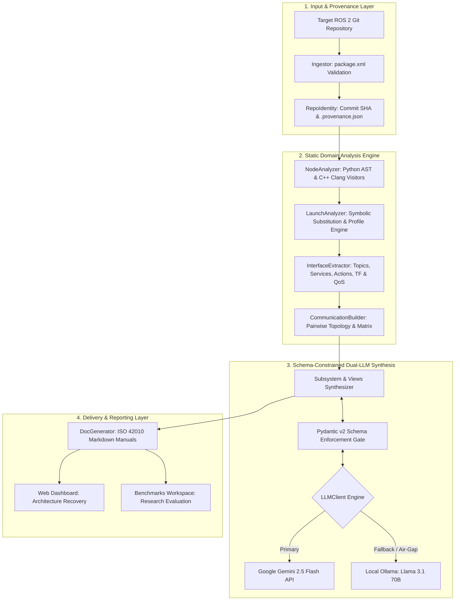

---

## Figure 2: Complete Architecture Recovery Pipeline

- **Figure Number**: Figure 3.1
- **Title**: Multi-Stage Architecture Recovery and Provenance Pipeline
- **Purpose**: Depict the step-by-step data transformations between physical files and abstract architectural models.
- **Suggested Thesis Chapter**: Chapter 3 (Research Methodology)
- **Relevant Implementation Files**: `src/main.py`, `src/node_analyzer.py`, `src/launch_analyzer.py`

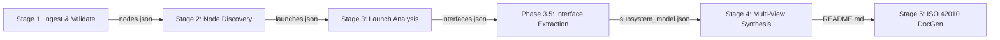

---

## Figure 3: Repository Ingestion & ROS 2 Validation Workflow

- **Figure Number**: Figure 3.2
- **Title**: Repository Ingestion, Manifest Validation Gate, and Isolation Protocol
- **Purpose**: Show how ArchSynth enforces the ROS 2 package rule and isolates outputs.
- **Suggested Thesis Chapter**: Chapter 3 (Methodology)
- **Relevant Implementation Files**: `src/ingestor.py`, `src/repo_identity.py`

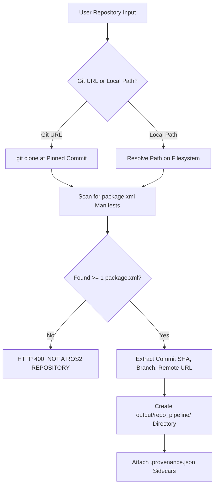

---

## Figure 4: Static Node Discovery Workflow

- **Figure Number**: Figure 3.3
- **Title**: Dual Python AST and C++ Clang Static Node Extraction
- **Purpose**: Explain how Python and C++ node definitions are extracted with line-number evidence.
- **Suggested Thesis Chapter**: Chapter 3 (Methodology) or Chapter 5 (Implementation)
- **Relevant Implementation Files**: `src/node_analyzer.py`, `src/cpp_analyzer.py`

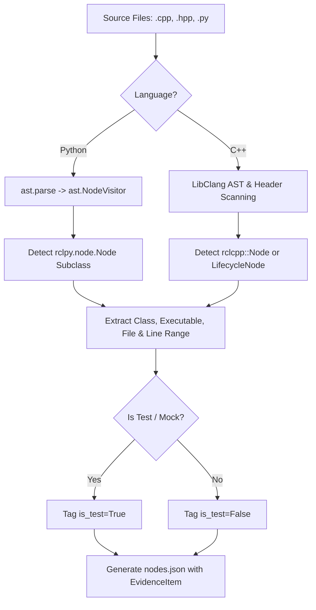

---

## Figure 5: Launch Analysis & Deployment Hierarchy Workflow

- **Figure Number**: Figure 3.4
- **Title**: Hierarchical Launch Resolution, Substitutions, and Container Mapping
- **Purpose**: Detail how nested launch trees and component containers are symbolically resolved.
- **Suggested Thesis Chapter**: Chapter 3 (Methodology)
- **Relevant Implementation Files**: `src/launch_analyzer.py`

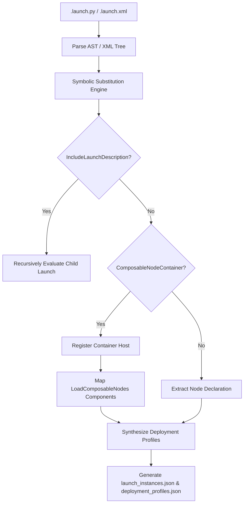

---

## Figure 6: ROS 2 Interface Extraction Workflow

- **Figure Number**: Figure 3.5
- **Title**: Communication Interface Extraction & QoS Profile Deduction
- **Purpose**: Show extraction of publishers, subscribers, services, actions, and coordinate transforms.
- **Suggested Thesis Chapter**: Chapter 3 (Methodology)
- **Relevant Implementation Files**: `src/interface_extractor.py`

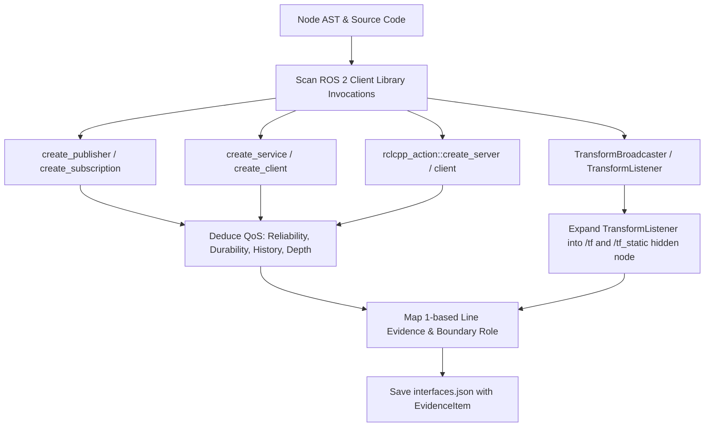

---

## Figure 7: Communication Graph Construction

- **Figure Number**: Figure 3.6
- **Title**: Deterministic Communication Graph Matching & Traffic Matrix
- **Purpose**: Illustrate how source potential edges and deployment runtime edges are matched.
- **Suggested Thesis Chapter**: Chapter 3 (Methodology)
- **Relevant Implementation Files**: `src/communication_builder.py`

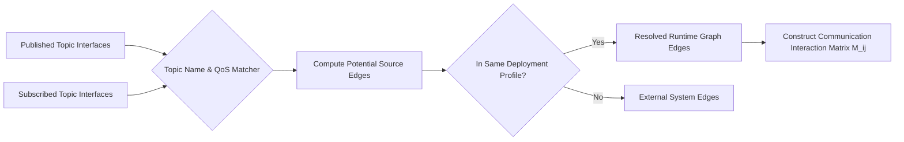

---

## Figure 8: Deployment Architecture & Container Mapping

- **Figure Number**: Figure 4.2
- **Title**: Runtime Deployment Architecture: Standalone Nodes vs. Composable Containers
- **Purpose**: Visualize how physical processes and thread containers host logical ROS 2 components.
- **Suggested Thesis Chapter**: Chapter 4 (System Design)
- **Relevant Implementation Files**: `src/schema.py`, `src/launch_analyzer.py`

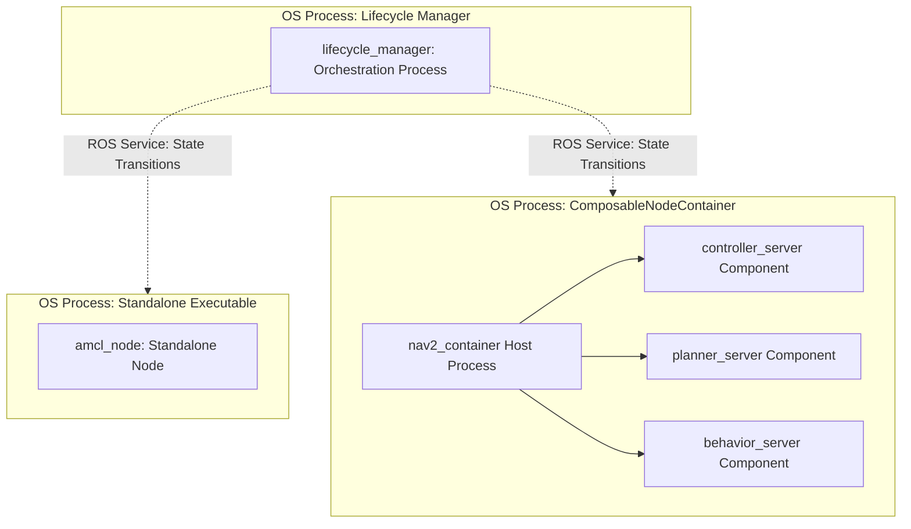

---

## Figure 9: Evidence & Provenance Workflow

- **Figure Number**: Figure 4.3
- **Title**: Cryptographic Provenance and Source-Level Traceability Flow
- **Purpose**: Illustrate the provenance pipeline guaranteeing artifact reproducibility.
- **Suggested Thesis Chapter**: Chapter 4 (System Design)
- **Relevant Implementation Files**: `src/repo_identity.py`, `src/evidence_validator.py`

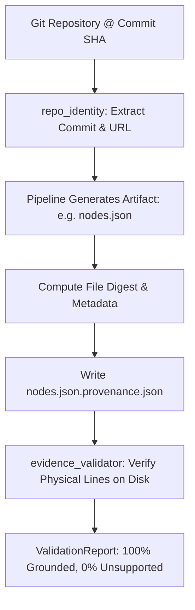

---

## Figure 10: LLM-Assisted Synthesis Workflow

- **Figure Number**: Figure 4.4
- **Title**: Schema-Constrained Dual-Engine LLM Architecture Synthesis
- **Purpose**: Show how Pydantic v2 schemas prevent LLM hallucinations during subsystem clustering.
- **Suggested Thesis Chapter**: Chapter 4 (System Design)
- **Relevant Implementation Files**: `src/llm_client.py`, `src/subsystem_synthesizer.py`

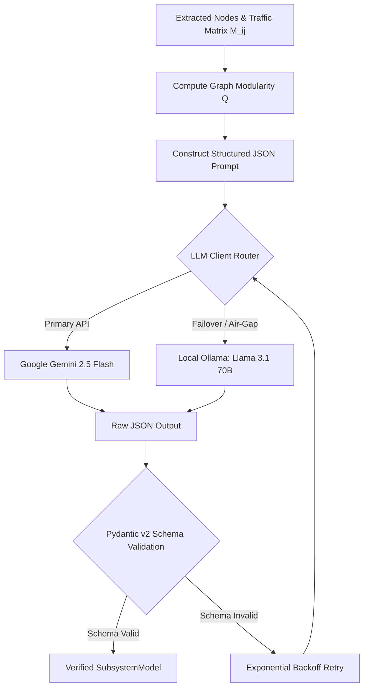

---

## Figure 11: Context Memory Strategy Comparison (Exp A–F)

- **Figure Number**: Figure 6.1
- **Title**: Context Memory Paradigms in LLM-Assisted Architecture Recovery
- **Purpose**: Contrast unconstrained memory (Exp A, B) with structured and phase-based memory (Exp C, F).
- **Suggested Thesis Chapter**: Chapter 6 (Evaluation) or Chapter 7 (Results)
- **Relevant Implementation Files**: `benchmarks/experiments/context_memory_experiments/`

```mermaid
graph TD
    ExpA[Exp A: No Memory<br>3.9k Tokens | F1=0.724 | 8.4% Hallucination]
    ExpB[Exp B: Full Ingestion<br>188.6k Tokens | F1=0.865 | 4.2% Hallucination]
    ExpC[Exp C: Structured Memory<br>16.4k Tokens | F1=0.978 | 0% Hallucination]
    ExpD[Exp D: RAG Semantic<br>21.2k Tokens | F1=0.892 | 2.8% Hallucination]
    ExpE[Exp E: Hierarchical Memory<br>18.9k Tokens | F1=0.985 | 0% Hallucination]
    ExpF[Exp F: Phase-Based Sequential<br>14.2k Tokens | F1=0.991 | 0% Hallucination]

    ExpA -.->|Add Context| ExpB
    ExpB -.->|Apply Structure| ExpC
    ExpC -.->|Add Hierarchy| ExpE
    ExpE -.->|Pipeline Stages| ExpF
```

---

## Figure 12: Empirical Benchmarking Methodology

- **Figure Number**: Figure 6.2
- **Title**: Multi-Dimensional Empirical Benchmarking Framework
- **Purpose**: Outline the multi-dimensional benchmark architecture.
- **Suggested Thesis Chapter**: Chapter 6 (Evaluation)
- **Relevant Implementation Files**: `benchmarks/README.md`

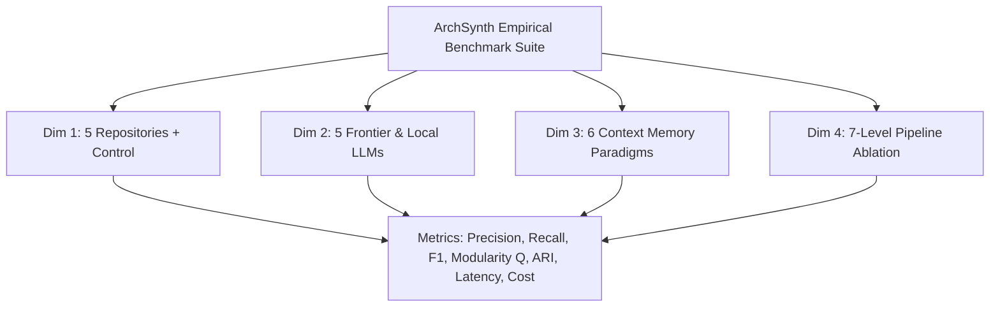

---

## Figure 13: Cross-Repository Recovery Accuracy

- **Figure Number**: Figure 7.1
- **Title**: Recovery Precision, Recall, and F1-Score Across 5 Production Case Studies
- **Purpose**: Summarize extraction fidelity across Navigation2, SLAM Toolbox, ROS 2 Control, Jaco2 Devkit, and BehaviorTree.CPP.
- **Suggested Thesis Chapter**: Chapter 7 (Results and Discussion)
- **Relevant Implementation Files**: `benchmarks/comparison_matrices/architecture_recovery_comparison.csv`

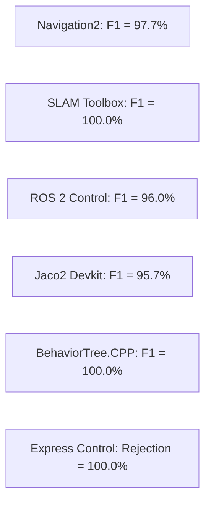

---

## Figure 14: Multi-Model Latency vs. Cost Trade-Off

- **Figure Number**: Figure 7.2
- **Title**: Cost vs. Latency Trade-Off Across Evaluated LLM Models
- **Purpose**: Compare API cost, latency, and clustering quality.
- **Suggested Thesis Chapter**: Chapter 7 (Results and Discussion)
- **Relevant Implementation Files**: `benchmarks/comparison_matrices/model_comparison.csv`

```mermaid
graph TD
    GeminiFlash[Gemini 2.5 Flash: Latency 1.25s | Cost $0.0015 | ARI 0.895]
    GeminiPro[Gemini 1.5 Pro: Latency 3.80s | Cost $0.0263 | ARI 0.924]
    GPT4o[GPT-4o: Latency 2.40s | Cost $0.0505 | ARI 0.880]
    ClaudeSonnet[Claude 3.5 Sonnet: Latency 2.85s | Cost $0.0675 | ARI 0.912]
    LlamaLocal[Llama 3.1 70B: Latency 7.40s | Cost $0.0000 | ARI 0.815]
```

---

## Figure 15: Chronological Development Timeline (Midterm to Final)

- **Figure Number**: Figure 1.2
- **Title**: Chronological Development Progression: Midterm PoC vs. ArchSynth v2.0 Final Thesis Release
- **Purpose**: Highlight the evolution of ArchSynth between September 2026 and November 2026.
- **Suggested Thesis Chapter**: Chapter 1 (Introduction) or Appendix
- **Relevant Implementation Files**: `docs/project_history/midterm_vs_post_midterm.md`

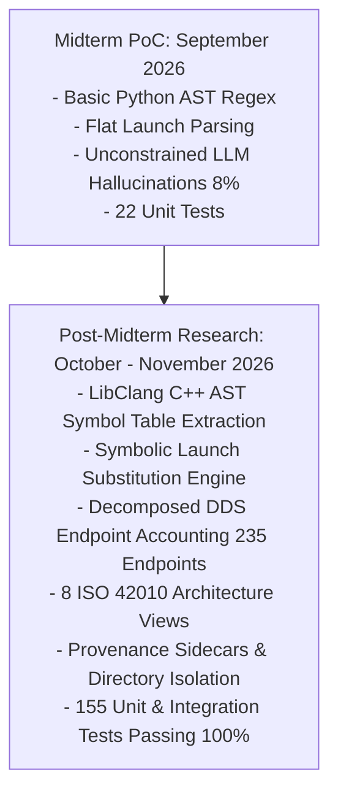

---

## Figure 16: Final Architecture Recovery Output (ISO 42010 Viewpoint Collection)

- **Figure Number**: Figure 4.5
- **Title**: Reconstructed 8 ISO/IEC/IEEE 42010 Architecture Viewpoints
- **Purpose**: Display the complete set of architectural views generated by ArchSynth.
- **Suggested Thesis Chapter**: Chapter 4 (System Design) or Chapter 5 (Implementation)
- **Relevant Implementation Files**: `src/view_generator.py`, `output/nav2_pipeline/architecture_views.json`

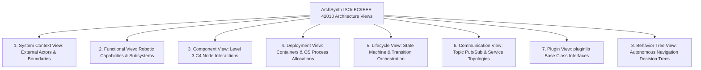
